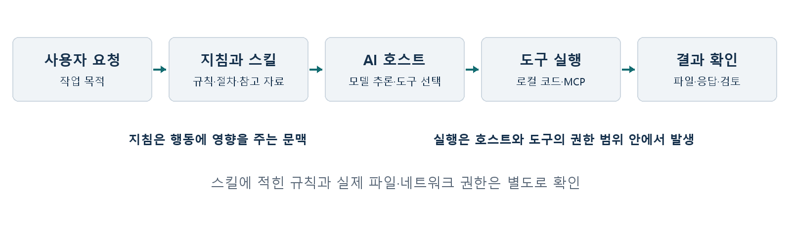
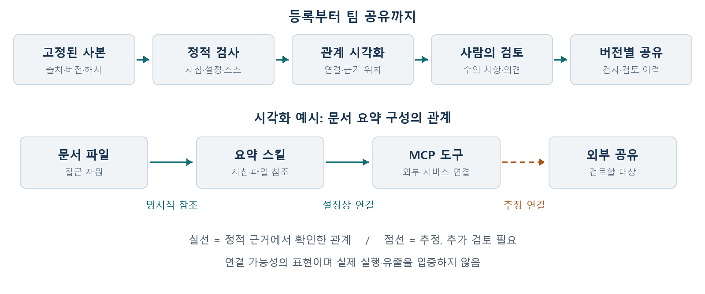

# AI 워크플로 구성요소의 공급망 보안 검사 및 공유 플랫폼

팀프로젝트 아이디어 설명회 제안서     조사 기준 2026.09.16

### 1 제목 및 프로젝트 개요

외부에서 가져온 규칙 파일·스킬·MCP 서버·플러그인을 사용하기 전에 검사하고, 구성요소 사이의 연결과 위험 근거를 시각화하여 검사한 버전과 함께 공유하는 웹 플랫폼을 개발한다.

주요 사용자는 AI 코딩 도구와 에이전트의 외부 구성요소를 재사용하는 학생 개발팀·소규모 개발팀이다. 검사 결과와 검토 이력이 없는 상태에서 지침과 도구를 도입하는 문제를 해결한다.

### 2 세부 목표

| 목표 | 이번 학기 결과물 |
| --- | --- |
| 규칙 파일·스킬 보안 검사 | 지침과 동봉 스크립트의 위험 징후를 찾고 파일 위치·판단 근거·수정 방향을 제시 |
| 워크플로 및 위험 경로 시각화 | 규칙 → 스킬 → 도구 → 접근 자원의 관계를 표시하고 확인된 연결과 추정 연결을 구분 |
| MCP 서버·플러그인 보안 검사 | 설정·도구 설명·제공된 소스에서 접근 범위와 목적 불일치 징후를 검사 |
| 검사 근거가 포함된 공유 | 출처·해시·보안상 변경·검토 이력을 묶어 검사한 버전과 함께 재사용 |

### 3 기대 효과

- 도입 전 위험 인지: 긴 지침과 여러 설정 파일 속 위험 근거를 한 화면에서 확인한다.
- 검토 효율 향상: 구성요소의 관계와 접근 자원을 보여 주어 검토 우선순위 판단을 돕는다.
- 재사용의 책임성 확보: 누가 어떤 버전을 검토했는지 남기고, 변경된 버전에는 재검사를 요구한다.

### 4 해당 분야 최신 동향 조사 요약

증가를 뒷받침하는 공개 근거는 있다. n8n의 사용자 성장 발표, 스킬 유통 규모 확대, MCP 도구 호출 증가가 확인된다. 다만 이를 모든 워크플로 프레임워크의 사용자 수 증가율로 일반화할 수는 없다. [S01–S05]

> 이번 학기는 정적 검사·보안상 변경 검토·팀 공유를 우선한다. 탐지 정확도와 검토 효율은 구현 후 평가할 기대 효과다. 읽는 순서는 개념 → 실제 파일 → 동향 → 설계 → 전공 적합성 평가다.

## 5 처음 접하는 사람을 위한 개념 안내

이 문서에서 말하는 워크플로 프레임워크의 범위

AI 워크플로는 “어떤 작업을 어떤 순서로, 어떤 도구와 검토 절차를 거쳐 수행할지”를 정한 작업 방식이다. 여기서는 다른 사람이 만든 업무 지침·역할·스킬·설정을 묶어 AI 도구에서 재사용하는 프로젝트를 워크플로 프레임워크라고 부른다. 하나의 공통 파일 형식이나 단일 제품 종류를 뜻하는 용어는 아니다.

개발자의 노하우는 “먼저 요구사항을 확인하고, 설계한 다음 구현하고, 마지막에 테스트한다” 같은 절차와 판단 기준으로 담긴다. SuperClaude와 BMAD는 이런 지침·절차를 재사용하도록 구성한 사례다. 모델을 새로 학습시키는 것과는 구분된다. [S16·S17]

| 구성요소 | 쉬운 설명 | 실제 파일이나 형태 |
| --- | --- | --- |
| 규칙 파일 | 프로젝트에서 계속 참고할 작업 원칙 | CLAUDE.md, AGENTS.md 등 |
| 스킬 | 특정 작업을 수행하는 방법과 참고 자료 묶음 | SKILL.md + scripts/ + references/ 등 |
| 명령과 역할 | 작업을 호출하는 메뉴, 또는 검토자·설계자 등 역할 지침 | commands/*.md, agents/*.md 등 |
| 워크플로 | 단계·순서·분기·완료 조건을 정한 절차 | workflow.md, step-*.md 또는 도구별 구성 파일 |
| MCP 서버 | AI가 사용할 외부 기능을 제공하는 프로그램이나 서비스 | 연결 설정 + 도구 설명 + 서버 구현 |
| 플러그인 | 여러 스킬·역할·연결 설정 등을 한 번에 배포하는 묶음 | 매니페스트, skills/, hooks/, MCP 설정 등 |
| 훅과 스크립트 | 특정 이벤트나 작업 단계에서 호출될 수 있는 코드 | hooks/hooks.json, scripts/*.py 등 |

> 위 파일명은 대표 사례다. 모든 프로젝트에 전부 들어 있지는 않으며, 호스트와 버전에 따라 읽는 위치와 적용 방식이 다르다. 근거 [S13·S18·S23–S25]

### API와는 어떤 관계인가

AI 모델 API는 추론 기능을 호출하는 통로다. 프레임워크의 지침은 작업 방식을 정하고, 실제 AI 도구는 모델 API 및 파일·브라우저·MCP 등의 기능을 연결한다. API를 직접 사용하는 프로그램도 이러한 구성요소를 재사용할 수 있다.

## 6 실제 공개 프로젝트에는 무엇이 들어 있는가

저장소와 공식 문서를 읽어 확인한 세 가지 사례

### SuperClaude는 명령과 역할을 묶는다

공개 소스에는 commands, agents, modes, mcp, skills 등의 디렉터리가 있다. 예를 들어 commands/implement.md에는 기능 구현 명령의 설명, 관련 역할과 MCP 도구, 요구사항 분석부터 계획·구현·검증으로 이어지는 지침이 들어 있다. 사용자가 명령을 호출하면 호스트가 이 내용을 문맥으로 사용하도록 설계되어 있다. [S15·S16]

보안 검토에서는 명령이 참조하는 지침과 도구를 함께 확인한다. 문서에 특정 MCP 도구 이름이 적혀 있다는 사실만으로 그 서버가 설치되어 있거나 호출되었다고 판단하지 않는다.

### BMAD는 개발 절차를 여러 파일로 나눈다

조사한 현재 BMAD는 개발 절차를 스킬·플러그인 형태로 배포한다. bmad-build 폴더에는 SKILL.md 외에 workflow.md, 요구사항 확인·계획·구현·검토·결과 제시 단계의 문서, 참고 자료와 검토 프롬프트가 있다. 진입 파일은 로컬 렌더링 스크립트를 거쳐 생성된 워크플로 지침을 읽도록 안내한다. [S17–S19]

따라서 첫 Markdown 파일만 검사하면 뒤에서 읽는 문서나 보조 코드가 빠질 수 있다. 파일 참조 관계와 지원하지 못하는 부분을 함께 기록할 필요가 있다.

### Anthropic PDF 스킬은 지침과 실제 코드를 함께 제공한다

PDF 스킬에는 SKILL.md, forms.md, reference.md, scripts 디렉터리가 있다. 지침은 적용할 작업과 문서 처리 방법을 설명하고, scripts에는 PDF를 이미지로 바꾸거나 양식 필드를 확인하는 Python 파일이 있다. 하나의 스킬도 문서와 실행 코드가 결합된 배포 단위가 될 수 있다. [S20–S22]

| 사용자가 얻는 것 | 보안 검토에서 확인할 것 |
| --- | --- |
| 잘 정리된 작업 순서 | 목적에 맞는 절차인지, 승인이나 검토를 건너뛰도록 요구하는지 |
| 참고 문서와 자동화 코드 | 추가로 읽는 파일, 실행 코드의 동작과 접근 범위 |
| 외부 기능과의 연결 | 어느 도구를 참조하며 어떤 자료를 전달하도록 되어 있는지 |

> 세 프로젝트는 내용물과 구조를 설명하기 위한 정상 사용 사례다. 악성이라는 평가가 아니며, 설치·실행 성능을 검증한 결과도 아니다. 공개 저장소의 구조는 이후 변경될 수 있다.

## 7 실제 폴더 구조와 지침 파일 읽어보기

선택한 파일만 표시한 실제 구조와 직접 작성한 설명용 예시

### BMAD의 bmad-build 폴더 일부

```text
skills/bmad-build/
  SKILL.md
  workflow.md
  step-01-clarify-and-route.md
  step-02-plan.md
  step-03-implement.md
  step-04-review.md
  step-05-present.md
  references/
  review-prompts/
```

SKILL.md는 진입점이고, workflow와 step 파일은 작업의 진행 방법을 나눈다. 위 목록은 전체 파일 목록이 아닌 발췌다. [S18·S19]

### PDF 스킬 폴더 일부

```text
skills/pdf/
  SKILL.md
  forms.md
  reference.md
  scripts/
    convert_pdf_to_images.py
    check_fillable_fields.py
```

scripts 아래 파일은 AI가 읽을 설명만 있는 것이 아니라, 도구를 통해 실행할 수 있는 코드다. 실제 실행 여부는 호스트와 권한·승인 설정에 달려 있다. [S20–S22]

### 스킬 지침의 모양

```text
---
name: local-note-summary
description: Summarize a user-selected local note.
---
1. Read the note selected by the user.
2. Summarize its key points in five bullets.
3. Save the result in the agreed output folder.
```

위 코드는 설명을 위해 직접 작성한 예시다. 앞부분은 이름과 사용 상황을 알리는 메타데이터이고, 뒷부분은 작업 지침이다. “외부 전송을 하지 말라”는 문장을 덧붙여도 그것만으로 네트워크 권한이 차단되는 것은 아니다. 지침과 실제 권한 통제는 별도로 확인해야 한다. [S13·S25]

## 8 문서가 AI의 작업에 영향을 주는 과정

읽히는 지침과 실행되는 프로그램을 구분

사용자가 “이 문서를 요약해 줘”라고 요청하면 AI 도구는 프로젝트 규칙과 관련 스킬을 참고하고 필요한 기능을 선택한다. Agent Skills 사양은 먼저 메타데이터를 확인하고, 필요한 스킬의 본문과 추가 자료를 단계적으로 읽는 방식을 설명한다. [S13]



### MCP 서버와 플러그인이 더하는 것

MCP는 AI 호스트와 기능을 제공하는 서버 사이의 연결 규약이다. 서버는 로컬 프로그램일 수도, 원격 서비스일 수도 있다. 도구 설명은 AI가 기능을 선택하는 데 사용되지만 서버 구현의 모든 동작을 보여 주지는 않는다. [S24]

플러그인은 여러 구성요소를 묶는다. Claude Code의 경우 .claude-plugin/plugin.json에 메타데이터와 구성 정보를 둘 수 있고, skills/, agents/, hooks/hooks.json, .mcp.json 등을 함께 제공할 수 있다. 매니페스트는 해당 제품에서 선택 사항이며, 다른 제품의 플러그인 형식과 동일하지 않다. [S23]

### 왜 Markdown 파일도 보안 검토 대상인가

Markdown 자체가 일반 프로그램처럼 실행되는 것은 아니다. AI가 그 내용을 작업 지침으로 읽고 도구 호출을 결정할 때 행동에 영향을 줄 수 있다. 반면 훅과 동봉 스크립트는 설정에 따라 코드로 실행될 수 있다. 따라서 지침의 목적 적합성과 코드의 동작을 구분해 분석해야 한다.

> 설정에 적힌 접근 범위, 운영체제·서비스가 실제 허용한 권한, 실제 발생한 실행은 서로 다르다. 이번 프로젝트의 정적 그래프는 확인한 참조와 추정 관계를 표시하며 실행 기록을 대신하지 않는다.

## 9 최신 동향  사용 증가는 실존하는가

성장 근거와 해석의 범위

“일부 워크플로 제품의 성장과 재사용 가능한 AI 구성요소 생태계의 확대가 관측된다”는 주장은 근거가 있다. 특히 본 프로젝트와 직접 맞닿는 변화는 지침·스킬·도구 연결을 외부에서 가져와 조합하는 유통 방식의 확산이다.

| 발표·자료 | 확인된 내용 | 해석할 때의 한계 |
| --- | --- | --- |
| n8n<br>2025.10.09 [S01] | 2025년 들어 사용자 규모가 6배 성장했다고 발표 | 업체 자체 발표. 사용자 정의·기준 규모가 상세히 제시되지 않으며 AI 전용 사용량도 아님 |
| Vercel<br>2026.01–02 [S02·S03] | 1월 20일 skills 생태계 공개. 2월 20일 스킬 69,000개 이상, skill CLI 설치 200만 회 발표 | 스킬 수·설치 횟수는 고유 사용자나 실제 업무 사용 횟수와 다름 |
| MCP 프로젝트<br>2026.07.28 [S04] | Tier 1 SDK의 월 다운로드가 약 5억 회에 근접한다고 발표 | 반복 설치·자동화 트래픽이 포함될 수 있는 배포 지표 |
| Linux Foundation / AAIF<br>2026.09.14 [S05] | ChatGPT 사용자의 MCP 호출이 1월 대비 8월 98배에 도달했다고 발표 | 특정 서비스 호출량. 전체 개발자·기업 수 또는 전체 시장 성장률은 아님 |

### 설명회에서 사용할 수 있는 결론

“AI 워크플로 제품과 스킬·MCP 생태계에서 성장 신호가 확인됩니다. 이에 따라 외부 구성요소를 도입할 때 지침, 도구 접근 범위, 검토한 버전을 함께 확인할 필요가 커지고 있습니다.”

### API 사용과 프레임워크 사용은 양립한다

API는 모델이나 외부 서비스의 기능을 호출하는 인터페이스이고, 워크플로는 호출 순서·조건·도구·승인 절차를 구성하는 방식이다. 직접 API를 사용하는 프로그램도 외부 스킬이나 MCP 도구를 연결할 수 있다. 따라서 본 프로젝트의 적용 대상은 특정 프레임워크 하나의 점유율에 종속되지 않는다.

### 통계로 말할 수 없는 부분

- 위 수치들을 합산해 전체 시장 규모나 사용자 수를 산출하지 않는다.
- GitHub 스타 수를 실사용자 수로 대체하지 않는다.
- 생태계 확대는 보안 검사 수요의 배경이다. 우리 플랫폼에 대한 실제 수요는 사용자 인터뷰와 시제품 평가로 별도 검증한다.

## 10 보안 필요성 및 문제 정의

외부 지침도 AI의 행동에 영향을 주는 공급망 구성요소

공급망 보안은 외부 구성요소가 만들어지고 배포되어 우리 환경에 도입되는 과정의 신뢰를 확인하는 일이다. AI 환경에서는 실행 코드뿐 아니라 에이전트가 읽는 지침, 도구 설명, 플러그인 설정도 검토 대상이 된다. OWASP는 에이전트 공급망 취약성을 ASI04로 분류한다. [S08]

### 실제 사례가 보여 주는 위험

| 사례·근거 수준 | 확인 내용 | 프로젝트에 주는 시사점 |
| --- | --- | --- |
| 악성 스킬 유포<br>Acronis 연구 [S06] | 2026.04.30 보고서에서 13개 계정의 악성 스킬 575개 이상을 관측 | 스킬 지침과 동봉 파일을 함께 검토해야 함. 관측 건수는 피해자 수·전체 악성 비율이 아님 |
| 비인가 패키지 배포<br>Cline 공식 사후 보고 [S07] | 2026.02.17 Cline CLI npm 패키지의 비인가 배포 사고를 공식 보고 | 출처와 검토 버전 관리도 필요함. 이번 학기 지침 검사만으로 배포 자격 증명 침해까지 해결할 수는 없음 |

### 검사하려는 문제

| 대상 | 주요 질문 |
| --- | --- |
| 규칙 파일 | 사용자의 작업 목적을 벗어나도록 유도하거나, 승인·검토 절차를 무시하도록 요구하는가? |
| 스킬 | 설명한 기능과 실제 지침·동봉 스크립트가 일치하는가? 민감정보 접근·외부 전송·추가 설치 요구가 있는가? |
| MCP 서버·플러그인 | 어떤 파일·환경 변수·외부 서비스에 접근할 수 있는가? 선언과 제공된 코드 사이에 불일치 징후가 있는가? |
| 구성요소 조합 | 데이터를 읽는 구성요소와 외부 전송 도구가 연결되는가? 사람이 검토해야 할 지점은 어디인가? |

### 단순 키워드 탐지로 충분하지 않은 이유

보안 교육 문서가 위험 행동을 설명할 수도 있고, 정당한 백업 도구가 파일을 읽고 외부로 전송할 수도 있다. 따라서 표현 하나만으로 악성이라고 단정하지 않고, 목적·맥락·호출 관계·접근 대상을 함께 보여 주어야 한다. 위험도와 판단 확신도도 분리한다.

> 악성 구성요소 유포, 정상 제품의 취약점, 배포 계정 침해는 서로 다른 사건 유형이다. 사례를 섞어 피해 규모나 우리 검사기의 방어 범위를 부풀리지 않는다.

## 11 세부 목표와 이번 학기 구현 범위

사용 전 검사   관계 확인   검토 근거 공유

| 기능 | 최소 구현 범위 | 완료를 확인할 결과물 |
| --- | --- | --- |
| ① 규칙 파일 검사 | AGENTS.md·CLAUDE.md·.cursor/rules/*.mdc의 지침 검사. 목적 이탈·승인 우회·민감정보 취급 징후 표시 | 파일·행 번호와 근거가 있는 한국어 검사 보고서 |
| ② 스킬 검사 | SKILL.md 및 같은 패키지의 scripts·references를 분석. 지원 언어의 스크립트를 정적으로 확인 [S13] | 지침과 동봉 파일을 연결한 결과. 미지원 파일 목록도 표시 |
| ③ 워크플로 시각화 | 팀이 정의한 JSON/YAML 구성 명세의 단계·의존성·도구 연결을 그래프로 표현 | 노드 선택 시 원본 근거 표시. 자연어 추정 연결은 별도 표시 |
| ④ MCP·플러그인 검사 | MCP 설정·제공된 도구 목록 JSON·공개 소스, 플러그인 명세 1종의 도구·스킬·hook 참조를 검사 | 접근 자원 목록과 선언·구현 불일치 후보. 비공개 구현은 확인 불가 표시 |
| ⑤ 변경 검토와 공유 | 선택한 형식의 버전별 접근·연결·실행 요청을 비교하고 출처·해시·검토 기록을 팀 공간에 저장 | 보안상 변경 비교와 원본 근거. 변경 시 재검사 필요 상태 |

### 한 학기에 완성하기 위한 경계

- 필수: 정적 검사, 보안상 변경 비교, 명시적 연결 그래프, 검토 기록, 팀 단위 공유. 먼저 팀 공통 구성 명세로 4종 대상을 연결한다.
- 선택: LLM을 이용한 지침 의미 분석, n8n JSON 등 외부 워크플로 형식 1종 연동. 필수 기능 완료 후 추가한다.
- 후속 학기: 전체 의존성 취약점 검사·SBOM, 배포 서명 검증, 실시간 실행 차단, 상시 업데이트 감시, 공개 마켓 운영.

MCP 서버를 임의로 실행하거나 외부 플러그인을 설치하지 않고 제출된 자료를 검사한다. 스크립트 분석은 Python·JavaScript/TypeScript의 제한된 패턴부터 시작하며, 모든 언어·바이너리·동적 동작 분석은 지원 범위에 포함하지 않는다.

> 범위 확정안: 1–2주차에 플러그인 명세 1종과 입력 크기·지원 언어를 고정한다. SKILL.md의 allowed-tools 같은 선언은 실제 호스트의 권한 강제 여부와 구분한다. [S13]

## 12 서비스 구조와 시각화 설계

검사 결과가 어떤 파일과 연결에서 나왔는지 추적

사용자는 외부 구성요소의 고정된 사본과 작업 목적을 등록한다. 플랫폼은 파일을 정규화하고 정적 검사 결과를 연결 그래프로 만든 뒤, 사람이 검토한 결과를 동일한 버전에 묶어 공유한다.



### 검사 결과의 필수 정보

각 결과에는 검사 규칙 ID, 대상 파일·행, 근거 문장 또는 코드 위치, 예상 영향, 수정 권고, 위험도, 판단 확신도를 저장한다. 결과 전체에는 커밋·파일 해시, 검사 시각, 검사 엔진·규칙 버전, 지원 범위와 누락 파일 목록을 함께 기록한다.

### 그래프에서 구분할 것

- 실선: 구성 명세나 정적 참조에서 확인한 연결. 해당 파일과 위치를 눌러 확인할 수 있다.
- 점선: 자연어 분석으로 추정한 연결. 실제 실행이나 정보 유출이 확인되었다는 의미가 아니다.
- 자원 표시: 파일·환경 변수·외부 서비스 등을 연결한다. 접근 가능성, 실제 권한, 실행 여부를 별도 항목으로 구분한다.

### 시연 시나리오

① 문서 요약용 예제 묶음을 등록한다. ② 파일 읽기와 외부 전송 기능의 연결 후보를 찾는다. ③ 그래프에서 해당 경로와 원본 근거를 확인한다. ④ 목적에 맞게 권한·설정을 수정하고 재검사한다. ⑤ 수정 전후 결과를 비교한 뒤 팀 공간에 공유한다. 시연에는 가상 문서와 무해한 테스트 자료를 사용한다.

> 공유 상태는 “검사 완료·주의 사항 있음·검토 대기·검사 불가·재검사 필요” 등으로 표현한다. “안전 인증”으로 표시하지 않으며, 새로운 내용에는 기존 버전의 결과를 승계하지 않는다.

## 13 기존 서비스와 차별화 검증

이미 존재하는 보안 도구 위에서 검토 경험을 개선

| 기존 서비스·도구 | 공개적으로 확인되는 기능 | 우리 프로젝트가 비교할 부분 |
| --- | --- | --- |
| skills.sh [S09] | 스킬 검색·유통과 보안 검사 결과 표시. Gen·Socket·Snyk 협업 | 공유+검사 자체의 중복을 인정하고, 팀 전체 구성의 검토 경험을 비교 |
| Cisco Skill Scanner [S10] | 지침·코드 분석, 선택적 LLM 분석, 보고서·그래프 등 | 그래프의 존재가 아니라 여러 유형을 연결한 근거 이해·검토 정확도를 비교 |
| Cisco MCP Scanner [S11] | MCP 도구 설명·소스 검사, 오프라인 JSON 검사 | 기존 탐지 결과를 공통 형식으로 통합할 수 있는지 확인 |
| Cisco DefenseClaw [S12] | 사용 전 검사, 런타임 트래픽 검사, 감사 근거 관리 | 통합 보안 제품도 존재함. 학생·소규모 팀의 도입·검토 과업에 맞춰 비교 |
| MCP Registry [S14] | 서버 검색과 메타데이터·버전 관리 | 검색·등록 정보에 더해 실제 검사 범위와 검토 근거를 제공 |

### 검증할 차별화 가설

- 조합 관점: 사용자가 실제로 가져오는 규칙·스킬·MCP·플러그인 묶음을 같은 그래프와 검사 보고서에서 검토하면 위험 판단이 쉬워지는가?
- 설명 가능성: 한국어 설명과 파일·행·연결 근거를 함께 제시하면 경고 목록만 볼 때보다 판단 정확도가 높아지는가?
- 팀 재사용: 특정 버전의 검사 범위와 사람의 검토 기록을 함께 공유하면 재검토 시간을 줄일 수 있는가?

세 가지는 구현 후 비교 실험으로 검증할 가설이다. “최초의 통합 플랫폼”, “기존 도구에는 시각화가 없다”, “기존 제품보다 탐지가 정확하다”는 주장은 하지 않는다. 공개 기능 비교와 실제 성능 비교를 구분한다.

### 개발 방향

기존 검사 엔진의 라이선스와 입력·출력 형식을 검토해 재사용하고, 팀은 공통 결과 모델·연결 그래프·검토 및 공유 흐름에 집중한다. 자체 규칙은 목표 대상과 기존 엔진 사이의 실제 누락을 확인한 뒤 추가한다.

> 오픈소스 기능은 변경될 수 있다. 비교 실험에서는 도구·규칙·모델 버전을 고정하고, 지원 대상이 다른 도구는 단일 순위로 비교하지 않는다.

## 14 보안전공 학생 프로젝트로서의 평가

공개 기능 비교와 한 학기 수행 조건에 따른 정성 평가

보안전공 프로젝트로 적합한 주제다. 다만 현재 기획은 범위가 넓으며, 팀이 직접 해결할 보안 문제를 좁혀야 한다. 핵심 평가는 화면의 수보다 위협 모델·판단 근거·검증 결과가 얼마나 명확한지에 두어야 한다.

| 평가 항목 | 현재 판단 | 판단 이유 |
| --- | --- | --- |
| 전공 적합성 | 높음 | 신뢰 경계·접근 권한·정적 분석·버전 무결성을 다룰 수 있음 |
| 문제의 현실성 | 높음 | 악성 스킬 유포 연구와 실제 보안 검사 제품이 존재 [S06·S09–S12] |
| 독창성 | 현재 제한적 | 검사·그래프·공유 기능 자체는 기존 도구와 겹침 |
| 기술적 깊이 | 구현에 따라 달라짐 | 외부 API 호출 수준에 머물거나 근거 기반 분석으로 발전할 수 있음 |
| 학기 내 완성 가능성 | 범위 조정 필요 | 네 종류 입력 분석과 플랫폼 개발을 동시에 깊게 수행하기는 부담 |
| 평가 가능성 | 확보 가능 | 탐지 성능·오탐·검토 정확도·버전 변경 처리를 비교할 수 있음 |

### 현재 기획에서 보완할 세 가지

첫째, 웹 플랫폼 구현이 분석 작업을 압도할 수 있다. 로그인·검색·공유 화면을 완성해도 검사 근거가 불명확하면 보안 기술 기여를 설명하기 어렵다. 최소한의 업로드·검토·결과 공유 화면부터 만들고 분석 기능을 우선한다.

둘째, 악성 지침의 판정 기준이 모호하다. 파일 읽기나 외부 전송은 정상 작업에도 필요하다. 작업 목적과 허용 정책을 정한 뒤, 목적 이탈·설명 불일치·새 접근 요청을 구분해 알리는 기준이 필요하다.

셋째, 시각화가 단순 연결도에 머물 수 있다. 각 연결에 원본 근거를 붙이고 접근 자원과 권한 경계를 보여 주어야 한다. 연결이 추정이라는 사실도 화면에 드러내야 한다.

> 이 평가는 현재 기획에 대한 판단이다. 팀 인원·경험·주당 투입 시간은 확정되지 않았으므로 개발 기간과 달성 수준을 보장하는 평가가 아니다.

## 15 기술적 기여를 분명히 하는 보완 권고안

보안 분석과 변경 검토를 중심에 두고 공유 기능을 연결

핵심 질문을 “외부에서 가져온 AI 스킬·MCP 구성과 그 업데이트에서, 사용자가 검토해야 할 보안상 변경을 근거와 함께 찾아낼 수 있는가”로 좁힌다. 규칙 파일·플러그인은 선택한 형식을 같은 분석 모델로 연결하되 각 생태계 전체를 지원하는 목표는 두지 않는다.

### 우선 개발할 세 기능

- 근거가 있는 검사: 지원 범위 안의 지침·스크립트·도구 설정에서 위험 징후를 찾고 파일 위치와 판정 이유를 제시한다.
- 보안 관점의 변경 비교: 이전 버전에 없던 파일 접근, 외부 연결, 실행 요청을 식별한다. 단순 해시 변경과 의미 있는 보안 변경을 구분한다.
- 검토와 공유: 변경된 관계를 그래프에서 확인하고, 해당 버전에 대한 검토 기록과 주의 사항을 팀에 공유한다.

### 변경 비교 화면의 설명용 예시

| 검토 항목 | 이전 버전 | 새 버전 | 보고할 내용 |
| --- | --- | --- | --- |
| 문서 입력 | 선택한 로컬 문서 | 동일 | 입력 범위 변화 없음 |
| 결과 전달 | 로컬 결과 저장 | 외부 업로드 요청 추가 | 새 전송 대상과 관련 파일 위치 표시 |
| 판정 | 기존 검토 기록 있음 | 목적 적합성 재검토 필요 | 자동 악성 판정 없이 근거와 검토 항목 제시 |

이는 구현할 화면을 설명하는 가상 사례이며 실제 제품의 사고나 탐지 결과가 아니다. 업데이트 기능도 코드 서명이나 배포 계정 침해 방어 전체를 대신하지 않는다.

### 학생들이 직접 설명할 수 있어야 하는 결과

- 어떤 입력과 행위를 위협으로 정의했는지, 정상적인 유사 동작과 어떻게 구분했는지
- 기존 검사 도구와 같은 자료에서 무엇이 달랐는지, 개선되지 않은 경우 원인이 무엇인지
- 팀이 추가한 규칙·연결 분석·변경 분석이 어떤 근거를 더 제공했는지

> 기존 엔진을 재사용하는 것은 가능하다. 다만 자체 기여와 외부 엔진의 기능을 구분해 보고한다. 정밀도 85%·재현율 80% 등 수치는 초기 목표안이며 기초 실험 후 조정한다.

## 16 기대 효과와 평가 계획

기대 효과를 측정 가능한 질문으로 전환

| 기대 효과 | 평가 질문 | 측정 방법 |
| --- | --- | --- |
| 도입 전 위험 인지 | 위험 징후를 놓치지 않으면서 정상 자료를 과도하게 경고하지 않는가? | 정밀도·재현율·정상 자료 오탐률, 유형별 TP·FP·FN·TN 공개 |
| 검토 시간 절감 | 같은 검토 과업을 더 빠르고 정확하게 수행하는가? | 경고 목록과 그래프 화면의 과업별 소요 시간·정답률 비교 |
| 연결 관계 이해 | 위험 지점의 원본과 접근 자원을 올바르게 연결하는가? | 사람이 표시한 정답 그래프와 명시적 노드·간선 비교 |
| 근거 있는 공유 | 보안상 변경을 찾아 재검토하고 같은 버전에만 결과를 연결하는가? | 변경 유형별 탐지와 해시·검토 상태 전환 검증 |

### 평가 자료 구성안

규칙 파일·스킬·MCP 자료·플러그인 자료를 대상으로 총 120건 이상을 목표로 한다. 정상·위험 예제를 균형 있게 구성하고, 개발용과 최종 평가용을 저장소·템플릿 계열 단위로 분리한다. 위험 예제는 활성 악성코드 대신 무해한 지침·정적 코드 조각을 사용한다. 최소 2명이 독립적으로 라벨을 검토하고 불일치를 조정한다.

### 정량 목표안  아직 측정하지 않은 목표

| 지표 | 목표안 | 판정 조건 |
| --- | --- | --- |
| 탐지 정밀도 / 재현율 | 각 0.85 / 0.80 이상 | 지원 범위 내 평가 자료에 한정. 유형별 건수와 분모를 함께 보고 |
| 정상 자료 오탐률 | 0.10 이하 | 악성 판정과 “사람 검토 필요” 알림을 구분하여 계산 |
| 명시적 연결 간선 F1 | 0.90 이상 | 구성 명세에서 추출 가능한 연결에 한정. 자연어 추정은 별도 평가 |
| 필수 보고 항목 완성도 | 지원 대상 결과의 100% | 출처·해시·검사 버전·근거·누락 범위 기록 여부 |

정밀도는 TP/(TP+FP), 재현율은 TP/(TP+FN), 오탐률은 FP/(FP+TN)로 계산한다. 판정 기준과 경고 임계값은 평가 전에 고정한다. 검사 불가 자료는 정상으로 집계하지 않고 별도 비율로 공개한다. 표본 수가 작으므로 절대 건수와 신뢰구간도 함께 제시한다. 변경 분석은 접근·연결·실행 요청의 추가 여부를 사람이 라벨링한 버전 쌍과 비교한다.

> 사용성 평가는 동료 개발자 6–10명을 목표로 하며 화면 제시 순서를 교차 배치한다. 초기 표본의 결과는 탐색적 평가로 보고하고 일반 사용자 전체의 효과로 확대하지 않는다.

## 17 수행 계획과 설명회 발표 문안

16주 학기를 가정한 일정안

| 기간 | 핵심 작업 | 완료 기준 |
| --- | --- | --- |
| 1–2주 | 사용자 5–8명 인터뷰, 입력 형식·위협 모델·플러그인 1종 확정 | 필수 요구사항과 지원 범위 문서 |
| 3–5주 | 파일 정규화·출처/해시 기록, 규칙·스킬 검사 구현 | 근거 위치가 포함된 첫 검사 보고서 |
| 6–8주 | MCP·플러그인 검사와 공통 결과 모델 연동 | 4종 자료를 같은 형식으로 조회 |
| 9–11주 | 관계 그래프·보안상 변경 비교·원본 근거 탐색 | 새 접근·연결 요청과 근거를 표시하는 화면 |
| 12–13주 | 팀 공유·검토 이력·버전 변경 상태 구현 | 등록 → 검사 → 검토 → 공유 시연 |
| 14–16주 | 분리된 평가 자료 실험, 사용성 평가, 수정·발표 | 측정 결과·한계·시연 영상과 최종 보고서 |

### 플랫폼 자체의 기본 보안 설계

검사 대상은 신뢰하지 않는 입력으로 취급한다. 업로드 크기·형식을 제한하고 압축 경로와 화면 표시를 검증한다. 스캐너 작업의 파일·네트워크 권한을 제한하며, 팀 자료는 기본 비공개로 저장한다. 저장소의 비밀정보는 보고서에서 제거한다. 외부 LLM 분석은 선택 기능으로 두고 원문 전송 범위를 고지한다. 검사 모델에는 실행 도구를 제공하지 않는다.

### 약 90초 발표 문안

저희 팀은 AI 워크플로 구성요소의 공급망 보안 검사 및 공유 플랫폼을 제안합니다. 개발자는 다른 사람이 만든 규칙 파일, 스킬, MCP 서버를 가져와 AI의 기능을 빠르게 확장합니다. 하지만 무엇을 읽고 어떤 도구를 사용할지, 작업 목적과 관계없는 지침이 포함됐는지를 일일이 확인하기 어렵습니다.

이 분야의 성장은 공개 자료로 확인됩니다. n8n은 사용자 성장을 발표했고, 스킬 유통과 MCP 도구 호출도 확대되고 있습니다. 악성 스킬이 실제 유포된 연구도 있습니다. 저희는 이번 학기에 규칙과 스킬, MCP와 플러그인의 자료를 검사하고, 서로 연결되는 관계와 위험 근거를 그래프로 보여 주겠습니다.

이미 스킬 보안 검사 도구는 존재합니다. 저희가 검증하려는 가치는 여러 구성요소를 한 번에 이해하고, 검사한 정확한 버전과 검토 기록을 팀이 함께 재사용하는 경험입니다. 평가에서는 탐지 성능뿐 아니라 검토 시간과 판단 정확도도 측정하겠습니다.

> 예상 질문: “모두 안전하다고 보장하나요?” → 지원 범위와 검사 근거를 공개하는 검토 지원 도구입니다. “왜 공급망인가요?” → 외부 구성요소의 출처·내용·연결·검토 버전을 도입 전에 확인하기 때문입니다.

## 18 참고 자료 성장과 보안 사례

모든 자료 확인일 2026.09.16  원문은 아래 제목 링크에서 확인

**[S01] n8n | 2025-10-09**

[n8n raises $180m to get AI closer to value with orchestration](https://blog.n8n.io/series-c/)

2025년 사용자 6배 성장이라는 공급자 발표. 전체 시장 성장률이나 고유 활성 사용자 수로 일반화하지 않는다.

**[S02] Vercel | 2026-01-20**

[Introducing skills, the open agent skills ecosystem](https://vercel.com/changelog/introducing-skills-the-open-agent-skills-ecosystem)

skills CLI와 skills.sh 공개. 에이전트 지침의 패키지화·유통 사례.

**[S03] Vercel | 2026-02-20**

[Skills Night: 69,000+ ways agents are getting smarter](https://vercel.com/blog/skills-night-69000-ways-agents-are-getting-smarter)

69,000개 이상 스킬, skill CLI 설치 200만 회. 공급자 집계이며 고유 사용자 수가 아니다.

**[S04] MCP 프로젝트 | 2026-07-28**

[MCP 2026-07-28 release](https://blog.modelcontextprotocol.io/posts/2026-07-28/)

Tier 1 SDK 월 다운로드 약 5억 회에 근접. 다운로드에는 반복 설치가 포함될 수 있다.

**[S05] Linux Foundation / AAIF | 2026-09-14**

[Agentic AI Foundation Launches MCPA Certification to Validate MCP Expertise](https://www.linuxfoundation.org/press/agentic-ai-foundation-launches-mcpa-certification-to-validate-mcp-expertise)

ChatGPT 사용자의 MCP 도구 호출이 1월 대비 8월 98배라는 발표. 특정 서비스의 호출량이며 시장 점유율이 아니다.

**[S06] Acronis TRU | 2026-04-30**

[Poisoning the well: AI supply chain attacks on Hugging Face and OpenClaw](https://www.acronis.com/en/tru/posts/poisoning-the-well-ai-supply-chain-attacks-on-hugging-face-and-openclaw/)

13개 개발자 계정에서 악성 스킬 575개 이상을 관측한 연구. 피해자 수나 전체 스킬의 악성 비율로 해석하지 않는다.

**[S07] Cline | 2026-02-24**

[Post-mortem: Unauthorized Cline CLI npm publish on February 17, 2026](https://cline.bot/blog/post-mortem-unauthorized-cline-cli-npm)

2026-02-17 비인가 CLI 패키지 배포에 관한 운영 주체의 사후 보고. 스킬 검사만으로 모든 배포 사고를 막을 수 없다는 범위 설명에 사용.

## 19 참고 자료 표준과 기존 도구

모든 자료 확인일 2026.09.16  원문은 아래 제목 링크에서 확인

**[S08] OWASP GenAI Security Project | 2025-12-09**

[OWASP Top 10 for Agentic Applications](https://genai.owasp.org/2025/12/09/owasp-top-10-for-agentic-applications-the-benchmark-for-agentic-security-in-the-age-of-autonomous-ai/)

ASI04 Agentic Supply Chain Vulnerabilities를 포함한 위험 분류. 발생 빈도 통계나 제품 인증 기준은 아니다.

**[S09] Vercel | 2026-02-17**

[Automated security audits now available for skills.sh](https://vercel.com/changelog/automated-security-audits-now-available-for-skills-sh)

Gen·Socket·Snyk와 보안 검사 및 결과 표시를 제공. 공유와 검사 자체는 기존 기능이다.

**[S10] Cisco AI Defense | 상시 갱신 문서**

[Skill Scanner](https://github.com/cisco-ai-defense/skill-scanner)

정적 분석·선택적 LLM 분석·보고서 및 그래프 등 공개 기능 확인. 직접 성능 비교를 수행한 결과는 아니다.

**[S11] Cisco AI Defense | 상시 갱신 문서**

[MCP Scanner](https://github.com/cisco-ai-defense/mcp-scanner)

MCP 메타데이터·소스 검사와 오프라인 JSON 검사 기능 확인. 직접 성능 검증 결과는 아니다.

**[S12] Cisco AI Defense | 상시 갱신 문서**

[DefenseClaw](https://github.com/cisco-ai-defense/defenseclaw)

사용 전 검사, 런타임 트래픽 검사, 감사 근거 내보내기를 제공하는 통합 거버넌스 사례.

**[S13] Agent Skills | 상시 갱신 문서**

[Specification](https://agentskills.io/specification)

SKILL.md와 선택적 scripts·references·assets 구조. allowed-tools는 실험적 항목이며 범용 권한 강제를 뜻하지 않는다.

**[S14] MCP 프로젝트 | 상시 갱신 문서**

[MCP Registry FAQ](https://modelcontextprotocol.io/registry/faq)

서버 검색·메타데이터·버전 관리의 공식 유통 기반. 등록 여부만으로 동작 안전성을 보장하지 않는다.

## 20 참고 자료 프레임워크의 실제 구성

모든 자료 확인일 2026.09.16  원문은 아래 제목 링크에서 확인

**[S15] SuperClaude 프로젝트 | 상시 갱신 저장소**

[SuperClaude 구성 디렉터리](https://github.com/SuperClaude-Org/SuperClaude_Framework/tree/master/src/superclaude)

commands·agents·modes·mcp·skills 등 실제 디렉터리 확인. 설치 후 경로와 저장소 개발 경로는 다를 수 있다.

**[S16] SuperClaude 프로젝트 | 상시 갱신 파일**

[implement.md 명령 지침](https://github.com/SuperClaude-Org/SuperClaude_Framework/blob/master/src/superclaude/commands/implement.md)

명령의 메타데이터·작업 단계·역할·선호 MCP 도구를 확인. 자연어로 선언된 동작은 실행 성공이나 권한 부여의 증거가 아니다.

**[S17] BMAD 프로젝트 | 상시 갱신 저장소**

[BMAD Method README](https://github.com/bmad-code-org/BMAD-METHOD)

개발 절차를 스킬과 플러그인으로 배포하는 현재 공개 구조와 사용 흐름 확인.

**[S18] BMAD 프로젝트 | 상시 갱신 저장소**

[bmad-build 디렉터리](https://github.com/bmad-code-org/BMAD-METHOD/tree/main/skills/bmad-build)

workflow.md, 단계별 Markdown, 참고 자료, 검토 프롬프트, 명세 템플릿의 실제 파일명 확인.

**[S19] BMAD 프로젝트 | 상시 갱신 파일**

[bmad-build SKILL.md](https://github.com/bmad-code-org/BMAD-METHOD/blob/main/skills/bmad-build/SKILL.md)

진입 파일이 로컬 렌더링 스크립트와 생성된 워크플로 문서로 이어지는 구조 확인. 설치·실행은 수행하지 않았다.

**[S20] Anthropic | 상시 갱신 저장소**

[PDF 스킬 디렉터리](https://github.com/anthropics/skills/tree/main/skills/pdf)

SKILL.md, forms.md, reference.md, scripts, LICENSE.txt의 실제 구성 확인. 공개 열람과 재배포 허용은 구분해야 한다.

## 21 참고 자료 스킬과 실행 환경

모든 자료 확인일 2026.09.16  원문은 아래 제목 링크에서 확인

**[S21] Anthropic | 상시 갱신 파일**

[PDF SKILL.md](https://github.com/anthropics/skills/blob/main/skills/pdf/SKILL.md)

스킬의 적용 상황, PDF 처리 지침, 참고 문서 참조와 라이브러리 사용 예를 확인. 원문을 통째로 복제하지 않고 구조를 요약했다.

**[S22] Anthropic | 상시 갱신 저장소**

[PDF 스킬의 scripts 디렉터리](https://github.com/anthropics/skills/tree/main/skills/pdf/scripts)

PDF 이미지 변환·양식 필드 확인 등 Python 보조 스크립트가 실제 포함됨을 확인.

**[S23] Anthropic | 상시 갱신 문서**

[Claude Code Plugins reference](https://code.claude.com/docs/en/plugins-reference)

플러그인 구성 예시의 근거. .claude-plugin/plugin.json, skills, agents, hooks, .mcp.json 등을 묶는 구조이며 모든 플러그인의 공통 표준은 아니다.

**[S24] MCP 프로젝트 | 2026-07-28 사양 문서**

[Architecture overview](https://modelcontextprotocol.io/docs/2026-07-28/learn/architecture)

AI 호스트·클라이언트·서버의 구분과 도구 연결 구조. 도구 설명만으로 서버 구현 전체를 검증할 수는 없다.

**[S25] Anthropic | 상시 갱신 문서**

[How Claude remembers your project](https://code.claude.com/docs/en/memory)

CLAUDE.md 등 프로젝트 지침을 문맥으로 읽는 방식의 근거. 규칙 문서와 실행 권한 설정을 구분한다.

### 조사와 해석의 구분

공개 저장소와 공식 문서의 파일명·구조·설명을 조사했다. 제시한 사례를 설치하거나 실행한 것은 아니며 안전성 인증도 아니다. 설명용 스킬과 변경 비교 사례는 실제 저장소와 구분해 표시했다. 성장 수치는 공급자의 집계 정의와 한계를 유지했다.
