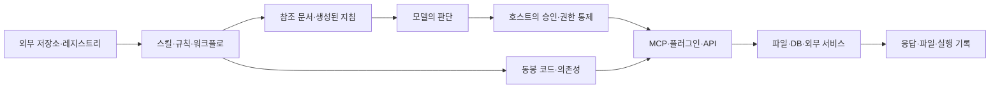

# 구성요소 검사 범위와 증거 시각화

## 1. 검사의 단위

이 프로젝트의 기본 단위는 “프레임워크 전체가 안전한가”가 아니라 **특정 출처·버전의 구성요소를 특정 호스트·권한으로 도입할 때 무엇을 검토해야 하는가**다. 같은 스킬도 연결된 도구와 호스트 권한에 따라 실제 영향이 달라진다.

이 그림은 일반적인 구성 관계이며 특정 제품의 관찰된 실행 추적이 아니다. 코드·설정의 연결과 실제 실행 이벤트를 같은 엣지로 그리지 않는다.

## 2. 어디까지 검사할 수 있는가

| 대상 | 정적으로 확인 가능한 내용 | 추가 확인이 필요한 내용 | 결과에 붙일 한계 |
|---|---|---|---|
| 규칙·스킬 본문 | 출처, 메타데이터, 참조 경로, 명시된 작업·명령, 변경 줄 | 문맥상 목적 적합성, 호스트가 실제로 로딩했는지 | 지시가 존재함 ≠ 실행됨 ≠ 악성 |
| 참조 문서·생성 지침 | 고정된 파일 간 연결, 누락 파일, 콘텐츠 해시 | 원격 참조 내용, 실행 시 생성 결과 | 미수집·동적 참조를 Unknown으로 표시 |
| 동봉 스크립트 | 언어·import·프로세스·파일·네트워크 사용 후보, 잠금 의존성 | 동적 로딩, 간접 호출, 실제 도달 가능성 | 정적 추정과 실행 관찰을 구분 |
| 워크플로 JSON/YAML | 노드·엣지·조건·코드 노드·모델/도구 연결 | 런타임 표현식, 플러그인 내부 동작, 외부 데이터 | 그래프가 전체 권한을 설명하지 않음 |
| MCP 설정 | stdio/원격 구분, 실행 파일·패키지 식별, 주소, 환경변수 이름 | 실제 서버 코드·인증·배포 권한·설명 변경 | 설정을 읽는 검사와 서버를 시작하는 검사는 별개 |
| MCP 메타데이터 | 도구 이름, 설명, 입력 스키마, 선언된 주석 | 서버 구현과 선언의 일치, 서버별 접근 통제 | readOnly 등의 선언은 강제된 권한으로 표시하지 않음 |
| 플러그인 | manifest, hooks, scripts, bundled skills/MCP, 버전 | 호스트가 부여한 실제 권한·설치 동작 | 호스트별 포맷 차이를 숨기지 않음 |
| 배포·업데이트 | 해시, commit, 잠금 버전, 서명·provenance 존재, 파일 차이 | 빌드 출처 검증, 서명 주체의 신뢰, 원격 서버의 현재 상태 | 서명은 무해성을 보증하지 않음 |
| 모델·호스트 실행 | 요청·응답, 도구 요청, 승인·거절, 완료 이벤트 | 외부 서비스에서 실제 효과가 발생했는지 | 응답 200·도구 호출 요청만으로 효과 성공 판정 금지 |

Agent Skills는 SKILL.md와 선택적 scripts/references/assets 같은 구조를 정의한다. 선언된 도구 범위는 호스트의 강제 기능과 함께 확인해야 한다. [Agent Skills 사양](https://agentskills.io/specification)

MCP의 인증·전송 경계는 자연어 지침 검사와 별개다. 토큰 대상 검증, 서버별 동의, 세션과 인증의 구분, 로컬 서버의 실행 권한 등을 검토해야 한다. 이 문서가 참고한 보안 지침은 고정 버전 2025-11-25이며 최신 프로토콜 구현 전체를 검증했다는 뜻은 아니다. [공식 보안 지침](https://modelcontextprotocol.io/docs/2025-11-25/tutorials/security/security_best_practices)

## 3. 네 종류의 증거를 분리한다

| 증거 상태 | 의미 | 예시 | 표시 방식 |
|---|---|---|---|
| DECLARED | 제작자·설정이 선언 | “읽기 전용 도구” 주석 | 빈 원·점선 |
| STATIC_INFERRED | 파일을 분석해 추정 | 특정 파일 경로를 사용하는 코드 | 점선·근거 줄 링크 |
| OBSERVED | 시험 중 실제 관찰 | 호스트가 도구 호출을 요청 | 실선·실행 ID |
| ENFORCED | 통제 기능의 적용을 관찰 | 쓰기 요청이 정책으로 차단 | 잠금 표시·정책/거절 이벤트 |

실행하지 못한 항목은 NOT_RUN, 실행 실패는 FAILED, 관측 범위 밖은 UNKNOWN이다. 이들은 “안전”이나 “취약”으로 변환하지 않는다. 위험 등급, 신뢰도, 검토 상태도 서로 다른 필드로 둔다.

## 4. 추천하는 세 화면

### 도입 검토: 무엇을 함께 가져오는가

왼쪽에는 출처·버전·라이선스·검사 범위, 가운데에는 스킬 → 참조 → 스크립트 → 도구 → 데이터 연결, 오른쪽에는 선택한 엣지의 파일과 줄·검출기·판단 근거를 둔다. 외부 연결이 있다는 이유만으로 빨간색으로 칠하지 않는다. 조직 정책과의 불일치, 설명되지 않은 변경, 증거 부족을 각각 구분한다.

### 업데이트 검토: 검토했던 버전 이후 무엇이 변했는가

원문 diff와 의미 단위 diff를 함께 제공한다. 신규 파일·참조·MCP 주소·패키지 버전·도구 설명·훅·권한 요청을 분리하고, 과거 검토 결론이 어떤 해시에 대한 것이었는지 표시한다. “코드는 동일하나 프롬프트가 변경됨”, “스킬은 동일하나 원격 도구 설명이 변경됨”도 독립적으로 표현한다.

### 실행 관찰: 어디까지 진행되고 무엇이 차단됐는가

시간축에 지침 로드 → 모델 응답 → 도구 요청 → 정책 결정 → 도구 결과 → 관찰된 효과를 놓는다. 모델이 제안한 행동과 앱이 실제 허용한 행동의 차이가 보이게 한다. 로그가 없거나 검열·샌드박스 차단으로 결과를 확인할 수 없는 구간은 빈칸/Unknown으로 둔다. 모델의 내부 추론 내용을 실행 증거로 쓰지 않는다.

## 5. 진행률을 어떻게 보여줄 것인가

“85% 안전” 같은 점수는 쓰지 않는다. 아래처럼 범위와 상태를 보여준다.

| 단계 | 완료 판정 | 사용자에게 보여줄 정보 |
|---|---|---|
| 수집 | 고정된 파일 목록과 해시 확보 | 수집 성공/실패/제외 수, 미해결 참조 |
| 구조 해석 | 지원 형식에 한해 구문 해석 | 포맷·파서 버전·지원되지 않는 노드 |
| 검사 | 지정 검출기가 정상 종료 | 검사기별 성공/실패/건너뜀, 근거 |
| 검토 | 사람이 결과를 판정 | 확인·오탐·보류·예외 사유 |
| 선택적 실행 | 시험 환경·이벤트 확보 | 요청·차단·실행·효과별 상태 |
| 공유 | 검토한 버전과 증거 묶음 등록 | 적용 범위·유효 시점·재검토 조건 |

## 6. 최소 데이터 구조 제안

필수 엔티티는 ArtifactVersion, FileEvidence, ReferenceEdge, CapabilityClaim, Finding, ReviewDecision, Run, Event다. 모든 Finding은 대상 버전·파일 위치·검출기 버전·검출 근거·신뢰도·검토 결론을 갖는다. Run은 모델 ID·제공자·호스트 버전·권한 설정·입력 해시를 갖는다. 원격 서버의 소스나 고정된 버전을 알 수 없다면 그 사실 자체를 기록한다.

공유 플랫폼은 원본을 임의 수정해 재배포하기보다 **원본 버전 참조 + 검사·검토 증거 묶음**을 중심으로 시작한다. 공개 저장소의 인기와 검토 완료를 혼동하지 않도록 별 수와 보안 상태는 다른 영역에 둔다.
