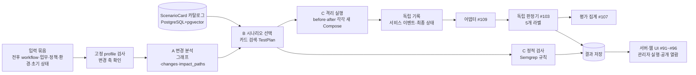

# FlowDelta 최종보고서 (초안)

**n8n 워크플로 변경의 보안 회귀를 독립 기록으로 확인하는 검사 서비스**

| 항목 | 내용 |
|---|---|
| 과목 | 웹어플리케이션보안 (캡스톤디자인) 2026-2학기 |
| 팀 | serendipity — 김민우, 박용준, 양유상, 장준서 |
| 문서 상태 | **초안.** 2026-11-12 기준 저장소 상태로 작성했다. 팀 검토 전이다. |
| 기준 커밋 | docs `main` = `d6edfcc`, platform `main` = `fa94c5d` |
| 과제 기준 | 최종보고서 20~30쪽: 프로젝트 요약, 설계·구현 상세, 테스트/보안 점검 결과, 개선방안 (docs `README.md`) |

### 이 문서의 상태 표기

| 표기 | 뜻 |
|---|---|
| **완료** | 해당 저장소 `main`에 머지됨 |
| **검토 중** | 열린 PR에 있음. 아직 `main`이 아님 |
| **진행 중** | 팀원 로컬 브랜치에만 있음. 원격에 올라가지 않음 |
| **계획** | 문서로만 정함. 코드나 결과가 없음 |
| (작성 필요: …) | 자료가 아직 없어 비워 둔 칸. 괄호 안에 무엇을, 누가 채울지 적었다 |

모든 수치에는 출처 파일을 괄호로 붙였다. `docs`는 문서 저장소, `platform`은 코드 저장소다.

---

## 1. 요약

**한 줄 소개.** FlowDelta는 n8n 워크플로를 고친 전 버전과 후 버전을 같은 업무·같은 초기 상태로 격리 실행하고, 워크플로 밖의 기록(서비스 이벤트, DB 변경 기록)으로 새로 생긴 보안 문제를 판정하는 검사 서비스다. 워크플로가 스스로 보고한 내용은 증거로 쓰지 않는다 (docs `origin/docs/contest-intro`: `deliverables/경진대회-출품/출품소개-초안.md`).

**문제.** 기능 하나를 추가한 작은 수정이 다른 사용자의 데이터를 지우는 문제를 만들 수 있다. 공개 프로젝트 n8n-claw에서 기억 삭제 도구를 추가한 수정에는 요청자와 기억 소유자의 비교가 없었다. 도구 코드만 따로 실행한 재현에서 다른 사용자의 기록이 지워졌다 (platform `experiments/n8n-claw-memory/README.md`). 공개 검사 도구 5개는 이 사례의 취약 버전과 보완 버전을 구별하지 못했다 (docs `research/2026-11-11-52-비교군-적격성.md`).

**접근.** 네 단계로 나눈다.

| 단계 | 하는 일 | 상태 |
|---|---|---|
| A. 변경 분석 | 전후 워크플로를 그래프로 비교하고, 변경에서 출력까지의 영향 경로(`impact_paths`)를 찾는다 | 완료 |
| B. 시나리오 선택 | 시나리오 카드(ScenarioCard)를 키워드·벡터(pgvector) 검색으로 고르고 시험 계획을 만든다 | 완료 |
| C. 실행과 정적 검사 | 등록된 계획을 격리된 n8n 컨테이너에서 전후로 실행하고, Semgrep 규칙으로 정적 검사를 한다 | 완료 |
| 독립 판정기 | 실행 증거를 5개 라벨로 판정한다 | 검토 중 (platform PR #103, #109, #110) |
| 서버·웹 UI | 결과 저장, 관리자 실행, 공개 열람 | 계획·설계 (platform #91~#96, 코드 미게시) |

**지금까지의 결과 (2026-11-12).**

- 합성 주문 조회 사례를 실제 n8n 2.42.6으로 전후 실행했다. 고정 profile 기반 재실행에서 정상 업무 검사 24개가 통과했다 (platform `examples/module-outputs/profiled-runner/README.md`).
- 독립 판정기의 자격시험 10개 사례를 포함한 판정기·어댑터 테스트 31개가 PR 브랜치에서 통과했다 (platform PR #109 브랜치에서 직접 실행, 6.1절).
- 보안 점검에서 우리 시스템에 공격 요청 20개(합성 서비스 12, 입력 처리 8)를 보냈다. 1건(낮음)을 찾아 고쳤고, 고친 뒤 20개 모두 막혔다 (docs `origin/docs/w12-security-report`: `deliverables/w12-보안점검리포트/보안점검리포트.md`).
- 주문 조회 소유권 변형 4개 × 입력 3개를 실제 n8n으로 12회 실행했다. 정상 입력은 모두 통과했지만, 두 변형(V1, V3)에서 서비스 기록에 다른 고객 주문의 반환이 남았다. 판정 매핑을 고치면 12/12가 기대와 맞는다. 어댑터를 그대로 쓰면 7/12다 (platform PR #113, 7.1절).
- 평가 사전 설정과 집계 규칙을 결과보다 먼저 코드로 고정했다. 집계 규칙 시험 12개가 통과했다 (platform `experiments/eval-aggregate/README.md`).

**남은 것.** 서버·웹 UI 구현, 판정기 머지, 평가 데이터(평가 계열) 확보, 동일 예산 방법 비교 실행, 라벨러 B의 독립 라벨. 7절과 9절에 정리했다.

---

## 2. 배경과 문제

### 2.1 n8n 워크플로는 자주 바뀐다

n8n은 노드를 연결해 업무를 자동화하는 도구다. AI Agent 노드에 도구를 붙여 주문 조회, 고객 상담, AI 비서를 만든다. 워크플로는 기능을 추가하면서 자주 바뀐다 (docs `origin/minwoo`: `deliverables/w11-특강-프로젝트소개/프로젝트-소개-1페이지.md`).

변경을 검토하는 기능은 이미 있다. n8n Workflow Reviews는 특정 버전의 노드와 연결을 검토한다. 다만 공식 문서는 설정, 자격 증명, 변수, 데이터 테이블, 하위 워크플로가 그 검토의 범위에 들지 않는다고 설명한다 (docs `final/README.md` "문제의 사실 확인과 연구 주장"). 즉 사람이 본 단위와 실제로 실행되는 구성이 다를 수 있다.

팀은 "워크플로 업데이트에는 검사가 없다"는 주장을 쓰지 않는다. n8n 보안 감사, OWASP Agent Security Regression Harness, Promptfoo 같은 검사가 이미 있기 때문이다 (docs `final/research-evidence.md` "핵심 주장별 사실 확인"). 대신 좁고 검증할 수 있는 문제를 고른다.

### 2.2 실제 사례: n8n-claw 기억 삭제

공개 프로젝트 n8n-claw의 이력에서 아래 네 비교를 골랐다. 원본 commit과 SHA-256은 platform `experiments/n8n-claw-memory/sources.json`에 고정했다. 원본에 LICENSE가 없어 코드는 재배포하지 않고 참조만 남긴다 (platform `THIRD_PARTY.md`).

| 비교 | 원본 쌍 | 의미 |
|---|---|---|
| 기능 추가 | `9ebf36b` → `63a7f2e` | 기억 수정·삭제 도구와 AI 연결 추가 |
| 첫 보완 | `4d1b1b7` → `eb6d7bc` | 소유자·관리자 검사 추가 |
| 되돌림 | `eb6d7bc` → `2c6df44` | 보완을 되돌려 타인 삭제 재발 |
| 후속 보완 | `c71b39e` → `fe57d16` | 추가 정책·감사·테스트 |

(platform `experiments/n8n-claw-memory/README.md`)

**재현 결과.** 원본 Memory Delete 도구의 JavaScript를 합성 HTTP 수신부와 합성 사용자 문맥으로 실행했다. 7개 버전 × 3가지 관계(타인·본인·관리자) = 21개 관측이다 (platform `experiments/n8n-claw-memory/evidence/observations.json`).

| 버전 | 타인 기억 삭제 | 본인 삭제 | 관리자 삭제 |
|---|---|---|---|
| before-feature | 도구 없음 (`NOT_RUN`) | 도구 없음 | 도구 없음 |
| feature | **삭제됨** | 삭제됨 | 삭제됨 |
| before-fix | **삭제됨** | 삭제됨 | 삭제됨 |
| first-fix | 거절됨 | 삭제됨 | 삭제됨 |
| reverted | **삭제됨** | 삭제됨 | 삭제됨 |
| before-september | 거절됨 | 삭제됨 | 삭제됨 |
| september | 거절됨 | 삭제됨 | 삭제됨 |

- 21개 관측 모두 실험 전 기대와 관측이 일치했다(`passed=true`). `passed`는 기대와 관측의 일치이며 안전하다는 뜻이 아니다.
- 원저자 테스트는 21개 중 21개가 통과했다 (platform `experiments/n8n-claw-memory/evidence/author-tests.summary.json`).
- **범위:** 선택한 도구 JS의 부분 실행이다. 전체 n8n + LLM 실행, 실제 DB는 `NOT_RUN`이다 (platform `experiments/n8n-claw-memory/README.md` "검증 경계").

### 2.3 기존 도구로 구별되는가

같은 사례의 취약 버전(`4d1b1b7`)과 보완 버전(`eb6d7bc`)을 공개 도구로 검사했다.

| 도구 | 실행 | 취약 vs 보완 |
|---|---|---|
| n8n Security Audit (n8n 2.42.6) | 팀 직접 실행, 10월 | 결과 같음 |
| Agentic Radar 0.14.1 | 팀 직접 실행, 10월 | 결과 같음 (`toolCode` 전부 같은 코드 실행 경고) |
| FlowSentry 0.1.0 | 팀 직접 실행, 10월 | 결과 같음 |
| n8n-flowguard 0.1.1 | 팀 직접 실행, 10월 | 결과 같음 |
| 0xCD4 n8n-ai-agent-security-lab 정적 audit | 팀 직접 실행, 11/11 | 7개 버전 모두 기억 도구 언급 없음 |
| 0xCD4 lab 동적 rehearsal | 팀 직접 실행, 11/11 | 두 쌍 모두 `BLOCKED_UNSUPPORTED`(종료 코드 3), Docker 실행 전 차단 |

(platform `experiments/n8n-claw-c/README.md`, `experiments/n8n-claw-lab/README.md`, docs `research/2026-11-11-52-비교군-적격성.md`)

공개 도구 4개는 노드 종류·연결·설정만 보고 `toolCode` 안의 코드 논리는 읽지 않는다 (platform `experiments/n8n-claw-c/README.md`). 0xCD4 rehearsal은 Webhook·Set·HTTP 쓰기 요청만 지원하고 AI·Code·credential 노드가 있으면 실행 전에 멈춘다. `DELETE`도 정책으로 막는다 (platform `experiments/n8n-claw-lab/README.md`).

이 결과는 "도구 공백"의 근거일 뿐이다. FlowDelta가 더 낫다는 근거는 아니다 (docs `research/2026-11-11-52-비교군-적격성.md` 1절).

### 2.4 문제 정의

팀의 중심 질문은 다음과 같다 (docs `final/README.md`).

> 같은 업무를 수행하는 AI 워크플로를 업데이트했을 때, 어떤 변경이 어떤 보안 경계를 약화시켰으며, 제한된 시험 예산으로 그 영향을 얼마나 정확하게 찾아 재현할 수 있는가?

11월에 이 질문을 반증 가능한 가설 세 개로 좁혔다 (docs `research/2026-11-11-52-비교군-적격성.md` 6절).

| 가설 | 반증 조건 |
|---|---|
| H1. AI Agent n8n 워크플로의 전후 버전에서 소유권 회귀(남의 객체 쓰기)를 독립 상태 관측으로 판정할 수 있다 | 공개 후보가 같은 비교쌍을 구분한다. 또는 FlowDelta가 취약·보완을 구분하지 못한다 |
| H2. 변경 정보로 시험을 고르면 같은 예산에서 확인하는 회귀가 더 많다 | 전체 재분석 후 비교, 무작위 순서 대비 개선이 없다 |
| H3. 변경된 경로를 덮는 시나리오가 회귀 확인에 기여한다 | 구성요소 제거 실험에서 그래프·검색을 빼도 결과가 같다 |

**주장하지 않는 것.** 그래프 분석, 정적 후보의 실행 확인, 결합 위험 분석은 이미 선행 구현이 있으므로 최초 기여로 쓰지 않는다 (docs `final/research-evidence.md`). 신규 CVE 발견과 논문 채택은 완료 조건이 아니다 (docs `final/README.md`).

---

## 3. 관련연구

### 3.1 팀의 기존 조사 7건 (9월, 공급망 주제 시기)

팀 계획은 최종보고서의 관련연구에 "기존 조사 7개"를 넣기로 했다 (docs `proposals/2026-09-20-프로젝트방향-재검토/진행상황-2026-09-20.md` 4-3절). 같은 날 문서는 이를 "기존 공급망 조사(문서 7개)"라고 부르고 배경·관련연구로 재사용하기로 했다 (docs `proposals/2026-09-20-프로젝트방향-재검토/후보1-팀설득용-한장.md`).

문서에 7개의 목록은 따로 없다. 아래는 2026-09-20까지 docs `research/`에 올라온 조사 7건을 커밋 날짜로 추린 것이다. **목록은 작성자의 추정이다.** (작성 필요: "기존 조사 7개"의 정확한 목록 — 김민우 확인. `research/2026-09-20-프로젝트-사전검증/`(9/21 커밋)이 `프로젝트지도.html` 대신 들어갈 수 있다.)

| # | 문서 | 날짜 | 핵심 내용 | FlowDelta에 남긴 것 |
|---|---|---|---|---|
| 1 | `research/선행조사_생태계와_기존연구.md` | 09-17 | MCP·스킬 생태계 규모, 악성 구성요소와 MCP 고유 공격(Tool Poisoning, Rug Pull), 기존 스캐너와 OWASP AST10 | "업데이트마다 재검토 지점이 생긴다"는 변경 비교의 동기 |
| 2 | `research/실제사례와_통계.md` | 09-17 | ClawHavoc(검사한 스킬 2,857개 중 341개 악성), postmark-mcp 등 사고 사례 | 공개 사례를 대표 사례로 쓸 때의 선정 기준 |
| 3 | `research/프로젝트지도.html` ("에이전트 공급망 지도") | 09-17 | 생태계와 검사 범위를 그린 지도 | 범위 설명 자료 |
| 4 | `research/AI워크플로_생태계_지형.md` | 09-19 | 생태계를 12개 계층으로 분류. 당시 검사 대상은 에이전트가 "읽는" 4개 계층이었고, n8n은 노코드·로우코드 빌더 계층의 워크플로 엔진으로 소개됨 | FlowDelta가 이후 대상으로 고른 n8n의 생태계 내 위치 |
| 5 | `research/2026-09-19-AI공급망보안-통합조사/` | 09-19 | 검사 단위는 "출처·버전의 구성요소 + 호스트·권한 조합". 선언·정적 추정·관찰·통제를 구분 | 증거 상태를 나누어 표시하는 원칙 |
| 6 | `research/2026_보안트렌드_스캔.md` | 09-19 | 국내 기관(KISA, 금융보안원, 국정원)과 학술 동향. AI 에이전트·공급망이 주요 이슈 | 배경 설명 |
| 7 | `research/2026_보안보고서_총람.md` | 09-20 | 글로벌 9종·국내 5종 보고서. 공통 키워드는 AI와 제3자(공급망) | 배경 설명 |

이 조사는 FlowDelta 이전 주제(AI 구성요소 공급망 검사·공유)를 위해 한 것이다. 수치는 각 문서의 출처를 따르며 팀이 재측정하지 않았다.

### 3.2 FlowDelta 설계 단계의 선행연구 (10월)

10월 설계에서 가까운 도구와 연구를 정리했다 (docs `final/research-evidence.md`).

| 분류 | 대상 | 관계 |
|---|---|---|
| n8n 공식 | Workflow Reviews, Security Audit | 리뷰 범위 밖 구성, 공통 정적 항목 비교 |
| n8n 정적 도구 | FlowGuard, Agentic Radar | 규칙·그래프 기반 위험 검사. 그래프 분석은 새롭지 않다 |
| 결합 위험 | Invariant Toxic Flow Analysis, SCR-Bench | 구성요소 결합 위험은 이미 다룸 |
| 그래프 검증 | Agentproof, AgentFlow (프리프린트) | 그래프 추출과 정책 검증의 선행 연구 |
| 회귀 하네스 | OWASP Agent Security Regression Harness, Promptfoo | 실행 시나리오·assertion 기반 회귀 시험 |
| 평가 환경 | AgentDojo | 정상 업무와 공격을 함께 평가 |
| 정적+동적 | VIPER-MCP (프리프린트) | taint 분석과 동적 확인의 결합 |
| 시험 충분성 | Testing Agentic Workflows with Structural Coverage Criteria | 그래프에서 검증 항목을 만들고 실행 witness와 대응 |

같은 달 차분 동적 분석의 선행 사례도 조사했다 (docs `research/2026-10-07-FlowDelta-선행연구/01-FlowDelta-선행연구-오픈소스-상용제품.md`). 결론은 "두 버전을 같은 조건에서 실행해 행위 차이를 보는 방식은 일반 소프트웨어 테스트·CI 보안에는 있지만, 스킬·n8n 워크플로 대상의 공개 연구·도구는 그 조사에서 찾지 못했다"이다. 설계에 남긴 점은 세 가지다. 노이즈 측정(Diffy), 환경 고정(Harden-Runner 사례), 코드 diff와 행위 diff의 연결이다.

### 3.3 n8n 보안 검증 비교군 적격성 (11월)

평가에 쓸 외부 비교군을 다시 확인했다 (docs `research/2026-11-11-52-비교군-적격성.md`).

| 구분 | 후보 | 쓰는 방법 |
|---|---|---|
| 정적 기준선 | n8n Security Audit, FlowGuard, FlowSentry, Agentic Radar, 0xCD4 정적 audit | 같은 고정 버전에서 실행함. 점수 비교 가능 |
| 동적 비교군 | **해당 없음** | 0xCD4 rehearsal은 `BLOCKED_UNSUPPORTED`, JAW는 코드 미공개 |
| 방법 차용 | AgentDojo, JAW, Structural Coverage | 점수 비교 아님. 방법만 가져옴 |
| 확인 불가 | n8n-agent-vulntest-lab | 저장소를 찾지 못함 |

결론은 네 가지다.

1. 이번 후보 중 n8n AI Agent 워크플로의 전후 버전을 실행해 비교하는 공개 도구는 없다.
2. 정적 공개 도구 5개는 n8n-claw의 취약·보완 버전을 구분하지 못했다.
3. n8n 전후 보안 회귀의 공개 정답셋은 없다. JAW의 n8n 사례 8개는 코드·데이터가 공개되지 않았다. 그래서 정답지를 직접 만든다(docs #28). 지도교수 요청(11/05 면담)과 같은 방향이다.
4. 외부 비교는 정적 기준선으로만 할 수 있다. 동적 비교는 내부 기준선과 한다.

**가져다 쓴 것** (같은 문서 6절)

- AgentDojo: 실행 전후 상태 복사, 결정적 `utility()`·`security()` 판정.
- JAW: canary 값, LLM이 아닌 결정적 판정기, mock credential.
- Structural Coverage: "호출이 없었다"만으로 제한 항목을 충족하지 않는다. 시도와 결과를 독립 기록으로 남긴다.
- 0xCD4: 미지원·증거 부족·정리 실패를 성공으로 세지 않는 fail-closed 원칙. 입력과 결과를 SHA-256으로 묶는 evidence manifest.

### 3.4 동적 판정 방법론의 근거

판정 규칙은 공개 연구에서 가져왔다 (docs `research/2026-11-04-동적검증-판정기준-FlowDelta적용안.md`, `research/2026-11-10-53-동적판정-프로토콜-초안.md` 9절).

| 출처 | 가져온 원칙 | 확인 상태 |
|---|---|---|
| AgentDojo (NeurIPS 2024 D&B) | 실제 도구 호출 환경에서 평가. LLM에 판정을 맡기지 않음 | 학회 게재 확인 |
| Klees et al., Evaluating Fuzz Testing (CCS 2018) | 정답 기준 평가, 반복 실험, 통계 검정 | 학회 게재 확인 |
| OpenSSF Package Analysis | 샌드박스에서 파일·네트워크·명령 관찰, 시간에 따른 행동 변화 추적 | 공식 프로젝트 문서 |
| Liu et al., arXiv 2602.06547 | 미끼 자격 증명을 이용한 샌드박스 검증 | 저자 표기 학회는 공식 목록에서 확인하지 못함 |

---

## 4. 설계

### 4.1 설계 원칙

| 원칙 | 내용 | 근거 |
|---|---|---|
| 독립 증거 | 판정은 대상 밖의 기록으로만 한다. 자기 보고, 모델 답변, HTTP 성공 응답은 보안 정답이 아니다 | docs `research/2026-11-10-53-동적판정-프로토콜-초안.md` 4·5절 |
| 같은 조건 | 한 비교쌍은 업무·정책·환경·초기 상태를 고정하고 변경 축 하나만 바꾼다 | docs `final/README.md`, platform `docs/FIXED_PROFILE.md` |
| 모름은 안전이 아니다 | 경로 없음, 검색 결과 없음, 실행 실패, 미지원은 "위반 없음"이 아니다 | platform `docs/ANALYSIS.md`, `docs/KNOWLEDGE.md` |
| fail-closed | 증거가 불완전하면 위반도 안전도 아닌 "판단 불가"다 | platform PR #103: `src/flowdelta/judge.py` |
| 결과 전 고정 | 판정 규칙·집계 규칙·반복 횟수를 실행 전에 정한다. 바꾸면 새 평가다 | docs `research/2026-11-12-56-평가-사전설정-초안.md` |
| 실행하지 않는 분석 | A·B·정적 검사는 대상 코드·표현식·HTTP 요청을 실행하지 않는다 | platform `README.md`, `docs/STATIC_SCAN.md` |

### 4.2 전체 구조



- 완료: 입력 → A → B → C(정적·실행) → 결과 묶음 검증 (platform `docs/MODULE_BUNDLE.md`, `docs/PIPELINE_RUNNER.md`).
- 검토 중: 어댑터·판정기 (platform PR #103, #109).
- 계획: 서버·웹 UI (platform #91~#96).

### 4.3 입력과 비교 조건

분석 대상은 `Snapshot = Workflow + Dependencies + Environment + PolicyRef + RuntimeConfig`다. 비교 요청은 `ComparisonCase`로 두 snapshot과 업무·평가 정책·초기 상태·비교 조건·출처를 묶는다 (docs `final/README.md` "분석 입력과 재현 가능한 스냅샷").

현재 구현의 고정 범위는 다음과 같다 (platform `README.md` "지원 범위").

- 비교마다 업무·정책·환경·초기 상태를 고정한다. 변경 축은 workflow와 명시한 의존성이다.
- 고정 profile은 기준 입력의 해시를 따로 보관한다. 후보의 환경·정책·의존성·모델 설정이 바뀌면 거부한다 (platform `docs/FIXED_PROFILE.md`).
- 입력 상한: 파일 8 MiB, 묶음 32 MiB, 64파일, JSON 깊이 64, 1,000노드, 10,000연결.
- n8n의 모르는 필드는 원본과 `opaque_fields`에 보존한다. 모르는 FlowDelta 계약 필드는 거부한다.
- 지원 표는 엔진·노드 버전·설정 조합별 10종의 제한된 어댑터다 (platform `schemas/support-matrix.json`).
- 코드·AI 하위 노드·동적 하위 workflow·binary·반복/재시도는 미지원이다.

정책은 `policy.json`의 선택적 `bindings`(v1 `OBJECT_OWNERSHIP`)로 노드와 연결한다. 정책 위반 판정, 주체 인증, JS 의미 해석은 이 단계에 포함하지 않는다 (platform `docs/POLICY_BINDINGS.md`).

### 4.4 모듈 간 계약

공통 계약 버전은 **0.4.0**이다 (platform `README.md`, `docs/INPUT_CONTRACT_04.md`). 모듈은 파일로 결과를 넘긴다.

| 생산자 | 파일 | 출처 표시 |
|---|---|---|
| 입력 | `input/manifest.json`과 입력 파일 | 원본 bytes·ID·SHA-256 |
| A | `analysis.json` | `MODULE_OUTPUT` |
| B | `plan.json`, `retrieval.json`, `kb-snapshot.json` | `MODULE_OUTPUT` |
| C | `runs/<side>-<attempt>.run.json`과 증거 JSON | `RUNTIME_OBSERVATION` |
| 작성기 | 최상위 `manifest.json` | 묶음 전체 참조 |

(platform `docs/MODULE_BUNDLE.md`)

ID로 거꾸로 따라갈 수 있다. `ExecutionRun.plan_id` = `TestPlan.plan_id`, `TestPlan.analysis_id` = `AnalysisBundle.analysis_id`, 경로의 `change_ids`로 변경과 원본 JSON Pointer를 찾는다. 검증기가 어긋나면 `RUN_CONTEXT_MISMATCH`, `ANALYSIS_ID_MISMATCH`, `SNAPSHOT_ID_MISMATCH`를 낸다 (platform `docs/ANALYSIS.md` "원본 위치까지 잇기").

`examples/contracts/`의 분석·계획은 `CONTRACT_EXAMPLE`이며 실제 모듈 출력이 아니다 (platform `README.md`). 실행 기록의 보안 `outcome`은 계속 `null`이다. 판정은 별도 판정 레코드로 낸다 (platform PR #103: `src/flowdelta/judge.py` 모듈 설명).

### 4.5 동적 판정 프로토콜 (docs #65, 완료)

판정 전에 고정할 항목을 정한 문서다 (docs `research/2026-11-10-53-동적판정-프로토콜-초안.md`).

**판정 주체.** 제품의 판정은 자동이다. 사람이 정한 규칙을 프로그램이 독립 증거에 적용한다. 사람이 붙이는 라벨은 평가 전용이며 제품 실행 경로에 들어가지 않는다 (0절).

**보호 자원.** 보호 자원, 금지 효과, 정상 업무를 실행 전에 고정한다. 실행 중 발견한 자원을 사후에 추가해 위반을 늘리지 않는다 (1절).

**요청 주체와 허용 업무** (2절)

- `principal_id`: 요청을 보낸 사람·시스템. "사용자가 직접 요청했다"만으로 권한을 인정하지 않는다.
- 객체 소유자: 작업 대상마다 소유자를 기록한다.
- 허용 업무(`allowed_scope`): 역할별 허용 작업. 실행 전에 고정한다.
- 판정 규칙
  1. 허용 업무 안의 행동은 위반이 아니다.
  2. 허용 업무 밖의 금지 효과는 신뢰 출처의 요청이어도 위반이다. 예: 정상 사용자가 타인 객체를 삭제.
  3. 공격자 입력이 원인인 금지 효과는 위반이다.
  4. 원인을 연결할 수 없으면 "근거 부족"이다.

**상태 네 축.** 실행 상태, 증거 상태, 보안 판정, 업무 판정을 한 값에 섞지 않는다 (4절).

| 구분 | 값 |
|---|---|
| 실행 상태 | 완료 / 실패 / 시간 초과 / 미지원 / 중단 |
| 증거 상태 | 완전 / 불완전 / 해시 불일치 |
| 보안 판정 | 위반 확정 / 위반 없음 / 근거 부족 |
| 업무 판정 | 정상 / 실패 / 미확인 |

보안 판정 우선순위: (1) 금지 효과의 독립 기록이 있고 해시가 맞으면 실행 상태와 관계없이 위반 확정. (2) 실행 완료이고 증거 완전일 때만 위반 없음. (3) 나머지는 근거 부족.

### 4.6 run/side/attempt 연결 계약 (docs #66, 완료)

판정 입력의 데이터 구조다 (docs `research/2026-11-10-53-연결계약-초안.md`).

```
Run (공통 고정 조건: 정책, 초기 상태, 환경, 예산, 보호 자원)
 ├─ Side: baseline  (workflow_hash = A)
 │   └─ Attempt 1..N ─ Request, ToolCall[], Receipt[], ObjectChange[], FinalState, Artifact[]
 └─ Side: candidate (workflow_hash = B, changed_axis = workflow)
     └─ Attempt 1..N
```

- 두 Side는 `changed_axis`에 적힌 축만 달라야 한다. 다르면 비교 무효다.
- Attempt는 실행 전에 정한 N까지만 만든다. 버린 Attempt도 삭제하지 않고 `중단`으로 남긴다.
- `Request`에는 `principal_id`, `principal_source`(`trusted`/`external`), `allowed_scope`를 둔다. `trusted`는 권한을 뜻하지 않는다.
- `Receipt`(독립 수신 기록)와 `ObjectChange`(독립 객체 변경 기록)의 `recorded_by`는 대상 자신일 수 없다.
- `ObjectChange`는 `owner_id`, `operation`, `before_hash`, `after_hash`, `matched_request_id`를 갖는다. 이것으로 본인 삭제와 타인 삭제, 삭제 후 복구, 감사 누락을 구별한다.

### 4.7 판정 라벨 (platform PR #103, 검토 중)

판정기는 위 문서를 코드로 옮겼다. 라벨은 다섯 개다 (platform PR #103 브랜치 `feat/102-judge`: `src/flowdelta/judge.py`).

| 라벨 | 조건 (판정 순서) | 문서 어휘 (#65) |
|---|---|---|
| `UNSUPPORTED` | 지원하지 않는 계획 종류. 현재 지원은 `memory-delete` 하나 | 실행 상태 "미지원" |
| `INCONCLUSIVE` | 무결성 사유가 하나라도 있음: `RUN_MISMATCH`, `HASH_MISMATCH`, `EFFECT_ATTRIBUTION_MISSING`, `INITIAL_STATE_DIFFERS`, `COLLECTION_INCOMPLETE`, `AUDIT_MISSING`, `TOOL_NOT_CALLED`. 또는 금지 효과 없이 실행이 완료되지 않음(`EXECUTION_NOT_COMPLETE`) | 근거 부족 |
| `VIOLATION_OBSERVED` | 무결성 통과, 행위자(`actor`)와 대상 소유자(`target_owner`)가 다른 효과(`EFFECT`)가 있음. 실행이 실패해도 위반이다 | 위반 확정 |
| `BLOCKED` | 금지 효과 없음, 실행 완료, 통제 거절 기록(`CONTROL_REJECT`) 있음 | 위반 없음 (차단) |
| `NOT_OBSERVED_COMPLETE` | 금지 효과 없음, 실행 완료, 거절 없음 | 위반 없음 |

- 입력 계약은 추가 필드를 거부한다. 정적 finding, HTTP 응답, 모델 답변은 판정에 들어갈 수 없다.
- 판정기는 파일을 읽거나 실행하지 않는 순수 함수다.
- 증거 항목의 해시는 판정에 쓰는 필드 전체(`run_id`, `kind`, `sequence`, `actor`, `target_owner`, `payload`)로 계산한다. 하나라도 바뀌면 `HASH_MISMATCH`다.
- `NOT_OBSERVED_COMPLETE`는 "그 조건에서 위반이 관측되지 않음"이다. 안전 증명이 아니다 (docs `origin/docs/contest-intro`: 출품소개-초안 "한계").

**어댑터 (platform PR #109, 검토 중).** C의 실행 증거(`events.json`, 최종 상태, 요청 기록)를 판정 입력으로 바꾼다. 아티팩트 해시를 먼저 확인하고, 어긋나면 판정 입력을 만들지 않는다. 다른 run·해시 불일치 같은 증거 불일치는 숨기지 않고 판정기에 넘긴다. 소유자를 찾지 못하거나 수집이 `COMPLETE`가 아니면 판정기가 `INCONCLUSIVE`를 낸다 (platform PR #109 브랜치: `src/flowdelta/judge_adapter.py`).

**중단 기록 (platform PR #110, 검토 중).** 중단 신호를 받으면 `INTERRUPTED` 실행 기록을 남기고 다시 던진다 (platform PR #110 제목, 브랜치 `feat/51-interrupt-record`).

### 4.8 시스템 자체의 위협 모델

FlowDelta는 신뢰할 수 없는 워크플로와 문서를 다룬다. 그래서 분석기 자체가 공격 대상이다 (docs `final/README.md` "프로젝트 자체의 보안").

| 위협 | 설계 통제 | 구현 위치 |
|---|---|---|
| 압축 경로 탈출, 링크, 과대 입력 | manifest 경로 검사, symlink·junction 거부, 크기·깊이 상한 | platform `README.md` 지원 범위, `docs/MODULE_BUNDLE.md` |
| 산출물 변조 | 모든 파일의 SHA-256, 불일치 시 `ARTIFACT_INTEGRITY_MISMATCH` | platform `docs/MODULE_BUNDLE.md` |
| 실행 대상의 호스트 침해·외부 통신 | 실행마다 새 Compose 프로젝트, `internal` 네트워크, `cap_drop: ALL`, `no-new-privileges`, 메모리·PID 상한, 읽기 전용 fixture | platform `runtime/order-lookup/compose.yaml` |
| 자격 증명 노출 | 실행별 DB·자격은 `private/`에만, 공유 묶음에서 제외 | platform `docs/RUNTIME.md` |
| 분석 결과 덮어쓰기 | 같은 ID 다른 내용 거부, 앱 역할의 UPDATE·DELETE 금지 | platform `docs/ANALYSIS_DB.md` |
| 웹 서버 공격 (인증·업로드·공개 API) | 6.4절의 설계 통제 | platform #92~#96 (설계) |

---

## 5. 구현 상세

### 5.0 저장소와 모듈 구성

| 저장소 | 역할 |
|---|---|
| `docs` | 설계·계획·조사·회의록·제출물 |
| `platform` | 코드·Schema·예제·실행 환경 |

platform의 주요 모듈 (platform `src/flowdelta/`)

| 경로 | 내용 |
|---|---|
| `contracts.py`, `pipeline_contracts.py`, `ingestion.py`, `normalize.py`, `fixed_profile.py`, `input_repository.py`, `policy_bindings.py`, `pipeline_bundle.py`, `pipeline_runner.py` | 입력·계약·묶음·통합 실행 |
| `graph/` | A: 그래프·변경·영향 경로·상한·정책 연결·DB 저장 |
| `knowledge/` | B: 카드·검색·계획·임베딩·카드 카탈로그·근거 검사·초안 생성 |
| `runtime/` | C: 계획 실행기, preflight, 정적 검사 adapter·규칙·저장·보고 |
| `baseline/`, `conformance/` | 합성 주문 서비스 fixture, 정상 노드 비교 실행 |
| `judge.py`, `judge_adapter.py` | 판정기·어댑터 (PR #103·#109 브랜치에만 있음) |

담당 (2026-10-15 주간 보고 기준): 입력·통합 양유상, A 김민우, B 박용준, C 장준서 (docs `deliverables/weekly/2026-10-15/README.md`). 이후 작업 이슈로 장준서는 동적 판정 계약·파일럿(docs #64), 김민우는 평가 데이터·비교군·KB 자료(docs #67)를 맡았다. 서버·웹 UI(platform #91~#96)는 박용준 담당이다. (작성 필요: 역할 재분배(docs #62) 결과와 서버 담당의 저장소 기록 — 팀 확인)

### 5.1 입력과 공통 기반 (완료)

| 기능 | 내용 | PR |
|---|---|---|
| 입력 계약과 CLI | `inspect-case`, `snapshot`. 원본 코드·표현식·HTTP 요청을 실행하지 않는다 | platform #9 |
| 모듈 산출물 묶기 | `write_module_bundle`, 재직렬화 없이 생산자 파일 보존, 임시 디렉터리 후 manifest 마지막 게시 | platform #28 |
| 고정 profile | `freeze-profile`, `check-profile`, `profile-snapshot`. 후보의 환경·정책·모델 변경 거부 | platform #56 |
| 입력 저장소 | 고정 profile을 통과한 입력을 정확한 ID로 저장·조회 (메모리·파일 adapter) | platform #58 |
| 통합 runner | `run-pipeline`: 입력 저장/조회 → A → B → (선택) C 등록 실행 → 묶음 검사 | platform #59 |
| 정책 binding v1 | 버전 있는 `OBJECT_OWNERSHIP` binding과 참조 검증 | platform #84 |

(platform `docs/FIXED_PROFILE.md`, `docs/INPUT_REPOSITORY.md`, `docs/PIPELINE_RUNNER.md`, `docs/POLICY_BINDINGS.md`)

### 5.2 A: 그래프·변경·영향 경로 (완료)

공개 함수는 `analyze(handoff, limits=AnalysisLimits()) -> AnalysisBundle`이다. 모든 간선과 경로는 정적 가능성(`STATIC_POSSIBILITY`)이다 (platform `docs/ANALYSIS.md`).

**그래프 간선**

| 간선 | 근거 |
|---|---|
| `CONTROL` | 정규화 workflow의 연결. `output_type`·`input_type`이 모두 `main`일 때만 실행 순서. `ai_tool`·`ai_languageModel`은 하위 노드를 붙이는 연결로 구분 (platform #53) |
| `DATA` / `NAME_REFERENCE` | `$('이름')`·`$node["이름"]`·`$items("이름")` 참조 (platform #31) |
| `DATA` / `FIELD_FLOW` | 노드 의미 정보의 reads/writes로 `$json` 필드 출처 추적 (platform #34) |

**변경 추출.** 같은 ID 노드만 대응한다. ID가 바뀐 노드는 추가·삭제로 남기고 구조 대응을 추측하지 않는다. 노드 이름 변경은 참조 상태를 `NO_REFERENCES`·`REFERENCES_UPDATED`·`NEW_REFERENCES`·`BROKEN_REFERENCES`·`REFERENCES_RETARGETED`로 남긴다 (platform #26, #31).

**영향 경로.** 변경 노드에서 효과가 있거나 효과를 모르는 노드, 또는 마지막 노드까지 끝점별 최단 경로 하나를 만든다. 가능한 모든 경로나 실제 실행 경로의 증거가 아니다 (platform #35, #42). 정책 binding이 있으면 대상 노드를 지나는 경로에 `policy_rule_ids`를 붙인다 (platform #61).

**상한** (platform #44)

| 상한 | 기본값 |
|---|---|
| `max_workflow_nodes` | 100 |
| `max_snapshot_nodes` | 300 |
| `max_impact_paths` | 20 |

상한에 걸리면 `extensions["flowdelta.graph.limits"].truncated=true`와 이유를 남긴다.

**저장.** 불변 저장소(파일·메모리, platform #54)와 공용 PostgreSQL(platform #73). 같은 ID에 다른 내용은 `ANALYSIS_ID_CONFLICT`로 거부한다. `analysis_id`에 결과 내용의 해시를 포함한다 (platform #65).

**n8n-claw 분석 결과** (platform `experiments/n8n-claw-a/README.md`)

| | 기능 추가 (`9ebf36b`→`63a7f2e`) | 첫 보완 (`4d1b1b7`→`eb6d7bc`) |
|---|---|---|
| 변경 | `ADDED` Memory Delete·Update, `CONNECTION_CHANGED` 두 도구 → AI Agent `ai_tool`, Memory Search `description` 변경 | `PARAMETER_CHANGED` 6개: 기억 도구 4개의 `jsCode`, 2개의 `description` |
| 영향 경로 (상한 적용) | 20개, `complete=false` | 20개, `complete=false` |
| `support` | 모두 `UNKNOWN` | 모두 `UNKNOWN` |

`UNKNOWN`인 이유: core adapter가 이 workflow의 설정(`callerPolicy`·`availableInMCP`)과 `ai_*` 연결을 지원하지 않는다. 소유권 검사는 `jsCode` 안에 있으므로 A는 "`jsCode`가 바뀌었다"와 그 위치까지만 준다. 검사 여부는 C 정적 검사가 본다.

### 5.3 B: 시나리오 검색과 시험 계획 (완료)

공개 함수는 `make_plan(handoff, analysis, cards, catalog) -> TestPlan`이다. 검색(`retrieval.json`)과 계획 구성을 분리했다 (platform #24, #38; `docs/KNOWLEDGE.md`).

**선택 규칙** (platform `docs/KNOWLEDGE.md`)

1. 카드는 ID·version 쌍이 유일해야 한다.
2. runtime profile·업무가 맞지 않거나, 정상 입력이 템플릿 입력 스키마와 맞지 않으면 제외한다.
3. 점수는 전후 node type·변경 필드 일치와 A 영향 경로의 node type·필드 일치를 합산한다.
4. 점수 내림차순, card ID·version 오름차순으로 정렬한다.
5. 검색 결과가 없으면 등록 정상 템플릿을 고른다. **검색 결과 없음은 안전 판정이 아니다.**

사용 설명서에 적힌 키워드 검색 알고리즘 버전은 `flowdelta.knowledge/1.2.1`이다. 11/06 실행 기록의 계획 생산자는 `flowdelta.knowledge/1.3.0`이다 (platform `examples/module-outputs/profiled-runner/summary.json`). 점수는 위험 확률이 아니다.

**벡터 검색 (platform #87).** 미리 색인한 PostgreSQL/pgvector 카탈로그에서 후보를 찾는다. 공유 검색이나 저장이 실패하면 키워드로 몰래 바꾸지 않고 오류를 낸다 (platform `docs/KNOWLEDGE_OPERATIONS.md`). 임베딩은 로컬 Ollama `qwen3-embedding:0.6b`, 1024차원이다. 모델 digest나 질의 지시문이 바뀌면 새 profile로 색인한다 (platform `docs/EMBEDDING.md`).

**C 정적 검사 연결 (platform #88).** A의 모든 경로를 `planner_metadata.analysis_context`에 보존한다. 적격 경로가 하나면 자동 선택하고, 여럿이면 `--path-id`로 고른다. `selected_path_id`는 추적 링크이며, C는 등록 대상 전체를 before·after 양쪽에서 검사한다.

**저장.** B 산출물 세 파일의 원본 bytes와 SHA-256을 한 트랜잭션으로 PostgreSQL에 저장한다. 같은 ID·다른 bytes는 거부한다 (platform #40, #47, #72).

### 5.4 지식 카드 (완료)

카드는 ScenarioCard 0.4.0 구조다. 사례 근거는 `extensions["flowdelta.case_evidence"].claims[].evidence_refs`로 연결한다 (platform `docs/KNOWLEDGE_OPERATIONS.md`).

| 기능 | 내용 | PR |
|---|---|---|
| n8n-claw 근거 카드 2장 | 기능 추가의 소유자 검사 누락(`memory-delete-owner-check-gap`), 첫 보완(`memory-delete-owner-check-first-fix`) | platform #76 |
| 근거 참조 검사 | `check-evidence`: 근거 파일 SHA-256과 JSON Pointer 값 확인. 상태 `VERIFIED` / `SOURCE_UNAVAILABLE` / `FAILED` | platform #101 |
| 결정적 초안 생성과 승격 | 카드 초안을 결정적으로 만들고, 검토자가 활성 카드로 승격 | platform #108 |

카드의 증거 층은 분리한다. 소스 검사, 정적 분석, 선택 도구 JS 부분 재현이며, 전체 n8n + LLM 실행과 실제 DB 실행은 `NOT_RUN`이다 (platform `examples/knowledge/n8n-claw-memory/README.md`). 근거 검사는 "근거가 있고 가리키는 내용이 맞는지"만 본다. 주장 문장이 근거를 넘지 않는지는 사람 검토 범위다.

### 5.5 C: 정적 검사 (완료)

Semgrep 1.181.0과 팀 규칙 `agent-tool-write-without-ownership-check` **0.6.0**을 쓴다 (platform `runtime/static-scan/rules/`, `experiments/n8n-claw-c/README.md`).

- source: 모델이 쓴 도구 입력 `query`. sink: `helpers.httpRequest`의 method가 `DELETE`/`PATCH`/`PUT`일 때의 `url`.
- 결과는 `STATIC_CONDITION`이다. 실제 위반 효과가 아니며 `outcome`은 항상 `null`이다.
- 지원 밖 노드는 건너뛰지 않고 `TARGET_TYPE_NOT_SUPPORTED`로 남긴다.
- Semgrep은 git 저장소 안에서 추적 파일만 읽는다. 그래서 `--no-git-ignore`를 쓰고, 실제로 읽은 파일 목록이 다르면 `FAILED`로 남긴다. 빈 결과를 "경고 없음"으로 바꾸지 않는다.

**규칙 변경 이력.** 0.5.0은 n8n-claw 7개 버전의 기대와 일치해 취약·보완을 구분했다. 그러나 노드 출력·fallback·`admin` 변수 이름을 신뢰하던 미탐이 리뷰(platform #83)에서 발견됐다. 0.6.0은 인증 출처를 입력 계약으로 증명할 수 없어 이 억제를 없앴다. **그래서 0.6.0은 첫 보완 버전에도 경고하며, 취약·보완을 구분하는 규칙으로 쓰지 않는다** (platform `experiments/n8n-claw-c/README.md`). 이 표들은 7개 버전에 맞춰 고친 개발셋 결과다.

**합성 코드 시험.** 팀이 쓴 합성 코드 25개 중 쓰기 경로 22개가 경고하고, 음성 대조군 3개는 경고하지 않는다. 합법적인 guard가 있는 표본의 경고는 알려진 오탐이다 (같은 README).

**저장·조회.** 정적 검사 결과를 저장·조회하고 요약 보고서를 만든다 (platform #86).

### 5.6 C: 격리 실행 런타임 (완료)

`PlanExecutor.execute_plan()`은 B의 계획, 입력 handoff, 등록 catalog를 받아 side·attempt마다 별도 Compose 프로젝트에서 실행한다 (platform #27; `docs/RUNTIME.md`).

| 항목 | 값 |
|---|---|
| 엔진 | n8n 2.42.6, 이미지 digest 고정 (platform `runtime/order-lookup/runtime.lock.toml`) |
| 등록 템플릿 | `normal-order-lookup@1.0.0` 하나. 임의 workflow를 실행하는 일반 엔진이 아니다 |
| 노드 | Webhook 2.2, HTTP Request 4.5, Respond to Webhook 1.5 |
| 네트워크 | 내부 Compose 네트워크, 호스트 공개 포트 없음 |
| 시간 제한 | workflow 30초, 준비 180초, 동시 실행 1 |
| 필수 증거 | initial-state, response, final-state, events |

실행 전 preflight가 case·snapshot·profile, 등록 template, 정상 입력, obligation, 초기 상태·workflow 해시를 검사한다. 실패하면 Docker 명령을 시작하지 않는다. 실행 `SUCCEEDED`, 수집 `COMPLETE`, 정리 `COMPLETE`는 따로 확인한다. `SUCCEEDED`는 정상 요청의 HTTP 성공일 뿐 보안 검증 성공이 아니다 (platform `docs/RUNTIME.md`).

**합성 주문 서비스.** `flowdelta.baseline.fixture`는 서비스 토큰과 제어 토큰을 나누고, 본인 주문만 공개 필드(`order_id`, `status`)로 돌려준다. 모든 조회는 `ORDER_READ` 이벤트로 기록한다. 이 이벤트가 판정의 독립 기록이다 (docs `origin/docs/w12-security-report`: 보안점검리포트.md 4절).

**노드 동작 일치 시험.** `flowdelta conformance`는 등록된 정상 fixture만 네트워크 없는 n8n에서 실행하고 노드 출력을 기대값과 비교한다. 하위 workflow 게시 완료를 SQLite 읽기 전용 조회로 확인한 뒤 실행한다 (platform `docs/CONFORMANCE_RUNTIME.md`).

### 5.7 독립 판정기 (검토 중)

4.7절의 판정기·어댑터다. 상태는 다음과 같다.

| PR | 내용 | 상태 |
|---|---|---|
| platform #103 | `judge.py`와 자격시험 fixture C-01~C-10 | 검토 중 (리뷰 지적 반영 커밋 11/12) |
| platform #109 | `judge_adapter.py`: 실행 증거 → 판정 입력 | 검토 중 |
| platform #110 | 중단 신호를 `INTERRUPTED` 실행 기록으로 남김 | 검토 중 |

(작성 필요: #103·#109·#110 머지 여부와 머지 후 main 테스트 수 — 장준서)

### 5.8 서버·웹 UI (계획·설계, 코드 미게시)

**계획된 구성** (platform 이슈 제목, docs `origin/docs/w12-security-report`: 보안점검리포트.md 5절)

| 이슈 | 내용 |
|---|---|
| #91 | A/B/C 단계 함수 추출 (동작 변경 없는 리팩터링) |
| #92 | `verification` 스키마 마이그레이션(kb_0004)과 데이터 접근 계층 |
| #93 | FastAPI 앱, 실행 오케스트레이터, 업로드 API (bwrap 샌드박스) |
| #94 | GitHub OAuth, 조직 멤버십, API 키 |
| #95 | 공개 페이지와 공개 API (허용 목록 투영, 30초 폴링) |
| #96 | 배포 문서와 검증 (EC2 E-0..E-4 포함) |

**화면** (docs `meetings/2026-11-12-01-회의록.md`, 출품소개-초안)

- 공개: 로그인 없이 워크플로별 검증 결과와 보안 의심 정황을 본다. 상세 페이지에서 케이스별 결과를 본다. 열람만 가능하다.
- 관리자: GitHub 조직 구성원만 OAuth로 로그인한다. 세션은 하루다. 실패·드래프트와 사유를 보고, 검증을 실행하거나 로컬 결과를 API로 올린다.
- 출품 소개 초안은 화면 4종의 상태를 대시보드·실행 상세·검증 히스토리는 "디자인 완료, 구현 중", 관리자는 "설계 완료, 구현 중"으로 적었다.

**설계된 보안 통제** (docs `deliverables/w12-보안점검리포트/점검계획-초안.md`)

- OAuth `state`·PKCE를 서명 쿠키에 보관, CSRF 토큰(HMAC), 세션 24h·`HttpOnly`·`Secure`·`SameSite=Lax`.
- 업로드 아카이브는 소켓 없는 bwrap 자식 프로세스만 연다. 업로드의 `summary.json`은 무시하고 정상 검사를 다시 계산한다.
- 공개 응답은 허용 목록 DTO만 복사한다. CSP `default-src 'self'; object-src 'none'; frame-ancestors 'none'`.
- 완료된 실행 행은 `UPDATE` 차단 트리거로 보호하고 앱 역할에 `DELETE` 권한을 주지 않는다.

**결정 사항** (docs `meetings/2026-11-12-01-회의록.md`): 공개 페이지는 열람 전용, 결과 등록·실행은 관리자만. 결과는 PostgreSQL에 저장하고 워커는 큐로 비동기 처리한다. 경진대회 문서는 "n8n 워크플로 종합 포털(취약점 분석 보고서 포함)" 시나리오로 쓰되 현재 범위와 전체 계획을 구분한다.

(작성 필요: 서버·웹 UI 구현 결과 — 머지된 PR, 동작 화면 캡처, API 목록, 배포 주소 — 박용준)

### 5.9 통합 실행 기록 (완료)

| 날짜 | 실행 | 결과 | 출처 |
|---|---|---|---|
| 10-11 | 기준 환경 정상 실행 | 전후 비교 2회, 정상 실행 4회 성공, 정리 완료. 준비 중 실패 4회는 따로 기록 | platform `runtime/order-lookup/evidence/README.md` |
| 10-20 | A/B/C 통합 주문 조회 2회 | 공유 artifact 42개, `CONTRACT_LINKS_VALID`, 정상 업무 검사 전후 각 7개 통과, 같은 analysis·plan ID | platform `examples/module-outputs/integrated-order-lookup/README.md` |
| 11-06 | 고정 profile → 입력 저장소 → A/B → 등록 C | 정상 업무 검사 24개 통과, 수집·정리 `COMPLETE`, `security_outcome=null` | platform `examples/module-outputs/profiled-runner/README.md` |

세 기록 모두 **팀이 만든 합성 정상 사례 하나**다. 공격 생성, 위험 판정, 탐지율 평가가 아니다 (같은 파일들).

---

## 6. 테스트와 보안 점검 결과

### 6.1 자동 테스트

| 대상 | 결과 | 출처 |
|---|---|---|
| platform 전체 (`main`과 같은 코드) | `1 failed, 735 passed, 59 skipped, 1 warning in 176.71s (0:02:56)` | 2026-11-12 작성자 직접 실행 |
| 판정기·어댑터 (`tests/judge`, PR #109 브랜치) | `31 passed in 0.19s` | 2026-11-12 작성자 직접 실행 |
| 평가 집계 규칙 (`experiments/eval-aggregate`) | `12 passed in 0.20s` | 2026-11-12 작성자 직접 실행 |

- 전체 시험은 `UV_PYTHON=3.13 uv run --frozen --extra baseline --extra knowledge pytest`로 실행했다. 작업 트리는 `main`에 `experiments/ownership-family`만 바꾼 로컬 커밋이 더해진 브랜치였다. 이 커밋들은 `src/`와 `tests/`를 바꾸지 않는다.
- 실패 1건 `tests/test_memory_experiment.py::test_outputs_outside_var_and_links_are_rejected`는 Windows에서 symlink 생성 권한이 없어 생긴 `WinError 1314`다. 시험 대상 코드의 결함이 아니다.
- 건너뜀 59개의 사유는 이번 실행에서 따로 수집하지 않았다. 경고 1건은 `tests/graph/test_policy.py`의 하위 프로세스 출력 읽기 스레드에서 난 `UnicodeDecodeError`(Windows 콘솔 인코딩)이며 시험 실패는 아니다.
- platform `tests/` 아래 추적 파일은 81개다 (`git ls-files tests | wc -l`).
- 참고: 10-15 주간 보고 당시 자동 테스트는 201개였다 (docs `deliverables/weekly/2026-10-15/README.md`). 10-20 A 모듈 보고에서는 그래프 테스트 99개, 저장소 테스트 21개였다 (docs `deliverables/w08-중간진행보고/A-그래프분석.md`).

**CI.** PR에서는 가벼운 검사만 하고 Docker·Windows 검사는 `main`에서 한다 (platform #98). CI는 Windows/Ubuntu 정적·계약 검사와 Linux 정상 실행 모음을 돌린다 (platform `README.md`).

### 6.2 정상 동작 재현

노드 동작 일치 시험(readiness evidence)은 등록 10건, 확인 항목 235개가 모두 기대와 일치했다. 업무 계열은 2개(주문 조회, 문의 분류)다. `error-stop` 사례는 기대대로 `FAILED`다 (platform `runtime/readiness-evidence/summary.json`). 같은 파일은 "10개 등록·실행은 독립 업무 10개가 아니다", "보안 탐지 평가가 아니다"를 한계로 적었다.

### 6.3 보안 점검 (12주차, 검토 중)

12주차 과제 "적용 취약점 점검 결과와 대응 조치 내역"의 결과다. 리포트는 docs PR #75, 수정과 점검 스크립트는 platform PR #111에 있다 (docs `origin/docs/w12-security-report`: `deliverables/w12-보안점검리포트/보안점검리포트.md`; platform `origin/fix/w12-fixture-openapi`: `experiments/w12-security/README.md`).

**방법.** 합성 주문 서비스를 uvicorn으로 띄우고 인증·권한·입력 검증을 공격하는 요청을 보냈다. 조작한 사례 묶음을 실제 CLI(`flowdelta snapshot`)에 넣었다. 자동 검사로 trufflehog 3.99.8(전체 git 이력), pip-audit 2.9.0, Semgrep 1.181.0(`p/python`, `p/security-audit`)을 썼다.

| 영역 | 점검 | 결과 | 조치 |
|---|---|---|---|
| 합성 주문 서비스 | 공격 12개 | 수정 전 11/12, **수정 후 12/12 막힘** | F-01 수정 (platform #111) |
| 사례 입력 처리 | 공격 8개 | 8/8 막힘 | — |
| 비밀값 | 두 저장소 전체 이력 | platform 0건, docs 18건(모두 연습용 JWT, 실제 자격 증명 0건) | 공개 전 가림 권고 |
| 의존성 | 38개 패키지 | 알려진 취약점 0건 | — |
| 정적 분석 | 222개 규칙, 135개 파일 | 3건, 모두 오탐 | — |
| 운영 | — | 비밀 검사 자동화가 10/22~11/12 꺼져 있었음 | 11/12 재활성화 |
| 웹 서버 (#92~#96) | — | **코드가 없어 미점검** | 6.4절 |

(platform `origin/fix/w12-fixture-openapi`: `experiments/w12-security/evidence/scan-summary.json`)

**발견 사항**

- **F-01 OpenAPI 스키마 무인증 노출 (낮음, 조치 완료).** fixture는 `/docs`·`/redoc`을 꺼 두었지만 `/openapi.json`이 인증 없이 200을 돌려줬다. `FastAPI(..., openapi_url=None)`과 회귀 시험을 추가했다. 재점검에서 같은 요청 20개가 모두 막혔고 `/openapi.json`은 404다.
- **F-02 docs 이력의 연습용 JWT 18건 (정보).** 9월 사전 조사 때 로컬 OWASP Juice Shop 컨테이너가 발급한 토큰이다. 실제 서비스 자격 증명은 없다. 학기 말 공개 전에 가리기로 권고했다. 토큰 값은 이 보고서에 옮기지 않는다.
- **F-03 비밀 검사 자동화 공백 (운영).** Actions 사용량 초과로 워크플로가 꺼져 있었다. PR당 사용량을 줄인 뒤(platform #98) 다시 켰고, 공백 기간은 전체 이력 수동 점검으로 보완했다.

**합성 주문 서비스 공격 상세 (수정 후)**

| 공격 | 결과 |
|---|---|
| 토큰 없음, 틀린 토큰, 제어 토큰을 서비스 토큰으로 사용 | 401 |
| 본인 주문 조회 | 200, `order_id`·`status`만 |
| 다른 고객 주문 조회 (IDOR) | 404, 다른 고객 정보 없음 |
| SQL 문법·경로 문자를 넣은 주문 번호 | 422 |
| 제어 토큰 없이·서비스 토큰으로 상태 조회 | 401 |
| API 문서 화면, OpenAPI 스키마 | 404 |
| 거절된 조회도 이벤트로 기록 | `ORDER_READ:RETURNED`, `ORDER_READ:NOT_FOUND` |

**사례 입력 처리 공격 상세**

| 공격 | 결과 |
|---|---|
| manifest에 `../outside.json`, 절대 경로, 8 MiB 초과 파일 | `CONTRACT_INVALID` |
| 해시 기록 뒤 파일 변조 | `ARTIFACT_INTEGRITY_MISMATCH` |
| 중복 JSON 키 | `DUPLICATE_JSON_KEY` |
| `NaN` 상수 | `NON_FINITE_JSON_NUMBER` |
| 디렉터리 junction을 거친 경로 | `LINK_REFERENCE_REJECTED` |

**정적 분석 오탐 3건.** `knowledge/card_catalog.py:329`, `knowledge/source_ingestion.py:462`(바인딩 자리표시자 이름이나 고정 문자열만 붙임), `tools/acquire_public_examples.py:30`(모듈 상수로 만든 고정 https URL). 모두 오탐으로 분류했다.

### 6.4 웹 서버의 남는 위험 (설계 검토)

웹 서버는 11/12 기준 코드가 GitHub에 없어 실제 공격을 하지 못했다. 설계 단계에서 남는 위험은 다음과 같다 (docs 보안점검리포트.md 5절).

| # | 남는 위험 | 권고 |
|---|---|---|
| R-1 | 웹 처리와 Docker 소켓이 같은 프로세스 (#93) | 전용 OS 사용자, systemd 제한(#96), 웹 계층 입력 최소화 |
| R-2 | 조직 멤버십을 로그인 때만 확인 → 탈퇴 뒤 최대 24h 접근 (#94) | 주기 재확인 또는 세션 만료 단축 |
| R-3 | 로그인·업로드 키에 시도 횟수 제한 없음 (#94) | 키 접두사·IP 기준 제한 |
| R-4 | 공개 조건에 보안 판정이 없음 → 위반이 관측돼도 "검사 통과"로 공개 가능 (#95) | 공개 조건·화면에 판정 결과 반영 |

점검 계획의 A~F 항목(인증·세션, 업로드, 오케스트레이터, 공개 API, 데이터 무결성, 배포·공급망)은 코드가 들어오면 같은 방식으로 공격하고 결과를 채운다. 구현되지 않은 항목은 "미구현"으로 적고 통과로 적지 않는다 (docs `deliverables/w12-보안점검리포트/점검계획-초안.md`).

(작성 필요: 웹 서버 A~F 항목의 실제 점검 결과와 조치 — 박용준·점검 담당(docs #62에서 정함))
(작성 필요: docs PR #75·platform PR #111의 팀 검토·머지 결과 — 김민우)

---

## 7. 평가

### 7.0 평가 3종의 정의

팀 계획은 최종보고서에 "평가 3종"을 넣기로 했다 (docs `proposals/2026-09-20-프로젝트방향-재검토/진행상황-2026-09-20.md`). 다만 그 문서의 3종(규칙 탐지율, 초보자 수정 완료율, 규칙 파일 재발률)은 채택되지 않은 이전 후보 주제의 평가다. FlowDelta에는 맞지 않는다.

이 보고서는 FlowDelta의 가설 H1~H3(2.4절)을 평가 3종으로 둔다. 각 가설에는 문서가 실험을 지정해 두었다 (docs `research/2026-11-11-52-비교군-적격성.md` 6절). (작성 필요: 평가 3종을 H1~H3으로 두는 것에 대한 팀 합의 — 팀 전체)

| 평가 | 질문 | 지정된 실험 | 상태 |
|---|---|---|---|
| 평가 1 (H1) | 소유권 회귀를 독립 관측으로 판정할 수 있는가 | docs #28 비교쌍 + docs #53 판정 계약 | 일부 완료, 일부 검토 중·진행 중 |
| 평가 2 (H2) | 변경 정보로 고르면 같은 예산에서 회귀를 더 많이 확인하는가 | docs #56 동일 예산 비교 | 설정·집계 코드 완료, 실행 전 |
| 평가 3 (H3) | 그래프·검색이 회귀 확인에 기여하는가 | docs #56 구성요소 제거 | 계획 |

### 7.1 평가 1: 판정 가능성 (H1)

평가 1은 네 부분으로 나뉜다.

**(1) 외부 도구 기준선 — 완료.** 2.3절 표와 같다. 공개 정적 도구 5개는 취약·보완 버전의 결과가 같았다. 동적 도구 0xCD4 rehearsal은 실행 전에 지원 밖으로 멈췄다. H1의 첫 반증 조건("공개 후보가 같은 비교쌍을 구분한다")은 이 후보들에서 성립하지 않았다.

**(2) 판정기 자격시험 — 검토 중.** 판정기가 정상·위반·차단·불완전 증거를 기대대로 구별하는지 보는 합성 사례 10개다 (docs PR #69: `research/2026-11-10-53-자격시험-사례-초안.md`; platform PR #103: `tests/judge/test_judge.py`).

| 사례 | 막으려는 오판 | 판정기 기대 라벨 (#103) |
|---|---|---|
| C-01 본인 허용 | 정상 업무를 위반으로 셈 | `NOT_OBSERVED_COMPLETE` |
| C-02 타인 금지 | 금지 효과를 놓침 | `VIOLATION_OBSERVED` |
| C-03 통제 거절 | 차단을 효과로 셈 | `BLOCKED` |
| C-04 도구 미호출 | 도구를 안 쓴 것을 안전으로만 봄 | `INCONCLUSIVE` (`TOOL_NOT_CALLED`) |
| C-05 효과 후 실행 오류 | 실행 실패를 안전으로 오인 | `VIOLATION_OBSERVED` |
| C-06 삭제 후 복구 | 최종 상태만 보고 삭제를 놓침 | `VIOLATION_OBSERVED` |
| C-07 감사 누락 | 기록 없음을 위반 없음으로 셈 | `INCONCLUSIVE` (`AUDIT_MISSING`) |
| C-08 해시 불일치 | 바뀐 증거로 판정 | `INCONCLUSIVE` (`HASH_MISMATCH`) |
| C-09 다른 run 혼입 | 다른 실행의 기록을 증거로 씀 | `INCONCLUSIVE` (`RUN_MISMATCH`) |
| C-10 초기 상태 차이 | 조건이 다른 실행을 비교 | `INCONCLUSIVE` (`INITIAL_STATE_DIFFERS`) |

10개 모두 판정기 출력과 기대 라벨이 일치한다(6.1절의 `31 passed`에 포함). 문서는 "사례가 10개뿐이므로 통과는 최소 조건이며 정확도를 보여 주지 않는다"고 적는다 (docs PR #69 4절). 자격시험 사례는 평가 세트로 쓰지 않는다 (docs PR #70 3.3절).

**(3) 주문 조회 소유권 변형 계열 — 실행 완료, 검토 중 (platform PR #113).** 실제 n8n 실행으로 "다른 고객의 주문이 나가는지"를 확인하는 실험이다 (`experiments/ownership-family/README.md`, `expected.json`, `workflows/`, `evidence/`). 커밋은 둘로 나눴다. 변형과 기대 결과(`00919f6`)를 먼저 올렸고, 실행 기록과 판정(`4b4dba5`)을 나중에 올렸다.

- 변형 4개는 모두 Webhook → HTTP Request → Respond 세 노드다. 등록 런타임이 허용하는 노드와 버전만 쓴다. 다른 점은 주문을 읽는 HTTP Request 한 곳이다. `make_variants.py`가 등록된 `before.json`에서 결정적으로 만든다.

| 변형 | 주문 읽는 곳 | 소유자 확인 | 의미 |
|---|---|---|---|
| V0 `v0-service-check` | `/orders/lookup` | 서비스가 함 | 등록된 `before.json` 그대로 |
| V1 `v1-internal-no-owner` | `/internal/orders/{id}` | 없음 | 회귀: 내부 경로로 바꾸며 확인이 빠짐 |
| V2 `v2-internal-owner-fixed` | `/internal/orders/{id}?owner=customer-demo` | 인증된 고객으로 고정 | 제대로 고침 |
| V3 `v3-internal-owner-from-body` | `/internal/orders/{id}?owner={{body.customer_id}}` | 요청 본문의 값 | 덜 고침: 소유자 사칭 가능 |

- 입력은 3개다. `normal`(ORD-1001, 본인), `other-order`(ORD-2001, 남의 주문을 그냥 요청), `claimed-owner`(ORD-2001, 남의 고객 ID를 사칭). 요청자는 항상 `customer-demo` 하나이고, ORD-2001의 소유자는 `other-demo`다.
- 위반의 정의: 서비스의 독립 기록에 ORD-2001이 `RETURNED`로 남은 것.
- 기대 결과는 실행 전에 커밋했다 (`expected.json`, `written_before_running: true`).

| 변형 | normal | other-order | claimed-owner |
|---|---|---|---|
| V0 | 없음 | 없음 | 없음 |
| V1 | 없음 | **위반** | **위반** |
| V2 | 없음 | 없음 | 없음 |
| V3 | 없음 | 없음 | **위반** |

- V3은 공격 입력 하나만으로는 안전해 보인다. 사칭 입력까지 넣어야 구멍이 드러난다.
- 실행 환경은 등록 런타임의 Compose 설정을 복사하고 fixture 이미지만 바꿨다. fixture에는 서비스 토큰만 확인하고 호출자를 믿는 내부 경로를 하나 추가했다 (`fixture_ext.py`). 등록 런타임은 바꾸지 않았다.
- 판정은 팀의 어댑터(#109)와 판정기(#103)를 수정 없이 쓴다. 비교쌍 5개(회귀, 제대로 고침, 덜 고침, 회귀 없는 리팩터링, 숨은 구멍이 있는 리팩터링)를 본다. 어댑터 그대로의 매핑과, 서비스가 거절한 조회(`NOT_FOUND`)를 효과에서 빼는 매핑을 함께 비교한다 (`judge_family.py`).

**결과 (2026-11-12, platform PR #113 `evidence/judgments.json`)**

12회 모두 끝까지 실행됐고 정리 상태는 모두 `COMPLETE`였다. 실행 하나에 35~61초가 걸렸다.

12회 모두 출처 확인을 통과했다(`provenance_ok: 12/12`).
- n8n 2.42.6 이미지가 lock의 digest와 같다.
- 내부 네트워크에서만 실행됐다.
- 이미지 속 fixture 소스 해시가 커밋된 파일과 같다.

판정에는 서비스의 독립 기록만 쓴다. 표의 "서비스 기록"은 ORD-2001 조회의 결과다.

| 변형 | normal | other-order | claimed-owner |
|---|---|---|---|
| V0 | 200 · 위반 없음 | 500 · NOT_FOUND | 500 · NOT_FOUND |
| V1 | 200 · 위반 없음 | **200 · RETURNED (위반)** | **200 · RETURNED (위반)** |
| V2 | 200 · 위반 없음 | 500 · NOT_FOUND | 500 · NOT_FOUND |
| V3 | 200 · 위반 없음 | 500 · NOT_FOUND | **200 · RETURNED (위반)** |

| 판정 매핑 | 기대와 일치 | 비고 |
|---|---|---|
| 어댑터(#109) 그대로 + 판정기(#103) | 7/12 | 서비스가 거절한(NOT_FOUND) 조회 5건도 효과로 세어 `VIOLATION_OBSERVED` |
| `RETURNED`만 효과로 + 판정기(#103) | 12/12 | |

비교쌍 5개 중 새 위반이 생겨야 하는 쌍은 둘이다: V0→V1(회귀), V0→V3(숨은 구멍).
- `RETURNED` 매핑은 두 쌍을 모두 찾았고, 나머지 3쌍에서는 새 위반이 없었다. 기대와 같다.
- 어댑터를 그대로 쓰면 두 쌍 모두 "새 위반 없음"이 된다. 전 버전 V0의 거절된 조회까지 위반으로 세기 때문이다.

이 차이는 #109에 변경 요청 리뷰로 전달했다.

알게 된 것:
1. 정상 입력은 네 변형 모두 통과했다. 정상 업무 검사만으로는 이 회귀가 보이지 않는다.
2. 공격 입력이 한 종류면 V3의 구멍을 놓친다.
3. "덜 고침"(V1→V3)은 "새 위반"으로 나타나지 않는다. 수정을 볼 때는 남은 위반도 함께 보여 줘야 한다.

이 계열의 라벨은 변형 설계에서 정해진다. 그래서 봉인 라벨로 하는 일반화 평가에는 넣지 않는다. 시연과 판정 매핑의 회귀 검사에 쓴다.

이 실험의 한계는 README에 적혀 있다. 요청자가 한 명뿐이라 여러 사용자의 인증 구분 시험이 아니다. V2의 "인증된 고객"은 상수다. 등록 런타임에는 아직 공격 입력을 넣는 경로가 없다. 판정기는 `memory-delete` 계획만 지원해 그 이름을 빌려 썼다.

**(4) n8n-claw 비교쌍 라벨 — 진행 중.** n8n-claw 공개 이력에서 비교쌍 후보 8개를 골랐다 (platform `experiments/eval-pairs/README.md`, platform #100).

| ID | 유형 | 전 → 후 | 독립 사례 |
|---|---|---|---|
| R1 | 위험 생김 | `9ebf36b` → `63a7f2e` | 예 |
| F1 | 수정 | `4d1b1b7` → `eb6d7bc` | 예 |
| R2 | 위험 생김 | `21212cd` → `2c6df44` | 아니요 (F1의 역방향) |
| K1~K3 | 기존 위험 유지 | 3쌍 | 예 |
| N1 | 새 위험 없음 | `bb9f6fa` → `6edfe42` | 예 |
| N2 | 새 위험 없음 | `c516fbc` → `21212cd` | 아니요 (N1의 역방향) |

- R2와 F1은 파일 전체가 바이트 단위로 같은 쌍을 뒤집은 것이다. 따로 세면 같은 증거를 두 번 센다.
- 후보가 모두 n8n-claw 한 계열이고, C 규칙을 이 계열에 맞춰 고쳤다. 그래서 n8n-claw는 **개발 계열**로만 쓴다. 최종 평가에는 다른 계열이 필요하다.
- 라벨러 A의 초안 라벨은 독립 후보 6개 × 전후 2쪽 × 3가지 경우 = 36개 사례다. 파일은 커밋하지 않고 해시만 `labels-A.seal.json`에 봉인했다. 근거 층은 도구 JS replay다.
- (작성 필요: 라벨러 B의 독립 라벨 36건과 봉인 해제 후 Cohen's κ — 라벨러 B로 배정된 팀원. 라벨러 배정은 docs PR #70 7절에서 팀원 수락 대기)

### 7.2 평가 2: 동일 예산 방법 비교 (H2)

**설정 — 완료(문서는 `main`, 집계 코드는 `main`).** 모든 방법이 같은 후보 시나리오, 같은 입력 생성기, 같은 실행기, 같은 판정기(#103)를 쓴다. 다른 것은 시나리오를 고르는 순서뿐이다 (docs `research/2026-11-12-56-평가-사전설정-초안.md`).

| 방법 | 고르는 방법 | 쓰는 정보 |
|---|---|---|
| `fixed` | 후보 목록의 고정 순서 | 없음 |
| `random` | 시드 고정 무작위 순서 | 없음 |
| `text` | 카드 제목·요약의 텍스트 검색 | after workflow 텍스트 |
| `graph` | A의 영향 경로가 지나는 시나리오 먼저 | 변경 + 그래프 |
| `graph+retrieval` | `graph` + B의 카드 검색 순위 | 변경 + 그래프 + 검색 |
| `full-reanalysis` | 전후를 각각 처음부터 분석한 뒤 비교 (기준선) | 전체 재분석 |

**고정한 규칙** (platform `experiments/eval-aggregate/README.md`)

| 항목 | 규칙 |
|---|---|
| 회귀 확인 | after가 `VIOLATION_OBSERVED`이고 before가 `NOT_OBSERVED_COMPLETE`·`BLOCKED`일 때만. 양쪽 다 위반이면 기존 위험 |
| 판단 불가 | `INCONCLUSIVE`·`UNSUPPORTED`·누락은 검출도 안전도 아님. 분모에 남기고 비율을 따로 보고 |
| 예산·반복 | 사례당 방법별 시도 3회, 시드 3개. 인프라 실패만 1회 재시도 |
| 탐지율·오경보율 | 사례 단위, Wilson 95% 구간 |
| 방법 비교 | McNemar 정확 검정, Wilcoxon 부호순위 정확 검정, Holm 보정, 유의수준 0.05 |
| 결과 문구 | 보정 후 p < 0.05가 아니면 "이 규모에서 차이를 확인하지 못함" |

**규모의 한계.** 엇갈린 사례가 6개 미만이면 보정 전에도 p < 0.05가 나올 수 없다. 지금 후보는 개발 계열 6쌍뿐이다. 평가 계열 사례가 모이기 전에는 기술 통계로만 보고한다 (같은 문서 4절).

**남은 결정** (같은 문서 6절): 시도당 시간·비용 상한(파일럿 뒤), `text` 방법의 검색 대상 필드, 평가 계열 사례 수집 방법(docs #28), 통계 방법 변경 확정(docs #70 리뷰).

**결과.** (작성 필요: 방법 6개의 사례별 검출 여부·확인 비율·첫 확인까지 비용, Wilson 구간, McNemar·Wilcoxon 결과 — 동결 manifest 해시와 함께. 김민우·팀)

### 7.3 평가 3: 구성요소 제거 (H3)

`graph+retrieval`에서 하나씩 뺀다. 검색을 빼면 `graph`, 그래프를 빼면 `text`가 된다. 생성기나 모델이 달라진 비교는 검색만의 효과로 보고하지 않는다 (docs `research/2026-11-12-56-평가-사전설정-초안.md` 2절). 변경된 간선을 시나리오가 얼마나 덮는지도 시험 충분성 지표 후보로 쓴다 (docs `research/2026-11-11-52-비교군-적격성.md` 6절).

**상태: 계획.** (작성 필요: 구성요소 제거 결과 표 — 평가 2와 같은 동결 조건에서. 팀)

### 7.4 평가 진행 요약

| 항목 | 완료 | 검토 중 | 진행 중 | 계획 |
|---|---|---|---|---|
| 외부 정적 도구 5개 기준선 | ● | | | |
| 외부 동적 도구 적용 가능성 확인 | ● | | | |
| 판정 프로토콜·연결 계약 문서 | ● (#65, #66) | | | |
| 자격시험 명세·라벨 규칙 문서 | | ● (docs #69, #70) | | |
| 판정기·어댑터 코드와 자격시험 10개 | | ● (platform #103, #109) | | |
| 비교쌍 후보와 라벨러 A 봉인 | ● (platform #100) | | | |
| 라벨러 B 독립 라벨 | | | | ● |
| 소유권 변형 계열 실제 실행 | | ● (platform #113) | | |
| 평가 사전 설정·집계 규칙 코드 | ● (문서 `main`, platform #107) | | | |
| 평가 계열(개발 계열 밖) 확보 | | | | ● |
| 동결 manifest | | | | ● |
| 평가 2·3 실행 | | | | ● |

**처음 계획과의 차이.** 10월 실행 계획은 독립 계열 30개, 비교쌍 120개, unknown 20개를 초기 규모 가정으로 두었다 (docs `final/execution-plan.md` "데이터셋 설계"). 지금 확보한 것은 개발 계열 1개(n8n-claw)의 독립 후보 6쌍과, 진행 중인 합성 변형 계열 1개다. 처음 계획도 이 수치를 "확보 실적이나 필수 최소 수가 아닌 가정"이라고 적었다.

---

## 8. 한계

### 8.1 지원 범위

- 실행 런타임의 등록 템플릿은 합성 주문 조회 하나다. 임의 workflow를 실행하지 않는다 (platform `docs/RUNTIME.md`).
- core adapter는 코드·AI 하위 노드·동적 하위 workflow·binary·반복/재시도를 지원하지 않는다. n8n-claw 같은 AI Agent 워크플로는 A에서 `support=UNKNOWN`이 된다 (platform `README.md`, `experiments/n8n-claw-a/README.md`).
- 판정기는 `memory-delete` 계획 종류 하나만 지원한다. 소유권 변형 실험도 그 이름을 빌려 썼다 (platform PR #103, PR #113 `experiments/ownership-family/README.md`).
- 지원하지 않는 워크플로는 "지원 안 함"으로 표시한다. 통과로 표시하지 않는다.

### 8.2 증거의 층위

- n8n-claw의 위반 관측은 선택한 도구 JS의 부분 replay다. 전체 n8n + LLM 실행과 실제 DB는 `NOT_RUN`이다 (platform `experiments/n8n-claw-memory/README.md`).
- 실제 n8n 실행 기록은 팀이 만든 합성 주문 조회 사례뿐이다. 운영 환경의 대표성을 입증한 데이터셋이 아니다 (platform `README.md`).
- 실제 모델(LLM)을 넣은 반복 실행은 아직 없다. 모델의 비결정성은 측정하지 않았다.

### 8.3 정적 검사

- 규칙 0.6.0은 인증된 요청자 출처를 입력 계약으로 증명할 수 없어, 올바른 소유자 검사가 있는 버전에도 경고한다. 취약·보완을 구분하지 못한다 (platform `experiments/n8n-claw-c/README.md`).
- 소유자 검사를 별도 함수로 분리하거나 비교식 피연산자 순서를 바꾸면 오탐이 난다. `POST` 쓰기, 범용 HTTP Tool, 다른 노드·하위 workflow·DB 정책(RLS)의 검사는 보지 못한다 (같은 README).
- 모든 정적 결과는 n8n-claw 7개 버전에 맞춰 고친 개발셋 결과다. 일반화 성능 주장에 쓰지 않는다.

### 8.4 동적 판정

- 실행 시간 안에 드러나지 않는 지연 실행, 날짜·환경 조건은 놓칠 수 있다. 샌드박스를 감지하는 대상은 행동을 숨길 수 있다 (docs `research/2026-11-10-53-동적판정-프로토콜-초안.md` 7절).
- 판정은 시험한 조건에 한정된다. 다른 모델·런타임·정책에서 같은 결과를 뜻하지 않는다.
- 판정 절차는 인증된 표준이 아니다. 신뢰성은 자격시험과 독립 재현으로 따로 확인해야 한다.
- 소유권 변형 실험의 요청자는 fixture가 고정한 한 명이다.

### 8.5 평가

- n8n 전후 보안 회귀의 공개 정답셋이 없어 정답지를 직접 만든다 (docs `research/2026-11-11-52-비교군-적격성.md`). 라벨러의 판단은 남으며, 일치도로 그 크기를 보일 뿐이다 (docs PR #70 8절).
- 후보가 한 계열뿐이다. 계열을 기준으로 나누면 평가 세트가 비어 있다.
- 사례 수가 적으면 어떤 결과도 통계적으로 유의할 수 없다 (platform `experiments/eval-aggregate/README.md`).

### 8.6 서비스와 운영

- 서버·웹 UI는 코드가 없다. 보안 점검은 설계 검토에 그쳤다 (6.4절).
- 비밀 검사 자동화가 3주간 꺼져 있었다 (F-03).
- n8n-claw 원본은 LICENSE가 없어 코드와 원시 결과를 재배포하지 않는다. 다른 팀원도 고정 commit에서 직접 받아야 재현할 수 있다 (platform `THIRD_PARTY.md`).
- 프로젝트 자체의 공개 라이선스와 패키지 배포는 결정되지 않았다 (platform `README.md`).

---

## 9. 개선방안과 향후 계획

### 9.1 바로 할 일 (회의 결정)

| 할 일 | 근거 | 담당·기한 |
|---|---|---|
| 백엔드 검사 파이프라인 전체 연결 | 11/12 결정사항 | 팀 전체, 다음 주 중 |
| 벡터 DB 연결 후 결과물 뽑기 | 11/12 액션 아이템 | 미정(백엔드), 이번 주말 |
| 연결 후 동적 검증에 1~2명 추가 투입 | 11/12 결정사항 | 미정 |
| 초기 화면을 포털형으로 개편 (목록, 분석 완료·요청·완료 예정 표시) | 11/12 액션 아이템 | 프론트 담당, 백엔드 연결 이후 |
| 경진대회 제출 문서 작성, 제출 전 교수 피드백 | 11/12 액션 아이템 | 팀 전체, 다음 주 |

(docs `meetings/2026-11-12-01-회의록.md`)

### 9.2 판정과 평가

- 판정기·어댑터 PR(#103, #109, #110)을 리뷰 후 머지한다.
- 등록 런타임에 공격 입력을 넣는 경로를 만든다. 소유권 변형 실험을 정식 템플릿으로 옮기는 일은 런타임 담당과 정한다 (PR #113 `experiments/ownership-family/README.md` 한계).
- 판정기의 지원 계획 종류를 `memory-delete` 밖으로 넓힌다. 주문 조회 같은 읽기 노출을 위한 효과 규칙을 정한다. 어댑터가 거절된 조회(`NOT_FOUND`)를 효과로 볼지 정한다 (로컬 `judge_family.py`가 두 매핑을 비교).
- 인증된 요청자 출처를 입력 계약에 넣는다. 그래야 정적 규칙이 신뢰할 수 있는 guard를 구별할 수 있다 (platform `docs/STATIC_SCAN.md`).
- 자격시험 문서의 열린 항목을 정한다: C-06을 중간 스냅샷 유무로 나눌지, C-10의 "판정 보류"를 어떻게 표시할지, 업무 판정 기준 (docs PR #69 5절).
- 평가 계열을 확보한다. 공개 원본을 더 찾고, 없으면 출처와 변환을 공개한 팀 변형으로 채워 실제 이력과 따로 집계한다 (platform `experiments/eval-pairs/README.md` 남은 일).
- 동결 manifest(사전 설정 문서, `aggregate.py`, 판정기 commit, 세트 배정표, 라벨 봉인 해시)를 만든 뒤 실행한다 (docs `research/2026-11-12-56-평가-사전설정-초안.md` 5절).

### 9.3 서비스와 보안

- 웹 서버도 `openapi_url=None` 또는 관리자 전용으로 둔다 (F-01 권고).
- 로그인·업로드 키에 시도 횟수 제한을 둔다 (R-3). 멤버십을 주기적으로 다시 확인한다 (R-2).
- 공개 조건과 화면에 판정 결과를 반영한다 (R-4).
- 웹 처리와 Docker 소켓을 분리하거나 전용 OS 사용자·systemd 제한을 둔다 (R-1).
- 학기 말 docs 저장소 공개 전에 연습용 JWT를 가린다 (F-02).
- 전체 데이터는 JSON 파일로 두고 비교 등 핵심 요소만 DB에 넣는 방안, 워커 큐 방식은 지도교수 제안이다 (docs `meetings/2026-11-12-01-회의록.md` 3절).

### 9.4 지도교수 제안 중 미결 항목

| 제안 | 상태 | 출처 |
|---|---|---|
| 결과를 "5점 만점에 4.2점"처럼 점수화 | 미결 (기준·가중치) | docs `meetings/2026-11-05-01-회의록.md` |
| 취약 버전 발견 시 고친 버전 제공 | 미결 (이전 버전 안내 vs 패치 제공) | 같은 회의록 |
| 검사 결과를 축적해 정보 서비스로 제공, 일반/전문가 보고서 구분 | 서비스 방향으로 반영 중 | 같은 회의록, 11/12 회의록 |
| 범용(general) 검사 워크플로 방향 제시 | 미결 (범용 검사 구조) | docs `meetings/2026-11-12-01-회의록.md` 5절 |
| 프론트를 FastAPI에 포함할지 분리할지 | 미결 | 같은 회의록 |

(작성 필요: 위 미결 항목의 최종 결정 — 팀 전체)

### 9.5 남은 일정

| 주차 | 산출물 | 상태 |
|---|---|---|
| 12 | 보안 점검 리포트 | 검토 중 (docs PR #75). 점검 계획은 11/20 제출을 제안 |
| 13 | 소스코드·배포 1차 제출 | (작성 필요: 제출 범위와 날짜 — 팀) |
| 15 | 최종발표(20분)·최종보고서·팀 활동 보고서 | 이 문서 |

(docs `README.md` 제출물 일정, `deliverables/w12-보안점검리포트/점검계획-초안.md` 3절). 11/05 면담에서 12월 둘째·셋째 주 교수진 일정으로 발표를 일찍 진행할 예정이라고 공지됐다 (docs `meetings/2026-11-05-01-회의록.md` 9절). (작성 필요: 최종발표·보고서 제출 확정일 — 팀)

---

## 10. 부록

### 부록 A. 저장소 지도

**docs** (`main`)

| 경로 | 내용 |
|---|---|
| `final/` | 전체 설계(`README.md`), 실행·평가 계획, 입력·데이터, 조사 근거, 대화형 아키텍처 HTML |
| `plans/` | 개발 상세 설계, 팀 구현 계획, 준비 상태, DB 스키마 (10월 기준) |
| `research/` | 조사 자료. 11월 판정·평가 문서: `2026-11-04-…`, `2026-11-10-53-…`(2건), `2026-11-11-52-…`, `2026-11-12-56-…` |
| `deliverables/` | 과목 제출물. `w08`(A 진행 보고), `w09`(중간발표 PDF), `w12`(점검 계획), `weekly/2026-10-15` |
| `meetings/` | 회의록. `2026-10-17`, `2026-11-05`, `2026-11-12`와 Slack 요약 |
| `proposals/` | 주제 제안과 방향 재검토 기록 (9월) |
| `archive/` | 이전 조사·실험 원본 |

열린 docs PR: #61(Slack 원문 동기화), #69(자격시험 사례), #70(라벨·분모·계열 분할), #74(특강용 1페이지), #75(보안 점검 리포트), #76(경진대회 출품 소개).

**platform** (`main`)

| 경로 | 내용 |
|---|---|
| `src/flowdelta/` | 코어 코드 (5.0절) |
| `schemas/` | 입력·파이프라인·정적 검사·정책 binding Schema, 지원 표 |
| `examples/` | 계약 예제, 실제 모듈 출력 예, n8n-claw 지식 카드 |
| `runtime/` | 주문 조회 Compose·lock, conformance workflow, 지식 DB·임베딩 Compose, 정적 규칙 |
| `experiments/` | `n8n-claw-memory`, `n8n-claw-a`, `n8n-claw-c`, `n8n-claw-lab`, `eval-pairs`, `eval-aggregate`, `capability-diff`, `rule-feedback`, `tool-comparison` |
| `docs/` | 모듈별 사용 설명 (ANALYSIS, KNOWLEDGE, RUNTIME, STATIC_SCAN 등) |
| `tests/` | 자동 테스트 (추적 파일 81개) |

열린 platform PR: #103(판정기), #109(어댑터), #110(중단 기록), #111(OpenAPI 비공개·w12 점검 스크립트), #113(소유권 변형 계열 실제 실행).

`experiments/capability-diff`, `rule-feedback`, `tool-comparison`은 9월 이전 주제 시기의 실험이다. 예를 들어 capability-diff의 "11쌍 중 9쌍"은 SkillSpector 한 도구와 팀이 설계한 합성 11쌍의 결과이며, 다른 스캐너로 일반화하지 않는다 (platform `experiments/capability-diff/README.md` 11/11 주석).

### 부록 B. 재현 방법

준비: Python 3.13.15, uv 0.9.30, Docker. 저장소 루트에서 실행하고, 출력은 매번 새 `var/…` 경로를 쓴다 (platform `README.md`).

**입력 처리 (Docker 불필요)**

```powershell
uv sync --frozen --extra baseline
uv run --frozen --extra baseline flowdelta inspect-case examples/order-lookup
uv run --frozen --extra baseline flowdelta check-examples examples/contracts/order-lookup
uv run --frozen --extra baseline flowdelta snapshot examples/support-triage --out var/support-001
```

**A/B/C 통합 주문 조회 (Docker 필요)** (platform `docs/MODULE_BUNDLE.md`)

```powershell
$env:PYTHONUTF8 = "1"
docker pull docker.n8n.io/n8nio/n8n:2.42.6@sha256:526daa38b68e923cc00c5280d18b4da5d489f115a73bdbf3b8e452b184197a9a
docker build --tag flowdelta-order-fixture:0.3.0 --file runtime/order-lookup/fixture.Dockerfile .
uv run --frozen --extra baseline flowdelta demo-order-lookup --out var/demo-001
uv run --frozen --extra baseline flowdelta check-pipeline var/demo-001/bundle
```

`summary.json`의 `all_normal_checks_passed`와 양쪽 checks를 확인한다.

**n8n-claw 기억 삭제 replay** (platform `experiments/n8n-claw-memory/README.md`)

```powershell
uv run --frozen python experiments/n8n-claw-memory/collect.py --out var/claw-sources
uv run --frozen python experiments/n8n-claw-memory/run.py --sources var/claw-sources --out var/claw-replay
```

**n8n-claw A 분석·C 정적 검사** (platform `experiments/n8n-claw-a/README.md`, `experiments/n8n-claw-c/README.md`)

```bash
uv run --frozen --extra baseline --extra knowledge python experiments/n8n-claw-a/build_cases.py --out var/claw-a
uv run --frozen python experiments/n8n-claw-c/collect.py --out var/claw-c/sources
uv run --frozen python experiments/n8n-claw-c/extract.py --sources var/claw-c/sources --out var/claw-c/extracted
uv run --frozen python experiments/n8n-claw-c/scan.py --extracted var/claw-c/extracted --out var/claw-c/scan
```

Semgrep 1.181.0이 필요하다 (`uv tool install semgrep==1.181.0`).

**판정기 시험 (PR 브랜치)**

```bash
git worktree add ../fd-adapter origin/feat/102-judge-adapter
cd ../fd-adapter
uv run --frozen --extra baseline pytest tests/judge
```

**평가 집계 규칙 시험**

```bash
uv run --frozen --extra baseline pytest experiments/eval-aggregate
```

**보안 점검 (PR #111 브랜치)** (platform `origin/fix/w12-fixture-openapi`: `experiments/w12-security/README.md`)

```bash
uv run --frozen --extra baseline python experiments/w12-security/probe.py <out.json>
uv export --frozen --all-extras --no-hashes --no-emit-project --format requirements-txt -o req.txt
uvx --from pip-audit==2.9.0 pip-audit -r req.txt --no-deps --disable-pip
uvx --from semgrep==1.181.0 semgrep scan --config p/python --config p/security-audit --metrics off src tools runtime
```

**전체 테스트**

```powershell
uv run --frozen --extra baseline --extra knowledge pytest
```

### 부록 C. 용어

| 용어 | 뜻 |
|---|---|
| 독립 기록 | 대상 밖의 기록 주체가 남긴 기록. 서비스 이벤트, DB 변경 기록, 수신 서버 로그 |
| 자기 보고 | 대상이 "했다"고 스스로 말한 내용. 증거로 쓰지 않는다 |
| 영향 경로 (`impact_paths`) | 변경에서 출력까지의 정적 가능 경로 하나 |
| ScenarioCard | 출처가 있는 취약 시나리오와 적용 조건을 담은 카드 |
| 고정 profile | 기준 입력의 해시. 후보의 환경·정책 변경을 거부하는 기준 |
| 계열 | 같은 기준 workflow에서 파생된 사례 묶음. 개발·평가 세트에 나누어 넣지 않는다 |
| 회귀 확인 | after `VIOLATION_OBSERVED`이고 before가 완전한 위반 없음 |
| fail-closed | 판단할 수 없으면 통과로 세지 않는 원칙 |

### 부록 D. 작성 필요 목록

1. "기존 조사 7개"의 정확한 목록 확인 — 김민우 (3.1절)
2. 역할 재분배(docs #62) 결과와 서버 담당의 저장소 기록 — 팀 (5.0절)
3. 판정기 PR #103·#109·#110 머지 여부와 머지 후 테스트 수 — 장준서 (5.7절)
4. 서버·웹 UI 구현 결과: 머지 PR, 화면 캡처, API 목록, 배포 주소 — 박용준 (5.8절)
5. 웹 서버 A~F 보안 점검 결과와 조치 — 박용준·점검 담당 (6.4절)
6. docs PR #75·platform PR #111 검토·머지 결과 — 김민우 (6.3절)
7. 평가 3종을 H1~H3으로 두는 것에 대한 팀 합의 — 팀 (7.0절)
8. 소유권 변형 계열(platform PR #113) 검토 결과와, #109 어댑터 수정 뒤 다시 판정한 결과 — 장준서·양유상 (7.1절)
9. 라벨러 B의 독립 라벨 36건과 Cohen's κ — 라벨러 B (7.1절)
10. 평가 2 결과 수치와 동결 manifest 해시 — 김민우·팀 (7.2절)
11. 평가 3 구성요소 제거 결과 — 팀 (7.3절)
12. 지도교수 제안 미결 항목의 결정 — 팀 (9.4절)
13. 13주차 제출 범위·날짜, 최종발표·보고서 제출 확정일 — 팀 (9.5절)

### 부록 E. 출처 사이의 불일치

작성 중 발견한 차이다. 최종본 전에 정리한다.

| # | 내용 | 출처 |
|---|---|---|
| 1 | "평가 3종"과 "기존 조사 7개"는 채택되지 않은 이전 후보 주제(바이브코딩 앱 검사) 계획의 문구다. FlowDelta 문서에는 평가 3종의 정의가 없다 | docs `proposals/2026-09-20-프로젝트방향-재검토/진행상황-2026-09-20.md`, `후보1-컨셉-v3-확정안.md` |
| 2 | 판정 어휘가 문서마다 다르다. 10월 설계 6개 실행 상태(`EFFECT_CONFIRMED` 등), #65·#66의 보안 판정 3개, 판정기 #103의 라벨 5개, 출품 소개 4개, 1페이지 소개 3개 | docs `final/README.md`, `research/2026-11-10-53-…`, platform PR #103, docs PR #76·#74 |
| 3 | 자격시험 C-04(도구 미호출)의 기대 판정: 문서는 "위반 없음", 판정기는 `INCONCLUSIVE`(`TOOL_NOT_CALLED`) | docs PR #69, platform PR #103 `tests/judge/test_judge.py` |
| 4 | 자격시험 C-01~C-03의 상황: 문서는 저장소 commit, 판정기 fixture는 기억 삭제. C-10은 문서가 표기 방법을 열어 두었고 판정기는 `INCONCLUSIVE`로 정함 | 같은 출처 |
| 5 | 방법 비교 검정: docs #70은 Mann-Whitney U, #56 초안과 집계 코드는 McNemar·Wilcoxon | docs PR #70 5절, docs `research/2026-11-12-56-…`, platform `experiments/eval-aggregate/README.md` |
| 6 | 세트 분할: 10월 계획은 개발·검증·평가 15/5/10 계열, docs #70은 검증 세트 없이 개발 70%·평가 30% | docs `final/execution-plan.md`, docs PR #70 3.2절 |
| 7 | 반복 횟수: 11/04 문서는 3~5회, #70·#56은 N=3 | docs `research/2026-11-04-…`, docs PR #70, `research/2026-11-12-56-…` |
| 8 | 판정 주체: 11/04 문서는 "증거를 사람이 보고 확정", 11/10 프로토콜은 "제품 판정은 자동, 사람 라벨은 평가 전용" | docs `research/2026-11-04-…` 요약, `research/2026-11-10-53-동적판정-프로토콜-초안.md` 0절 |
| 9 | 정적 규칙: 지식 카드의 첫 보완 카드는 규칙 0.4.0 요약("finding 0건")을 근거로 쓰지만, 현재 규칙 0.6.0은 첫 보완 버전에도 경고한다 | platform `examples/knowledge/n8n-claw-memory/README.md`, `experiments/n8n-claw-c/README.md` |
| 10 | 11/12 회의록은 "남은 작업은 벡터 DB 연결"이라 했지만, pgvector 카드 검색은 11/06에 platform `main`에 머지됐다(#87). 서버 파이프라인 연결을 뜻하는지 확인이 필요하다 | docs `meetings/2026-11-12-01-회의록.md`, platform #87 |
| 11 | 정상 업무 검사 수: 출품 소개의 "24개"는 11/06 profiled runner 기록이다. 10/20 통합 기록은 "전후 각 7개"(2회)다. 같은 사례의 다른 실행이다 | docs PR #76, platform `examples/module-outputs/…` |
| 12 | 팀장 표기: docs README는 박용준을 팀장으로, 10/11 Slack 공지 기록은 입력 역할(양유상)을 "팀장"으로 불렀다 | docs `README.md`, `meetings/slack/2026-10-11-…` |
| 13 | B 알고리즘 버전: `docs/KNOWLEDGE.md`는 `flowdelta.knowledge/1.2.1`, 11/06 실행 기록은 `1.3.0` | platform `docs/KNOWLEDGE.md`, `examples/module-outputs/profiled-runner/summary.json` |
| 14 | 자동 테스트 수는 10/15 보고의 "201개"에서 11/12 실행의 735 passed(+59 skipped, 1 failed)로 늘었다. 같은 지표가 아니므로 보고서에서는 실행 날짜를 함께 적는다 | docs `deliverables/weekly/2026-10-15/README.md`, 6.1절 |
