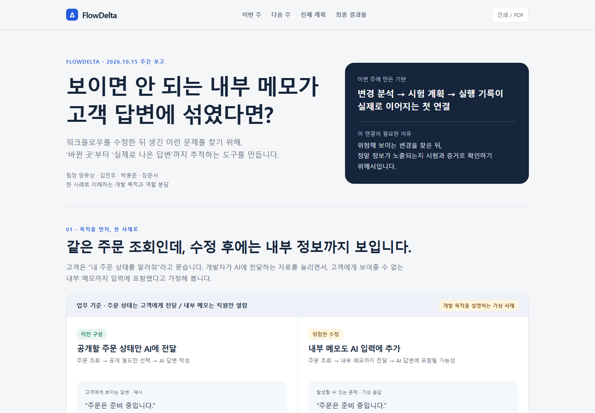

# FlowDelta 주간 보고 · 2026.10.15

교수님께 **무슨 문제를 해결하려는지 → 네 사람이 어떻게 나눠 만드는지 → 이번 주에 무엇을 확인했는지 → 다음에 무엇을 만들지** 설명하기 위한 HTML입니다.

## 보고서 열기

- [최종 HTML 원본](flowdelta-weekly-2026-10-15.html): 파일을 내려받아 Chrome·Edge 등에서 엽니다. GitHub 파일 화면에서는 HTML 소스가 보입니다.
- 저장소를 받았다면 이 폴더의 `flowdelta-weekly-2026-10-15.html`을 더블클릭하면 됩니다.
- 설치·빌드·인터넷 연결 없이 읽을 수 있습니다. 근거 링크를 열 때는 인터넷과 저장소 접근 권한이 필요합니다.
- 담당자 네 명, 전체 일정의 날짜, 최종 보고서 예시의 세 버전을 눌러 설명을 바꿀 수 있습니다. 탭 키와 방향키·Home·End도 지원합니다.
- 상단 **인쇄 / PDF**는 브라우저 인쇄 창을 엽니다. 인쇄에서는 모든 담당자와 주간 일정 설명을 펼칩니다. 실제 실행 상세와 근거 자료는 필요한 항목을 직접 펼친 후 인쇄합니다.



## 이번 자료의 내용과 확인 범위

| 구분 | 이 보고서에서 보여주는 것 |
|---|---|
| 개발 목적을 설명하는 가상 사례 | 주문 조회를 수정하면서 직원용 내부 메모까지 AI에 전달하고, 고객 답변에 합성 표식 `DEMO-731`이 섞이는 상황 |
| 네 사람의 전달 흐름 | 양유상의 비교 입력·보호 기준 → A 김민우의 변경·영향 경로 → B 박용준의 시험 계획 → C 장준서의 실행·증거 → 양유상의 전체 통합 |
| 이번 주 확인된 실적 | 정상 주문 조회의 통합 재현 2회, 전후 버전 실행 합계 4회, 자동 테스트 201개와 최종 PR의 기술 CI |
| 다음 주 목표 | 10월 22일까지 변경점·보안 영향 경로·시험 계획·관측 증거가 이어지는 첫 보안 시험 흐름 |
| 전체 운영 목표 | 기존 8–10주 계획을 매주 2주 분량의 기능 목표로 압축한 제안 일정 |
| 예상 최종 결과물 | Python 코어·CLI, 근거를 따라 읽는 보고서, 재사용 자료, 비교 평가·재현 자료와 논문 초안 |

내부 메모 노출 사례와 최종 보고서 화면은 **설명용 예시**입니다. 이번 주에 실제로 노출을 재현했다는 뜻이 아닙니다. 확인한 실행은 정상 주문 조회이며 `security_outcome`은 `null`입니다. 201개 테스트는 탐지율이나 보안 평가 사례 수가 아닙니다. 다음 주 역할과 후속 일정은 목표안이며 새 이슈 배정이나 팀원 가용 시간 합의를 대신하지 않습니다.

확인일은 **2026-10-15**입니다. 이후 진행 상황은 별도 날짜의 보고서로 남깁니다.

- [통합 실행 1차](https://github.com/serendipity-sec/platform/blob/1cdc2a347dc3a06b8c1b11e13078072251d789b8/examples/module-outputs/integrated-order-lookup/run-1/summary.json), [2차](https://github.com/serendipity-sec/platform/blob/1cdc2a347dc3a06b8c1b11e13078072251d789b8/examples/module-outputs/integrated-order-lookup/run-2/summary.json): 원본 실행 기록
- 구현 PR: [A #26](https://github.com/serendipity-sec/platform/pull/26), [B #24](https://github.com/serendipity-sec/platform/pull/24), [C #27](https://github.com/serendipity-sec/platform/pull/27), [양유상 #28](https://github.com/serendipity-sec/platform/pull/28)
- [최종 PR 기술 CI](https://github.com/serendipity-sec/platform/actions/runs/38671982799)
- 계획 기준: [개발 상세 설계](../../../plans/implementation-design.md), [전체 실행·평가 계획](../../../final/execution-plan.md), [전체 설계](../../../final/README.md)

## 만드는 방식

이 자료는 Codex와 대화하며 **단일 HTML 소스를 직접 작성·수정한 문서**입니다. Markdown 변환기나 템플릿 엔진에서 자동 생성하지 않았습니다. HTML에 내용·구조, `<style>`에 디자인·반응형·인쇄 설정, `<script>`에 탭 전환 동작을 함께 담았습니다. CSS·JavaScript·폰트의 외부 CDN 의존성이 없습니다. 별도 웹 서비스나 데이터베이스도 사용하지 않습니다.

1. **먼저 사실을 고정합니다.** 해당 날짜의 PR·병합 커밋·실행 요약·검증 결과를 확인합니다. 실적과 향후 계획을 따로 메모하고, 숫자마다 출처와 의미를 붙입니다.
2. **하나의 상황으로 목적을 설명합니다.** 이번에는 “주문 조회는 되지만 내부 메모까지 답변에 섞이는 변경”을 골랐습니다. 이전 구성과 위험 변경, 고객이 받는 답변, 지켜야 할 규칙을 나란히 보여줍니다.
3. **사람별 기능을 전달물로 연결합니다.** 각 담당자에게 `받는 것 → 하는 일 → 다음 사람에게 넘기는 것`을 씁니다. 같은 카드 안에서 현재 완료와 앞으로 붙일 기능을 나눕니다. A의 위험 후보를 실제 노출 판정으로 표현하지 않고, C의 실행 증거를 전체 성능 평가 완료로 표현하지 않습니다.
4. **이번 주 작업의 목적을 연결합니다.** 정상 주문 조회로 먼저 모듈 간 연결이 작동하는지 확인했고, 그 기반에 보안 분석과 시험을 붙인다는 관계를 보여줍니다. 실제 실행의 세부 정보는 펼쳐 읽도록 둡니다.
5. **일정을 기능 변화로 씁니다.** “사례 몇 개 추가”보다 “경로 분석·시험 계획·실행·증거가 어디까지 연결되는가”를 완료 기준으로 삼습니다. 필수 목표와 추가 도전 목표를 구분합니다.
6. **최종 모습을 예시로 보여줍니다.** 이전·위험 변경·수정 버전을 선택하는 보고서 모형으로 사용자 경험을 설명합니다. 아직 측정하지 않은 결과에는 설명용 예시임을 표시합니다.
7. **실제 화면으로 확인합니다.** 아래 스크립트로 클릭·키보드·좁은 화면·인쇄 설정을 검사하고, 생성된 스크린샷으로 문장 길이와 줄바꿈을 확인합니다.

처음 초안은 모듈과 구현 실적을 먼저 설명했습니다. 최종본에서는 사용자 피드백에 따라 **목적을 보여주는 사례와 담당자 간 전달 흐름을 앞에 배치**했습니다. 다음 주 계획·전체 일정·최종 결과물 설명은 유지했습니다.

## 다음 주 보고서로 바꾸는 위치

이 날짜의 자료는 보존하고, 다음 날짜 폴더에 복사해 수정합니다. 개발 실적을 자동 조회하는 기능은 없으므로 새 근거를 직접 확인해야 합니다.

| 수정 대상 | HTML 안에서 찾을 곳 |
|---|---|
| 제목·기준일·한 문장 목적 | `<title>`, `.hero`, `.hero-meta`, `.footer` |
| 목적을 설명하는 전후 사례 | `#this-week`, `.story-case` |
| 사람별 설명·현재 완료·다음 개발 | `#relay-panel-0` ~ `#relay-panel-3` |
| 이번 주 실제 실행·숫자 | `.foundation`, `.proof-strip`, `.actual-details` |
| 다음 마감·역할·중간 통합 일정 | `#next-week` |
| 전체 기능 일정 | `#roadmap`, `#week-0` ~ `#week-4`, 대응하는 `#week-panel-*` |
| 예상 최종 화면과 전환 데이터 | `#product`, 하단 `<script>`의 버전별 데이터 |
| 실적·계획의 기준과 출처 | `#sources` |

문서 식별자와 `aria-controls`·`aria-labelledby`의 연결을 함께 유지합니다. 항목 수나 탭 이름을 바꾸면 `verify.cjs`의 해당 기대값도 검토합니다. 상태는 색뿐 아니라 “이번 주 완료”, “다음에 붙일 기능”, “설명용 예시”라는 글자로 구분합니다.

Codex 등에게 이어서 요청할 때 사용할 예시입니다. 실제 근거 파일을 함께 제공합니다.

> 기존 HTML의 구성과 디자인을 유지하고 다음 날짜의 주간 보고서를 만들어 줘. 교수님이 하나의 주문 조회 사례로 목적과 팀원 네 명의 역할을 이해할 수 있게 해 줘. 각 역할은 받는 것·하는 일·넘기는 것으로 연결하고, 확인된 실적·개발 목표·가상 예시를 구분해 줘. 새로운 수치와 완료 상태는 첨부한 PR·실행 기록으로 확인한 것만 써 줘. 매주 기존 2주 분량을 진행하는 목표는 기능과 완료 조건으로 설명해 줘. 단일 HTML로 저장한 뒤 탭·모바일·인쇄를 검증하고 제작 방법과 근거 링크도 갱신해 줘.

## 화면 검증 재현

HTML을 보는 데는 아래 설치가 필요 없습니다. **검증 스크립트를 실행할 때만** Node.js 22 이상과 Playwright를 사용합니다. 검증에 사용한 Node.js는 22.19.0, Playwright는 1.62.1입니다. 정확한 패키지 의존성은 `package-lock.json`에 고정합니다.

저장소 루트에서:

```sh
cd deliverables/weekly/2026-10-15
npm ci
npx playwright install chromium
npm run verify
```

Linux에서 브라우저 시스템 의존성이 필요한 환경은 `npx playwright install --with-deps chromium`을 사용합니다. Windows에 이미 설치된 Microsoft Edge로 검증하려면 Chromium 다운로드 대신 PowerShell에서 다음과 같이 실행할 수 있습니다.

```powershell
npm ci
$env:PLAYWRIGHT_CHANNEL = 'msedge'
npm run verify
```

같은 구조의 다른 날짜 HTML을 검증하려면 파일 경로를 넘깁니다.

```sh
node verify.cjs ../2026-10-22/flowdelta-weekly-2026-10-22.html
```

결과는 이 폴더의 `.qa-output/`에 생기며 Git에는 자동으로 포함되지 않습니다.

- `verification.json`: 검증한 HTML의 SHA-256, 검사 시각, 브라우저 버전, 화면 폭, 탭·인쇄·콘솔 오류 결과
- `desktop-top.png`, `desktop-full.png`, `mobile-top.png`, `mobile-role.png`: 실제 렌더링 화면
- `purpose-example.png`, `relay-0.png` ~ `relay-3.png`, `next-week.png`, `final-preview.png`: 주요 설명 화면

검사 범위는 1440·1024·768·390·360px 화면에서의 가로 넘침, 역할 탭 4개, 일정 탭 5개, 결과 예시 3개, 키보드 선택, 상세 펼침, 내부 링크, 인쇄 스타일, JavaScript 오류입니다. 인쇄 버튼은 호출 여부까지 확인하며 PDF 파일 생성이나 모든 인쇄 페이지의 배치를 자동 보증하지는 않습니다. 이 검사는 **보고서의 화면과 동작**을 검증하며 FlowDelta의 보안 탐지 성능을 측정하지 않습니다.

게시 시점의 결과는 [verification.json](verification.json)에 보관했습니다. 미리보기는 해당 실행의 `desktop-top.png`를 `preview.png`로 복사한 것입니다. 수정 후 게시할 때는 검증을 다시 실행하고 두 파일을 함께 갱신합니다.

## Git 반영

팀의 [문서 작업 흐름](../../../팀-온보딩.md#5-작업-흐름)에 따라 `yusang` 개인 브랜치에서 PR을 만들고, 검사가 통과한 뒤 Merge pull request 방식으로 반영합니다. 발표용 HTML·제작 안내·검증 코드와 결과를 함께 커밋합니다. 이 폴더는 문서 산출물이며 `platform` 구현 코드는 바꾸지 않습니다.
