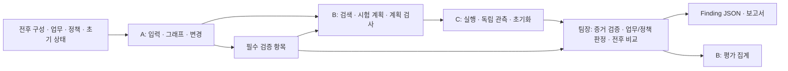

# FlowDelta 4인 역할·산출물·검토 기준

개정일: **2026-10-09, Asia/Seoul**. [상세 설계](README.md)와 [실행·평가 계획](execution-plan.md)을 구현 작업으로 구체화한다. **네 명 모두 핵심 모듈을 직접 구현한다**는 요청을 반영해 실행과 판정을 나누었다. 이름은 기존 표기인 **팀장·A·B·C**를 유지한다. 실제 사람 배정·가용 시간·일정 확약은 별도이며, 아래는 구현할 명세와 완료 기준이다. 구현·실험이 끝났다는 기록이 아니다.

## 1. 네 명이 각각 무엇을 만드는가

**A는 변경 분석기, B는 근거 검색과 시험 계획기, C는 실행기와 증거 수집기, 팀장은 독립 판정기와 결과 보고 기능을 만든다.** 네 영역 모두 제품이 동작하는 데 필요한 구현이다. 팀장은 판정 모듈의 구현자이면서 범위와 통합을 조정한다.

| 역할 | 쉽게 말하면 | 직접 구현할 핵심 | 다음 사람에게 넘기는 결과 |
|---|---|---|---|
| **A — 입력·그래프·변경 분석** | 무엇이 달라졌고 무엇을 확인해야 하는가 | 입력 검사, n8n 의미 해석, 보안 그래프, 변경·영향 분석, 필수 검증 항목 | 분석 결과·변경 근거·검증 항목 → B, C, 팀장 |
| **B — 지식·검색·시험 계획** | 어떤 근거로 어떤 시험을 할 것인가 | 카드 처리, 조건 기반 검색, 가설·계획 생성, 계획 검사, 검색 비교군 | 검증된 계획·미충족 항목·근거 → C, 팀장 |
| **C — 실행·관측·초기화** | 같은 조건에서 실행하면 실제로 무슨 일이 일어나는가 | n8n 실행 어댑터, 모의 서비스, 전후 실행, 독립 이벤트 수집, 상태 초기화 | 실행 기록·원시 증거·관측기 상태·비용 → 팀장 |
| **팀장 — 증거 검증·판정·보고** | 그 증거로 무엇을 결론 낼 수 있는가 | 증거 검사, 정책·정상 업무 판정, 검증 항목별 결과, 전후 비교, JSON·보고서 | Finding·업무 결과·미확인 목록 → 사용자, B의 집계기 |

각자 자신의 코드, 의미 있는 검증, 사용 안내, 관련 데이터와 비교 실험까지 책임진다. 공통 데이터·통계·문서 작업은 아래 소유자 표로 나눈다. 파일 수나 커밋 수로 일을 똑같이 나누는 대신 구현 난도, 실험 대기, 수작업, 검토 시간을 파일럿에서 함께 측정한다.

## 2. 같은 업무 하나로 네 역할 이해하기

설명용 업무는 **고객의 배송 상태 안내**다. 한 비교쌍에서는 업무 목적·평가 정책·초기 주문 상태를 동일하게 적용한다. 정책은 정확한 상태 안내를 요구하고 보호 주문의 변경을 제한하되, 허용된 상담 기록은 남길 수 있게 정의한다. 이는 실제 기업 정책이나 확인된 취약 이력을 뜻하지 않는다.

1. **A:** 이전·이후 구성에서 조회 경로와 쓰기 권한 등 달라진 조건을 찾는다. 정상 응답, 보호 주문의 변경, 허용된 상담 기록을 각각 확인해야 한다는 항목을 만든다.
2. **B:** 변경 조건에 맞는 검토된 카드를 찾고, 등록된 실험실 시험 형식으로 계획을 만든다. 정상 대조와 필수 항목의 대응도 검사한다.
3. **C:** 같은 초기 내용을 복제해 양쪽을 실행한다. 응답, 서비스의 쓰기 이벤트, 실행 전후 상태, 관측기 정상 여부와 초기화 결과를 수집한다.
4. **팀장:** 원시 증거가 올바른 실행에 속하는지 검사하고, 보호 주문의 변경과 허용된 상담 기록을 구별하는 판정 코드를 실행한다. 업무 성공과 정책 위반을 별도 결과로 내고 전후를 비교한다.

화살표는 결과가 전달되는 순서다. **개발은 동시에 시작한다.** A는 작은 workflow, B는 예시 그래프, C는 사람이 만든 plan, 팀장은 사람이 검토한 합성 증거 묶음으로 먼저 개발한다. 모의 자료로 확인한 것은 인터페이스와 판정 로직이며 실제 n8n 실행 검증과 구별한다.

## 3. A — 입력·그래프·변경 분석

**받는 것:** 전후 workflow, 하위 의존성, 환경·권한·버전, 업무·정책·초기 상태의 참조.

**만드는 코드:** 입력 로더·구조 검사, n8n 어댑터와 의미 계약, 그래프 구성, 객체 대응과 변경·영향 계산, 필수 검증 항목 생성.

| 작업 ID | 구현 범위 | 완료를 확인할 증거 |
|---|---|---|
| A-01 입력 묶음 | Snapshot·ComparisonCase, 공통 ID·해시·버전, task/policy의 구조 검사, manifest | 누락·깨진 참조·비교 조건 불일치를 구분한다. 원본·변환본·계열을 추적한다. |
| A-02 n8n 의미 | 지원 node/typeVersion/operation과 표현식, 제어·데이터·지시 영향·권한·보호 관계 | 지원 동작을 C의 실제 정상 실행과 비교한다. 미지원 부분에 임의 의미를 부여하지 않는다. |
| A-03 변경·영향 | 전후 객체 대응, 하위 의존성·환경 변화, 경로와 정책 조건의 연결 | 의미 없는 표시 변경과 실행 의미 변경을 구분한다. 대응이 모호하면 이유를 남긴다. |
| A-04 필수 항목·정적 비교군 | VerificationObligation 정의, B0 단순 규칙·B1 전체 분석 비교, coverage | 검색 결과가 없어도 필수 항목이 남는다. 각 항목을 정책·업무·원본 위치로 되짚는다. |

**첫 제출:** 한 계열의 전후 입력과 출처·변환 기록, 지원 의미 계약, 정상 변경 한 건의 분석 JSON, 해석 불가 한 건의 처리 결과.

**책임 경계:** A는 정책의 입력 형식과 분석에 필요한 조건을 읽는다. 자연어 정책 근거의 정리는 B, 실행 증거에 적용하는 최종 판정 규칙의 구현은 팀장이다. A의 경고는 위험 후보이며 실제 효과의 확정 증거가 아니다. 필수 항목의 원본 정의는 보존하고 실행·판정 결과를 별도 연결한다.

## 4. B — 지식·검색·시험 계획

**받는 것:** 변경·영향 경로·필수 항목, 업무·정책 근거, 검토된 공개 자료, C의 등록 시험 형식, 팀장의 관측·판정 요구사항.

**만드는 코드:** 카드 변환·검사, 검색과 적용 조건 필터, 가설·계획 구성, 출력 검증, 검색 비교군과 공통 집계 스크립트.

| 작업 ID | 구현 범위 | 완료를 확인할 증거 |
|---|---|---|
| B-01 지식 입력 | ScenarioCard 형식·출처·버전·이용 조건·중복 검사, 업무·정책 근거표 | 원문 주장과 연구자 가정을 구분한다. 정책에 없는 예외를 임의로 만들지 않는다. |
| B-02 검색 | 키워드·벡터 검색, 제품·버전·경로·권한 조건 필터, 검색 없음 처리 | 문장 유사성과 적용 가능성을 구분하고 검색 근거를 보존한다. |
| B-03 계획·검사 | Hypothesis·TestPlan, 등록 템플릿 선택·파라미터 바인딩, 참조·범위·예산 검사 | 없는 노드·허용되지 않은 자원·누락 필수 항목을 발견한다. 거부/미충족 이유를 출력한다. |
| B-04 비교군·집계 | B2 텍스트 RAG·B3 그래프+고정 시나리오·B4의 선택/생성, 집계 코드 | 같은 KB·모델·예산을 기록한다. 결과 표에서 원시 Finding과 분모를 추적한다. |

**첫 제출:** 소수의 검토된 카드, 업무·정책 출처표, 유효한 수동 plan 한 건, 부적합 plan 거부 예시, 계획에서 다루지 못한 항목 목록. 예시 그래프로 시작할 수 있다.

**책임 경계:** LLM이 임의 실행 코드나 최종 판정 규칙을 작성·교체하지 않는다. 필수 항목을 계획에 대응시키되 원본 정의를 삭제하지 않는다. C가 실행 직전 허용 범위를 다시 검사한다. 집계는 판정을 새로 만들지 않고 팀장의 결과와 독립 정답을 정해진 산식으로 비교한다. 최종 정답은 검색 모듈에서 접근하지 못하게 한다.

## 5. C — 실행·관측·초기화

**받는 것:** 비교 입력, 검증된 plan, 필수 항목의 관측 요구, 정상 업무 입력, 합성 초기 상태와 실행 한도.

**만드는 코드:** 실행 환경 구성, n8n 호출 어댑터, 모의 서비스와 관측기, 전후 실행 드라이버, 초기화와 자원 정리, 실행 비용 기록.

| 작업 ID | 구현 범위 | 완료를 확인할 증거 |
|---|---|---|
| C-01 환경·상태 | 고정한 n8n 버전, 팀 관리 fixture, 서비스 어댑터, 초기 상태 복제·초기화 | 양쪽이 같은 초기 내용에서 별도로 시작한다. 초기화 실패·잔여 상태를 기록한다. |
| C-02 실행 드라이버 | 등록 계획 수용, 입력·자원·예산 재검사, 정상 대조·전후 실행, 중단·시간초과 처리 | 다른 case의 자원을 쓰지 않는다. 미시작·실패·완료를 구분하고 모든 시도를 기록한다. |
| C-03 독립 관측 | 수신·쓰기 이벤트, 전후 상태, 관측기 건강 상태·수집 구간, 증거 저장 | 대상의 성공 주장과 서비스의 실제 효과를 구분한다. 대상이 증거·관측기 설정을 수정할 수 없다. |
| C-04 반복·재현 | 고정 호출 재생과 실제 모델 실행, B5 고정 회귀 검사, 시간·호출·토큰·초기화 비용 | 새 run ID로 재실행한다. 실행 방식·설정과 실패 비용을 보존하고 다른 팀원이 재현한다. |

**첫 제출:** 수동 plan으로 정상 업무 한 건을 실행한 기록, 관측 이벤트, 초기 상태 복제·초기화 기록, 관측기 실패와 미실행의 원시 기록, 등록 시험 형식.

**책임 경계:** C는 ExecutionRun·EvidenceEvent와 상태 자료를 낸다. **Finding과 최종 정책·업무 판정은 팀장이 구현한다.** C가 보고한 실행 종료만으로 검증 통과가 되지 않는다. 실제 효과를 관측하는 서비스 어댑터는 C가 구현하고, 어떤 증거가 충분한지는 팀장과 먼저 합의한다.

독립성은 작성자가 다르다는 뜻만으로 성립하지 않는다. C와 팀장은 분석·제어, 시험 대상 실행, 독립 증거의 권한을 나누고 대상이 관측 기록·판정 기준을 덮어쓸 수 없는지 확인한다. 해시는 자료의 동일성 확인에 쓰며 그 자체로 기록의 진실성을 보장하지 않는다.

## 6. 팀장 — 증거 검증·정책/업무 판정·전후 보고

**받는 것:** 비교 조건, 전체 필수 항목, plan과 실행 대응, 원시 이벤트·상태, 관측기 건강 상태, 정상 업무 조건과 정책.

**만드는 코드:** 증거 로더·유효성 검사, 업무·정책 assertion, 항목별 결과 장부, 전후 비교, Finding·보고서 생성.

| 작업 ID | 구현 범위 | 완료를 확인할 증거 |
|---|---|---|
| L-01 증거 검사 | case/run/snapshot 참조, 수집 출처·구간·완전성, 관측기 상태·초기화·증거 해시 검사 | 다른 실행의 증거, 잘못된 초기 상태, 누락 관측을 정상 결과로 수용하지 않는다. 근거 부족 이유를 남긴다. |
| L-02 정책·업무 판정 | P1·P2의 지원 규칙, 보호 자원·허용 부수 효과, 구조화된 정상 완료 조건 | 같은 증거와 규칙 버전에서 같은 결과를 낸다. 업무 성공과 정책 위반을 별도로 기록한다. |
| L-03 항목·전후 비교 | 전체 VerificationObligation 결과 장부, 실행 판정과 변경 판정의 분리 | 미실행·미지원·관측 실패 항목도 남는다. 기존 위험과 새로 관측된 위험을 구분한다. |
| L-04 결과·보고 | Finding JSON, 증거 링크·지원 범위·업무 결과·한계를 보이는 Markdown 보고서 | 화면이 판정을 다시 계산하지 않는다. 표의 수치·상태를 원시 자료로 되짚는다. |

**첫 제출:** 합성 증거 묶음과 기대 판정표, 증거 검사·기본 판정 코드, 미실행/관측 실패를 보이는 JSON·보고서 한 건. C의 환경 완성을 기다리지 않고 시작한다. 합성 증거에서의 정확성을 실제 workflow 탐지 성능으로 보고하지 않는다.

### 판정기에서 먼저 확인할 사례

| 입력 증거 상황 | 유지할 결과·경계 |
|---|---|
| 필수 시험을 시작하지 않음 | `NOT_RUN`; plan에 없다는 이유로 항목이 사라지지 않음 |
| 실행했지만 필요한 관측이 누락됨 | 필요한 결론은 `INCONCLUSIVE`; 누락과 영향 범위를 기록 |
| 보호 자원에 실제 금지 효과를 뒷받침하는 충분한 독립 기록이 있음 | `EFFECT_CONFIRMED`; 관련 이벤트·정책 조건 연결 |
| 대상 통제의 거부와 필요한 효과 관측이 확인됨 | `BLOCKED_BY_TARGET_CONTROL`; 실험실 방화벽 차단과 구별 |
| 시도는 보였으나 실제 효과를 입증하지 못함 | `ATTEMPT_OBSERVED`와 증거 한계; 효과 확인으로 승격하지 않음 |
| 필요한 시험·관측이 완료됐고 위반 효과가 보이지 않음 | `NO_VIOLATION_OBSERVED`; 해당 시험 범위의 결과 |
| 허용된 상담 기록만 추가됨 | 허용 부수 효과로 처리하며 정상 업무 성공 여부도 별도로 검사 |
| 한쪽 실행의 조건·관측이 비교 가능하지 않음 | 해당 실행의 확인된 사실은 보존하고 변경 비교는 미해결로 표시 |

이는 최종 상태 기계 전체를 대신하는 요약이 아니다. 여러 증거가 충돌하거나 일부만 확보됐을 때의 우선순위는 [상세 설계](README.md#실행-검증과-변경-원인-확인)에 맞춰 명세화한다. 필요한 증거가 충분한 확인 결과까지 다른 무관한 관측 실패로 지우지 않는다. 반대로 불완전한 관측으로 효과가 없었다고 결론 내리지 않는다.

**추가 조정 책임:** 주요 계약·범위·평가 동결과 통합 관문을 관리한다. 각 담당자는 자기 모듈의 기술 검토·문서 초안을 준비한다. 팀장의 구현 시간을 확보하기 위해 큰 웹 UI와 모든 PR의 추가 팀장 승인 절차는 두지 않는다. 팀장의 판정 코드도 다른 팀원의 검토를 받는다. 시간 배분 비율은 실제 가용 시간과 작업 측정 전에는 고정하지 않는다.

## 7. 모듈 경계와 공통 계약

아래는 구현할 데이터 계약의 의미다. [JSON 예시](contracts.example.json)는 미구현 설계 예시이며 완성된 API나 확정 스키마가 아니다. 구조 검사는 입력 형태, 계획 검사는 실행 적격성, 증거 검사는 결론의 근거를 각각 확인한다.

| 경계 | 전달 자료 | 생산자 / 소비자가 함께 확인할 것 |
|---|---|---|
| 입력 → A | Snapshot·ComparisonCase·TaskContract·Policy·InitialState 참조 | 출처·해시·지원 버전, 한 비교쌍의 공통 업무·정책·초기 상태 |
| A → B | 그래프·ChangeSet·VerificationObligation | 실제 객체 ID·원본 위치·지원 상태·정책 조건·미확인 경로 |
| B → C | Hypothesis·TestPlan·카드/항목 참조 | 등록 형식·허용 자원·정상 대조·관측 요구·예산·미충족 항목 |
| A·B → 팀장 | 전체 항목 정의·계획 대응·고정 비교 조건 | plan에서 누락한 항목도 전체 장부에 유지, 정의와 결과 분리 |
| C → 팀장 | ExecutionRun·EvidenceEvent·상태·관측기/초기화 기록 | case/run/snapshot 대응·수집 구간·출처·관측 범위·누락 이유 |
| 팀장 → B·사용자 | 항목별 결과·Finding·업무 결과·증거 참조 | 판정 규칙 버전·비교 가능성·지원/미실행/판단 불가·관측 분모 |
| 전원 → 집계 | 방법·계열·사례·실행 ID, 설정 해시, 시간·비용 | 독립 단위와 반복 구분, 실패 비용, 중복 없는 분모 |

### 최소 공통 규칙

- 모든 객체는 자체 ID, schema version, 관련 case/snapshot/run 참조와 출처를 갖는다. 객체마다 필요한 필드를 구체화하고 모든 ID를 무조건 복제하지 않는다.
- 재실행에는 새 run ID를 부여하고 원시 자료를 덮어쓰지 않는다. 생성·실행·판정·KB 버전과 설정 해시를 기록한다.
- A가 정의한 필수 항목의 전체 집합, B의 계획 대응, C의 실행 대응, 팀장의 판정 결과를 이어서 누락 여부를 확인한다.
- 지원 상태·실행 상태·정책 판정·정상 업무 결과·변경 비교는 서로 다른 축이다. 예를 들어 업무는 성공했지만 정책 위반이 확인될 수 있다.
- 검색 실패, 계획 거부, 실행 실패, 관측 실패를 한 종류의 탐지 실패로 합치지 않는다. 오류 위치와 재실행 가능한 조건을 남긴다.
- 필드 이름이나 의미가 바뀌면 생산자·소비자가 함께 검토한다. 예시 입출력과 소비자 계약 검증을 같은 변경에 포함한다.

### 병렬 개발을 위한 경계별 표본

G0에서 한 사례 ID를 사용하는 입력 묶음, 분석 JSON, 수동 plan, 실행/증거 표본, 기대 판정표를 함께 둔다. 성공 표본뿐 아니라 미지원 입력, 부적합 plan, 관측 누락, 미실행 표본도 포함한다. 각 모듈은 생산자 표본을 출력하고 소비자 표본을 읽는 작은 확인 명령을 갖춘다. 내부 함수나 다른 모듈의 DB 테이블에 직접 의존하지 않는다.

## 8. 구현 파일과 명령을 나누는 기준

아래는 **platform 저장소에 만들 디렉터리 제안**이며 현재 존재하거나 명령이 실행된다는 뜻이 아니다. 팀원 숙련도에 맞춰 이름·세부 라이브러리를 정하되 경계는 유지한다. MVP는 하나의 Python 코어와 격리 실행·관측 구성으로 시작하고, 역할 수 때문에 마이크로서비스 네 개를 만들지는 않는다.

| 제안 경로 | 소유자 | 포함할 것 |
|---|---|---|
| `src/flowdelta/analysis/` | A | 입력 해석, n8n 의미, 그래프·변경·필수 항목 |
| `src/flowdelta/knowledge/`, `planning/` | B | 카드·검색, 계획 생성·검사 |
| `src/flowdelta/execution/`, `lab/` | C | 실행 어댑터, fixture 서비스, 관측·초기화 |
| `src/flowdelta/verification/`, `reporting/` | 팀장 | 증거 검사, 정책/업무 assertion, 비교·보고 |
| `src/flowdelta/contracts/` | 객체별 생산자 | A 입력/분석, B 카드/계획, C 실행/증거, 팀장 판정/보고 스키마 |
| `src/flowdelta/cli/` | A 골격 + 각 명령 소유자 | 공통 설정·종료 상태, 해당 모듈을 호출하는 명령 |
| `benchmarks/` | A·B·C·팀장 분담 | 출처·계열 manifest, KB, 실행 설정, 독립 라벨 접근 분리 |
| `evaluation/` | B 집계 + 각 방법 소유자 | 비교군 설정, 원시 결과 집계·표/그림 |
| `tests/` | 각 모듈 구현자 | 의미 계약, 모듈 경계, 실행 실패·판정 실패, 통합 사례 |

명령의 초기 제안은 **입력 확인·분석(A) → 계획(B) → 실행(C) → 검증·보고(팀장)**다. 전체 흐름 명령은 얇게 연결하고 각 단계의 결과를 파일로 남겨 독립 재실행할 수 있게 한다. 함수명·명령명은 G0에서 결정한다. 네 명 모두 자기 경계의 CLI 연결과 스키마를 구현하며, A에게 전체 코드 기반 제작을 맡기지 않는다.

## 9. 데이터·평가·공통 작업의 주 담당

| 산출물 | 주 담당 | 함께 해야 할 일 |
|---|---|---|
| 연구 질문·지원 범위·완료 기준 | 팀장 | 전원이 비용·제약·검증 근거 제출 |
| 원본 목록·계열·변환 이력·비교 manifest | A | B 출처/이용 조건, C 실행 가능성, 팀장 판정 가능성 검토 |
| 업무·정책 근거와 내용 초안 | B | A 표현 범위, C 관측 가능성, 팀장 assertion·예외 검토 |
| 합성 초기 상태·정상 실행·서비스 fixture | C | B가 업무 사실·허용 부수 효과, 팀장이 정상 완료 판정 명세 제공 |
| 정책·업무 assertion과 기대 결과 표본 | 팀장 | B가 정책 근거, C가 관측 명세, A가 의미 일치 검토 |
| 필수 검증 항목 정의 | A | B 계획 대응, C 관측, 팀장 결과 장부 검토 |
| 카드·KB·검색 설정·중복 목록 | B | A 적용 조건, 팀장 평가 누수 절차 검토 |
| 실행·독립 원시 증거·초기화·비용 | C | 팀장 증거 적격성, A 의미 계약 검토 |
| Finding·정상 업무 결과·최소 보고서 | 팀장 | A 원인 변경, B 정책 의미, C 실행·증거 참조 확인 |
| 분할·평가 동결 목록 | 팀장 관리 | A 계열 중복 도구, B KB·계획 설정, C 실행 환경, 팀장 판정기 버전을 함께 동결 |
| 정적 비교군 B0·B1 | A | 의미 확인에 C의 실행 표본 활용. 자체 분석 결과를 독립 정답으로 취급하지 않음 |
| 검색·계획 비교군 B2·B3 및 B4 선택/생성 | B | 동일 입력·KB·예산과 필수 항목 처리 기록 |
| B4 실행 및 고정 회귀 비교군 B5 | C | 팀장이 동적 결과의 공통 판정기, B가 공통 산식 적용 |
| 외부 도구 지원 범위 | A 정리 | B 출처, C 동적 실행 범위. 미지원을 일반 미탐과 구분 |
| 지표·집계·표/그림 | B | A 계열·분모, C 원시 비용, 팀장 상태와 통계 해석 교차 검토 |
| 설치·실행 환경·새 환경 재현 안내 | C | 각자 자기 모듈의 설정·실패·사용 설명 제공 |
| 논문·발표·공개 안내 | 팀장 통합 편집 | 전원이 담당 방법·결과·한계 초안 작성 |

**정답 데이터 제작은 전원 공동 작업**이다. 사례마다 라벨 초안 작성자 1명, 각자 먼저 판단하는 검토자 2명, 불일치 조정자 1명을 지정한다. 제작 참여 이력을 남기며 완전한 외부 맹검이라고 주장하지 않는다. 초안 작성자가 팀장이어도 같은 규칙을 적용한다.

공개 n8n 원본·실제 Git 이력·공개 업무 benchmark는 [입력·데이터 기준](input-and-data.md)에 따라 이용한다. 운영자 사례는 동의받아 확보한 경우에만 추가한다. 현재 후보의 존재를 확인한 것과 실행·정답까지 갖춘 데이터셋 확보는 구별한다.

## 10. 현실적인 사례를 함께 만드는 순서

1. **B:** 업무 목적·정책 원문·정상 완료 조건·허용 예외를 정리하고 연구자 가정을 표시한다.
2. **A:** 계열 ID, 전후 원본, 실제 변경/연구자 변형, 하위 의존성, 지원 범위와 변환 이력을 연결한다.
3. **C:** 합성 초기 상태와 실행·관측·초기화 조건을 구현한다.
4. **팀장:** 정책·정상 업무 assertion, 필요한 증거와 판정 불가 조건을 구현한다.
5. **사례별 검토자:** 분석기 경고와 별개로 원본 의미·정책·독립 실행 근거를 검토해 정답을 확정하거나 판단 불가로 남긴다.

최종 평가 자료는 개발/검증 자료와 접근·시점을 구분한다. 방법·설정을 동결한 뒤 최종 정답 작성·집계에 접근하며, KB·프롬프트·검색·판정 규칙 튜닝에 사용하지 않는다. B의 집계 코드는 모의 결과와 개발셋으로 먼저 검증한다. 최종 결과를 보고 방법을 바꾸면 해당 자료를 개발셋으로 전환하고 새 평가셋을 마련하거나 탐색적 결과로 한정한다.

업무 요청 수·workflow 계열 수·비교쌍 수·실행 수는 별도로 센다. 30계열·120쌍·unknown 20개는 기존 초기 가정이며 네 명에게 기계적으로 4등분할 확보 수가 아니다. 먼저 대표 사례 작성 시간과 실행 변동성을 측정해 규모를 정한다.

## 11. 네 명이 바로 시작할 첫 작업

| 역할 | 처음 구현할 작은 단위 | 다른 모듈 없이 쓰는 입력 | 첫 연결 상대 |
|---|---|---|---|
| A | 한 계열의 입력 검사·기본 그래프·변경 JSON | 작은 전후 workflow와 사람이 검토한 의미 표 | B가 분석 JSON을 읽고 팀장이 항목을 읽음 |
| B | 카드 로더·조건 필터·수동 plan 검사 | 예시 그래프·항목·등록 시험 명세 | C가 유효 plan 수용, 팀장이 항목 대응 확인 |
| C | 정상 workflow 실행·상태 복제·관측 이벤트 | 수동 plan과 합성 초기 상태 | 팀장이 증거를 읽고 A가 의미를 대조 |
| 팀장 | 증거 검사·기본 assertion·항목 장부·보고 | 합성 실행/증거 표본과 기대 판정 | C의 실제 기록으로 표본 교체, B의 집계와 연결 |

첫 제출 자료에는 **입력 예시, 실행/확인 명령, 출력 예시, 정상 및 의미 있는 실패 사례, 미지원 범위**를 함께 넣는다. 이 자료를 다른 팀원이 자기 환경에서 읽거나 실행할 수 있어야 인계가 끝난다. 문서 한 장이나 각자 화면 시연만으로 통합 완료를 처리하지 않는다.

## 12. 통합 관문과 완료 기준

날짜 대신 산출물로 진행을 판단한다. [10주 계획](execution-plan.md)의 주차는 상대 주차의 초기 목표다.

| 관문 | A | B | C | 팀장 | 전체 완료 기준 |
|---|---|---|---|---|---|
| G0 계약 맞추기 | 전후 입력·의미·항목 표본 | 카드·수동 plan·거부 표본 | 등록 형식·실행/증거 표본 | assertion·기대 판정표 | 같은 case ID·정책·상태·스키마로 서로의 자료를 읽음 |
| G1 정상 업무 한 건 | 원본·그래프·필수 항목 | 고정 plan·정상 대조 | 실제 실행·독립 기록·초기화 | 실제 증거로 업무/정책 판정 | 정상 업무가 성공하고 결과에서 증거까지 추적됨 |
| G2 두 업무의 전후 연결 | 변경·영향·미지원 | 전후 시험·미충족 항목 | 두 버전 실행·관측 실패 기록 | 전후 Finding·항목 전체 장부 | 기존/새 위험·미실행·관측 실패를 구분하는 공통 결과 |
| G3 검색·계획 자동화 | 경로·coverage | RAG·생성·검사·검색 비교군 | 수동/자동 plan 공통 실행 | 동일 판정기·보고 적용 | 자동화 여부가 판정 기준을 바꾸지 않음 |
| G4 파일럿·동결 | 계열·의미·정적 비교군 | KB·계획·집계·설정 | 변동성·시간·동적 비교군 | 판정 규칙·분할·통계 계획 | 규모·반복·예산·버전·지원 범위를 근거로 동결 |
| G5 평가·재현·공개 준비 | 정적 결과·새 입력 안내 | 검색 결과·집계·출처 | 원시 실행·새 환경 재현 | 결과·오류 분석·한계 보고 | 다른 팀원이 새 지원 사례를 연결하고 연구 결과를 재현 |

G0부터 네 모듈을 병행한다. G2까지는 두 업무의 연결을 우선하고, 대규모 카드 수집·웹 UI·여러 플랫폼 지원은 이후에 판단한다. 목표가 지연돼도 비교군·정상 업무·독립 증거·정답 분할은 완료 기준으로 유지한다.

## 13. 검토와 작업량 조정

기본 순서는 **작성자 자체 확인 → 동료 기술 검토 → 주요 통합 관문 공동 확인**이다. 팀장은 범위·계약·평가 설정이 바뀌는 결정을 조정한다. 합의한 계약 안의 모든 작은 수정에 추가 팀장 승인을 요구하지 않는다. 구현 저장소의 동료 1명 승인, 문서 저장소의 게시 방식은 기존 온보딩 규칙을 따른다.

| 구현 산출물 | 기본 동료 검토 | 소비자가 추가 확인할 경계 |
|---|---|---|
| A 입력·그래프·변경 | C | B의 경로 해석, 팀장의 항목 장부 |
| B 지식·계획 | A | C 실행 적격성, 팀장 정책·증거 요구 |
| C 실행·증거 | 팀장 | A의 실제 n8n 의미와 관측 결과 일치 |
| 팀장 판정·보고 | B | C의 증거 출처·상태 해석, A의 변경 근거 |

팀장도 자기 판정 코드와 연구 해석을 단독 승인하지 않는다. 인간 검토의 역할 분리와 실행 시스템의 독립 관측은 별도 조건으로 확인한다. 모든 구현자는 자기 산출물의 정상·실패 확인 결과와 남은 제약을 검토자에게 전달한다.

| 부담이 커진 곳 | 먼저 조정할 범위 | 유지할 핵심 |
|---|---|---|
| A 의미 해석 | 실제 후보에 필요한 node/operation부터 지원 | 원본 의미 대조·미지원 표시·coverage |
| B 검색·생성 | 작은 검토 KB·고정 템플릿으로 시작 | 출처·적용 조건·계획 검사·항목 보존 |
| C 실행 환경 | 한 환경·팀 관리 fixture·낮은 동시성 | 독립 관측·초기화·실행 실패 기록 |
| 팀장 판정·통합 | P1·P2와 구조화된 업무 조건, JSON·Markdown 보고 | 증거 적격성·정상 업무·미실행/미확인 보존 |
| 공통 데이터·평가 | 대표 계열부터 완성하고 작성 시간을 측정 | 출처·독립 검토·계열 분할·동일 비교 조건 |

작업을 옮길 때는 작은 산출물 단위로 소유자·입출력·인계 기준을 남긴다. 팀장에게 남은 구현과 편집을 전부 넘기는 방식으로 해결하지 않는다. 논문은 각자가 담당 방법·결과·한계 초안을 작성하고 팀장이 연결한다.

## 14. 기여 증거와 다음 결정

| 역할 | 남길 구현 기여의 증거 |
|---|---|
| A | 입력·의미·그래프·변경 코드, 원본/변환 기록, 정적 비교군, 지원·실패 검증 |
| B | 카드·검색·계획·검사 코드, 정책 근거, 검색 비교군·집계 코드, 오류 분석 |
| C | 실행·서비스·관측·초기화 코드, 원시 실행·비용, 동적 비교군, 재현 기록 |
| 팀장 | 증거 검사·assertion·비교·보고 코드, 판정 경계 검증, 계약·동결·통합 결정 |
| 전원 | 소비자 인계, 동료 검토, 사례별 정답 검토, 담당 문서·논문 초안 |

**이번에 구체화한 것:** 네 개의 핵심 구현 영역, 역할별 4개 작업 묶음, 데이터와 평가의 소유자, 모듈 전달 계약, 첫 제출물, 여섯 통합 관문.

**착수 때 정할 것:** A·B·C 실제 배정, 개인별 주당 가용 시간, 첫 두 사례, n8n 버전·지원 operation, 사용할 실행 환경·모델·예산, 스키마/명령 이름. A는 정적 분석·자료구조, B는 검색·LLM 출력 검사, C는 실행 환경·관측·재현, 팀장의 기술 역할은 백엔드 판정 로직·검증에 대한 경험과 관심을 참고한다. 필요하면 사람 배정을 바꾸되 네 기술 영역은 유지한다.

**지금 할 일:** 한 사례의 G0 표본을 같이 읽고 네 명이 각자의 첫 작업을 시작한다. 다음 합류 지점은 네 프로그램의 입력·출력 연결이며, 그 뒤 실제 정상 업무 한 건으로 G1을 확인한다.
