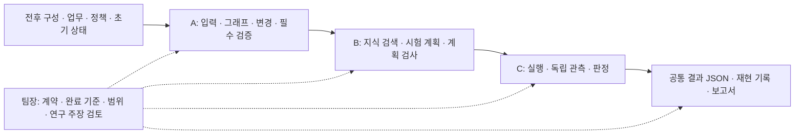

# FlowDelta 4인 역할·산출물·검토 기준

개정일: **2026-10-09, Asia/Seoul**. [상세 설계](README.md)와 [실행·평가 계획](execution-plan.md)을 구현 책임으로 구체화한 문서다. 사용자의 요청에 따라 **팀장·A·B·C**로만 표기한다. 실제 이름과 개인별 가용 시간은 배정하지 않는다. 아래 내용은 역할과 완료 기준이며, 구현 완료나 측정 실적을 뜻하지 않는다.

## 1. 이번에 정하는 운영 방식

**팀장은 직접 구현할 범위를 작게 잡고, 세 담당자의 결과 검토·통합 확인·연구 방향 조정에 시간을 먼저 배정한다.** A·B·C는 서로 연결되는 핵심 모듈을 하나씩 끝까지 책임진다. 데이터셋·평가·사용 설명도 해당 모듈의 작업에 포함한다.

| 역할 | 한 문장으로 설명 | 직접 만드는 핵심 결과 | 반드시 확보할 검토 시간 |
|---|---|---|---|
| **팀장** | 무엇을 어디까지 만들고, 어떤 근거로 완성이라 할지 조정한다 | 공통 계약·완료 기준의 승인 기록, 설계 결정 기록, 얇은 통합 보고서 템플릿 | A·B·C의 주요 산출물, 통합 결과, 연구 주장 검토 |
| **A — 입력·그래프·변경 분석** | 전후 구성에서 보안상 달라진 부분과 확인할 항목을 찾는다 | 입력 검사, n8n 의미 계약, 그래프·변경·영향 분석, 필수 검증 항목 | B의 경로·조건 사용, C의 실제 n8n 동작과 의미 일치 |
| **B — 지식·검색·시험 계획** | 바뀐 조건에 맞는 참고 사례를 찾아 실행 가능한 시험 계획을 만든다 | 출처가 있는 카드, 검색, 가설·계획 생성, 계획 검증, 공통 집계 스크립트 | C의 계획 소비·상태 구분, 데이터 출처·정답 누수 점검 |
| **C — 실행·관측·증거 판정** | 같은 조건에서 전후 버전을 실행하고 실제 효과를 증거로 확인한다 | 격리 실행, 상태 초기화, 정상 업무 검사, 독립 관측, 전후 판정 | A의 의미 계약, B의 실행 파라미터·관측 조건 |

이전 역할안의 D에 모여 있던 데이터셋·평가·CLI·보고서 작업은 이 문서의 책임표에 따라 분배한다. 팀장이 그 묶음을 전부 인수하지 않는다. 작업량은 파일 수보다 구현 난도·실험 대기·검토·수작업 시간을 합쳐 판단한다.

## 2. 하나의 업무로 네 역할 이해하기

예시는 고객의 배송 상태를 안내하는 업무다. 업무 목적·평가 정책·초기 주문 상태를 한 비교쌍에서 같게 두고, 이전·이후 워크플로우를 비교한다. 설명용 예시이며 실제 운영 데이터나 확인된 취약 이력을 뜻하지 않는다.

1. **팀장**은 “배송 상태 안내는 성공해야 하고, 허용되지 않은 주문 수정은 없어야 한다”는 완료 기준과 이번에 지원할 n8n 동작을 검토한다.
2. **A**는 두 구성에서 조회·쓰기 권한과 데이터 경로가 어떻게 달라졌는지 분석한다. 정상 안내와 보호 주문의 상태를 확인해야 한다는 검증 항목도 만든다.
3. **B**는 관련 원리와 적용 조건이 있는 카드를 찾아, 등록된 실험실 시험 형식에 맞는 계획을 만든다. 계획이 실제 노드·권한·검증 항목을 참조하는지 검사한다.
4. **C**는 같은 초기 상태를 복제한 환경에서 양쪽을 실행한다. 정상 응답, 독립적인 상태 기록, 초기화 결과를 묶어 전후 판정을 만든다.
5. **팀장**은 근거가 충분한지, 기존 위험인지 새로 관측된 위험인지, 미지원·관측 실패를 결론에서 빠뜨렸는지 확인한다. 오류는 해당 모듈 담당자가 수정한다.

화살표는 산출물의 전달 순서다. 개발은 계약 예시와 임시 입력을 공유해 병행한다. A가 모든 분석을 완성해야 B·C가 착수할 수 있는 구조로 만들지 않는다.

## 3. 팀장 — 작은 구현 범위와 명확한 검토 책임

### 직접 책임지는 일

- **범위 결정:** 연구 질문, 지원 n8n 동작, 정책 P1·P2, 공개 범위, 우선순위와 미루는 항목을 결정 기록으로 남긴다.
- **공통 계약 검토:** 각 담당자가 작성한 입력·출력의 의미, 버전, 오류·미지원 상태와 모듈 간 충돌을 확인한다. 스키마 구현은 해당 소유자가 한다.
- **완료 판단:** 아래 통합 관문에서 재현 기록과 원시 증거를 확인하고, 미완료 이유와 다음 조치를 정리한다.
- **연구 관리:** 비교군·분할·반복·비용 계획의 동결을 관리하고, 결과가 허용하는 주장 범위를 검토한다. 정답 검토의 불일치를 조정하되 근거를 남긴다.
- **통합 문서:** A·B·C가 작성한 모듈 설명과 결과를 연결해 공통 설계·논문·공개 안내의 일관성을 유지한다.

### 직접 구현하는 작은 산출물

팀장의 기본 구현 산출물은 **공통 결과 JSON을 읽는 최소 Markdown 보고서 템플릿**으로 제한한다. 사례 ID, 전후 변경, 증거 링크, 정상 업무 결과, 미지원·미실행·판단 불가, 한계를 보여 준다. 화면에서 판정을 새로 계산하지 않는다. 처음에는 정적 템플릿으로 시작하고 필드가 안정되면 얇은 렌더러로 연결한다. 큰 웹 UI·사용자 계정·작업 큐는 후속 범위다.

검토와 통합이 밀리면 렌더러 확장을 먼저 미룬다. C가 내보내는 구조화 결과와 각 담당자의 실행 설명만으로도 통합 검증은 진행할 수 있어야 한다. 팀장 산출물도 A 또는 B의 검토를 받는다.

### 시간 배분의 초기 제안

| 팀장 개인 시간의 용도 | 제안 비율 | 남기는 결과 |
|---|---:|---|
| 직접 구현·템플릿 관리 | 20% | 보고서 템플릿, 작은 수정 |
| 세 담당자의 산출물·증거 검토 | 40% | 검토 의견, 수락·보완 사유 |
| 설계·연구 방향과 범위 조정 | 25% | 결정 기록, 비교 기준, 우선순위 |
| 통합 일정·의존성 조정 | 15% | 관문 상태, 장애 담당·다음 조치 |

합계 100%는 **팀장 본인의 시간 배분 제안**이다. 팀 전체 기여도나 성적 배점이 아니다. A·B·C도 각자 구현 60%, 교차 검토 20%, 데이터·평가·문서 20%를 초기 참고치로 삼고 파일럿에서 조정한다. 실제 주당 시간은 아직 정하지 않았다.

## 4. A — 입력·그래프·변경 분석

**받는 것:** 이전·이후 워크플로우, 하위 의존성, 환경·권한·버전, 업무·정책·초기 상태의 참조.

**넘기는 것:** 재현 가능한 비교 입력, 그래프와 변경·영향 경로, 출처 위치, 지원 범위, 필수 검증 항목.

| 작업 | 구체적인 구현·작성 범위 | 완료를 확인할 증거 |
|---|---|---|
| A1 입력 계약과 사례 목록 | Snapshot·ComparisonCase와 공통 ID/버전, TaskContract·Policy 입력 형식 검사, 원본·변환·계열 메타데이터 | 필수 필드 누락을 구분하고, 원본과 변환본·비교 조건을 되짚을 수 있음 |
| A2 n8n 의미 계약 | 지원 node/typeVersion/operation, 표현식 부분집합, 데이터·제어·권한·지시 영향·보호 관계 | C의 실제 정상 실행과 계약의 일치·불일치 기록. 미지원 동작을 임의로 해석하지 않음 |
| A3 변경과 영향 분석 | 전후 객체 대응, 부모·하위 의존성·환경 변화, 정책 조건과 경로 근거 | 정상 변경과 위험 후보를 구분하고, 같은 입력에서 설명 가능한 결과를 출력 |
| A4 필수 검증과 정적 비교군 | 검색 전 VerificationObligation 생성, B0 단순 규칙·B1 전체 재분석, coverage 집계 | 검색이 없어도 필수 검증 항목이 남음. 각 후보를 원본 위치와 연결 |

**A의 첫 제출 묶음:** 후보 한 계열의 원본·변환 기록, 전후 입력 예시, 지원 의미 계약, 정상 변경 한 건의 분석 결과, 해석 불가 한 건의 처리 결과. 최초 예시는 개발 자료이며 최종 평가 성능으로 사용하지 않는다.

**중요한 경계:** 그래프 경로와 정적 경고는 위험 후보다. 실제 효과의 확정 판정은 C의 증거에서 나온다. A는 필수 검증 항목의 정의를 소유하고, C가 실행·관측 상태를 별도 결과로 연결한다. 실행 중 원본 정의를 덮어쓰지 않는다.

## 5. B — 지식·검색·시험 계획

**받는 것:** A의 변경·경로·검증 항목, 검토된 업무·정책, 출처가 확인된 참고 자료, C가 제공하는 등록 시험 형식·관측기 명세.

**넘기는 것:** 적용 조건과 근거를 가진 검색 결과, 가설, 검증된 시험 계획, 검색·계획 지표와 결과 집계.

| 작업 | 구체적인 구현·작성 범위 | 완료를 확인할 증거 |
|---|---|---|
| B1 지식과 업무·정책 근거 | ScenarioCard, 출처·버전·라이선스·적용 조건, TaskContract·Policy 내용 초안 | 원문 주장과 연구자 가정을 구분. 공개 템플릿에 없는 기업 정책을 사실처럼 만들지 않음 |
| B2 검색과 조건 연결 | 키워드·벡터 검색, 경로·권한·제품 조건 필터, 검색 없음 처리 | 관련성 평가와 적용성 평가를 분리하고, 없는 근거를 만들어 넣지 않음 |
| B3 가설·계획 생성과 검사 | Hypothesis·TestPlan, 등록 템플릿·파라미터 바인딩, 스키마·경로·권한·예산 검사 | 없는 노드·허용되지 않은 도구·누락 검증 항목을 발견. 미충족 항목을 숨기지 않음 |
| B4 비교군과 집계 | B2 텍스트 RAG·B3 그래프와 고정 시나리오·B4 검색/생성 부분, 공통 결과 집계 스크립트 | 동일 KB·모델·예산·실행기 조건을 기록. 표에서 원시 결과와 분모를 추적할 수 있음 |

**B의 첫 제출 묶음:** 소수의 검토된 카드, 업무·정책 출처표, 사람이 만든 유효한 plan 한 건, 부적합 plan 거부 예시, 결과가 없는 검증 항목의 표시. 임시 그래프 JSON으로 시작할 수 있다.

**중요한 경계:** LLM이 실행 코드나 최종 oracle을 작성·교체할 권한을 갖지 않는다. B는 검증 항목을 시험 계획에 대응시키며 정의를 삭제하지 않는다. C는 실행 직전에도 계획의 허용 범위와 예산을 확인한다. 검색 개발과 통계 집계는 모듈을 분리하고 최종 정답을 검색 지식에 넣지 않는다.

## 6. C — 실행·관측·증거 판정

**받는 것:** 비교 입력, 필수 검증 항목, 검증된 시험 계획, 정상 업무 완료 기준, 정책과 합성 초기 상태.

**넘기는 것:** ExecutionRun, EvidenceEvent, 검증 항목별 실행·관측 결과, Finding, 초기화 증거와 실행 비용.

| 작업 | 구체적인 구현·작성 범위 | 완료를 확인할 증거 |
|---|---|---|
| C1 작은 실행 환경 | 버전 고정 n8n, 팀 관리 fixture, 모의 자원·수신처, 실행 제한·초기화 | 같은 초기 상태를 별도로 복제하고, 실행 간 잔여 상태를 확인 |
| C2 정상 업무와 독립 관측 | 정상 응답·허용 부수 효과, 수신·쓰기 이벤트, 관측기 상태와 권한 경계 | 대상의 출력 설명과 별도 증거를 구분. 관측기 실패를 위반 없음으로 판정하지 않음 |
| C3 전후 실행과 판정 | 고정 호출 재생·실제 모델 실행 구분, 전후·수정 후 비교, 원시 증거 연결 | EFFECT_CONFIRMED·BLOCKED_BY_TARGET_CONTROL·ATTEMPT_OBSERVED·NO_VIOLATION_OBSERVED·INCONCLUSIVE·NOT_RUN을 구분 |
| C4 재현과 동적 비교군 | B5 고정 회귀 시험, 공통 실행 드라이버, 시간·토큰·시도·초기화 비용, 실행 환경 안내 | 다른 담당자가 같은 입력으로 재실행. 실험실 차단과 대상 통제 차단을 구분 |

**C의 첫 제출 묶음:** 정상 업무 한 건의 실행·초기화 기록, 독립 상태 관측 예시, 관측 불가·미실행의 결과 예시, 지원하는 시험 형식과 필수 필드. 사람이 만든 고정 plan으로 먼저 연결한다.

**중요한 경계:** C의 판정기는 모델의 자기 보고를 정답으로 삼지 않는다. 검증 항목별 지원 상태·실행 상태·관측 판정을 보존한다. 실행 단계의 “위반 미관측”과 변경 비교의 “새로 관측/기존 위험/시험에서 해소/판단 불가”도 분리한다. 세부 기준은 [상세 설계의 실행·판정 절](README.md#실행-검증과-변경-원인-확인)을 따른다.

C의 부담이 커지면 실행 대상·동시성·외부 연동 종류부터 줄인다. 독립 관측·정상 업무·초기화는 완료에 필요한 기준으로 유지한다. 데이터 수집·전체 통계·웹 UI를 C에게 추가로 몰아주지 않는다.

## 7. 공통 작업도 산출물마다 주 담당자를 둔다

주 담당자는 초안·진행·수정·인계를 끝까지 관리한다. 검토자는 오류와 누락을 확인한다. 각 행의 주 담당자가 모든 세부 작업을 혼자 해야 한다는 뜻은 아니다.

| 공통 산출물 | 주 담당 | 협업·검토와 경계 |
|---|---|---|
| 연구 질문·P0 범위·완료 기준·설계 결정 기록 | 팀장 | A·B·C가 비용·제약·근거를 제출 |
| 객체 ID·스키마 버전·입력 파일 구조·CLI 기본 골격 | A | B·C가 자기 객체와 명령을 구현, 팀장이 호환성 기준 검토 |
| 원본 workflow 목록·계열 ID·변환 이력·데이터셋 manifest | A | B가 출처·재배포 조건, C가 실행 가능성과 변환 영향 검토 |
| 업무·정책 근거와 TaskContract·Policy 내용 | B | A가 표현·지원 가능성, C가 정상 완료·관측 가능성, 팀장이 연구 범위 검토 |
| 초기 상태·정상 업무 fixture·관측기·oracle | C | B가 정책과의 일치, A가 실제 동작과 해석 일치 검토 |
| VerificationObligation 정의 | A | B가 plan의 대응, C가 관측 가능성 검토 |
| 카드·KB·검색 설정과 출처/중복 목록 | B | A가 경로·조건, 팀장이 평가 누수 관리 절차 검토 |
| 실행 기록·독립 증거·Finding JSON·초기화 기록 | C | A가 변경 근거, B가 정책과 상태 구분 검토 |
| 데이터 분할·평가 동결 목록·정답 접근 관리 | 팀장 | A가 계열·중복 도구, B가 KB 중복 목록, C가 실행 설정 해시 제공 |
| 사례 라벨과 근거 | 사례별 지정 라벨 초안 작성자 | 두 검토자가 각자 먼저 판단, 불일치 시 제3자 조정. 초안 작성자가 단독 확정하지 않음 |
| 정적 baseline B0·B1과 coverage | A | C가 의미·실행 표본 교차 확인 |
| 검색·계획 baseline B2·B3, B4의 선택/생성 | B | A가 입력 공정성, C가 같은 실행 조건 확인 |
| B4의 실행/판정, 동적 baseline B5·측정 로그 | C | B가 같은 예산·시나리오 집합 확인 |
| 외부 도구의 공통 지원 범위표 | A | B가 출처, C가 실행 가능 범위 제공. 실행 어댑터는 정적 A·동적 C |
| 지표 산식·집계 코드·표/그림 생성 | B | A가 분모·계열 중복, C가 원시 실행값, 팀장이 통계 계획·주장 검토 |
| 최소 통합 보고서 템플릿 | 팀장 | A·B·C가 자기 모듈 결과·설명 제공, A 또는 B가 템플릿 검토 |
| 설치·재현·공개 묶음 구성 | C | A가 입력 작성·지원 범위, B가 KB·모델·집계 설명, 팀장이 공개 기준 확인 |
| 논문·최종 발표 자료 | 팀장 편집 | 각자 담당 방법·실험·한계 초안 작성. 자료를 팀장에게 새로 쓰게 넘기지 않음 |

**평가 운영 구분:** 팀장은 평가 조건을 동결한다. A·B·C가 자신의 비교 방법 설정과 모듈 검증을 준비하고, C가 공통 실행기를 관리하며, B가 결과를 집계한다. 팀장에게 전체 실험 구현·실행·통계를 한꺼번에 맡기지 않는다.

## 8. 실제에 가까운 사례를 네 명이 함께 만드는 방법

공개 n8n 원본·실제 Git 변경 이력·공개 업무 benchmark의 정책/초기 상태를 [입력·데이터 기준](input-and-data.md)에 따라 이용한다. 운영자 사례는 동의를 받고 확보한 경우에만 별도 출처로 추가한다. 기존 후보는 자료의 존재를 확인한 단계이며 실행 가능한 정답 데이터셋으로 완성된 상태가 아니다.

사례마다 아래 순서로 하나의 묶음을 완성한다.

1. **B: 업무 근거 초안** — 출처, 업무 목적, 허용 행위, 정상 완료 조건, 정책의 원문/연구자 가정을 정리한다.
2. **A: 원본과 비교 묶음** — 계열 ID, 이전·이후 원본, 실제 변경/연구자 변형 구분, 하위 의존성, 지원하지 못한 동작과 변환 내역을 기록한다.
3. **C: 재현 조건** — 합성 초기 상태, 정상 업무 oracle, 독립 관측, 상태 초기화와 실행 가능성을 확인한다.
4. **독립 검토자 2명: 정답 검토** — 분석기 경고와 별개로 업무·정책·구성 의미·실행 근거를 검토하고 각자 판단을 먼저 남긴다.
5. **팀장: 적격성·분할·불일치 관리** — 근거가 부족하면 제외 또는 판단 불가로 남기고, 같은 원본의 파생물이 분할을 넘지 않게 확인한다.

**최종 평가 자료는 개발 자료와 접근·시점을 구분한다.** 개발 중에는 개발/검증 자료로 조정한다. 최종 사례의 정답 작성·집계 접근은 방법과 설정을 동결한 뒤로 두고 KB·프롬프트·검색 튜닝에 사용하지 않는다. B의 집계 코드는 동결 전에 모의 결과와 개발셋으로 검증하며, 최종 라벨이 검색 프로세스로 넘어가지 않게 한다.

네 명이 제작과 평가를 함께 하므로 완전한 외부 맹검이라고 주장하지 않는다. **사례별 라벨 초안 작성자 한 명, 검토자 두 명, 불일치 조정자 한 명**을 지정한다. 검토자 둘은 서로의 판정을 보기 전에 각자 근거와 판단을 기록한다. 팀장이 라벨 초안 작성자인 사례도 같은 규칙을 적용한다. 업무·워크플로우·환경 제작에 참여한 이력이 있는 검토자는 그 이력을 공개하며, 이 절차의 독립성은 판정 과정의 분리를 뜻한다. 제작자와 완전히 분리된 외부 평가로 표현하지 않는다. 최종 결과를 본 뒤 방법을 바꾸면 그 자료는 개발 자료로 전환하고 새 평가 자료를 마련하거나 탐색적 결과로 한정한다.

## 9. 모듈 사이에서 먼저 합의할 계약

아래는 구현할 인터페이스의 의미다. 현재 [JSON 예시](contracts.example.json)는 미구현 설계 예시이며 완성된 API나 확정 스키마가 아니다. 저장 디렉터리·함수명은 착수 시 정한다.

| 경계 | 전달하는 자료 | 소비자가 확인해야 할 조건 | 계약 초안 / 검토 |
|---|---|---|---|
| 사용자 입력 → A | Snapshot·ComparisonCase·TaskContract·Policy·InitialState 참조 | 버전·해시·출처, 한 비교쌍의 공통 업무·정책·초기 상태, 누락/미지원 | A / B·C |
| A → B | Graph·ChangeSet·영향 경로·VerificationObligation | 실제 객체 ID·근거 위치·지원 상태, 검색할 조건과 아직 확인하지 못한 부분 | A / B |
| B → C | Hypothesis·TestPlan·적용 카드·검증 항목 참조 | 등록 시험 형식, 허용 파라미터·자원, 정상 대조·예산, 미충족 항목 | B / C |
| C → A·B·보고서 | ExecutionRun·EvidenceEvent·Finding·검증 항목별 결과 | 원시 증거, 관측기 상태, 정상 업무 결과, 초기화, 전후 대응, 미실행 이유 | C / A·B |
| A·B·C → 집계 | 방법 ID·계열/사례/실행 ID·설정 해시·지표 원시값 | 중복 없는 단위·분모, 실패 비용, UNSUPPORTED/NOT_RUN/INCONCLUSIVE의 별도 처리 | B / A·C |

공통 객체에는 ID·schema version·출처 참조를 둔다. 의미가 바뀌는 수정은 해당 경계의 생산자·소비자가 함께 검토하고 팀장이 범위 영향을 확인한다. 예시 입력과 소비자 확인 결과를 같은 변경에 포함한다. 실행 결과가 아직 없으면 NOT_RUN으로 남긴다.

## 10. 첫 작업 묶음과 통합 관문

날짜 대신 산출물의 완료를 기준으로 다음 단계로 간다. 기존 [10주 계획](execution-plan.md)은 상대 주차의 초기 목표이며, 아래 관문과 함께 읽는다.

| 관문 | A의 제출 | B의 제출 | C의 제출 | 팀장의 확인 |
|---|---|---|---|---|
| G0 계약 맞추기 | 입력·출력 예시, 최소 지원 동작 | 업무·정책 근거, 카드·수동 plan 예시 | 등록 시험 형식, 정상 업무·관측 명세 | 같은 사례 ID·정책·상태·용어로 연결되는가 |
| G1 정상 업무 한 건 | 원본·변환 기록과 그래프 | 고정 계획과 검증 항목 대응 | 실제 정상 실행·독립 기록·초기화 | 업무가 성공하며 기록을 다른 사람이 읽을 수 있는가 |
| G2 두 업무의 전후 연결 | 전후 변경·영향·필수 검증 | 등록 시험 계획·미충족 항목 | 전후·정상 대조·미실행/관측 실패 구분 | 모듈별 데모가 공통 증거로 연결되는가 |
| G3 자동 검색·계획 연결 | 근거 경로와 coverage | RAG·생성·계획 검사·검색 비교군 | 고정 plan과 자동 plan의 공통 실행 | 자동화가 판정 기준을 바꾸지 않는가 |
| G4 파일럿과 동결 | 계열·지원 범위·정적 baseline | KB·계획·집계 코드·비용 추정 | 실행 변동성·oracle·초기화·동적 baseline | 규모·반복·분할·예산·버전을 동결할 준비가 되었는가 |
| G5 평가·재현·공개 준비 | 정적 결과·입력 작성 안내 | 검색 결과·집계·출처 목록 | 원시 실행·판정·재현 환경 | 수치·한계·재현 기록에 맞는 연구 주장을 하는가 |

G0 직후부터 A는 작은 정상 workflow, B는 임시 그래프, C는 수동 plan으로 병행한다. G2까지는 대규모 카드 수집·웹 UI·여러 플랫폼 지원보다 두 업무의 연결을 우선한다. G4 전에는 표본 수와 반복 수를 확정 실적처럼 표시하지 않는다.

## 11. 검토가 병목이 되지 않는 운영

기본 순서는 **작성자 자체 확인 → 동료 기술 검토 → 주요 관문에서 팀장 검토**다.

| 산출물 | 기본 동료 검토자 | 추가로 필요한 확인 |
|---|---|---|
| A의 입력·그래프·변경 | C | B가 자신이 소비하는 경로·검증 항목 확인 |
| B의 카드·검색·계획 | A | C가 실제로 실행 가능한 계획인지 확인 |
| C의 실행·증거·판정 | B | A가 실제 n8n 동작과 의미 계약 일치 확인 |
| 팀장의 계약 결정·보고서 템플릿 | A 또는 B | 관련 모듈 담당자가 영향 확인 |

모든 작은 수정에 팀장 승인을 추가하지 않는다. 이미 합의한 계약 안의 구현은 저장소의 검토 규칙으로 진행한다. **지원 범위·공통 계약·정답 기준·평가 설정·외부에 발표할 주장**을 바꾸는 수정은 팀장 검토 대상으로 둔다. 구현 저장소의 동료 1명 승인 규칙과 문서 저장소의 게시 절차는 기존 온보딩 기준을 따른다.

검토를 요청할 때는 다음 다섯 가지를 한 묶음으로 제출한다.

1. 이번에 완성한 범위와 아직 미지원인 범위.
2. 입력·출력 예시와 실행/확인 방법.
3. 정상 동작, 의미 있는 실패·판단 불가 사례의 확인 기록.
4. 다음 담당자가 사용할 계약과 변경 영향.
5. 팀장의 결정이 필요한 항목이 있으면 선택지·근거·비용.

팀장은 검토 의견을 **수락 / 보완 필요 / 범위 조정 필요**로 남긴다. 보완 구현은 소유자가 처리한다. 의견 충돌은 선호가 아니라 명세·원본 동작·관측 증거로 해결하고, 증거가 없으면 미확인 상태를 유지한다. 검토 시간은 기존 팀 회의와 별도 비동기 검토에 배분하되, 응답 시한은 실제 가용 시간을 확인한 뒤 정한다.

## 12. 어느 역할이 밀릴 때 어떻게 조정할 것인가

| 병목 | 먼저 할 조정 | 유지할 완료 기준 |
|---|---|---|
| A의 n8n 의미 해석 | 실제 후보에 필요한 동작부터 지원, 임의 Code·동적 참조 등은 지원 한계를 명시 | 원본 의미·실제 실행과의 비교, UNKNOWN·coverage 보고 |
| B의 검색·생성 | 작은 검토 KB와 고정 템플릿부터 연결, 고도화는 통합 후 진행 | 근거·적용 조건·계획 검사·필수 검증 항목 보존 |
| C의 환경·실행 | 팀 관리 fixture와 한 실행 환경, 낮은 동시성으로 축소 | 독립 관측·정상 업무·초기화·실패 상태 |
| 공통 데이터 제작 | 대표 계열을 먼저 완성하고 작성 시간을 측정한 뒤 규모 조정 | 출처·변환 이력·독립 검토·계열 분할 |
| 팀장의 검토 적체 | 작성자가 재현 자료를 보완하고 동료가 기술 검토, 팀장은 의미·범위가 바뀌는 결정을 우선 | 주요 관문 검토와 결정 기록 |

병목 업무를 팀장이 계속 대신 구현하는 방식으로 운영하지 않는다. 필요한 경우 A·B·C 간에 **작은 산출물 단위**로 지원자를 정하고, 소유자·인터페이스·인계 기준을 기록한다. 두 번째 프레임워크·큰 UI·최적화보다 비교군과 근거의 품질을 우선한다.

## 13. 개인 기여를 어떻게 남길 것인가

| 역할 | 기여의 핵심 증거 |
|---|---|
| 팀장 | 범위·계약 결정, 검토에서 발견한 오류와 해결, 관문 수락/보완, 평가 동결, 주장·한계 정리, 보고서 템플릿 |
| A | 입력·의미 계약·분석 코드, 원본/변환 이력, 정적 baseline, 지원·실패 사례와 재현 기록 |
| B | 카드·업무/정책 근거, 검색·계획 코드, 비교 설정·집계 코드, 검색 실패·부적합 계획 분석 |
| C | 재현 환경·관측/초기화·판정 코드, 원시 실행·정상 업무·동적 baseline, 재실행 안내 |
| 전원 | 동료 검토, 사례별 독립 라벨 검토, 담당 방법·결과·한계 초안 |

커밋 수와 코드 줄 수만으로 기여를 비교하지 않는다. 팀장의 검토도 어느 산출물의 어떤 문제를 해결했는지 기록으로 남긴다. 구현자는 코드와 함께 검증·사용 안내까지 인계한다.

## 14. 지금 정해진 것과 다음에 정할 것

**현재 역할 기준:** 팀장·A·B·C 체계, 팀장의 작은 직접 구현 범위, 모듈·공통 작업의 주 담당, 교차 검토와 통합 관문을 이 문서에 정리했다.

**다음에 팀이 정할 사항:** A·B·C 실제 배정, 개인별 주당 가용 시간, 첫 두 업무 후보, 최소 지원 n8n 버전·동작, 사용할 실행 환경과 예산. 이름은 이 문서에 적지 않는다. 배정할 때 A는 그래프·정적 분석·스키마, B는 자료 구조화·검색·LLM 출력 검사, C는 실행 환경·상태 관측·재현 작업의 경험과 관심을 참고한다.

**바로 시작할 일:** 네 명이 G0의 같은 사례를 읽고, 각자 첫 제출 묶음을 만든다. 그 결과로 계약을 맞춘 뒤 G1 정상 업무를 연결한다. 세부 기술 선택이나 카드 수 확대는 그 과정에서 근거를 갖고 결정한다.
