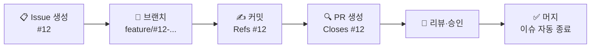

# PR & Issue 템플릿

<aside>
📌

**우리 프로젝트 결정 사항** · 결정일: 0000-00-00 · 결정자: 

| 항목 | 우리 선택 | 비고 |
| --- | --- | --- |
| Issue 템플릿 | 기능 / 버그 / 조사 중 사용할 것 |   |
| PR 템플릿 | 사용 | `.github/pull_request_template.md` |
| 리뷰어 | 최소 N명 승인 |   |
| 리뷰 기한 | PR 생성 후 N일 이내 |   |
| PR 제목 | 커밋 컨벤션과 동일 | 예: `feat(agent): L1 판별 로직` |
| 이슈 연결 | PR 본문에 `Closes #번호` | 머지 시 이슈 자동 종료 |
| 라벨 | `feature`, `bug`, `research`, `docs`, `priority:high` |   |
</aside>

---

## 📖 템플릿이 필요한 이유

이슈와 PR을 같은 양식으로 쓰면 빠진 정보 없이 빠르게 리뷰할 수 있습니다. GitHub은 저장소의 `.github` 폴더에 템플릿 파일을 두면 새 이슈·PR을 만들 때 자동으로 채워 줍니다.

## 🔄 작업 흐름



## 📁 파일 위치

```
.github/
├── ISSUE_TEMPLATE/
│   ├── feature_request.md
│   ├── bug_report.md
│   └── research.md
└── pull_request_template.md
```

## 📋 Issue 템플릿

- ✨ 기능 요청 — `feature_request.md`
    
    ```markdown
    ---
    name: ✨ 기능 요청
    about: 새로운 기능을 제안합니다
    title: "[FEAT] "
    labels: feature
    assignees: ''
    ---
    
    ## 📌 개요
    어떤 기능인지 한두 줄로 설명
    
    ## ✅ 할 일
    - [ ] 
    - [ ] 
    
    ## 🎯 완료 조건
    무엇이 되면 이 이슈를 닫을 수 있는지
    
    ## 🔗 참고
    ```
    
- 🐛 버그 리포트 — `bug_report.md`
    
    ```markdown
    ---
    name: 🐛 버그 리포트
    about: 버그를 제보합니다
    title: "[BUG] "
    labels: bug
    assignees: ''
    ---
    
    ## 🐛 버그 설명
    
    ## 🔁 재현 방법
    1. 
    2. 
    
    ## ✅ 기대 동작
    
    ## ❌ 실제 동작
    
    ## 💻 환경
    OS / Python 버전 / 브랜치
    
    ## 📎 로그·스크린샷
    (민감정보는 마스킹)
    ```
    
- 🔎 조사 과제 — `research.md`
    
    ```markdown
    ---
    name: 🔎 조사 과제
    about: 기술 검토·선행연구 조사를 요청합니다
    title: "[RESEARCH] "
    labels: research
    assignees: ''
    ---
    
    ## ❓ 알고 싶은 것
    
    ## 🎯 결정에 쓸 곳
    이 조사 결과로 무엇을 정할지
    
    ## 📚 결과 (완료 후 작성)
    노션 조사 자료 DB 링크
    ```
    

## 🔍 PR 템플릿

- `pull_request_template.md`
    
    ```markdown
    ## 📌 관련 이슈
    Closes #
    
    ## ✨ 변경 사항
    - 
    
    ## 🧪 테스트
    - [ ] 로컬에서 동작 확인
    - [ ] 테스트 코드 통과
    - [ ] pre-commit 통과
    
    ## 📸 스크린샷 (선택)
    
    ## 💬 리뷰 요청 사항
    특히 봐 주었으면 하는 부분
    ```
    

## ✅ 리뷰 예절

- PR은 작게 나눕니다. 변경이 수백 줄을 넘으면 쪼개는 것을 검토합니다.
- 리뷰는 사람이 아니라 코드에 대해 남기고, 제안에는 이유를 함께 씁니다.
- 필수 수정은 `[필수]`, 선택 제안은 `[제안]`처럼 앞에 표시하면 구분이 쉽습니다.