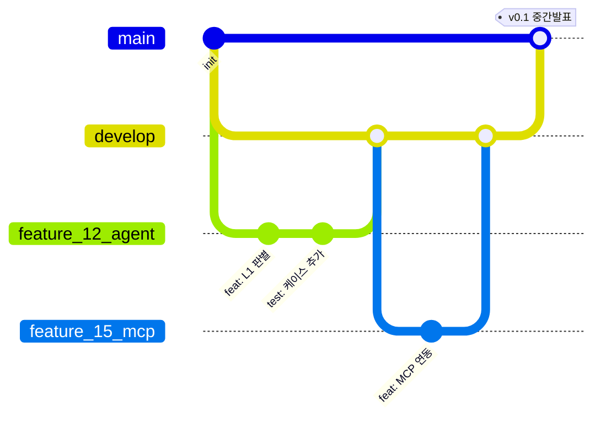

# 브랜치 전략

<aside>
📌

**우리 프로젝트 결정 사항** · 결정일: 0000-00-00 · 결정자: 

| 항목 | 우리 선택 | 비고 |
| --- | --- | --- |
| 전략 | GitHub Flow / Git Flow(간소화) / Trunk-based 중 선택 |   |
| 기본 브랜치 | main | 배포·제출 가능한 상태만 |
| 통합 브랜치 | develop / 없음 |   |
| 브랜치 이름 | `타입/#이슈번호-설명` | 예: `feature/#12-l1-agent` |
| main 직접 push | 금지 | 브랜치 보호 규칙으로 강제 |
| 머지 조건 | 리뷰 승인 N명 + CI 통과 |   |
| 머지 방식 | Squash / Merge commit / Rebase 중 선택 |   |
| 머지 후 브랜치 | 자동 삭제 | Settings → General |
</aside>

---

## 📖 브랜치 전략이란

여러 명이 동시에 개발할 때 **어떤 브랜치를 만들고, 어디로 합치고, 언제 배포하는지**에 대한 약속입니다. 이게 없으면 main이 자주 깨지고, 누가 무엇을 작업 중인지 파악하기 어렵습니다.

## 🔀 대표 전략 비교

|   | GitHub Flow | Git Flow | Trunk-based |
| --- | --- | --- | --- |
| 구조 | main + 작업 브랜치 | main, develop, feature, release, hotfix | main 하나 + 아주 짧은 브랜치 |
| 장점 | 단순함, 배우기 쉬움 | 버전별 릴리스 관리가 명확 | 충돌 최소, 빠른 통합 |
| 단점 | main이 항상 안정적이어야 함 | 브랜치가 많고 복잡함 | 테스트 자동화가 필수 |
| 추천 상황 | 소규모 팀, 수시 배포 | 정기 릴리스, 버전 여러 개 유지 | CI가 갖춰진 숙련된 팀 |

<aside>
💡

**대학 프로젝트 팀이라면:** GitHub Flow, 또는 main + develop + feature 만 쓰는 **간소화 Git Flow**를 추천합니다. develop에서 통합·테스트하고, 발표·제출 시점에만 main으로 올리면 "발표 때 돌아가는 버전"이 항상 main에 남습니다.

</aside>

### 간소화 Git Flow 예시

※ 다이어그램 도구 제약상 브랜치 이름을 `feature_12_agent`처럼 표기했습니다. 실제 브랜치는 아래 규칙대로 `feature/#12-l1-agent` 형식을 씁니다.

## 🏷️ 브랜치 이름 규칙

형식: `타입/#이슈번호-짧은-설명` (영문 소문자, 하이픈 연결)

| 타입 | 용도 | 예시 |
| --- | --- | --- |
| `feature/` | 새 기능 | `feature/#12-l1-agent` |
| `fix/` | 버그 수정 | `fix/#20-parser-null` |
| `refactor/` | 동작 변화 없는 구조 개선 | `refactor/#25-agent-base` |
| `docs/` | 문서 | `docs/#30-readme` |
| `chore/` | 설정, 패키지, 빌드 | `chore/#3-pre-commit` |
| `hotfix/` | main의 긴급 수정 | `hotfix/#41-demo-crash` |

## 🔒 브랜치 보호 규칙 설정 (GitHub)

1. 저장소 Settings → Rules(Rulesets) 또는 Branches 메뉴
2. 대상 브랜치에 `main` (통합 브랜치를 쓰면 `develop`도) 지정
3. PR 필수, 승인 N명 필수, 상태 검사(CI) 통과 필수 켜기
4. force push와 브랜치 삭제 막기

<aside>
⚠️

GitHub 메뉴 이름은 바뀔 수 있어요. 보호 규칙 메뉴가 안 보이면 저장소 요금제(비공개 저장소 여부)와 공식 문서를 확인하세요.

</aside>