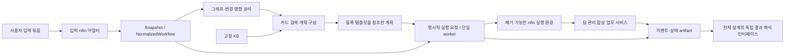

# FlowDelta 개발 상세 설계서

개발 언어 · 기술 구성 · 데이터 계약 · 모듈 구현 · 4인 개발 계획

- 작성일: **2026-10-11, Asia/Seoul**
- 문서 버전: **0.2 — 공통 기반 구현 상태 반영**
- 상태: **현재 기반 구현 + 후속 확장 설계**. 구현된 범위와 아래 장기 계획을 구분한다. 첫 연결의 실제 API·필드·버전은 현재 0.4.0 계약과 팀 구현 계획을 따른다.
- 구현 위치: `serendipity-sec/platform` 저장소. 이 파일은 `serendipity-sec/docs` 저장소의 별도 설계 문서다.
- 사람 배정: **팀장 = 현재 요청자**, 나머지는 A·B·C로 표기한다. 실명·개인별 가용 시간·합의 마감일은 아직 확정하지 않았다.
- 역할 조건: **네 명 모두 구현한다. 검증·판정·보고는 네 명의 역할 항목으로 배정하지 않는다.** 기존 전체 시스템에 필요한 관련 기능과 데이터 계약은 유지한다.

## 현재 구현과 본문의 적용 범위

이 문서는 개발 착수 때 작성한 전체 상세 계획을 보존하면서 현재 구현과의 차이를 명시한다.
초기 제안 코드 구조·0.3.0 JSON 예시·향후 DB/API/모델 구성은 아래 본문에 남아 있다. 그대로 복사해 현재 파일 형식으로 사용하지 않는다.

| 항목 | 현재 기준 |
|---|---|
| 공통 입력·모듈 계약 | **0.4.0**. [모델·Schema·이전 방법](https://github.com/serendipity-sec/platform/blob/0c30e4e349d49b05df6ca36e01ad5dbc78564b24/docs/INPUT_CONTRACT_04.md) |
| 실제 설치 조합 | Python 3.13.15, uv 0.9.30, 잠긴 `uv.lock`; n8n 2.42.6 digest 고정 |
| 구현된 코어 | 입력 loader, 정규화, 제한된 노드 의미, 명시 의존성, snapshot, CLI |
| 첫 실행 환경 | 주문 조회·문의 분류의 팀 작성 정상 사례. 주문 상태 저장은 SQLite |
| 다음 구현 | A 그래프/변경, B 파일 카드/검색/계획, C plan 기반 실행 엔진 |
| PostgreSQL·pgvector·LLM·제품 API | 후속 확장 계획. 현재 설치 완료나 첫 착수의 필수 조건으로 표시하지 않음 |
| 현재 함수·폴더·입출력 | [팀 구현 계획의 현재 착수 명세](team-implementation.md#current-start) |
| 실제 결과·지원 범위·남은 한계 | [현재 준비 현황](current-readiness.md) |

아래 4–5절의 초기 구조와 계약 예시보다 위 고정 구현의 모델·Schema를 우선한다. 전체 설계와 연구 범위는 그대로 유지한다.

## 읽는 순서

팀장은 1–4절로 기술 결정과 구조를 파악하고, 15–18절로 작업을 배정한다. 각 구현자는 5절 공통 계약을 읽은 다음 자신의 모듈인 6·7·8·9절을 읽는다. 개발 환경은 12절, CLI·API는 11절, 근거 자료는 21절에 있다.

| 범위 | 이 문서의 절 |
|---|---|
| 결정한 기술과 기존 문서의 관계 | 1–3 |
| 시스템·저장소 구조 | 4 |
| 공통 데이터 계약 | 5 |
| 팀장 입력 모듈 / A 분석 / B 검색·계획 / C 실행 | 6 / 7 / 8 / 9 |
| DB·파일 저장, CLI·API | 10–11 |
| 개발 환경, 버전 고정, 오류·로그, 개발 품질 | 12–14 |
| 4인 작업 목록, 첫 10개 작업일, 8–10주 계획 | 15–17 |
| 협업 방식, 범위·미결정 사항, 첫 구현 산출물 | 18–20 |
| 공식 기술 근거와 용어 | 21–22 |

## 1. 이번 문서에서 결정하는 사항

### 1.1 개발 기준 요약

**네 명의 주 개발 언어를 Python 3.13으로 통일한다.** 입력 처리, 그래프 계산, 검색, 계획 구성, 실행 제어를 하나의 Python 패키지 안에서 모듈로 나눈다. n8n은 별도 컨테이너에서 실행하는 분석 대상이다.

| 항목 | 채택 기준 | 처음 사용하는 시점 |
|---|---|---|
| 주 언어 | **Python 3.13**, 일반 CPython 빌드 | 첫날 |
| 패키지·환경 | **uv**, `pyproject.toml`, `uv.lock` | 첫날 |
| 공통 모델 | **Pydantic 2**, 생성한 JSON Schema | 첫날 |
| CLI | **Typer + Rich** | 첫 주 |
| 그래프 | **NetworkX 3의 MultiDiGraph** | 첫 주 |
| 업무·정책·중간 결과 | **UTF-8 JSON** | 첫날 |
| 런타임 설정 | **TOML**, Python `tomllib`로 읽음 | 첫 주 |
| 메타데이터·지식 저장 | **PostgreSQL 17** | 첫 주 환경 구성, 둘째 주 연결 |
| 벡터 저장·검색 | **pgvector 0.8 계열**, 소규모 정확 검색 | 검색 기능 확장 시 |
| DB 접근·변경 이력 | **SQLAlchemy 2 + psycopg 3 + Alembic** | DB 연결 시 |
| HTTP 서비스 | **FastAPI + Uvicorn**, 클라이언트는 **HTTPX** | 첫 주 모의 서비스, 이후 선택적 제품 API |
| 실행 환경 | **Docker Engine + Compose v2**, Linux 컨테이너 | 첫 주 |
| n8n 기준 릴리스 | **2.42.6을 첫 호환성 확인 대상으로 선택**, 통과한 이미지 digest를 고정 | 첫 주 |
| 로컬 모델 | **Ollama의 `qwen3:4b`**를 개발용 기본 모델로 선택 | 정상 실행 연결 후 |
| 임베딩 | **`intfloat/multilingual-e5-small`**, Sentence Transformers로 로컬 처리 | 검색 확장 시 |
| 개발 도구 | **pytest, Ruff, mypy** | 첫 주 |
| CI | **GitHub Actions**, 기존 secret scan 유지 | 첫 주 |
| 초기 사용자 인터페이스 | **CLI와 JSON 파일** | 첫 주부터 |
| 선택적 웹 화면 | **TypeScript + React + Cytoscape.js** | 핵심 연결 이후, 별도 범위 합의 시 |

정확한 Python 패치 버전·라이브러리 패치 버전·이미지 digest·모델 revision은 첫 환경 확인에서 잠근다. 현재 확인하지 않은 digest를 만들어 적지 않는다. **언어와 구성은 이 문서에서 정하고, 설치 가능한 정확한 조합은 첫 환경 산출물로 남긴다.**

### 1.2 이 구성을 선택한 이유

1. 기존 실험 코드와 현재 역할 계획이 Python 중심이다. 네 명이 같은 모델과 도구를 공유할 수 있다.
2. Pydantic 모델에서 JSON Schema를 생성하면 코드·중간 파일·API의 필드 정의를 일치시키기 쉽다. [Pydantic 공식 문서](https://docs.pydantic.dev/latest/concepts/json_schema/)
3. 같은 두 노드 사이에 제어·데이터·권한 관계가 동시에 존재할 수 있으므로 다중 방향 간선을 지원하는 `MultiDiGraph`가 맞는다. [NetworkX 공식 문서](https://networkx.org/documentation/stable/reference/classes/multidigraph.html)
4. 기존 상세 설계가 제안한 PostgreSQL·pgvector를 유지하면 메타데이터·텍스트 검색·벡터 검색을 하나의 DB에서 관리할 수 있다. 처음에는 작은 카드 집합을 정확 검색한다. [PostgreSQL 검색](https://www.postgresql.org/docs/17/textsearch.html), [pgvector](https://github.com/pgvector/pgvector)
5. 첫 연결은 네 모듈의 Python 함수와 JSON 파일만으로 가능하다. API·DB·모델의 설치가 다른 사람의 구현 시작을 막지 않게 한다.
6. uv lock으로 의존성 해석 결과를 공유하고 CI에서는 잠긴 의존성을 사용한다. [uv 공식 문서](https://docs.astral.sh/uv/concepts/projects/sync/)

이 선택은 개발 복잡도를 줄이기 위한 설계 판단이다. Python의 속도나 특정 검색 방식의 우수성을 측정했다는 주장은 아니다.

### 1.3 개발 초기에 추가하지 않을 구성

초기에는 Redis·Celery·Kafka, 별도 그래프 DB, 별도 벡터 DB, Kubernetes, 계정·결제·다중 조직 기능을 도입하지 않는다. 작업 실행은 **명시적으로 요청된 작업을 처리하는 단일 worker**로 시작한다. 웹 화면도 핵심 모듈이 연결된 뒤 추가한다.

우리 코어에 LangChain·LangGraph를 필수 의존성으로 넣지 않는다. n8n의 내부 구현이 해당 생태계의 라이브러리를 사용하는 것과 우리 코어의 의존성 선택은 별개다. 모델 호출은 작은 공급자 인터페이스로 감싼다.

## 2. 기존 설계와의 관계 및 현재 저장소 상태

### 2.1 문서의 기준 위치

| 문서 | 담당하는 내용 |
|---|---|
| [전체 상세 설계](../final/README.md) | 무엇을 만들고 어떤 보안 경계와 연구 질문을 다루는가 |
| [입력·현실적인 데이터 기준](../final/input-and-data.md) | 무엇을 고정하고 어떤 출처의 업무·정책·데이터를 쓰는가 |
| [4인 역할·착수 계획](team-implementation.md) | 입력 / 분석 / 지식·계획 / 실행의 사람별 경계 |
| **이 문서** | 개발 언어, 코드 구조, 상세 계약, 환경과 구현 순서 |
| [기존 실행·평가 계획](../final/execution-plan.md) | 비교 방법, 분할, 연구 일정과 성과 해석 |
| [기존 계약 예시](../final/contracts.example.json) | 0.2 설계 예시. 실행 가능한 확정 스키마가 아님 |

기존 목표와 네 역할을 유지한다. 첫 구현의 0.3.0을 거쳐 현재 준비 계약은 **0.4.0**이다. 아래 초기 예시는 설계 이력이며, 현재 필드와 이전 방법은 위의 실제 모델·Schema 링크를 따른다.

### 2.2 현재 공유 상태

- 이 상세 설계는 로컬 전용 문서에서 `docs`의 팀 공유 문서로 반영한다.
- `platform`의 준비 브랜치에는 `src/flowdelta/`, 패키지 설정, 계약과 두 정상 사례가 구현돼 있다.
- 구현의 `main` 반영은 별도 코드 리뷰 승인 조건을 따른다. 현재 준비 현황에서 코드 기준 커밋과 PR을 확인한다.
- A/B/C 모듈의 실제 생성물 연결과 최종 연구 성능은 아직 완료하지 않았다.
- 이 문서의 뒤쪽 주차·작업일은 초기 계획이며, 실명·개별 마감일을 확정한 기록이 아니다.

## 3. 첫 번째 업무와 입력을 고정하는 방법

### 3.1 첫 개발 사례

첫 업무는 **인증된 고객에게 본인 주문의 배송 상태를 알려 주기**로 정한다. 첫 연결에는 정상 업무와 정상적인 전후 변경을 사용한다. 공개 원본을 실행 환경에 맞게 줄였다면 원본과 변환본을 모두 추적한다.

| 항목 | 첫 사례의 정의 |
|---|---|
| 업무 | 고객과 주문의 관계를 확인하고 정확한 배송 상태를 반환 |
| 정책 | 허용된 주문만 읽음, 보호 주문 상태를 수정하지 않음, 허용된 상담 기록은 추가 가능 |
| 초기 데이터 | 합성 고객·주문·테넌트·권한·기존 상담 기록 |
| 기본 흐름 | Webhook → 입력 정리 → 고객·주문 관계 확인 → 조회 → 응답 |
| 첫 정상 변경 | 응답 문구·표시 형식 변경 또는 허용된 필드 선택 변경 |
| 다음 확장 | 같은 업무에 모델의 응답 작성이나 등록된 읽기 도구를 연결 |
| 두 번째 업무 | 합성 내부 문서를 검색해 허용된 내부 수신처에 요약 전달 |

고객이 요청문에 적은 ID를 인증된 주체로 사용하지 않는다. 합성 서비스의 실행 설정에서 정한 주체와 데이터의 고객·테넌트 관계를 별도로 둔다.

### 3.2 한 비교쌍의 고정값과 변경값

- **동일하게 유지:** 업무 목적·정상 완료 조건·평가 정책·초기 데이터 내용·관측 범위.
- **명시적으로 비교:** workflow, 하위 의존성, 권한 환경, 모델·런타임 설정 중 어떤 축이 달라졌는지.
- **별도로 저장:** before와 after의 전체 스냅샷. 동일 초기 내용도 실행 시에는 각각 별도 상태로 복제한다.
- **정책이 바뀌면:** 요구사항 변경으로 기록하고, 같은 정책 아래의 회귀 비교와 구분한다.
- **기존 버전의 상태:** 공개 원본이라는 이유로 안전하다고 가정하지 않고 `baseline_security_status=UNKNOWN`으로 시작한다.

### 3.3 실제에 가까운 자료의 편입 절차

기존 입력 문서에 있는 공개 n8n 후보·업무 benchmark·Git 이력을 사용한다. 현재 운영자 자료를 확보한 것은 아니다.

1. 원본 URL·commit/버전·취득일·원본 해시·이용 조건을 기록한다.
2. 실제 업무 목적, 정상 결과, 정책의 출처를 따로 기록한다.
3. 실서비스 자격과 개인 데이터는 합성 서비스·합성 자료로 대체한다.
4. 원본을 그대로 쓰는지, 설정만 바꾸는지, 노드나 업무 동작을 바꾸는지 기록한다.
5. 같은 원본과 파생본은 같은 `family_id`에 넣는다.
6. 실제 변경 이력과 연구자가 만든 변경을 다른 `change_origin`으로 표시한다.
7. 실행 가능한 정상 흐름을 확보한 사례부터 데이터셋 후보로 편입한다. 다운로드 수를 확보한 사례 수로 세지 않는다.

## 4. 프로그램 구조와 저장소 배치

### 4.1 실행 구조



제어 코어, 실행 대상, 실행 산출물을 구분한다. 코어의 분석·검색은 대상을 실행하지 않고 동작한다. 실행은 등록된 실험실 프로필과 정상 업무 템플릿에 대해 사용자가 명시적으로 요청했을 때 수행한다.

### 4.2 코드 구조

아래는 **앞으로 `platform`에 만들 구조**다. 모두 현재 구현돼 있다는 뜻이 아니다.

```text
platform/
  pyproject.toml
  uv.lock
  .python-version
  .env.example
  src/flowdelta/
    cli.py
    config.py
    contracts/
      common.py
      input.py
      analysis.py
      knowledge.py
      planning.py
      execution.py
      outcome.py
    ingestion/
      bundle_loader.py
      snapshot.py
      provenance.py
    adapters/n8n/
      normalize.py
      expressions.py
      registry.py
      nodes/
    analysis/
      graph_builder.py
      matching.py
      diff.py
      impact.py
    knowledge/
      card_loader.py
      repository.py
      lexical.py
      embeddings.py
      retrieve.py
    planning/
      compose.py
      applicability.py
      providers.py
    execution/
      runner.py
      jobs.py
      n8n_runtime.py
      state.py
      artifacts.py
    storage/
      artifact_store.py
      database.py
      models/
    api/
      app.py
      routes/
  schemas/0.3.0/
  examples/order-lookup/
  examples/internal-summary/
  knowledge/cards/
  configs/
    dev.toml
    support-matrix.json
    runtime-lock.json
  lab/
    compose.yaml
    services/
    templates/
    fixtures/
  migrations/
  scripts/
  tests/
    unit/
    contracts/
    integration/
    semantics/
  var/                         # 로컬 생성물. Git 관리 대상에서 제외
  experiments/                 # 기존 실험. 원본 보존
```

폴더명과 Python 객체 이름은 영어, 설명과 작업 문서는 한국어를 기본으로 한다.

### 4.3 모듈 의존성

- `contracts`는 Pydantic과 표준 라이브러리만 사용한다. NetworkX·DB·n8n 클라이언트를 import하지 않는다.
- 입력·분석 모듈은 순수 계산을 중심으로 만들고 파일 읽기·쓰기와 분리한다.
- 검색·실행 모듈의 외부 연결은 인터페이스를 주입한다. 파일 저장소와 DB 저장소를 교체할 수 있게 한다.
- CLI와 FastAPI는 같은 애플리케이션 함수를 호출한다. 계산 로직을 두 번 만들지 않는다.
- 모듈 간 자료는 Pydantic 객체 또는 JSON으로 전달한다. 다른 모듈의 내부 테이블을 직접 질의하지 않는다.
- `pickle`과 NetworkX 객체 자체를 교환 형식으로 사용하지 않는다. 그래프는 버전 있는 노드·간선 목록으로 직렬화한다.

## 5. 공통 데이터 계약

### 5.1 모든 모듈이 따를 규칙

| 구분 | 규칙 |
|---|---|
| 인코딩 | UTF-8, 파일 생성 시 LF, JSON은 표준 JSON만 허용 |
| 버전 | 첫 구현 모델 `schema_version="0.3.0"`; 읽을 수 없는 버전은 명시적인 오류 |
| 필드 | 알 수 없는 필드는 기본적으로 거부. 확장은 별도 `extensions` 필드에 namespace를 붙임 |
| 공통 ID | 사례 `case_id`, 스냅샷 `snapshot_id`, 계획 `plan_id`, 실행 `run_id`를 분리 |
| 원본 위치 | 원본 artifact ID + JSON Pointer, 텍스트는 line/column 추가 |
| 상태 | 지원 상태·처리 상태·관측 결과를 다른 필드로 저장 |
| 해시 | 원본 바이트 SHA-256과 정규화 의미 해시를 별도 저장 |
| 시간 | 저장은 UTC ISO 8601, 표시할 때 Asia/Seoul 변환 |
| 참조 | 상대 경로는 bundle 루트 기준. archive 해제·원격 주소 자동 다운로드는 초기 입력에 없음 |
| 누락 | 알 수 없는 권한·표현식·의존성을 기본값으로 추측하지 않음 |

Pydantic의 엄격한 필드 검사와 `extra="forbid"`를 기본으로 한다. 파일의 JSON 값을 읽는 규칙과 내부 Python 타입 생성 규칙을 테스트로 고정한다. 사람이 보기 좋은 별칭은 ID와 별도다.

### 5.2 객체와 필수 필드

다음 표는 최소 계약이다. 구현 시 타입·열거형·필수 여부를 Pydantic 모델로 옮기고 JSON Schema를 생성한다.

| 객체 | 필수 정보 | 생산 → 소비 |
|---|---|---|
| `ArtifactRef` | ID, 상대 경로, SHA-256, 크기, media type, 원본/생성물 구분 | 전 모듈 공통 |
| `ComparisonCase` | case/family ID, before/after, task/policy/state 참조, 변경 축, 출처 | 입력 → 전 모듈 |
| `TaskContract` | 업무 목적, 주체, 정상 입력·완료 조건, 보호 자원, 허용 부수 효과, 출처 | 입력 → 분석·계획·실행 |
| `Policy` | policy ID·버전, 규칙 ID, 적용 주체/자원, 허용 조건·예외, 근거 | 입력 → 분석·계획 |
| `Snapshot` | 원본 manifest, 의존성, 환경, policy/runtime 참조, raw/semantic hash | 입력 → 분석·실행 |
| `NormalizedWorkflow` | 원본 workflow ID, 노드 목록, 포트가 있는 연결, 설정, 미지원 항목 | 입력 → 분석 |
| `NodeSemantics` | node ID, node/typeVersion/operation, 읽기·쓰기 필드, 외부 효과, 능력·원본 위치 | 입력 → 분석 |
| `SemanticGraph` | 노드·간선 목록, 관계 종류, 조건, 원본 근거, 해석 한계 | 분석 → 분석·계획 |
| `ChangeSet` | before/after, 대응표, 변경 유형·이전/이후 값·원본 위치 | 분석 → 계획 |
| `AnalysisBundle` | 그래프 참조, ChangeSet, 영향 경로, task/policy 참조, 지원 범위 | 분석 → 계획 |
| `ScenarioCard` | ID·버전, 요약, 출처, 제품/버전, 필요 조건, template 참조, 이용 조건 | 지식 → 검색 |
| `RetrievalResult` | card refs, 조건 적합성, 검색 방식·점수·순위, KB/모델 버전, 미선택 사유 | 검색 → 계획 |
| `TestPlan` | case/snapshot refs, template ID·버전, 입력 참조, 상태 참조, 예산, 필수 항목 대응·누락 | 계획 → 실행 |
| `ExecutionRun` | run/plan/case/snapshot 대응, 시도 번호, 실제 runtime, 단계·종료 상태·비용 | 실행 → 저장·후속 해석 |
| `EvidenceEvent` | run ID, 생산 서비스, 이벤트 순번·시간·유형, 관련 자원·자료 참조 | 실행 서비스 → artifact |
| `RunArtifacts` | 입력·응답·이벤트·초기/최종 상태·오류·manifest 참조 | 실행 → 후속 해석 |

### 5.3 스냅샷과 해시

1. `raw_sha256`은 원본 바이트 그대로 계산한다.
2. 정규화기는 명시된 비의미 필드만 제외하고 안정적인 순서의 JSON을 만든다. 배열 순서가 의미를 가지면 유지한다.
3. 의미 해시에는 정규화 규칙 버전과 의미에 영향을 주는 workflow·의존성·환경·정책·runtime 정보를 포함한다.
4. 생성 시각·출력 경로·일회성 run ID는 의미 해시에 넣지 않는다.
5. 스냅샷 구성요소의 참조가 같더라도 내용 해시가 다르면 다른 스냅샷이다.
6. 표시 좌표는 제외 가능하지만 노드 이름은 표현식 참조에 쓰일 수 있어 일괄 제거하지 않는다.
7. KB·계획 생성기 설정은 분석 대상 스냅샷과 구분해 계획의 재현 정보에 포함한다. 기존 예시의 `knowledge_ref`는 이 대응 관계를 보존한다.

`run_id`는 매 실행 시 새 UUID를 만든다. before/after에 같은 `run_id`를 재사용하지 않고 `comparison_run_id`로 묶는다. 부수 효과가 있는 실행을 해시가 같다는 이유로 생략하지 않는다.

### 5.4 입력 묶음

```text
examples/order-lookup/
  case.json
  workflow/before.json
  workflow/after.json
  task.json
  policy.json
  environment.json
  runtime.toml
  state/initial.json
  manifest.json
  provenance.json
```

`case.json`이 나머지를 참조한다. manifest에는 실제 파일 해시가 있어야 한다. 아래는 필드 연결을 설명하는 **부분 예시**이며 완성된 실행 입력이 아니다.

```json
{
  "schema_version": "0.3.0",
  "case_id": "order-lookup-demo-001",
  "family_id": "order-lookup-demo",
  "before_ref": "workflow/before.json",
  "after_ref": "workflow/after.json",
  "task_ref": "task.json",
  "evaluation_policy_ref": "policy.json",
  "initial_state_ref": "state/initial.json",
  "changed_axes": ["workflow"],
  "baseline_security_status": "UNKNOWN"
}
```

### 5.5 기존 결과 계약을 연결하는 경계

`VerificationObligation`의 ID·필수 여부·필요 자료·미지원 사유는 입력에서 계획과 실행까지 보존한다. 검색 결과가 없거나 예산이 부족해도 목록에서 삭제하지 않는다. 미연결 항목은 `uncovered_obligation_refs`에 남긴다.

`outcome.py`에는 기존 전체 설계의 결과 형식과 상태를 위한 계약을 둔다. **이 계약의 존재가 독립 판정기의 구현 완료를 뜻하지 않는다.** 이번 역할표는 관련 담당자를 배정하지 않는다. 결과 해석 구현이 연결되기 전에는 `outcome=null` 또는 `NOT_RUN`을 유지하며 정상 실행 성공을 보안 통과로 바꾸지 않는다.

## 6. 팀장 구현: 입력·n8n 어댑터

### 6.1 책임과 공개 함수

팀장은 파일을 읽고 n8n의 개별 노드 의미를 공통 표현으로 바꾼다. n8n 서버를 시작하거나 여러 노드의 영향 경로를 계산하는 일은 각각 C와 A의 모듈로 연결한다.

```text
load_case(bundle_dir) -> ComparisonCase + LoadedArtifacts
build_snapshot(case, side, artifacts) -> Snapshot
normalize(workflow_json, support_profile) -> NormalizedWorkflow
describe_node(node, context) -> NodeSemantics
```

### 6.2 처리 순서

1. 사례 파일의 schema version·필수 필드·참조 범위를 검사한다.
2. 경로를 bundle 루트 기준으로 해석하고 외부 경로·부모 이동·참조 순환·크기 초과를 처리한다.
3. workflow 원본, 하위 workflow, 제공된 도구 설명과 Skill 자료의 참조를 읽는다. 원격 자료를 임의로 수집하지 않는다.
4. 노드 ID·이름·종류·typeVersion·operation·parameter·port·connection을 보존한다.
5. 지원 어댑터에서 필드 참조·도구 능력·외부 효과·분기 조건을 얻는다.
6. 해석 불가 항목의 원본 위치와 이유를 남기고 스냅샷·공통 표현을 출력한다.

### 6.3 첫 지원 범위

지원 여부는 이름만으로 결정하지 않는다. `engine_version + node_type + typeVersion + operation + parameter_subset` 조합을 `support-matrix.json`에 등록한다.

| 단계 | 노드·동작 | 지원 범위 |
|---|---|---|
| 첫 연결 | Webhook / Respond to Webhook | 단일 JSON 요청·응답, 고정 경로 |
| 첫 연결 | Edit Fields | 상수, 명시적 필드 선택과 이름 변경 |
| 첫 연결 | If | 지원 타입의 단순 비교와 true/false 포트 |
| 첫 연결 | HTTP Request | 고정된 팀 관리 서비스, 명시적 method·경로·JSON 필드 |
| 두 번째 연결 | Merge | 선택한 단일 모드. 모드별 item 대응을 별도 계약으로 기록 |
| 두 번째 연결 | Execute Sub-workflow / 해당 Trigger | 고정 하위 workflow ID·파일 참조 |
| 이후 확장 | AI Agent / Chat Model / Workflow Tool | 등록된 모델·읽기 도구, 제한된 입력, 지원 연결 종류 |
| 초기 미지원 | 임의 Code, 동적 하위 참조, 미확인 커뮤니티 노드, 복잡한 표현식 | 원본 보존 + 위치별 `UNSUPPORTED` |

실제 typeVersion 숫자는 선택 이미지에서 추출한 뒤 등록한다. 문서에서 임의로 숫자를 추측하지 않는다. AI 노드 연결은 `main` 실행 연결과 모델·도구의 특수 연결을 구분한다.

### 6.4 표현식

첫 문법은 상수, 현재 item의 명시적 JSON 필드, 이름으로 지정한 노드의 제한된 필드 참조, 허용한 문자열 결합·단순 비교다. 토큰화 후 작은 AST로 처리하며 JavaScript `eval`이나 Python `eval`로 실행하지 않는다.

현재 item 참조의 문법은 n8n 공식 문서와 대조한다. 특히 sub-node는 여러 item에서 첫 item을 참조하는 의미가 있을 수 있으므로 일반 노드와 같은 규칙을 적용하지 않는다. 초기 AI 연결은 단일 item으로 제한하고, 여러 item의 참조를 복원하지 못하면 표시한다. [현재 노드 입력](https://docs.n8n.io/code/builtin/current-node-input/), [sub-node 표현식 설명](https://docs.n8n.io/integrations/builtin/cluster-nodes/sub-nodes/n8n-nodes-langchain.lmchatollama/)

### 6.5 첫 인계 조건

첫 전후 workflow에서 A가 n8n 원본을 다시 파싱하지 않아도 기본 그래프를 만들 수 있어야 한다. C는 같은 사례에서 원본 workflow·환경·초기 상태를 찾을 수 있어야 한다. 알 수 없는 필드는 위치별 목록으로 전달한다.

## 7. A 구현: 그래프·변경·영향 분석

### 7.1 공개 함수와 그래프 모델

```text
build_graph(normalized, semantics, snapshot) -> SemanticGraph
match_nodes(before, after) -> NodeMatchSet
compare(before_graph, after_graph, matches) -> ChangeSet
analyze_impact(graphs, changes, policy_refs, limits) -> AnalysisBundle
```

그래프 내부는 `MultiDiGraph`, 외부 형식은 정렬된 JSON이다. 기본 노드 종류는 workflow node, resource, principal/capability, dependency다. 관계는 `CONTROL`, `DATA`, `INSTRUCTION_INFLUENCE`, `CAPABILITY`, `DEPENDENCY_PROTECTION`으로 나눈다.

간선에는 출발·도착, 관계 종류, 입력/출력 포트·필드, 조건, 원본 위치, 의미 어댑터 버전, 근거 수준을 둔다. 정적 분석이 만든 가능한 관계를 실제 관측 관계로 저장하지 않는다.

### 7.2 전후 노드 대응

1. 같은 원본 ID와 호환되는 node type을 우선 대응한다.
2. ID가 달라졌으면 type·operation·정규화 파라미터·이웃 관계로 후보를 만든다.
3. 유일한 후보에만 자동 대응하고 근거를 남긴다.
4. 후보가 여러 개면 `AMBIGUOUS_MAPPING`으로 남기고 수동 대응 파일을 받을 수 있게 한다.
5. 새 ID가 생겼다는 이유만으로 모두 추가·삭제로 확정하지 않는다.

노드 이름 변경은 참조가 함께 바뀌었는지 확인한다. 화면 좌표 변경은 표시 변경으로 분리한다. 노드 enable/disable, 오류 계속 처리, 재시도 설정은 실행 의미에 영향을 주므로 단순 표시 변경에서 제외한다.

### 7.3 변경과 영향 범위

변경 유형은 노드·연결 추가/삭제, 의미 속성 변경, 권한 환경 변경, 하위 의존성 변경, 모델·runtime 변경, 표시 변경, 대응 불명으로 나눈다. 각각 before/after 값과 원본 위치를 붙인다.

영향 분석은 변경 위치에서 관련 데이터·도구·자원으로의 도달 가능성을 계산한다. 먼저 방문 집합을 사용하는 탐색으로 영향 노드 집합을 구하고, 설명에 필요한 제한된 대표 경로만 보관한다. 모든 단순 경로 열거를 기본 알고리즘으로 사용하지 않는다.

기본 상한은 한 workflow 100노드, snapshot 전체 300노드, 대표 경로 20개로 시작하는 **개발 설정**이다. 상한 도달 시 `truncated=true`와 이유를 남긴다. 경로 출력 상한 때문에 영향 집합 계산을 생략했다면 별도 불완전 상태로 표현한다. 수치는 파일럿에서 조정하며 성능 실적으로 사용하지 않는다.

### 7.4 처음에는 전체 분석

양쪽 전체 그래프를 만든 뒤 비교한다. 입력·그래프 모델이 안정된 다음에만 캐시나 선택적 재분석을 추가한다. 캐시 키에는 원본·의존성·환경·정책·runtime의 의미 해시와 정규화/어댑터/분석기 버전을 포함한다.

첫 인계는 변경 한 건과 짧은 영향 경로가 들어 있는 `analysis.json`이다. 위험 확정, 실제 효과 발생, 전체 안전이라는 결론은 이 모듈의 출력으로 만들지 않는다.

## 8. B 구현: 지식·검색·구조화 계획

### 8.1 공개 함수

```text
load_cards(directory) -> CardSet
index_cards(cards, kb_version, embedding_profile) -> KnowledgeSnapshot
retrieve(analysis, task, policy, knowledge_snapshot) -> RetrievalResult
compose_plan(analysis, retrieval, template_catalog, constraints) -> TestPlan
```

### 8.2 카드 데이터

카드는 ID·버전, 원문 출처, 요약, 제품·버전, 적용 조건, 필요 능력, 제외 조건, 템플릿 참조, 검토 상태, 이용 조건을 가진다. 주장·사실·연구자 가정을 구분한다. 처음에는 3–5개의 소수 카드로 시작한다.

지식 원본과 데이터셋 정답은 다른 저장소·접근 경계로 분리한다. 평가 사례의 정답·결과·구체적 수정 해설은 검색 입력으로 제공하지 않는다. KB는 카드 목록과 각 해시가 있는 불변 snapshot으로 묶는다.

### 8.3 검색 순서

1. node operation, 변경 유형, 관련 자원·정책, 제품·버전으로 구조 조건을 만든다.
2. 조건이 명백히 맞지 않는 카드는 제외하고, 정보 부족은 `UNKNOWN`으로 유지한다.
3. PostgreSQL 텍스트 검색으로 기술 키워드·영문 별칭을 찾는다. 한국어 형태소 처리를 기본 FTS가 모두 해결한다고 가정하지 않고 별칭·명시적 키워드를 함께 저장한다.
4. e5-small로 질의·카드를 임베딩하고 pgvector의 cosine 거리로 검색한다. 약 60개라는 초기 규모에서는 근사 인덱스를 추가하지 않는다.
5. 텍스트·벡터 순위를 RRF로 결합한다. 초기 설정은 각 10개 후보, `k=60`, 최종 5개다. 이는 조정 가능한 개발값이다.
6. 점수와 별도로 적용 조건·출처·선택 이유를 반환한다. 모델이 검색 점수를 사실 여부로 해석하지 않게 한다.

e5-small은 384차원이며 검색 질의와 문서에 각각 `query: `, `passage: ` 접두어를 사용한다. 고정한 모델 revision·정규화·분할 방식으로 임베딩을 생성한다. 모델 변경 시 새 KB snapshot과 새 인덱스를 만든다. [모델 제공자의 설명](https://huggingface.co/intfloat/multilingual-e5-small/raw/main/README.md)

### 8.4 계획 구성은 두 단계로 개발

- **1단계:** 조건 규칙과 등록된 정상 업무·비파괴 관측 템플릿으로 계획 JSON을 만든다.
- **2단계:** 같은 입출력 뒤에 모델을 연결해 관련 근거 요약과 등록 템플릿의 선택·허용 파라미터 구성을 보조한다.

모델은 쉘·Python 코드, 임의 URL, 새로운 실행 어댑터, 정책 또는 판정 코드를 생성할 수 없다. 계획 생성기는 실제 실행 권한을 가지지 않는다. 구조화 출력도 ID·타입·등록 여부·참조·예산을 코드에서 확인한다. 미지원 계획은 실행기로 넘기지 않고 사유를 남긴다.

개발용 기본 공급자는 HTTPX로 연결하는 Ollama다. 첫 모델은 `qwen3:4b`를 선택하되 서버가 보고한 전체 모델 digest·옵션·template을 runtime 기록에 고정한다. 계획 생성과 대상 workflow의 모델 호출은 역할·문맥·기록을 분리한다. [Ollama 모델 페이지](https://ollama.com/library/qwen3:4b), [구조화 출력](https://docs.ollama.com/capabilities/structured-outputs)

### 8.5 C와 합의할 템플릿 계약

템플릿에는 ID·버전, 목적, 허용 입력 JSON Schema, 필요한 서비스, 파라미터 범위, 예상 artifact 종류, timeout 상한이 있다. B는 등록부를 읽어 값을 연결한다. C는 등록된 정상 실행 동작을 구현한다.

템플릿·사례·관측 항목의 참조가 불완전하면 그 부분을 명시한다. 검색 결과가 없을 때 정상 업무와 필수 항목을 보존하고, 고정 계획 방식으로 계속 가능한 범위를 표시한다. 실패한 모델 출력을 성공한 고정 계획과 같은 생성 성과로 세지 않는다.

## 9. C 구현: 실행 엔진·환경·상태 관리

### 9.1 공개 인터페이스

```text
prepare_runtime(profile, run_id) -> RuntimeHandle
materialize_state(initial_state_ref, runtime) -> StateReceipt
install_workflow(snapshot, runtime) -> WorkflowBinding
execute_normal(plan, binding, runtime) -> ExecutionRun
collect_artifacts(run, runtime) -> RunArtifacts
finalize_runtime(run, runtime) -> CleanupReceipt
```

등록된 정상 업무·비파괴 관측 템플릿과 팀 관리 합성 서비스만 첫 실행 범위에 넣는다. 변경 분석 결과에서 임의 대상 실행으로 자동 이어지는 기능은 만들지 않는다.

### 9.2 서비스와 접근 경계

| 구성 | 역할 | 보관하는 상태 |
|---|---|---|
| 개발 코어·worker | 작업 접수, n8n 준비, 실행 제어, artifact 수집 | 메타데이터 DB 참조와 작업 상태 |
| `metadata-db` | FlowDelta 메타데이터·KB·작업 인덱스 | PostgreSQL, pgvector |
| `n8n-runtime` | 선택한 workflow 실행 | 실행별 별도 내부 DB·설정·자격 참조 |
| `fixture-service` | 합성 주문 조회·문서 조회·허용된 기록 API | 실행별 업무 상태 |
| `event-collector` | 서비스 이벤트와 관측 구간 기록 | 대상과 분리된 이벤트 파일 |
| 로컬 모델 서비스 | 모델 요청 처리 | 고정 모델, 실행별 분리된 요청 기록 |

첫 n8n 실행은 폐기 가능한 전용 데이터 디렉터리의 SQLite를 사용한다. 이것은 **n8n 내부 저장 방식**이며 FlowDelta 메타데이터 DB는 PostgreSQL이다. n8n 내부 DB를 직접 편집하거나 해석해 업무 결과의 독립 근거로 사용하지 않는다. n8n의 기본 SQLite와 PostgreSQL 지원은 공식 문서에 설명돼 있다. [n8n 설치 문서](https://docs.n8n.io/deploy/host-n8n/install-options/install-using-docker-compose.md)

합성 서비스는 별도 Python FastAPI 프로세스로 작성한다. 초기 상태는 버전 있는 JSON, 실행 중 상태는 실행별 디렉터리의 SQLite로 관리한다. 조회 응답은 호출 순번 대신 자원·질의 키로 대응시켜 전후의 호출 순서 차이가 입력 데이터 차이로 변하지 않게 한다.

네트워크는 제어용과 실험실용을 구분한다. 실행 대상에 호스트 홈·운영 토큰·Docker 소켓·FlowDelta DB·artifact 저장소 쓰기 권한을 주지 않는다. 생성형 코드 실행용 n8n Assistant나 privileged sandbox는 이 구성에 포함하지 않는다. Docker는 편의와 상태 분리 수단이며, 임의 외부 코드를 안전하게 실행할 수 있다는 보증으로 취급하지 않는다. 초기 범위는 팀이 관리하는 자료와 서비스다.

### 9.3 n8n을 실제로 호출하는 방법

첫 방식은 **자체 관리 n8n에 원본의 실행용 사본을 가져오고, 게시된 Webhook으로 정상 JSON 입력을 전달하는 것**으로 정한다.

1. 원본 workflow를 읽기 전용으로 보존한다.
2. 필요한 자격·서비스 주소·고정 하위 workflow ID를 실험실의 참조로 바인딩한다. 원본/실행용 ID 대응표와 변환 이력을 저장한다.
3. 해당 릴리스의 공식 CLI로 import하고, 필요한 bootstrap·credential 설정을 적용한다. 최초 계정 설정이 필요한 경우 개발자가 로컬 UI에서 한 번 수행하고 방법을 문서화한다.
4. 선택한 workflow를 게시하고 서버를 시작하거나 필요한 재시작을 수행한다.
5. 준비 상태와 합성 서비스 상태를 확인한다.
6. 테스트 URL을 누르는 방식에 의존하지 않고 등록된 Webhook에 정상 입력을 보낸다.
7. HTTP 응답, 서비스 이벤트, 실행 전후 상태, 실행 중 오류를 각각 저장한다.

계정·합성 자격 설정을 실행마다 수작업으로 반복하지 않도록, 준비가 끝난 n8n을 정지한 뒤 **실행 이력과 업무 상태가 없는 로컬 bootstrap 기준본**을 만든다. 각 실행은 이 기준본의 새 사본에서 시작하고 사례별 workflow를 설치한다. 실행 중인 SQLite 파일을 그대로 복사하지 않으며, 두 실행이 같은 쓰기 볼륨을 공유하지 않는다. 기준본은 비밀 값을 포함할 수 있으므로 로컬 전용으로 관리하고, 재현 자료에는 생성 절차·버전·비밀 값을 제외한 설정만 제공한다.

n8n 공식 CLI는 import·실행·게시 명령을 제공한다. 현재 문서는 2.x에서 `publish:workflow`를 사용하며, 실행 중인 서버에 CLI로 게시 상태를 바꾼 경우 재시작이 필요하다고 설명한다. Webhook의 테스트 URL과 게시된 workflow의 URL도 동작이 다르다. 첫 호환성 작업에서 이 경로를 확인한다. 존재를 확인하지 않은 `/workflows/{id}/run` 같은 n8n API를 가정하지 않는다. [n8n CLI](https://docs.n8n.io/hosting/cli-commands/), [Webhook](https://docs.n8n.io/integrations/builtin/core-nodes/n8n-nodes-base.webhook/)

선택한 2.42.6 릴리스에는 deprecated node를 포함한 workflow의 생성·수정을 막는 변경이 명시돼 있다. 오래된 공개 workflow의 import 가능 여부를 첫 주에 확인하고, 대체가 필요하면 원본과 변환 차이를 기록한다. 변환에 실패한 사례를 조용히 다른 사례로 바꾸지 않는다. [n8n 2.42.6 릴리스](https://github.com/n8n-io/n8n/releases/tag/n8n%402.42.6)

### 9.4 전후 상태와 실행 순서

기본 동시성은 1이다. before를 실행한 다음 after를 실행해도 각 실행은 새 상태를 가져야 한다.

```text
공통 initial-state 해시
  → before 전용 상태 생성 → before 실행 → artifact 고정 → 자원 정리
  → after 전용 상태 생성  → after 실행  → artifact 고정 → 자원 정리
```

업무 DB뿐 아니라 n8n 내부 저장, memory, workflow static data, 캐시, 하위 workflow의 상태도 분리한다. 대응하지 못한 상태가 있으면 초기화 완료로 표시하지 않는다. 사용 중인 공통 모델 서비스도 대화 문맥을 실행 사이에 재사용하지 않는다.

### 9.5 작업 상태 기계와 재시도

작업 진행 필드 `phase`는 `QUEUED → PREPARING → READY → RUNNING → COLLECTING → FINALIZING → FINISHED` 순서다. 종료 시 실행 상태 `execution_status`와 정리 상태 `cleanup_status`를 분리한다. 실패·취소도 수집·정리가 가능한 범위까지 진행하고 `FINISHED`에 도달하며 실제 종료 사유는 실행 상태에 남긴다.

- 실행 상태: `SUCCEEDED`, `FAILED`, `TIMED_OUT`, `CANCELLED`, `INTERRUPTED`, `NOT_RUN`.
- 정리 상태: `PENDING`, `COMPLETE`, `FAILED`.
- 보안 결과: 별도 후속 계약의 값. 실행 `SUCCEEDED`만으로 채우지 않는다.

정리 실패 후에는 환경을 격리 상태로 남기고 같은 자원을 재사용하지 않는다. worker 중단 뒤 실제 실행 여부가 모호하면 자동 재실행하지 않고 `INTERRUPTED`와 마지막 확인 단계를 남긴다. 재실행 요청은 새 run ID·새 초기 상태·`retry_of` 참조를 사용한다.

작업 요청 중복은 `idempotency_key`로 같은 job을 반환한다. 이것은 부수 효과를 이미 만든 실행을 안전하게 반복한다는 뜻이 아니다. 외부 효과가 있는 단계의 재시도 여부를 코드에서 구분한다.

### 9.6 시간·자원·모델 예산

다음은 개발용 기본값이며 파일럿으로 조정한다.

| 항목 | 초기값 | 초과 시 |
|---|---:|---|
| 동시 workflow 실행 | 1 | 대기 |
| 환경 준비 | 120초 | 준비 실패, 실행 `NOT_RUN` |
| 일반 서비스 HTTP 요청 | 30초 | 요청 오류 기록 |
| 모델 요청 | 120초 | 모델 오류 기록, 단계 중단 |
| workflow 한 번 실행 | 300초 | 실행 취소·수집·정리 |
| 대상 workflow 모델 요청 | 최대 8회 | 예산 소진 기록 |
| 계획 생성 모델 호출 | 기본 1회, 형식 오류 수정 최대 1회 | 고정 계획으로 가능한 범위만 별도 표시 |

대상 모델 요청은 고정 목적지의 중계 모듈을 통해 횟수·요청 ID를 기록한다. 공급자가 토큰 수를 제공하지 않으면 `usage=null`과 사유를 남긴다. 측정하지 않은 토큰이나 비용을 0으로 저장하지 않는다. CPU 환경에서 모델 지연이 길면 명시적으로 timeout 설정을 바꾸고 runtime hash를 갱신한다.

## 10. DB와 파일 저장 설계

### 10.1 저장 위치의 원칙

**큰 원본·그래프·실행 이벤트는 파일, 검색과 조회에 필요한 인덱스는 PostgreSQL**에 둔다. 파일 기반 모듈 입출력은 DB 연결 여부와 독립적으로 사용할 수 있다. 첫 주는 파일 저장소로 연결하고 둘째 주에 같은 repository 인터페이스의 DB 구현을 붙인다.

```text
var/
  artifacts/sha256/<접두어>/<전체해시>
  cases/<case_id>/manifest.json
  analyses/<analysis_id>/manifest.json
  plans/<plan_id>/manifest.json
  runs/<run_id>/
    run.json
    request.json
    response.json
    events.jsonl
    state-before.json
    state-after.json
    runtime.json
    error.json
    manifest.json
```

`error.json`은 오류가 있을 때 생성하며 없는 파일을 있는 것처럼 manifest에 쓰지 않는다. 원본 파일에 자격 값이 포함되면 공개 artifact로 복사하지 않고 입력 단계에서 정리를 요구한다. 실행 가능한 예제는 합성 데이터와 자격 참조만 포함한다.

### 10.2 주요 테이블

| 테이블 | 주요 키·필드 | 제약과 소유 경계 |
|---|---|---|
| `artifacts` | artifact ID, SHA-256, 경로, 크기, media type | 해시·크기 확인 후 등록, 전 모듈 공통 저장 인터페이스 |
| `cases` | case ID, family ID, task/policy/state refs, 출처 | 입력 모듈이 생성 |
| `snapshots` | snapshot ID, case/side, raw/semantic hash, manifest ref | 스냅샷 내용 불변 |
| `analyses` | analysis ID, before/after, analyzer version, manifest ref | A가 생성, 과거 결과 덮어쓰기 없음 |
| `knowledge_snapshots` | KB ID, 카드 manifest, embedding profile | 불변 KB 단위 |
| `scenario_cards` | KB ID + card ID + card version, JSONB, 검색 문서 | snapshot 안에서 유일 |
| `card_embeddings` | KB/card/chunk ID, model revision, `vector(384)` | 서로 다른 모델·차원을 섞어 검색하지 않음 |
| `plans` | plan ID, analysis/KB/template refs, manifest, 생성 설정 | B가 생성 |
| `jobs` | job ID, idempotency key, 상태, lease, 요청 참조 | C의 worker만 claim·상태 전이 |
| `runs` | run ID, job/plan/snapshot ID, retry ref, 상태·비용·manifest | 실행마다 신규 생성 |

정형 관계는 실제 FK를 사용하고 보존할 상세 계약은 JSONB로 저장한다. JSONB 내부 참조는 애플리케이션에서 검사를 수행한다. DB migration은 Alembic 순서대로 작성하고 schema 변경과 모델·예시 변경을 같은 PR에 넣는다.

### 10.3 일관성과 파일 기록

- 임시 파일에 기록 → flush/close → 같은 파일시스템 안에서 원자적 교체 → 해시 확인 → manifest 기록 순서를 따른다.
- DB에는 파일이 고정된 뒤 참조를 등록한다. DB 실패로 생긴 참조 없는 파일은 다음 인덱스 복구 작업의 후보로 남긴다. 자동 삭제하지 않는다.
- JSONL 이벤트는 순번과 생산 서비스 ID를 포함한다. 대상 workflow가 보낸 텍스트를 서비스가 직접 관측한 이벤트와 혼합하지 않는다.
- 수집기는 등록된 서비스의 인증된 채널에서만 관측 이벤트를 받는다. 대상 workflow의 로그는 다른 이벤트 종류로 저장하고 독립 서비스 관측으로 승격하지 않는다.
- 수집기가 받은 시간과 서비스 이벤트 시간을 구분한다. 이벤트 스트림의 시작·끝·누락·생산자 오류를 manifest에 기록한다.
- MVP의 파일 해시는 변경 탐지 수단이다. 저장소 관리자까지 막는 불변 저장이나 서명된 증거 체계를 구현했다고 부르지 않는다.

### 10.4 단일 worker

동기 CLI는 직접 실행기를 호출한다. 비동기 API를 추가할 때는 같은 실행기를 단일 worker에서 호출한다. DB transaction으로 job을 claim하고 lease·heartbeat를 기록한다. lease가 만료된 작업은 실제 대상이 멈췄는지 확인할 수 없으므로 즉시 중복 실행하지 않는다.

Redis나 별도 큐는 동시성·처리량 병목을 실제로 확인한 뒤 도입한다. 초기 큐는 연구 스케줄을 스스로 생성하거나 새로운 대상을 선택하지 않는다.

## 11. CLI와 API 계약

### 11.1 먼저 구현할 CLI

아래는 **구현할 명령의 설계**다. 현재 저장소에 이 명령이 존재하거나 지금 실행 가능하다는 뜻은 아니다.

| 명령 | 입력 | 출력 |
|---|---|---|
| `flowdelta inspect-case <bundle>` | 사례 묶음 | 참조·지원 범위·입력 오류 목록 |
| `flowdelta snapshot <bundle> --out <dir>` | 전후 원본과 환경 | case·snapshot·정규화 파일 |
| `flowdelta compare <bundle> --out <dir>` | 사례 또는 준비된 snapshot | analysis·graph·changes 파일 |
| `flowdelta kb build <cards> --profile <name>` | 카드·고정 모델 설정 | KB snapshot·검색 인덱스 |
| `flowdelta plan <analysis> --catalog <file>` | 분석·업무·정책·템플릿 목록 | 계획과 미연결 항목 |
| `flowdelta run-normal <plan> --profile <name>` | 검토된 정상 업무 계획·등록 환경 | run·상태·artifact manifest |
| `flowdelta runs show <run_id>` | 기존 실행 ID | 진행·종료·정리 상태와 파일 참조 |
| `flowdelta doctor --profile <name>` | 개발/실행 설정 | 설치·설정·연결 준비 여부 |

로그는 stderr, 자동 처리용 JSON은 파일 또는 stdout으로 분리한다. 종료 코드는 `0=요청한 처리 완료`, `2=입력/설정 오류`, `3=지원·참조 부족으로 요청 처리 불가`, `4=실행/서비스 오류`, `5=timeout/예산`, `130=취소`로 정한다. **0은 보안상 안전하다는 의미가 아니다.** 부분 분석이 출력됐더라도 완전성 상태를 JSON에 반드시 포함한다.

### 11.2 선택적 FastAPI

첫 주에는 합성 서비스용 FastAPI를 만들고, 제품 API는 CLI 계약이 연결된 뒤 추가한다. 웹 UI가 없어도 OpenAPI로 입력 형식을 확인할 수 있다. [FastAPI 공식 문서](https://fastapi.tiangolo.com/)

| 제품 API | 용도 |
|---|---|
| `POST /v1/cases` | 이미 등록된 artifact들로 사례 생성 |
| `POST /v1/comparisons` | 사례 ID와 분석 설정으로 분석 요청 |
| `GET /v1/comparisons/{id}` | 상태·지원 범위·산출물 참조 조회 |
| `POST /v1/plans` | 분석 ID·KB ID·템플릿 목록으로 계획 구성 |
| `POST /v1/runs` | 등록된 정상 업무 계획을 명시적으로 실행 요청 |
| `GET /v1/runs/{id}` | 진행·종료·정리 상태 조회 |
| `POST /v1/runs/{id}/cancel` | 중단 요청. 실제 중단 확인 상태와 구분 |

긴 실행 요청은 `202 + job_id`를 반환한다. 오류는 `code`, `message`, `stage`, `object_ref`, `source_ref`, `retryable`을 가진다. API가 임의 호스트 경로·URL·셸 명령을 받아 실행하지 않게 한다.

초기 제품 API는 loopback에만 바인딩하고 로컬 토큰을 요구한다. CORS는 기본 해제하고 예외 origin을 명시한다. 공유 서버·다중 사용자 인증은 별도 범위다.

## 12. 개발 환경과 버전 고정

### 12.1 기준 환경

- 통합 실행 기준은 **Ubuntu 24.04 LTS 계열의 Linux 환경**으로 정한다. Windows 사용자는 WSL2에서 통합 환경을 맞추는 것을 기본으로 한다.
- Python 코어는 Windows에서도 개발 가능하게 `pathlib`와 명시적 인코딩을 사용한다. 컨테이너 통합 테스트의 기준 환경과 구분한다.
- WSL 작업 디렉터리가 필요하면 개발자가 별도 checkout을 만든다. 기존 Windows 작업 폴더를 자동으로 이동하거나 덮어쓰지 않는다.
- CPU·메모리·GPU 정보와 OS·아키텍처를 `doctor` 결과에 기록한다. 16GB RAM을 개발 장비의 초기 권장 출발점으로 제안하지만 모델·컨테이너 동시 실행의 필요 자원은 첫 실행에서 측정한다.
- A·팀장의 정적 개발에는 GPU나 모델 서버가 필요하지 않다. B는 파일 카드와 고정 계획, C는 모델 없는 정상 업무로 시작할 수 있다.

n8n 공식 Compose 문서는 Windows에서 WSL 사용과 Linux 파일시스템 안의 작업 경로를 안내한다. 프로젝트는 필요한 서비스만 담은 자체 Compose 파일을 작성한다. [공식 Compose 안내](https://docs.n8n.io/deploy/host-n8n/install-options/install-using-docker-compose.md)

### 12.2 저장할 설정과 비밀 값

| 파일 | 포함할 내용 |
|---|---|
| `.python-version` | 확인한 정확한 Python 3.13 패치 버전 |
| `pyproject.toml` | `requires-python = ">=3.13,<3.14"`, 패키지·CLI·개발 도구 설정 |
| `uv.lock` | 실제 해석된 의존성 버전·출처 |
| `configs/dev.toml` | 파일 경로·분석 상한·검색 설정·개발 timeout |
| `configs/runtime-lock.json` | n8n·DB 이미지 태그/전체 digest, OS·아키텍처, 모델·임베딩 revision |
| `configs/support-matrix.json` | 확인한 n8n node/typeVersion/operation과 의미 계약 |
| `.env.example` | 변수 이름과 무해한 예시. 토큰·비밀번호는 제외 |
| 로컬 `.env` 또는 비밀 저장소 | DB 비밀번호·합성 실행 자격·API 토큰 |

초기 n8n 기준은 2.42.6이다. 공식 릴리스 존재는 확인했지만 실제 이미지 pull·import·실행은 이 문서 작업에서 수행하지 않았다. 첫 정상 흐름과 지원 노드가 해당 버전에서 동작하면 digest를 고정한다. 문제가 있으면 원인과 대체 버전을 기술 결정 기록에 남긴 뒤 바꾼다.

모델 이름만 저장하면 태그가 가리키는 자료가 바뀔 수 있다. `qwen3:4b`는 전체 모델 digest·quantization·template·추론 옵션을 함께 고정한다. 임베딩도 repository revision, tokenizer, 차원, 텍스트 정규화 버전을 기록한다. 개발 중인 모델의 동작이 실제 운영 환경 전체를 대표한다고 해석하지 않는다.

### 12.3 환경을 만드는 첫 PR

팀장이 패키지·공통 계약·CLI 골격을 만들고 각자는 자신의 의존성 그룹을 추가한다. 기본 패키지는 가볍게 유지하고 `embeddings` extra에 Sentence Transformers와 모델 의존성을 분리한다. DB 드라이버·모델 서버가 없어도 파일 기반 분석이 가능해야 한다.

첫 의존성 해석에서 `uv lock`을 만들고 팀의 기준 환경에서 동기화한다. 이후 CI와 재현 실행은 잠긴 의존성을 사용한다. 아래는 골격 PR 이후 사용할 개발 명령 예시다.

```text
uv sync --locked --group dev
uv run --locked ruff check .
uv run --locked ruff format --check .
uv run --locked mypy src/flowdelta
uv run --locked pytest tests/unit tests/contracts
uv run --locked flowdelta doctor --profile dev
```

이 설계 단계에서 소프트웨어 설치·모델 다운로드·서버 시작은 수행하지 않았다. `doctor`는 정적 개발 준비와 동적 실행 준비를 별도 항목으로 반환하게 만든다.

## 13. 오류·미지원·로그 처리

### 13.1 상태를 섞지 않는 모델

| 축 | 예시 | 의미 |
|---|---|---|
| 지원 상태 | `SUPPORTED`, `PARTIAL`, `UNSUPPORTED`, `UNKNOWN` | 해당 입력의 의미를 어디까지 해석하는가 |
| 작업 상태 | `RUNNING`, `SUCCEEDED`, `FAILED`, `TIMED_OUT` 등 | 요청한 처리·실행이 어떻게 종료됐는가 |
| 관측 결과 | 기존 결과 계약의 `EFFECT_CONFIRMED`, `INCONCLUSIVE`, `NOT_RUN` 등 | 충분한 근거로 무엇을 말할 수 있는가 |

기존 상세 설계의 표에서 '실행 상태'로 묶은 효과·판단 문자열은 이 구현에서는 **관측 결과**로 명확히 이름을 구분한다. 문자열의 의미를 바꾸거나 원본 예시를 덮어쓰는 변경은 아니다.

### 13.2 공통 오류 코드

`INVALID_SCHEMA`, `MISSING_REFERENCE`, `HASH_MISMATCH`, `UNSUPPORTED_NODE`, `UNSUPPORTED_EXPRESSION`, `AMBIGUOUS_MAPPING`, `DEPENDENCY_UNRESOLVED`, `NO_MATCHING_CARD`, `INVALID_PLAN_REFERENCE`, `BUDGET_EXHAUSTED`, `RUNTIME_UNAVAILABLE`, `EXECUTION_TIMEOUT`, `STATE_RESET_FAILED`, `ARTIFACT_INCOMPLETE`를 첫 목록으로 둔다.

각 오류에는 발생 단계·대상 ID·원본 위치·짧은 설명·재시도 가능 여부를 붙인다. 예외 문자열 전체를 그대로 사용자 메시지에 노출하지 않고, 민감 값이 빠진 진단 자료의 참조를 둔다. 재시도 가능 여부는 전송 계층 오류와 실행의 부수 효과 여부를 함께 보고 정한다.

### 13.3 구조화 로그

로그에는 `timestamp`, `level`, `component`, `case_id`, `plan_id`, `run_id`, `event`, `duration_ms`, `error_code`를 사용한다. 원문 고객 데이터·자격 값·모델 요청 전체는 일반 로그에 넣지 않는다. 필요한 합성 원문은 해당 run의 별도 artifact로 보존한다.

관측이 시작되지 않았거나 중간 이벤트가 누락됐다면 빈 로그를 정상으로 취급하지 않는다. 무해한 정상 호출이 실패한 이유와 지원하지 못한 이유를 각각 남긴다.

## 14. 개발 품질과 CI

각자가 **자기 구현 모듈의 테스트와 오류 처리**를 함께 작성한다. 전담 검증·판정·보고 역할은 두지 않는다.

### 14.1 필요한 테스트

| 종류 | 확인할 구체적인 위험 |
|---|---|
| 입력 단위 테스트 | 같은 자료의 안정적 정규화, 원본 위치 유지, 잘못된 참조·누락 처리 |
| 의미 계약 테스트 | n8n의 선택한 분기·포트·item 처리와 어댑터 해석 일치 |
| 그래프 테스트 | 같은 두 노드 사이의 서로 다른 관계 보존, 표시 변경과 의미 변경 분리 |
| 대응 테스트 | 이름·ID 변경과 모호한 전후 대응을 잘못 확정하지 않음 |
| 계획 계약 테스트 | 없는 template/node/card ID 거부, 미지원·필수 항목 누락 보존 |
| 실행 통합 테스트 | 새 초기 상태, timeout·취소·중단 처리, 원시 자료 수집 |
| 저장 테스트 | artifact 완료 전 DB 참조 노출 방지, 덮어쓰기·중복 실행 처리 |
| 전체 연결 | 앞 모듈의 실제 출력이 다음 모듈 입력으로 사용됨 |

단순 내부 함수와 똑같은 계산을 복사한 테스트보다 경계와 실패 사례를 우선한다. n8n 동작 계약은 직접 작성한 정상·경계 입력으로 확인하며 취약점 payload 재현을 착수 조건으로 삼지 않는다.

### 14.2 CI 단계

1. Ruff 형식·정적 검사.
2. mypy 타입 검사.
3. pytest 단위·계약 테스트.
4. 생성한 JSON Schema와 저장된 스키마의 차이 확인.
5. PostgreSQL 연결·migration 통합 테스트.
6. 별도 통합 job에서 팀 관리 정상 n8n 사례 실행.
7. 기존 secret scan과 PR 규칙 확인.

외부 모델이 필요한 작업은 명시적인 별도 job으로 두고 결과를 일반 단위 테스트와 구분한다. 모델을 실행하지 않은 CI를 모델 동작 확인 완료로 표시하지 않는다. 깨끗한 환경에서 실행되지 않는 테스트를 자동 건너뛰고 전체 성공처럼 보이게 하지 않는다.

## 15. 네 명의 구현 작업과 인계

L/A/B/C-01~05의 ID와 기본 의미는 [기존 역할 계획](team-implementation.md)을 유지한다. 번호는 구현 순서를 강제하지 않는다. 예를 들어 B-04의 작은 고정 계획을 먼저 만들고 B-02의 벡터 인덱스를 나중에 연결한다.

### 15.1 팀장 — 입력·n8n 어댑터

| ID | 작업 | 출력·인계 조건 | 선행 조건 |
|---|---|---|---|
| L-01 | 사례 로더·입력 모델, 최소 패키지 골격 | 다른 세 명이 같은 계약을 import하고 bundle 참조를 읽음 | 이 문서 |
| L-02 | n8n 정규화 | 첫 전후 원본을 `NormalizedWorkflow`로 출력, 원본 위치 유지 | 공통 입력 모델 |
| L-03 | 첫 노드·표현식 의미 어댑터 | 지원 조합과 미지원 이유를 `NodeSemantics`로 전달 | 첫 업무와 runtime 버전 |
| L-04 | snapshot·의존성·출처 | A/C가 같은 원본·환경·초기 상태 참조를 사용 | manifest 계약 |
| L-05 | 입력 API·CLI, 두 번째 업무 편입 | 예제 ID 하드코딩 없이 같은 입력 형식으로 편입 | 첫 연결 |

공통 골격을 맡는 것은 모든 모듈 코드를 대신 쓰는 역할이 아니다. 이후 의존성·CLI 명령·모델은 해당 모듈 담당자가 PR에 함께 넣는다.

### 15.2 A — 그래프·변경 분석

| ID | 작업 | 출력·인계 조건 | 선행 조건 |
|---|---|---|---|
| A-01 | 그래프·분석 계약 | 노드·다중 관계를 JSON으로 왕복 저장 | 수작업 공통 표현 |
| A-02 | 관계 builder | 제어·데이터부터 시작해 지원하는 권한·의존성·지시 영향 관계로 확대 | L의 예시 계약 |
| A-03 | 노드 대응·의미 diff | 변경·표시 변화·모호한 대응을 구분 | 전후 예시 |
| A-04 | 변경 영향과 경로 | 원본 근거와 해석 한계를 가진 `AnalysisBundle` | 관계·변경 결과 |
| A-05 | 분석 CLI·상한·선택적 캐시 | 두 업무를 동일 API로 처리, 상한 도달을 명시 | 전체 분석 기준 구현 |

### 15.3 B — 지식·검색·계획

| ID | 작업 | 출력·인계 조건 | 선행 조건 |
|---|---|---|---|
| B-01 | 카드 모델·로더·출처 | 소수 카드와 KB manifest | 카드 예시 |
| B-02 | 지식 저장·텍스트·벡터 인덱스 | 고정 KB·모델로 검색용 인덱스 생성 | DB 환경·임베딩 lock |
| B-03 | 조건 검색·필터·순위 | 파일 검색부터 시작해 검색 근거와 적용 조건 출력 | A 예시 + 카드 |
| B-04 | 등록 템플릿의 구조화 계획 | 첫 정상 `plan.json`을 C가 읽음, 미연결 항목 보존 | A 예시 + C catalog |
| B-05 | 모델 보조 인터페이스·설정·캐시 | 고정 계획 뒤에 제한된 생성기 연결, 두 업무에서 결과 추적 | 고정 계획 계약 |

### 15.4 C — 실행 엔진·환경

| ID | 작업 | 출력·인계 조건 | 선행 조건 |
|---|---|---|---|
| C-01 | Compose·n8n 호환성·runtime lock | 고정 버전에서 정상 workflow 가져오기·호출 | 첫 정상 workflow |
| C-02 | 합성 서비스·template catalog | B가 사용할 입력 형식과 정상 동작 | 업무·상태 정의 |
| C-03 | 실행 작업·timeout·취소·단일 worker | 수작업 plan부터 시작해 실제 B 계획으로 작업 실행 | C-01/02 |
| C-04 | 상태 복제·초기화·정리 | 이전 실행의 상태가 새 실행에 섞이지 않고 정리 실패를 명시 | 상태·실행 계약 |
| C-05 | 이벤트·artifact 저장 | 두 업무의 응답·상태·실패 기록을 run과 manifest로 연결 | 첫 연결 |

### 15.5 인계 파일과 계약 소유자

| 경계 | 첫 파일 | 생산자 | 소비자 |
|---|---|---|---|
| 입력 → 분석 | `before.normalized.json`, `after.normalized.json`, `semantics.json` | 팀장 | A |
| 입력 → 실행 | `case.json`, `snapshots.json`, 환경·상태 manifest | 팀장 | C |
| 분석 → 계획 | `analysis.json` | A | B |
| 실행 환경 → 계획 | `template-catalog.json` | C | B |
| 계획 → 실행 | `plan.json` | B | C |
| 실행 → 저장·후속 단계 | `run.json`, `manifest.json`, 원시 파일 | C | 전체 시스템의 후속 소비자 |

계약 파일은 생산자가 수정하고 소비자가 필드 의미를 확인한다. 공통 파일의 동시 변경은 작은 별도 PR로 먼저 합친다. 파일 소유 범위는 역할 기준이며 특정 실명에 대한 완료·동의를 가정하지 않는다.

## 16. 착수 후 첫 10개 작업일

**D1은 팀이 실제로 함께 개발을 시작하는 첫 작업일이다. 2026-10-11을 자동으로 D1로 지정하지 않는다.** 아래는 각자의 가용 시간을 확인한 뒤 조정할 순서다.

| 시점 | 팀장 | A | B | C | 합류 결과 |
|---|---|---|---|---|---|
| D1 | 패키지·입력 모델·예시 bundle | 그래프·분석 모델 예시 | 카드·계획 모델 예시 | runtime profile·template 예시 | 같은 schema/ID/ref를 사용 |
| D2–3 | 첫 노드 정규화·원본 위치 | 수작업 입력으로 그래프·diff | 소수 카드·고정 정상 계획 | n8n import·게시·정상 호출 | 각 모듈의 실제 출력 파일 |
| D4 | 실제 정규화 파일 인계 | 실제 입력으로 분석 출력 | 실제 분석으로 계획 출력 | 계획·snapshot으로 호출 | 수작업 중간 파일 교체 |
| D5 | 누락 필드·바인딩 수정 | 경계 오류 수정 | template 참조 수정 | 실행·artifact 경계 수정 | 첫 정상 업무 전체 연결 |
| D6–7 | 두 번째 원본·의존성 입력 | 두 번째 관계·diff | 두 번째 카드·계획 | 전후별 새 상태·두 번째 서비스 | 동일 코어로 새 사례 편입 |
| D8–9 | DB 참조·지원 목록 | 상한·모호함 처리 | DB 검색·미연결 항목 | timeout·중단·정리 처리 | 오류가 숨겨지지 않는 연결 |
| D10 | 설정·예시 정리 | 분석 CLI 정리 | 검색·계획 CLI 정리 | 정상 실행 CLI 정리 | 두 사례의 사용 흐름 고정 |

**D1에 반드시 합의할 것:** 첫 업무 원본, 정상 입력·정책, 공통 필드, n8n 기준 이미지, 개발 장비, 개인별 가용 시간, 첫 출력일. n8n·모델 설치가 늦으면 A와 B는 예시 계약으로 계속 개발한다.

## 17. 8–10주 개발 진행 계획

| 주차 | 구현 목표 | 완료를 보여 주는 산출물 |
|---|---|---|
| 1주 | 패키지·계약·첫 정상 업무 연결 | 실제 모듈 출력을 이어 붙인 한 사례 |
| 2주 | 두 번째 업무·전후 상태 분리·DB 연결 | 같은 코어를 쓰는 두 사례와 독립 run |
| 3주 | 노드 의미·환경·하위 의존성·그래프 확대 | 지원 행렬과 원본 근거를 가진 분석 |
| 4주 | 텍스트·벡터 검색·제한된 모델 연결 | 고정 KB와 생성 설정이 기록된 계획 |
| 5주 | 실행 오류·예산·정리·작업 처리 안정화 | 정상 및 실패 경로의 완전한 artifact 목록 |
| 6주 | 코어·계약·KB·runtime 기능 동결 | 버전이 고정된 첫 배포 후보 |
| 7–8주 | 설치·호환·성능 병목과 결과 연결 문제 보완 | 다른 개발 환경에서 같은 입력을 처리하는 패키지 |
| 9–10주 | 기존 연구 일정에 필요한 버그 수정·재현성 보완 | 동결 버전과 수정 이력, 공개 가능한 구현 자료 |

기존 연구의 비교 실험·통계·논문 일정은 [실행·평가 계획](../final/execution-plan.md)을 따른다. 이 표는 네 명의 구현 계획이며 해당 업무를 특정인의 역할에 추가하지 않는다. 동결 이후 새 모델·프레임워크·대형 UI를 기본 일정에 넣지 않는다.

### 단계별 연결 기준

- **I0:** 합의한 JSON 예시와 모델을 네 모듈이 읽는다.
- **I1:** 첫 정상 업무가 입력부터 실행 artifact까지 연결된다.
- **I2:** 같은 업무·정책·초기 내용으로 before/after를 별도 상태에서 실행한다.
- **I3:** 두 번째 업무가 코어의 데모 ID 수정 없이 연결된다.
- **I4:** 선택한 검색·모델·환경 버전을 고정한 설치 가능한 배포 후보가 나온다.

I4까지 구현돼도 전체 연구 완료나 P1·P2의 독립 판정 완료를 자동 선언하지 않는다. 전체 시스템의 필수 결과 기능이 연결되고 기존 연구의 완료 기준을 충족해야 한다.

## 18. Git과 협업 진행 방식

### 18.1 작업 단위

하나의 이슈는 보통 한 입출력 경계를 완성하는 크기로 잡는다. 이슈에는 다음을 적는다.

```text
목표:
받는 입력과 생산자:
만들 파일·함수:
넘길 출력과 소비자:
지원 범위:
오류·미지원 처리:
완료를 확인할 호출과 출력:
선행 이슈:
```

실제 이슈 번호와 담당 실명은 아직 생성·배정하지 않았다. 브랜치는 기존 규칙인 `<type>/<issue번호>-<설명>`을 따른다. `main` 직접 push 대신 PR과 다른 사람 1명 이상의 승인 후 squash merge를 사용한다.

### 18.2 인계 중심 합류

첫 출력은 착수 후 2–3개 작업일, 첫 전체 연결은 첫 주를 목표로 제안한다. 합류 때 각자는 **입력 파일, 호출 명령, 출력 파일, 지원 범위, 다음 모듈이 필요한 필드**를 보여 준다. 화면만 보여 주고 실제 파일 전달이 안 되면 인계 완료로 처리하지 않는다.

팀장은 자신의 입력 모듈을 구현하면서 범위·공통 계약·연결 순서를 조정한다. 구현 선택을 바꿀 때는 변경 이유, 영향을 받는 모듈, 예시 입력, 대체 경로를 짧은 기술 결정 기록으로 남긴다.

### 18.3 공통 변경 원칙

- 계약 이름·의미 변경은 생산자와 소비자를 함께 수정한다.
- `uv.lock`, migration, schema 생성물의 충돌은 한 사람이 조정하되 각 모듈 담당자가 자신의 의존성을 설명한다.
- 모듈 전체 완성을 기다리지 않고 작은 완결 기능을 자주 합친다.
- 지연 시 UI·지원 노드 확대·벡터/모델 고도화·캐시 최적화 순서로 조정한다.
- 원본 위치·출처·상태 분리·미지원·필수 항목 보존은 줄이지 않는다.

## 19. 남은 결정과 범위 관리

### 19.1 현재 채택한 결정

Python 3.13, uv, Pydantic 2, NetworkX, PostgreSQL 17·pgvector, FastAPI, Docker Compose를 사용한다. n8n 2.42.6을 첫 기준으로 확인한다. 초기 모델은 Ollama `qwen3:4b`, 임베딩은 multilingual-e5-small이다. 네 구현 영역과 첫 업무·두 번째 업무, 파일 계약 우선 순서는 이 문서의 기준이다.

### 19.2 실제 환경 확인 후 채울 값

| 항목 | 누가 무엇을 확인하는가 | 확인 시점 |
|---|---|---|
| A·B·C 실명·가용 시간 | 팀장이 사람과 모듈을 연결 | 착수 회의 |
| Python·의존성 정확 버전 | 패키지 담당과 각 모듈 작성자가 lock 생성·설치 | D1–3 |
| n8n 이미지 digest·지원 typeVersion | C의 환경에서 팀장과 노드 동작 확인 | D1–3 |
| 모델 서버 실행 위치·메모리·지연 | 사용 가능한 팀 장비에서 정상 호출 확인 | 첫 모델 연결 전 |
| 원본 workflow·자료 이용 범위 | 후보별 출처·변환 범위·재배포 조건 기록 | 사례 편입 전 |
| 실제 실행 예산·일정 | 초기 시간·호출량을 보고 팀이 상한 합의 | 첫 파일럿 후 |
| 전체 시스템의 결과 해석 기능 배분 | 기존 설계와 이 문서의 인계 계약으로 별도 계획 | 첫 전체 업무 연결 시점까지 |

마지막 항목은 사용자 요청에 따라 이번 네 사람의 역할표에 배정하지 않았다. 그렇다고 제품 완료 조건에서 제거되는 것은 아니다. 이 경계를 해결하지 않은 상태의 산출물은 **입력·분석·계획·실행 코어**로 표시한다.

### 19.3 공개와 외부 의존성

FlowDelta 소스·스키마·설치 안내·재배포 가능한 합성 예제를 공개 가능한 구조로 개발한다. 원본 n8n, 모델 가중치, 공개 workflow, 카드 원문은 각각 출처·이용 조건을 기록한다. n8n은 자체 라이선스 조건을 가지므로 우리 코드와 같은 라이선스로 일괄 표기하지 않는다. [n8n 라이선스 안내](https://docs.n8n.io/sustainable-use-license/)

구현 저장소의 LICENSE 선택과 데이터 재배포 범위는 공개 전에 확정한다. 이 문서가 라이선스를 부여하거나 외부 자료의 재배포 허락을 대신하지 않는다. 원문을 재배포할 수 없으면 출처·획득 방법과 자체 작성한 합성 예제를 제공한다.

## 20. 첫 구현이 시작됐다고 볼 산출물

팀장과 팀원은 다음 항목을 첫 구현 PR들의 목표로 사용한다. 현재 완료 체크는 하지 않는다.

- [ ] `pyproject.toml`, `uv.lock`, `.python-version`과 CLI 엔트리포인트.
- [ ] 0.3.0 Pydantic 모델과 생성한 JSON Schema.
- [ ] 첫 업무 bundle과 출처·변환 기록.
- [ ] 전후 `NormalizedWorkflow` 및 `NodeSemantics` 예시.
- [ ] 수작업 입력을 처리하는 graph·diff 출력.
- [ ] 소수 카드와 고정 정상 `plan.json`.
- [ ] n8n 기준 이미지·template catalog·정상 실행 기록 형식.
- [ ] 네 모듈의 출력 파일을 교체하며 연결하는 호출 순서.
- [ ] 개인별 첫 출력일·소비자·선행 조건이 있는 작업 이슈.

이 산출물이 있으면 각자가 다른 사람의 완성을 기다리지 않고 구현할 수 있다. 다음 목표는 두 업무를 동일한 코어로 연결하고 실제 환경에서 드러난 문제를 반영해 계약과 지원 범위를 안정화하는 것이다.

## 21. 기술 선택에 사용한 공식 자료

확인일은 **2026-10-11**이다. 라이브 문서의 설명과 특정 버전의 실행 동작이 일치하는지는 지원 행렬에서 별도로 확인한다. 아래 자료를 조사했지만 패키지 설치·컨테이너 실행·성능 측정은 수행하지 않았다.

| 자료 | 이 설계에서 참고한 내용 |
|---|---|
| [Python 3.13 문서](https://docs.python.org/3.13/whatsnew/3.13.html) | 주 언어의 기준 버전 |
| [uv 프로젝트](https://docs.astral.sh/uv/concepts/projects/), [동기화·lock](https://docs.astral.sh/uv/concepts/projects/sync/) | 패키지·환경 재현 |
| [Pydantic JSON Schema](https://docs.pydantic.dev/latest/concepts/json_schema/) | 코드 모델과 JSON 계약 |
| [NetworkX MultiDiGraph](https://networkx.org/documentation/stable/reference/classes/multidigraph.html) | 다중 방향 관계 |
| [PostgreSQL 17 검색](https://www.postgresql.org/docs/17/textsearch.html), [pgvector](https://github.com/pgvector/pgvector) | 텍스트·벡터 저장과 검색 |
| [FastAPI](https://fastapi.tiangolo.com/) | 모의 서비스와 API |
| [Docker Compose 네트워크](https://docs.docker.com/compose/how-tos/networking/) | 서비스 연결과 네트워크 분리 |
| [n8n 2.42.6 릴리스](https://github.com/n8n-io/n8n/releases/tag/n8n%402.42.6) | 기준 릴리스, deprecated node 처리 변경 |
| [n8n Compose](https://docs.n8n.io/deploy/host-n8n/install-options/install-using-docker-compose.md), [CLI](https://docs.n8n.io/hosting/cli-commands/) | 설치·import·게시·시작 방식 |
| [n8n Webhook](https://docs.n8n.io/integrations/builtin/core-nodes/n8n-nodes-base.webhook/), [표현식](https://docs.n8n.io/code/builtin/current-node-input/) | 호출 경로와 입력 의미 |
| [n8n Ollama Chat Model](https://docs.n8n.io/integrations/builtin/cluster-nodes/sub-nodes/n8n-nodes-langchain.lmchatollama/) | sub-node의 item 해석 주의점 |
| [Ollama qwen3:4b](https://ollama.com/library/qwen3:4b), [구조화 출력](https://docs.ollama.com/capabilities/structured-outputs) | 로컬 모델·계획 보조 인터페이스 |
| [multilingual-e5-small 모델 설명](https://huggingface.co/intfloat/multilingual-e5-small/raw/main/README.md) | 384차원·검색 접두어·모델 이용 조건 |
| [n8n 라이선스](https://docs.n8n.io/sustainable-use-license/) | 외부 소프트웨어와 우리 산출물의 구분 |

## 22. 용어

| 용어 | 이 문서에서의 뜻 |
|---|---|
| 코어 | 입력·분석·검색·계획의 공통 Python 프로그램 |
| 어댑터 | n8n의 개별 동작을 우리 표현으로 바꾸거나 실행 환경에 연결하는 코드 |
| 정규화 | 비교에 적합한 공통 형식으로 바꾸는 처리 |
| 스냅샷 | workflow·의존성·환경·정책·runtime의 특정 시점 묶음 |
| 계약 / schema | 모듈 사이에서 주고받는 데이터의 필드와 의미 |
| manifest | 파일·참조·해시·버전을 모은 목록 |
| artifact | 입력 원본이나 프로그램이 만든 출력 파일 |
| fixture | 정상 업무와 경계 조건을 확인하기 위해 준비한 합성 자료·서비스 |
| digest | 특정 파일·이미지·모델 내용을 식별하는 해시 |
| KB | 출처와 조건이 있는 시나리오 카드 집합 |
| worker | 명시적으로 요청된 실행 작업을 처리하는 프로세스 |
| 기술 결정 기록 | 선택한 방법·이유·영향·변경 조건을 남기는 짧은 문서 |
