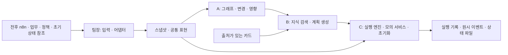

# FlowDelta 4인 역할·착수 태스크·상세 실행계획

> **2026-10-11 공유 기준:** 역할·일정의 최초 계획(아래 1–17절)을 보존하고, 준비된 계약 0.4.0의 폴더·함수·예제·완료 조건을 [현재 착수 명세](#current-start)에 통합했다.
> 지금 구현을 시작할 때는 현재 착수 명세와 [준비 현황](current-readiness.md)을 먼저 읽는다. 초기 계획의 수작업 준비·미확정 버전 항목은 현재 구현 상태를 뜻하지 않는다.
> A/B/C 이슈의 배정·본문 갱신은 이번 문서 정리 이후의 별도 작업이다.

작성 기준: **2026-10-09, Asia/Seoul**. 오늘의 목표는 팀장이 네 명의 구현 업무를 배정하는 것이다. 개발물을 오늘 모두 완성한다는 일정이 아니다. 팀장은 이 요청을 한 사용자이며 입력 모듈도 직접 구현한다. 팀원 A·B·C는 실명·숙련도·가용 시간을 확인하기 전의 임시 표기다. 아래 기간은 착수 후 상대적인 제안이며 개인별 합의 마감은 아직 없다.

**문서 용도:** 기존 설계에서 누가 어떤 코드를 어떤 순서로 만들지 정하는 별도 작업 문서다. 검증·판정·보고는 이번 역할 분배에 넣지 않는다. 시스템의 관련 기능은 전체 설계에 유지하며, 이 문서의 네 구현 영역이 연결됐다고 연구 전체가 완성되는 것은 아니다.

**공유 위치:** [별도 Notion 실행계획](https://app.notion.com/p/3f4c2d6e153780748df8f4d69467142c) · [팀의 기존 최종 설계](https://app.notion.com/p/3eec2d6e1537801bb949de84023a2f23).

## 기존 설계와 이 문서의 관계

| 문서 | 용도 |
|---|---|
| [현재 상세 설계](../final/README.md) | 시스템이 해결할 문제, 전체 구성과 기능 경계 |
| [입력·데이터 기준](../final/input-and-data.md) | 무엇을 고정하고 현실적인 자료를 어떻게 구성하는지 |
| [10주 연구·평가 계획](../final/execution-plan.md) | 연구 전체의 비교 방법, 자료 분할, 비용과 완료 조건 |
| **이 문서** | 네 명의 구현 역할, 오늘 전달할 태스크, 첫 산출물과 연결 순서 |
| [PR #16 당시 계획 원본](https://github.com/serendipity-sec/docs/blob/f7750a377c0eb5210ed939e839d1e62da040b725/final/execution-plan.md) | 당시 내용을 그대로 확인하는 고정 이력. 과거 역할표는 현재 배정안으로 사용하지 않음 |

PR #16의 여섯 설계 파일은 Git 이력에 보존돼 있다. 이후 PR #17–19에서 설계서·실행 계획·HTML의 역할 설명을 바꿨고 별도 역할 파일을 추가했다. 입력·데이터, 조사 근거, JSON 계약 파일은 PR #16 이후 동일하다. 이번 분리에서는 설계 본문의 업무·정책·그래프·검색·실행·연구 기준을 유지하고 역할 상세의 기준 위치를 이 문서로 모은다.

**팀장이 먼저 읽을 순서:** 아래 전체 설계 설명 → 1절 역할표 → 13절 오늘 배정 순서 → 14절 네 개의 첫 태스크 → 15절 진행 계획. 각 담당자는 자신의 모듈 상세와 7절 전달 계약을 이어서 읽는다.

## 팀장이 먼저 이해할 전체 설계

### 무엇을 만드는가

**FlowDelta는 같은 업무를 수행하는 AI workflow의 변경이 보안 경계에 어떤 영향을 주는지 분석하는 도구다.** n8n은 업무를 실행하는 대상이고 FlowDelta는 그 대상의 전후 구성·환경을 읽고 비교한다. 초기 결과물은 제한된 n8n 동작과 정책 형식을 지원하는 재사용 가능한 코어다. 연구할 때는 입력·버전·조건을 고정하고 다른 사용자는 같은 형식으로 자기 사례를 넣는다.

설명용 업무는 “고객에게 본인 주문의 배송 상태를 알려 준다”다. 다음 네 가지를 구분한다.

| 항목 | 이 업무에서의 의미 |
|---|---|
| 업무 | 인증된 고객에게 해당 주문의 정확한 배송 상태를 안내 |
| 정책 | 허용된 주문만 읽고 보호 주문을 수정하지 않으며, 허용된 상담 기록은 남길 수 있음 |
| workflow | 고객 확인 → 주문 조회 → 응답 작성의 n8n 노드·연결·설정 |
| 초기 상태 | 합성 고객·주문·테넌트·권한·기존 상담 기록 |

업무의 정상 완료 조건과 허용 예외도 입력에 포함한다. 정책은 현재 workflow가 하는 행동을 그대로 따라 만들어서는 안 된다. 정책 출처는 운영자 요구, 공개 업무 benchmark, 연구자 정의 중 무엇인지 기록한다. 한 비교쌍에서는 같은 업무·평가 정책·초기 상태를 적용하고 비교하려는 변경만 구별한다. 여러 사례에서는 서로 다른 업무와 workflow 계열을 사용한다.

### 입력부터 결과까지 여섯 단계

| 단계 | 쉽게 설명하면 | 필요한 이유 |
|---|---|---|
| 1. 입력과 스냅샷 | 전후 workflow·하위 구성·권한·모델 설정을 버전과 함께 묶음 | 같은 JSON이어도 연결 계정이나 하위 workflow가 달라질 수 있음 |
| 2. 그래프와 변경 분석 | 무엇이 실행되고, 값이 어디로 가며, 어떤 권한을 쓰는지 관계로 표현한 뒤 차이를 계산 | 파일의 글자 차이와 업무에 영향을 주는 차이를 구분 |
| 3. 관련 지식 검색 | 달라진 조건에 맞는 출처 있는 시나리오 카드를 찾음 | 참고할 사례를 좁히고 적용 조건과 근거를 붙임 |
| 4. 구조화 계획 | 지원하는 템플릿·입력·자원·예산을 묶은 계획을 만듦 | 자연어 제안을 실행기가 읽는 명확한 형식으로 바꿈 |
| 5. 전후 실행 | 같은 초기 자료를 별도 환경에 복제해 정상 업무와 정해진 실험을 실행 | 한쪽 실행이 다른 쪽의 DB·메모리를 바꾸는 일을 방지 |
| 6. 결과 해석 | 서비스 기록·상태 변화와 업무 조건을 바탕으로 결과와 한계를 구분 | 모델의 답변만으로 실제 효과나 전체 안전성을 단정하지 않음 |

이번 네 명의 구현 분담은 1–5단계를 입력·분석·계획·실행의 네 영역으로 나눈다. 6단계와 전체 연구의 담당 배분은 이번 표의 범위에 포함하지 않는다. 해당 기능이 삭제되거나 뒤로 미뤄져도 괜찮다는 의미는 아니다.

**그래프는 화면에 선을 그리는 기능보다 먼저 계산 모델이다.** 제어 순서, 데이터 전달, 모델 지시에 대한 영향 가능성, 권한·능력, 하위 의존성·보호 조건을 각각 표현한다. 그래프가 나타내는 가능한 경로와 실제 실행 기록은 구분한다. 이해할 수 없는 노드나 표현식은 해석 불가 상태와 위치를 남긴다.

**RAG는 필요한 지식을 찾아오는 부분이다.** 검색 결과는 사실·조건·출처와 함께 사용한다. 검색 점수가 높다고 실제 위험이 확인된 것은 아니고, 검색 결과가 없다고 분석 후보를 없애지도 않는다. 생성 모델은 등록된 템플릿을 사용하는 구조화 계획을 제안하며 임의 실행 코드를 작성하는 역할을 갖지 않는다.

**업무 성공과 정책 준수는 따로 본다.** 배송 상태 응답을 잘 만들었어도 보호 주문을 건드렸을 수 있다. 반대로 모든 호출을 막아 업무가 멈췄다면 유용한 개선이라고 할 수 없다. 실제 효과 확인·대상 통제 차단·시도만 관측·시험 범위에서 미관측·판단 불가·미실행을 구분하는 기존 설계가 유지된다. 이전 버전에도 있던 현상은 변경 후 새로 생긴 현상과 구분한다.

### 실제에 가까운 자료와 연구 방향

기존 [입력·데이터 조사](../final/input-and-data.md)에 기록된 고객지원 workflow 14550·18499, 공개 업무의 정책·초기 DB, 실제 Git 이력은 후보 자료다. 현재 운영 중인 기업의 데이터셋을 확보했다는 뜻은 아니다. 첫 업무는 그 후보의 지원 가능한 주문 조회 흐름으로 잡고, 서비스 노드를 대체하거나 흐름을 줄였으면 변환 이력을 남긴다. 합성 고객·주문으로 업무 관계를 보존한다.

프로젝트의 연구 질문은 환경·하위 의존성·정책을 포함한 분석이 단순 구성 비교에서 놓치는 부분을 줄이는지, 같은 실행 예산에서 변경 정보·그래프·RAG가 추가 가치를 주는지다. 단순 규칙·전체 재분석·텍스트 RAG·고정 시나리오 등과 비교하는 원래 계획을 유지한다. 수작업으로 만든 위험 변경만 성공하는 시연에 연구 결론을 한정하지 않도록 정상 변경·실제 이력·지원 한계도 다룬다.

첫 개발 단계에서는 **한 업무가 입력부터 실행 기록까지 연결되는 작은 흐름**을 먼저 만든다. 그다음 두 번째 업무를 붙여 데모 ID 하드코딩을 제거하고, 검색·생성·지원 동작을 확장한다. 30계열·120쌍과 카드 수 등은 초기 가정이며 첫 사례의 작성·실행 비용을 확인한 뒤 확정한다.

## 1. 네 명의 역할을 한눈에 보기

| 담당 | 구현 영역 | 만드는 프로그램 | 핵심 출력 |
|---|---|---|---|
| **팀장** | **입력·n8n 어댑터** | 전후 workflow·업무·정책·의존성을 읽고, n8n 구성을 공통 표현으로 바꾸는 입력 엔진 | ComparisonCase, Snapshot, 정규화 workflow, 노드별 의미 정보 |
| **A** | **보안 그래프·변경 분석** | 노드별 의미를 연결하고, 변경된 조건과 영향을 받는 경로를 계산하는 분석 엔진 | SemanticGraph, ChangeSet, 영향 경로·해석 범위 |
| **B** | **지식·검색·계획 생성** | 출처가 있는 카드를 저장·검색하고, 현재 변경에 맞는 등록 템플릿을 조합하는 계획 엔진 | ScenarioCard, 검색 결과, Hypothesis, TestPlan |
| **C** | **실행 엔진·환경** | 고정한 n8n 환경과 모의 서비스를 구성하고, 동일 초기 상태로 전후 버전을 실행하는 런타임 | ExecutionRun, 원시 이벤트·상태 파일, 실행 산출물 참조 |

팀장은 첫 번째 모듈의 구현자다. API·CLI 연결도 각자 자기 모듈까지 맡는다. 큰 웹 화면, 계정 시스템, 다중 플랫폼 지원은 초기 구현 범위에 추가하지 않는다.

이 분할의 이유는 **n8n을 읽는 문제와 그래프로 추론하는 문제가 서로 다른 구현 난도를 갖기 때문**이다. 입력 어댑터의 세부 동작이 바뀌어도 공통 표현을 유지하면 분석기를 그대로 사용할 수 있다. 검색·계획과 실행도 파일 계약으로 연결해 따로 개발할 수 있다. 네 역할 때문에 네 개의 마이크로서비스를 만들 필요는 없다. 초기 구성은 하나의 Python 코어와 분리된 실행 환경이다.

## 2. 하나의 업무로 이해하기

설명용 업무는 **고객에게 본인 주문의 배송 상태를 알려 주기**다. 업무 요청·평가 정책·초기 주문 상태는 한 비교쌍에서 동일하게 둔다. 공개 원본의 일부를 축소하거나 서비스 노드를 대체했다면 변환 이력을 남긴다. 다음 설명은 실제 운영 사례나 실행 결과가 아니다.

1. **팀장:** 이전·이후 n8n JSON과 업무·정책 파일을 읽는다. 어떤 노드가 주문을 읽고, 어떤 값이 응답으로 전달되며, 어떤 서비스·권한 참조를 사용하는지 공통 표현으로 만든다.
2. **A:** 두 표현을 그래프로 연결한다. 조회 도구 연결, 데이터 참조, 권한 설정 등이 달라졌는지 계산하고 영향을 받는 경로와 원본 위치를 묶는다.
3. **B:** 변경 조건에 맞는 카드를 검색하고, 팀이 등록한 실험실 시나리오 템플릿과 정상 업무 입력을 연결해 구조화된 계획을 만든다.
4. **C:** 합성 고객·주문 상태를 두 환경에 각각 복제한다. 계획에 따라 양쪽 workflow를 실행하고 응답·도구 호출·서비스 이벤트·상태 파일을 저장한다.

화살표는 데이터가 전달되는 순서다. **개발 시작 순서는 아니다.** 팀장은 작은 n8n JSON, A는 수작업 공통 표현, B는 예시 분석 결과, C는 수작업 계획을 사용해 동시에 착수한다.

## 3. 팀장 — 입력·n8n 어댑터

**목적:** 사용자가 제공한 자료를 분석기가 읽을 수 있는 일관된 입력으로 바꾼다.

**입력:** 전후 workflow JSON, task·policy, 의존성 manifest, 환경·권한 설명, 초기 상태와 runtime 설정의 참조.

**출력:** ComparisonCase·Snapshot과 정규화된 workflow, 노드별 의미 정보, 지원 범위와 누락 사유. 원본 파일은 별도로 보존한다.

| 작업 | 구현 내용 | 구체적인 산출물 |
|---|---|---|
| L-01 사례 입력 로더 | 업무·정책·초기 상태·전후 구성의 파일 참조를 읽고 공통 case ID로 연결. 형식 오류와 누락 필드를 명시 | bundle 로더, TaskContract·Policy 입력 모델, ComparisonCase |
| L-02 n8n 정규화 | node ID·type·typeVersion·operation·parameter·connection·port를 공통 구조로 변환. 화면 좌표와 실행 의미를 구분 | 정규화 모델, 원본 JSON 위치 매핑, 결정적인 직렬화 |
| L-03 노드 의미 어댑터 | 지원하는 노드·동작의 입력/출력 필드, 도구 능력, 외부 효과, 오류·배치 특성을 기술. 제한된 표현식 참조를 추출 | 버전별 어댑터 등록부, 노드별 의미 정보, 미지원 사유 |
| L-04 구성 스냅샷 | 명시된 하위 workflow·MCP/Skill 설명·환경 참조를 묶고 원본/정규화 해시와 의존성 버전을 기록 | Snapshot, 의존성 manifest, 원본·변환 이력 |
| L-05 입력 진입점 | 파일 기반 사용 흐름, 입력 설정, 오류 위치 표시, 공통 CLI 골격과 입력 명령 연결 | 입력 모듈 API, CLI 연결, 같은 형식의 두 사례 묶음 |

### A와 겹치지 않도록 정하는 경계

- **팀장이 만드는 것:** “이 노드는 어떤 필드를 읽고 쓰며, 이 파라미터는 어느 노드의 값을 참조한다”는 개별 노드의 의미.
- **A가 만드는 것:** 그 정보를 여러 노드·하위 workflow에 걸쳐 연결한 관계와 변경 영향.
- 단일 노드 안의 표현식 해석은 팀장, 노드 사이의 값 전달·지시 영향 추적은 A가 맡는다.
- ID가 재생성됐을 때 전후 노드를 대응시키는 알고리즘은 A가 맡는다. 팀장은 각 버전의 원본 ID와 위치를 보존한다.

**초기 범위:** 첫 업무 후보에 필요한 한 n8n 릴리스와 명시적인 node/typeVersion/operation 조합. 동적 하위 참조·임의 Code·알 수 없는 표현식은 추정해 채우지 않고 표시한다. 서버를 시작해야 얻을 수 있는 정보는 입력 파싱에 숨기지 않고 실행 작업으로 분리한다.

**첫 연결 가능한 산출물:** 같은 작은 workflow의 전후 JSON을 읽어, 원본 위치가 포함된 두 공통 표현과 하나의 ComparisonCase를 출력한다. A는 이 결과만으로 그래프를 만들 수 있고 C는 원본과 환경 참조를 찾을 수 있어야 한다.

## 4. A — 보안 그래프·변경 분석

**목적:** 두 구성에서 무엇이 바뀌었고, 그 변화가 어느 관계에 영향을 주는지 계산한다.

**입력:** 팀장의 정규화 workflow·노드 의미 정보·Snapshot, 구조화된 업무·정책 참조.

**출력:** 전후 SemanticGraph, ChangeSet, 영향 경로, 정책·업무 참조, 원본 위치, 해석할 수 없는 구간과 그 이유.

| 작업 | 구현 내용 | 구체적인 산출물 |
|---|---|---|
| A-01 그래프 모델·구성 | 제어·데이터·지시 영향·권한·의존성/보호 관계를 구분하고 원본 노드·필드와 연결 | typed node/edge 모델, 그래프 builder·직렬화 |
| A-02 관계 연결 | 분기·병합·도구 연결·고정 하위 호출을 따라 지원 범위의 관계를 연결. 알 수 없는 관계를 별도로 유지 | 경로 탐색, 조건·지원 범위 정보 |
| A-03 의미 변경 계산 | 노드 대응, 추가·삭제·속성·권한·환경·하위 의존성의 차이 계산. 좌표 변경 등을 실행 의미 변경과 구별 | ChangeSet, 대응 근거·모호한 대응 목록 |
| A-04 영향 범위 계산 | 변경된 노드·조건에서 관련 데이터·도구·보호 자원 경로를 찾고 업무·정책 ID를 연결 | 영향 경로, 경로별 변경 근거·해석 한계 |
| A-05 분석 진입점 | 양쪽 전체 그래프를 먼저 만든 뒤 비교하는 기준 구현, 분석 설정·결과 저장·CLI 연결 | 분석 API, B가 바로 읽을 수 있는 분석 묶음 |

**초기 범위:** 지원 동작에 대한 전체 분석을 먼저 만든다. 선택적 재분석·캐시 최적화는 이 구조가 연결된 뒤 추가한다. 정적 경로와 실제 실행 효과는 별개의 정보다. 경로가 발견됐다는 이유로 실제 효과가 발생했다고 기록하지 않는다.

**첫 연결 가능한 산출물:** 수작업 공통 표현의 두 버전에서 노드/연결 변경 한 건과 영향 경로를 JSON으로 출력한다. 각 변경에서 원본 ID·필드로 돌아갈 수 있어야 한다. 이후 팀장 출력으로 입력만 교체한다.

## 5. B — 지식·검색·계획 생성

**목적:** 분석 결과와 관련된 근거를 찾고, 등록된 실행 형식에 맞는 계획을 만든다.

**입력:** A의 변경·경로·지원 범위, task·policy 참조, 출처가 있는 자료, C가 제공하는 템플릿·어댑터 목록과 파라미터 명세.

**출력:** ScenarioCard, 검색 결과와 적용 조건, Hypothesis, TestPlan, 아직 계획에 연결하지 못한 항목과 이유.

| 작업 | 구현 내용 | 구체적인 산출물 |
|---|---|---|
| B-01 카드 입력·저장 | 자료를 조건·원리·대상 버전·출처가 있는 구조화 카드로 변환. 원문 주장과 연구자 가정을 구분 | 카드 스키마·로더, 출처·버전·중복 관리 |
| B-02 지식 인덱스 | 키워드·벡터 검색용 필드와 메타데이터 인덱스 구성, KB 버전 고정과 재색인 | 검색 저장소·인덱싱 코드, KB snapshot 참조 |
| B-03 조건 기반 검색 | 변경 종류·경로·제품/버전·필요 권한 등으로 검색·필터·순위화. 결과 없음도 표현 | 근거와 적용 조건이 붙은 검색 결과 |
| B-04 구조화 계획 조합 | 등록된 템플릿 선택, 실제 노드·입력·자원 참조 바인딩, 정상 업무 입력·예산 연결 | Hypothesis·TestPlan, 미연결 항목 목록 |
| B-05 생성기 연결 | 고정 템플릿 방식부터 시작하고 LLM을 선택적 구성 요소로 연결. 모델·프롬프트·KB 버전, 제한된 재시도와 캐시 처리 | 계획 모듈 API·CLI, 공급자 교체 가능한 생성 인터페이스 |

**초기 범위:** 작은 출처 확인 카드 집합과 고정 템플릿으로 먼저 연결한다. 검색 결과가 없을 때도 업무·정책의 요구 항목을 보존한다. LLM에는 등록된 템플릿과 파라미터만 제공하고 임의 실행 코드를 만들 권한을 주지 않는다. 사례의 비공개 정답 자료는 KB 입력에 포함하지 않는다.

**C와의 경계:** B는 어떤 등록 템플릿을 어떤 값으로 사용할지 구성한다. C는 해당 템플릿을 실행할 어댑터·모의 서비스·상태 전이를 구현한다. 템플릿 ID, 허용 파라미터, 결과 artifact 형식은 두 모듈이 공유한다.

**첫 연결 가능한 산출물:** 예시 ChangeSet 하나로 소수 카드에서 조건이 맞는 결과를 찾고, 실제 실행 코드가 아닌 등록 템플릿 참조를 포함한 계획 JSON 한 건을 출력한다. C는 같은 형식의 수작업 계획으로 먼저 개발할 수 있다.

## 6. C — 실행 엔진·환경

**목적:** 입력 묶음과 계획을 받아 같은 초기 조건에서 전후 workflow를 돌리고 실행 자료를 남긴다.

**입력:** Snapshot·ComparisonCase, 구조화 계획, 합성 초기 상태, 서비스 연결 설정, 시간·호출 수·동시 실행 한도.

**출력:** ExecutionRun, 실행 응답·도구 호출·서비스 이벤트·전후 상태 파일, 초기화 기록과 산출물 참조. 여기서 다루는 실행 상태는 작업 진행·종료 상태다.

| 작업 | 구현 내용 | 구체적인 산출물 |
|---|---|---|
| C-01 고정 실행 환경 | 지정 n8n 버전·서비스를 시작하고 설정·자격 참조를 바인딩. 실행용 환경과 개발 환경 분리 | 환경 명세, 시작·종료 스크립트, runtime manifest |
| C-02 서비스·어댑터 | 팀 관리 문서/주문 저장소·내부 수신 서비스 등 업무에 필요한 모의 서비스와 n8n 호출 어댑터 | 서비스 API, 등록 템플릿/어댑터 목록, 이벤트 출력 |
| C-03 실행 작업 관리 | plan 접수, 전후 실행 순서, run ID, 시간초과·취소·자원 한도·작업 진행 상태 처리 | 실행 API·CLI, 작업 상태 기계, 모든 시도 기록 |
| C-04 상태 복제·초기화 | 같은 초기 자료를 전후 실행에 각각 복제하고 잔여 상태·메모리·서비스 데이터를 초기화 | 상태 로더·복제·초기화 코드, 실행별 자원 이름 공간 |
| C-05 실행 산출물 저장 | 응답·원시 이벤트·상태 파일·실행 비용을 run ID에 연결하고 이전 실행 자료 보존 | ExecutionRun·EvidenceEvent, artifact manifest·참조 |

**초기 범위:** 하나의 격리 환경과 낮은 동시성, 팀 관리 합성 데이터·모의 서비스로 시작한다. 실제 운영 자격이나 고객 데이터를 필요로 하는 연결은 기본 예제에 넣지 않는다. 두 버전이 하나의 변경 가능한 DB를 공유하지 않는다. 대상 workflow는 실행 기록 저장 영역을 수정할 수 없어야 한다.

**팀장과의 경계:** 팀장은 파일을 읽어 표현을 만드는 n8n 어댑터, C는 n8n을 시작·호출하고 상태를 다루는 실행 어댑터를 구현한다. 선언된 권한·연결 참조와 실행 환경에서 사용한 실제 참조를 서로 연결할 수 있게 남긴다.

**첫 연결 가능한 산출물:** 수작업 계획으로 정상 업무 한 건을 실행해 run ID·응답·상태 파일을 저장하고, 초기화 후 새 run ID로 다시 실행할 수 있는 작은 실행기. 외부 API 전면 연동과 다중 사용자 작업 큐는 초기 목표에 포함하지 않는다.

## 7. 네 모듈의 전달 계약

기존 객체의 예시는 [contracts.example.json](../final/contracts.example.json)에 있다. 아래 `NormalizedWorkflow`, `NodeSemantics`, `AnalysisBundle`, `RunArtifacts`는 **경계를 설명하기 위해 추가 제안한 이름**이며 현재 JSON 예시에 확정 스키마가 존재한다는 뜻이 아니다. 구현 착수 때 필드와 schema version을 합의한다.

| 전달 방향 | 묶음 | 반드시 포함할 정보 |
|---|---|---|
| 사용자 → 팀장 | ComparisonCase·Snapshot·TaskContract·Policy 참조 | 전후 원본, 같은 업무·평가 정책·초기 상태, 변경 축, 출처 |
| 팀장 → A | NormalizedWorkflow·NodeSemantics·Snapshot | 원본 ID/위치, node/typeVersion/operation, 포트·필드 참조, 지원 상태·누락 사유 |
| 팀장 → C | Snapshot·ComparisonCase와 실행 참조 | 원본 workflow 위치·해시, 환경·의존성·초기 상태 참조, 비밀값을 포함하지 않는 자격 참조 |
| A → B | AnalysisBundle | SemanticGraph·ChangeSet, 영향 경로, 업무/정책 참조, 원본 위치·해석 불가 구간 |
| C → B | 등록 템플릿·어댑터 목록 | ID·버전, 허용 입력/자원 형식, 필요한 fixture, 산출물 형식·실행 한도 |
| B → C | Hypothesis·TestPlan | case/snapshot 참조, 템플릿 ID·버전, 파라미터, 정상 입력, 초기 상태 참조·예산 |
| C → 산출물 저장소 | ExecutionRun·RunArtifacts | run/case/snapshot/plan 대응, runtime 버전, 원시 이벤트·상태 파일 참조, 초기화·실행 상태·비용 |

### 공통 규칙

- ID는 사람이 보기 좋은 이름과 구분한다. 원본 ID와 공통 ID의 매핑을 보존하고 재실행에는 새 run ID를 만든다.
- 원본 해시와 정규화 해시는 구분한다. 비교 정책·정규화 규칙·KB·모델 설정도 버전을 기록한다.
- `unsupported`, `missing_reference`, `ambiguous_mapping`, `no_matching_card`, `budget_exhausted`, `execution_timeout` 등의 사유는 발생 모듈과 대상 ID에 연결한다. 정확한 코드 목록은 초기 계약에서 확정한다.
- 원본 정의와 실행 산출물을 덮어쓰지 않는다. 실패한 호출도 없던 일로 삭제하지 않는다.
- 각 모듈은 다른 모듈의 내부 DB 테이블을 직접 읽지 않는다. 처음에는 버전 있는 JSON 파일과 함수 인터페이스로 연결한다.
- 필드의 이름·의미가 바뀌면 생산자와 소비자의 코드·예시 파일을 같은 변경에 맞춘다. 알 수 없는 필드를 조용히 기본값으로 채우지 않는다.

## 8. 업무·정책·현실적인 원본의 구현 분담

이 표는 **데이터를 프로그램에 넣는 기능**의 소유자다. 실제 정책을 임의로 만들거나 연구 정답을 각 개발자에게 배분하는 표가 아니다. 구체적인 후보와 출처 기준은 [입력·데이터 상세](../final/input-and-data.md)를 따른다.

| 자료 | 구현 책임 | 보존할 것 |
|---|---|---|
| 기존/수정 n8n·하위 의존성 | 팀장: 원본 로더·스냅샷·변환 이력 | URL·commit·해시·원본 ID, 실제 이력과 연구자 변형의 구분 |
| 업무·정책 파일 | 팀장: 구조화 입력 로더와 참조 모델 | 업무 목적·주체·자원·허용 부수 효과·정책 출처/버전 |
| 업무·정책과 그래프의 연결 | A: 노드/자원/경로에 조건 ID 연결 | 어떤 조건이 어느 원본 위치와 연결되는지, 연결 불가 사유 |
| 공개 보안 지식 | B: 카드 입력·인덱싱·검색 | 원문 URL·적용 조건·버전·이용 조건, 요약과 가정의 구분 |
| 초기 DB·문서·서비스 상태 | C: 상태 로더·모의 서비스·초기화 | 고객–주문 관계, 테넌트·권한·상태 전이와 실행별 분리 |

한 비교쌍 안에서는 task·평가 policy·초기 상태를 동일하게 적용한다. 서로 다른 사례에서는 여러 업무 계열을 지원한다. 특정 데모의 고객명·노드 ID·정답을 핵심 코드에 넣지 않는다. 정책은 해당 workflow의 현재 행동에서 자동으로 정답처럼 도출하지 않고 출처가 있는 입력으로 받는다.

## 9. 파일·API·CLI를 어디까지 맡는가

아래는 **platform 저장소에 만들 경로와 인터페이스 제안**이다. 현재 존재하는 파일이나 구현된 API라고 주장하지 않는다. 화면 작업이 추가되면 각 모듈의 입출력을 표시하는 얇은 연결부터 만들고, 별도의 프런트엔드 전담자를 두지 않는다.

| 담당 | 제안 경로 | 자기 모듈의 진입점 |
|---|---|---|
| 팀장 | `src/flowdelta/ingestion/`, `adapters/n8n/`, `contracts/input/` | 파일 입력·snapshot 명령, 향후 `POST /snapshots` |
| A | `src/flowdelta/analysis/`, `contracts/analysis/` | 비교 분석 명령, 향후 `POST /comparisons` |
| B | `src/flowdelta/knowledge/`, `planning/`, `contracts/planning/` | 카드 검색·계획 명령, 향후 `POST /test-plans` |
| C | `src/flowdelta/execution/`, `lab/`, `contracts/execution/` | 실행 작업 명령, 향후 `POST /runs` |

- **공통 골격:** 팀장이 최소 패키지·설정·CLI 등록 방식을 만든다. 각자는 자기 명령·의존성·오류 처리를 연결한다.
- **스키마:** 객체를 출력하는 모듈이 모델 파일을 소유한다. 소비자는 해당 버전을 명시해서 읽는다.
- **저장:** B는 KB·인덱스, C는 실행 artifact, 팀장은 입력 snapshot, A는 분석 결과의 저장 형식을 구현한다. 전역 저장 시스템을 한 사람에게 몰아주지 않는다.
- **사용 흐름:** 정적 입력만으로도 입력 처리와 분석·검색은 시작할 수 있게 한다. 실행 단계에는 해당 환경·상태·어댑터가 추가로 필요하다.

## 10. 동시에 시작하기 위한 첫 작업

먼저 한 사례 ID와 네 경계의 작은 JSON 예시를 맞춘다. 다른 사람의 구현 완성을 기다리지 않는다. 다음 표의 모의 입력은 인터페이스 개발용이며 실제 환경에서 얻은 결과로 표시하지 않는다.

| 담당 | 다른 모듈 없이 쓰는 입력 | 처음 만들 기능 | 첫 인계 |
|---|---|---|---|
| 팀장 | 작은 n8n JSON과 task/policy 파일 | 입력 로더·정규화·원본 위치 매핑 | A에게 공통 표현, C에게 원본/환경 참조 |
| A | 손으로 만든 노드 의미 정보 | 기본 그래프·변경 한 건·영향 경로 | B에게 분석 JSON |
| B | 예시 ChangeSet·소수 카드·C의 템플릿 명세 | 카드 로더·검색·고정 계획 조합 | C에게 계획 JSON |
| C | 손으로 만든 계획·합성 초기 상태 | 정상 workflow 실행·상태 복제·초기화 | 실행 기록·artifact 참조, B에게 템플릿 목록 |

**첫 합류 때 필요한 자료:** 실행 가능한 각 모듈, 입력 파일, 호출 명령, 출력 파일, 지원 범위와 알려진 오류 처리. 내부 화면 시연만으로 연결 가능한 프로그램이 되지는 않는다.

## 11. 구현을 합치는 순서

연구 전체의 완료 기준과 구별하기 위해 아래 단계는 **I0–I3 구현 연결 단계**라고 부른다. 날짜나 성능 달성률을 뜻하지 않는다.

| 단계 | 팀장 | A | B | C | 합쳐진 결과 |
|---|---|---|---|---|---|
| I0 경계 맞추기 | 입력·공통 표현 예시 | 그래프·변경 예시 | 카드·계획 예시 | 템플릿·실행 기록 예시 | 같은 ID·참조·schema version으로 자료를 읽음 |
| I1 작은 업무 연결 | 실제 파일을 공통 표현으로 변환 | 그 표현으로 그래프 생성 | 고정 템플릿 계획 출력 | 합성 상태에서 정상 업무 실행 | 입력부터 실행 기록까지 한 번 연결 |
| I2 전후 비교 연결 | 두 snapshot·같은 task/policy | 변경·영향 경로 계산 | 같은 등록 형식으로 계획 구성 | 분리된 초기 상태로 양쪽 실행 | 전후 자료를 case ID로 연결하고 원시 산출물 보존 |
| I3 두 번째 업무·자동화 | 새 사례를 설정으로 추가 | 동일 모델로 새 관계 처리 | 조건 검색·선택적 생성기 연결 | 동일 런타임으로 새 fixture 처리 | 핵심 코드의 데모 ID 하드코딩 없이 두 업무 연결 |

순차 화살표 때문에 직렬로 개발하지 않는다. I0 이후 각 모듈을 병행하고 경계마다 수작업 파일을 실제 출력으로 교체한다. I3까지 연결돼도 논문 평가나 전체 제품이 완료됐다는 뜻은 아니다. 연구 전체의 남은 작업은 실행·평가 계획에서 관리한다.

## 12. 작업량 조정과 착수 결정

역할별 다섯 작업은 기능을 쪼갠 단위이며 같은 인시를 뜻하지 않는다. 사람별 가용 시간과 첫 업무 구현 시간을 아직 모르므로 25%씩 균등하다고 단정하지 않는다.

| 부담이 커지는 영역 | 먼저 줄일 확장 | 유지할 구현 중심 |
|---|---|---|
| 팀장: n8n 동작·표현식 | 여러 릴리스, 임의 코드 해석, 동적 참조 자동 추적 | 실제 후보에 필요한 동작과 명시적 미지원 처리 |
| A: 관계·경로 수 | 선택적 재분석, 전 범위 정밀 필드 분석 | 전체 분석 기준과 근거가 있는 변경·영향 경로 |
| B: 검색·생성 비용 | 대규모 자동 수집, 자유 형식 계획, 여러 모델 | 작은 KB·조건 검색·등록 템플릿 계획 |
| C: 실행 환경·연동 | 실제 SaaS 다수 연동, 다중 사용자 큐, 높은 동시성 | 한 환경·필수 모의 서비스·상태 분리·초기화 |

그 뒤에도 특정 역할이 과부하라면 **완결된 작은 모듈**을 옮긴다. 예를 들어 B가 카드 검색과 계획을 함께 감당하기 어려우면 A의 분석 API 연결이 끝난 뒤 고정 템플릿 조합 모듈을 맡길 수 있다. 이동할 때는 파일 소유자·입출력·소비자만 명시적으로 바꾸고 미완성 일을 팀장에게 일괄 이전하지 않는다.

**착수 때 정할 항목:** A·B·C의 실제 배정, 각자의 가용 시간, 첫 두 업무와 원본, n8n 릴리스·지원 동작, 공통 표현 필드, 실행 환경, 모델·예산. 경험상 팀장 영역은 JSON·어댑터·백엔드 입력 처리, A는 자료구조·정적 분석, B는 검색·LLM 연동, C는 컨테이너·서비스·비동기 실행에 관심 있는 사람이 맡기 좋다. 실제 역량을 확인한 뒤 사람과 영역의 매핑을 조정할 수 있다.

**지금 시작할 일:** 한 사례의 입력·공통 표현·분석 결과·계획·실행 기록 예시를 같은 버전으로 저장하고 네 명이 각각 첫 기능을 구현한다. 다음 합류에서는 문서 분량이 아니라 프로그램 사이에 파일이 실제로 전달되는 모습을 확인한다.

## 13. 오늘 팀장이 배정할 순서

**오늘(2026-10-09)은 배정과 착수 조건을 합의하는 날**이다. 아래를 한 번에 정리해 네 명에게 같은 작업 기준을 전달한다. 시간은 회의 운영 제안이며 팀원의 확정 가용 시간을 뜻하지 않는다.

| 순서 | 오늘 정할 것 | 회의 후 남길 결정 |
|---|---|---|
| 1 | A·B·C와 기술 영역 연결 | 실명, 선호 분야, 주당 가능 시간. 어려운 분야를 맡은 사람에게 지원 방법도 정함 |
| 2 | 첫 업무와 정상 입력 선정 | 주문 조회 후보의 출처·축소 범위, 합성 입력, 업무·정책·초기 상태 |
| 3 | 최소 공통 표현·ID·파일 참조 합의 | case/snapshot/node/plan/run의 의미, 필수 필드, 네 경계의 예시 JSON |
| 4 | 각자의 첫 태스크 전달 | 아래 L-START·A-START·B-START·C-START의 입력·출력·범위·소비자 |
| 5 | 첫 합류 시점 합의 | 착수 후 2–3개 작업일의 첫 출력과 첫 주 연결을 초기 목표로 제안하고 실제 날짜는 각자 확인 |

지원 엔진과 정확한 노드 동작은 원본과 실행 가능성을 보고 고른다. 아직 정하지 않은 버전을 “최신”으로 뭉뚱그려 기록하지 않는다. 비공개 자격·운영 데이터가 필요한 부분은 합성 상태와 팀 관리 서비스로 대체하는 범위를 적는다.

범위가 불명확한 태스크는 “n8n 전체 지원”, “RAG 완성”, “전체 시스템 연결”처럼 전달하지 않는다. 다른 사람이 읽을 첫 출력 파일 하나를 기준으로 작게 시작한다.

## 14. 그대로 전달할 네 개의 첫 태스크

다음은 **태스크 초안**이다. 실제 이슈 번호·담당 실명·시작/완료 날짜는 아직 생성하거나 확정하지 않았다. 파일 경로와 객체 이름은 구현 제안이다. 완료 조건은 해당 작은 기능의 인계 가능 상태를 뜻한다.

### L-START — 팀장: 사례 로더와 n8n 공통 표현 만들기

**전달 문구:** “기존·수정 n8n JSON과 task/policy 파일을 읽어 ComparisonCase와 두 버전의 공통 표현을 만들어 주세요. 우선 첫 주문 조회 사례에 필요한 필드만 지원하고, A가 원본 n8n 구조를 다시 해석하지 않아도 그래프를 만들 수 있게 넘겨 주세요.” 팀장 본인에게 배정하는 구현 태스크다.

- **받을 자료:** 첫 업무의 전후 JSON, 업무·정책 초안, 초기 상태·환경 참조.
- **세부 기능:** 파일 참조 로딩 → 노드 ID·type/typeVersion·operation 추출 → 포트/연결·지원 필드 참조 변환 → 원본 위치·누락 사유 저장.
- **제안 파일:** `ingestion/case_loader.py`, `adapters/n8n/normalize.py`, `contracts/input/`, `examples/order-lookup/`.
- **넘길 결과:** `case.json`, `before.normalized.json`, `after.normalized.json`, 원본/정규화 ID 매핑. A와 C가 소비한다.
- **첫 인계 상태:** 소비자가 문서 설명을 수작업으로 다시 입력하지 않고 파일을 읽을 수 있음. 원본 ID·지원 버전·필드 위치가 남고 누락 참조가 명시됨.
- **범위 상한:** 첫 사례의 지원 노드부터. 그래프 경로 계산, 모든 n8n 표현식, 자동 원격 의존성 수집은 이 태스크에 넣지 않음.
- **진행 의존성:** 실제 어댑터가 늦어져도 동일 필드의 수작업 JSON을 먼저 A에게 전달.

### A-START — 팀원 A: 공통 표현에서 그래프와 첫 변경 결과 만들기

**전달 문구:** “합의한 공통 표현으로 노드와 관계를 만들고, 두 버전에서 달라진 객체·속성·연결을 ChangeSet으로 출력해 주세요. 화면보다 JSON 출력을 먼저 만들고, 각 변경이 원본의 어느 위치에서 나온 것인지 연결해 주세요.”

- **받을 자료:** 수작업 `NormalizedWorkflow`·`NodeSemantics` 예시 두 개. 이후 팀장 출력으로 교체.
- **세부 기능:** 그래프 모델 → 첫 사례의 제어·데이터 관계 → 안정 ID 기반 대응 → 의미 있는 속성/연결 차이 → 짧은 영향 경로.
- **제안 파일:** `analysis/graph_builder.py`, `analysis/diff.py`, `analysis/impact.py`, `contracts/analysis/`.
- **넘길 결과:** `before.graph.json`, `after.graph.json`, `changes.json`, `analysis.json`. B가 소비한다.
- **첫 인계 상태:** 같은 형식의 두 입력을 받아 변경 위치·관계·근거를 출력함. 표시 좌표 변경은 의미 변경과 구분하고 대응이 모호하면 표시함.
- **범위 상한:** 전체 분석 후 비교로 시작. 증분 최적화·모든 경로 열거·대형 그래프 UI는 뒤에 둠.
- **진행 의존성:** 팀장의 전체 로더가 끝나기 전에 수작업 입력으로 개발. B에게도 작은 분석 JSON을 먼저 제공.

### B-START — 팀원 B: 카드 로더·조건 검색·고정 계획 조합 만들기

**전달 문구:** “소수의 출처 있는 카드와 예시 변경 결과를 받아 조건이 맞는 카드를 찾고, 등록된 템플릿을 참조하는 계획 JSON을 만들어 주세요. 첫 연결은 고정 규칙으로 만들고, 같은 입출력 뒤에 벡터 검색과 LLM을 추가할 수 있게 해 주세요.”

- **받을 자료:** 예시 `analysis.json`, 업무·정책 참조, 소수 카드, C의 정상 업무 템플릿 명세.
- **세부 기능:** 카드 필드·출처 읽기 → 버전/동작/필요 조건 필터 → 검색 근거 저장 → 등록 템플릿과 실제 ID 바인딩 → 계획 출력.
- **제안 파일:** `knowledge/card_loader.py`, `knowledge/retrieve.py`, `planning/compose.py`, `contracts/planning/`.
- **넘길 결과:** 카드 파일, 검색 결과, `plan.json`. C가 소비한다. 첫 계획은 정상 업무 연결부터 구성.
- **첫 인계 상태:** 같은 분석 입력에서 계획의 근거 카드·템플릿·case/snapshot 참조를 추적할 수 있음. 검색 결과 없음과 연결하지 못한 항목도 표현함.
- **범위 상한:** 카드 3–5개 정도의 작은 시작 규모를 제안. 대규모 수집·자유 형식 실행 코드·여러 모델 연결은 첫 태스크에서 제외.
- **진행 의존성:** A의 완성 전에는 예시 분석을 사용. C와 템플릿 ID·파라미터·결과 파일 형식부터 합의.

### C-START — 팀원 C: 정상 업무 실행·상태 초기화 만들기

**전달 문구:** “고정한 n8n 환경과 합성 주문 서비스를 준비해 수작업 계획으로 정상 주문 조회를 실행해 주세요. 실행마다 새 run ID를 만들고 초기 상태·응답·서비스 이벤트·결과 파일을 남겨 주세요. 같은 초기 상태에서 다시 실행할 수 있게 만드는 것이 첫 범위입니다.”

- **받을 자료:** 정상 workflow, 합성 초기 데이터, 수작업 plan, 실행 설정·예산 초안.
- **세부 기능:** 환경 시작 → 원본과 서비스 연결 → 초기 데이터 적재 → 작업 실행 → 응답/이벤트 저장 → 초기화 → 새 실행.
- **제안 파일:** `execution/runner.py`, `execution/state.py`, `execution/artifacts.py`, `lab/services/`, `contracts/execution/`.
- **넘길 결과:** 등록 템플릿 명세, `run.json`, 응답·이벤트·상태 파일과 manifest.
- **첫 인계 상태:** 이전 실행의 상태가 다음 실행에 섞이지 않고 run ID로 자료를 찾을 수 있음. 시간초과·초기화 실패 등 작업 상태를 숨기지 않음.
- **범위 상한:** 한 환경·정상 업무 한 건·낮은 동시성부터. 실제 SaaS 전면 연동·운영 자격·다중 사용자 큐는 이후.
- **진행 의존성:** B의 검색기를 기다리지 않고 수작업 plan으로 시작. 입력 JSON과 실행 환경을 연결하는 요구를 팀장에게 먼저 전달.

## 15. 앞으로의 진행 계획

### 배정 직후부터 첫 주까지

| 구간 | 구현할 상태 | 합류 기준 |
|---|---|---|
| 오늘 배정 | 네 역할과 L/A/B/C-START, 첫 업무·공통 참조·경계 예시 확정 | 각자가 받을 파일과 만들 파일, 연결 상대를 설명할 수 있음 |
| 착수 후 첫 2–3개 작업일 | 로더·그래프·고정 계획·정상 실행기가 각각 작은 입력을 처리 | 네 사람이 자기 모듈의 실제 출력 파일을 서로 전달 |
| 첫 주 첫 합류 | 수작업 중간 파일을 앞 모듈의 실제 출력으로 차례로 교체 | 업무 입력 → 정규화 → 변경 분석 → 계획 → 실행 기록 연결 |
| 두 번째 주 | 두 번째 업무, 전후 상태 분리, 지원하지 못한 구간·의존성 처리 | 사례를 바꿔도 같은 코어와 계약으로 연결 |

첫 합류에 모든 고급 기능이 필요하지 않다. 입력·분석·고정 계획·정상 실행이 연결되면, 검색·추론·실행 환경의 개선을 각자 계속 붙일 수 있다. 반대로 각자 화면만 시연하고 파일이 연결되지 않으면 같은 단계에 머문 것이다.

### 3주차 이후 구현 확장

| 구간 | 팀장 | A | B | C |
|---|---|---|---|---|
| 3–4주차 | 후보에 필요한 노드 의미·하위 의존성·환경 참조 확대 | 데이터·지시 영향·권한 관계와 변경 영향 확대 | 혼합 검색·적용 조건·선택적 LLM 생성기 연결 | 등록 시나리오 어댑터·작업 한도·산출물 관리 확대 |
| 5–6주차 | 여러 사례의 입력과 스키마·버전 고정 | 분석 결과 안정화와 필요한 범위의 성능 개선 | KB·모델·프롬프트·계획 형식 고정 | 환경·초기화·반복 실행 설정 고정 |
| 7–8주차 | 새 입력 연결에서 발견된 호환 문제 보완 | 남은 지원 범위·메모리/시간 문제 보완 | 검색·계획의 오류 처리와 설치 설정 보완 | 새 환경 설치·실행 의존성·자원 정리 보완 |
| 9–10주차 | 필요할 때 두 번째 버전 지원 | 근거가 있을 때 선택적 재분석 | 필요할 때 검색 순위·두 번째 모델 | 필요한 범위의 실행 환경 확장 |

위 표는 네 구현 역할의 계획이다. 연구 전체의 비교 실험·통계·논문 일정은 [기존 실행·평가 계획](../final/execution-plan.md)을 함께 따른다. 그 작업을 이번 역할표에 특정인 몫으로 섞어 배정하지 않는다. 전체 연구 기능의 별도 배분은 첫 업무 연결 전에 정해야 하는 미결정 사항으로 남긴다.

### 지연될 때 범위를 줄이는 순서

1. 처음부터 만들려던 큰 웹 UI·다중 사용자 기능·다른 프레임워크 지원을 미룬다.
2. 첫 두 업무에 불필요한 node/operation·표현식·실제 SaaS 연결을 줄인다.
3. 벡터 검색·LLM 연결이 늦으면 작은 카드와 고정 계획 방식으로 입력/실행 연결을 유지한다.
4. 선택적 재분석보다 전체 분석 기준을 유지한다.
5. 상태 분리·출처·원본 위치·미지원 표시 같은 공통 계약은 생략하지 않는다.

## 16. 팀장이 진행을 관리하는 방식

팀장은 L-START와 입력 모듈을 직접 구현하면서 세 가지 결정을 조정한다. **공통 범위**, **입출력 계약**, **모듈이 만나는 순서**다. 모든 코드를 팀장이 작성하거나 모든 세부 결정을 대신하는 방식으로 운영하지 않는다.

- 작업 상태는 제안 단계에서 시작한다. 실제 착수·완료 상태는 담당자가 작업한 근거가 있을 때만 바꾼다.
- 합류 시에는 “얼마나 했는가” 대신 “어떤 파일을 받아 어떤 파일을 만들었는가”를 확인한다.
- 막히면 필요한 필드·템플릿·서비스·버전을 구체적으로 적고 해당 생산자와 소비자가 함께 해결한다.
- 계약을 바꿀 때는 바뀐 필드·영향받는 모듈·예시 파일을 같이 갱신한다. 구두 합의만으로 서로 다른 형식을 유지하지 않는다.
- 두 작업을 동시에 끝내기 어려우면 작은 기능 하나를 끝내 다음 사람에게 넘긴다. 주당 가용 시간을 확인한 뒤 첫 합류 목표를 조정한다.
- 코드 작업은 기존 platform 저장소의 브랜치·PR 규칙을 따른다. 이 문서는 승인 규칙을 변경하지 않는다.

## 17. 오늘 전달할 공통 안내문과 남은 결정

다음 문구를 팀장이 조정해 전달할 수 있다. 이 문서를 작성하면서 팀원에게 메시지를 보내거나 GitHub 이슈를 자동 배정하지는 않았다.

> 이번 개발은 입력·n8n 어댑터, 그래프·변경 분석, 지식·계획, 실행 엔진의 네 영역으로 나눕니다. 저도 입력 모듈을 구현합니다. 우선 정상 주문 조회 한 건을 같은 JSON 계약으로 연결합시다. 각자 L/A/B/C-START의 작은 기능부터 만들고, 앞 모듈이 아직 없으면 합의한 예시 입력으로 시작해 주세요. 첫 출력은 착수 후 2–3개 작업일, 첫 연결은 첫 주를 목표로 제안하니 각자의 가능한 일정과 함께 합의합시다. 모듈 전체 완성보다 다음 사람이 바로 읽을 수 있는 첫 출력 파일이 우선입니다.

| 항목 | 현재 상태 |
|---|---|
| 네 구현 영역과 첫 태스크 | 이 문서에 제안 완료 |
| 팀장 | 현재 요청자. 입력 모듈 구현 포함 |
| A·B·C 실명·경험·가용 시간 | 미확정. 팀장이 배정할 때 확인 |
| 첫 업무 | 공개 고객지원 후보의 지원 가능한 주문 조회를 제안. 원본·축소 범위 확정 필요 |
| 엔진·노드 버전·모델·실행 예산 | 미확정. 실제 사용 설정을 기록한 뒤 고정 |
| 개발 마감 | 상대 목표만 제안. 오늘은 태스크 배정 목표일 |
| 네 역할 밖의 전체 연구 기능 배분 | 미결정. 이번 역할표에서 검증·판정·보고를 담당자에게 배정하지 않음 |
| 실제 구현·실험·팀원 전달 | 이 문서 작성만으로 완료 처리하지 않음 |

## 18. 현재 착수 명세 — 계약 0.4.0

2026-10-11 · **계약 0.4.0** · [입력 계약](https://github.com/serendipity-sec/platform/blob/0c30e4e349d49b05df6ca36e01ad5dbc78564b24/docs/INPUT_CONTRACT_04.md)과 함께 읽는 **별도 역할·상세 작업 문서**

네 명 모두 구현을 맡는다. A/B/C는 역할 표기이며 실명·개인 마감은 팀장이 정한다.
기존 전체 설계·평가 계획을 대체하지 않는다. 날짜를 임의의 D1로 지정하지 않는다.

### 18.1. 오늘 배분할 단위

| 담당 | 소유할 구현 | 처음 사용할 입력 | 첫 PR의 결과 |
|---|---|---|---|
| 팀장 | 입력·정규화·의미 어댑터 확장 | source bundle, engine/node metadata | 추가 지원 조합과 지원 범위의 근거 |
| [A · #12](https://github.com/serendipity-sec/platform/issues/12) | 그래프·노드 대응·변경/영향 | 완성된 input handoff | 실제 생성한 analysis.json |
| [B · #13](https://github.com/serendipity-sec/platform/issues/13) | 지식 카드·로더·검색·template 선택 | 수작업 analysis, cards, catalog | 실제 생성한 plan.json |
| [C · #14](https://github.com/serendipity-sec/platform/issues/14) | 계획 실행·상태 분리·초기화·기록 | 수작업 plan, catalog, 동작하는 baseline | plan을 읽어 만든 before/after 실행 파일 |

공통 서명은 [interfaces.py](https://github.com/serendipity-sec/platform/blob/0c30e4e349d49b05df6ca36e01ad5dbc78564b24/src/flowdelta/interfaces.py)에 있다. Protocol은 구현 약속이며
아직 동작하는 A/B/C 구현 클래스가 아니다. 각 구현자는 자기 코드의 테스트도 작성한다.

### 18.2. A — A-START: 그래프와 변경 추출

#### 수정 위치와 공개 함수

- 새 폴더: `src/flowdelta/graph/`, `tests/graph/`.
- 공개 함수: `analyze(handoff: Handoff) -> AnalysisBundle`.
- CLI: `flowdelta analyze <handoff-dir> --out <new-analysis-file>`를 추가한다.
- 입력 파일 로더는 `pipeline_io.read_handoff()`를 재사용한다.

#### 입력과 기대 출력

- 입력: `examples/contracts/order-lookup/input/`.
- 기대 출력: `examples/contracts/order-lookup/analysis.json`.
- 동일한 노드 ID 3개를 대응시키고 control 연결 2개를 양쪽에 만든다.
- `response`의 `/nodes/2/parameters/responseBody` 변경 한 개를 추출한다.
- `Change.before_source/after_source`에 원본 artifact ID와 JSON Pointer를 넣는다.
- 실제 생성물은 `authorship.origin=MODULE_OUTPUT`, producer는 자신의 모듈/버전으로 표시한다.

#### 구현 순서

1. normalized node/connection에서 포트와 방향을 보존해 control graph를 생성한다.
2. 동일 ID를 우선 대응한다. 한쪽에만 있으면 ADDED/REMOVED. 중복·모호한 대응을 추측하지 않는다.
3. parameter·표시 필드·연결·노드 버전·설정·credential 참조·선언 의존성 변경을 구분한다. 원본 값과 위치를 남긴다.
4. case의 필수 obligation ID와 task/policy 참조를 그대로 전달한다.
5. 다음 PR에서 의미 어댑터의 reads/writes/effects를 이용한 관계·영향 범위를 추가한다.

#### 오류와 완료 조건

- 입력 해시 불일치·dangling node·중복 ID는 안정적인 오류 코드로 반환한다.
- `UNKNOWN/UNSUPPORTED`에서는 확인하지 않은 효과를 확정하지 않고 limitations에 남긴다.
- 좌표만 변경한 입력은 DISPLAY_CHANGED로 구분하며 실제 업무 효과가 바뀌었다고 추정하지 않는다.
- 첫 완료: 정상 예제의 실제 생성 결과가 위 기대 구조와 일치하고 `validate_pipeline()`에서 연결된다.
- schema를 하드코딩한 JSON 복사로 결과를 만들지 않는다. 최소 다른 ID·parameter의 작은 입력에서도 생성되는지 확인한다.

**A가 지금 기다릴 팀원 산출물: 없음.** input과 의미 파일은 준비됐다.

첫 주문 연결 뒤 같은 코드로 `examples/contracts/support-triage/input/`를 읽는다.
If의 조건과 true/false 포트, Merge의 두 입력, 고정 하위 workflow를 보존한다.
`semantics.json`의 branches와 `dependencies.normalized.json`을 사용한다.
첫 PR에는 기본 control graph와 변경 추출, 다음 PR에는 의미 관계·영향 경로를 넣는다.

### 18.3. B — B-START: 카드와 정상 계획

#### 수정 위치와 공개 함수

- 새 폴더: `src/flowdelta/knowledge/`, `tests/knowledge/`.
- 공개 함수: `make_plan(handoff, analysis, cards, catalog) -> TestPlan`.
- CLI: `flowdelta plan <analysis-bundle> --catalog <file> --cards <dir> --out <new-file>`.
- 첫 단계는 파일 카드·결정적인 검색/선택으로 구현한다. 모델/API key와 벡터 DB 없이 시작 가능하다.

#### 입력과 기대 출력

- 입력: 위 input, `analysis.json`, `cards/*.json`, `template-catalog.json`.
- 기대 출력: `examples/contracts/order-lookup/plan.json`.
- 변경 노드 종류·필드·업무에 맞는 두 카드를 로드한다.
- 등록된 `normal-order-lookup@1.0.0`을 고른다.
- case/snapshot/analysis/catalog ID, 정상 입력, 초기 상태 참조를 연결한다.
- 필수 obligation을 유지하고 각 항목의 필요한 자료 종류를 연결한다.

#### 구현 순서

1. `ScenarioCard`로 파일을 읽고 중복 card ID/버전·잘못된 참조를 거부한다.
2. profile·node type·업무·변경 필드로 검색하고, 동점 처리와 검색 근거를 일정하게 유지한다.
3. 검색한 card의 template ID/버전을 catalog와 대조한다.
4. `TestPlan`을 생성하고 `validate_pipeline()`을 통과시킨다.
5. `RetrievalResult`에 검색 방법·KB snapshot 해시·rank·점수·선택/제외 이유를 남긴다.
6. 문의 분류의 중첩 배열 입력과 NORMAL_MANUAL_WORKFLOW를 같은 계획 코어로 처리한다. 이후 RAG 실험을 연결한다.

#### 오류와 완료 조건

- template가 없거나 버전이 다르면 `TEMPLATE_NOT_FOUND`로 반환한다.
- 필요한 항목을 연결할 수 없으면 `uncovered_obligation_ids`에 남긴다. 빈 계획을 성공으로 가장하지 않는다.
- catalog에 없는 경로·실행 코드·외부 대상을 만들어 넣지 않는다.
- 카드 내용은 참고 데이터다. 코드나 작업 지시로 실행하지 않는다.
- 첫 완료: 분석 예시에서 자동 plan을 생성하고, 검색 결과가 비어 있을 때도 원인을 설명하며 필수 항목을 보존한다.

**B가 지금 기다릴 팀원 산출물: 없음.** 분석 예시와 catalog는 팀장 제공본으로 시작한다.

### 18.4. C — C-START: 계획을 처리하는 실행 엔진

#### 수정 위치와 공개 함수

- 새 폴더: `src/flowdelta/runtime/`, `tests/runtime/`.
- 공개 함수: `execute_plan(handoff, plan, catalog, output: Path) -> list[ExecutionRun]`.
- CLI: `flowdelta execute <plan-bundle> --out <fresh-run-dir>`.
- 기반: `runtime/order-lookup/compose.yaml`, `baseline/fixture.py`, `baseline/manual.py`.
- baseline은 참고 가능한 실제 실행 코드다. C의 엔진은 plan과 template를 읽어 수명주기를 관리하도록 분리한다.

#### 입력과 기대 출력

- 입력: 위 input, `plan.json`, catalog, runtime lock.
- 파일 형식 예시: `run.example.json`. 실제 실행 자료: `runtime/order-lookup/evidence/`.
- before/after마다 새 run ID, DB, 자격, Compose project를 사용한다.
- 출력: run.json, response, initial-state, final-state, events, runtime, cleanup 자료.
- 파일 해시·크기·자료 종류를 실제로 존재하는 ArtifactRef와 연결한다.

#### 구현 순서

1. side 선택과 고정 template dispatch를 분리한다. 먼저 정상 주문 template 한 개만 구현한다.
2. plan의 case/snapshot/template/초기 상태·timeout·필수 항목을 실행 전에 확인한다.
3. 준비 → 실제 요청 → 수집 → 종료 단계를 `ExecutionRun.phase`로 기록한다.
4. 정상 종료와 요청/수집 실패에서 자원 정리를 실행하고, 정리 실패도 보존한다.
5. 새 실행을 기존 실행 DB에서 시작하지 않는 초기화 경로를 만든다.
6. 다음 PR에서 문의 분류 template를 추가한다. `conformance/lab.py`의 등록 workflow 실행과
   `conformance/observations.py`의 포트·item/pairedItem 수집을 재사용할 수 있다.
7. `attempt_number`를 포함하고 before/after별 새 상태를 쓴다. 재시도·동시 실행은 그다음 확장이다.

#### 오류와 완료 조건

- 입력/lock 불일치·미지원 template·필수 항목 미포함 상태에서는 요청을 실행하지 않는다.
- 업무 성공, 자료 수집, 정리 성공은 독립 상태다. 자료가 없으면 `PARTIAL`/missing 목록을 남긴다.
- workflow 응답을 보안상 PASS로 바꾸지 않는다. 현재 outcome은 항상 null이다.
- 첫 완료: 제공된 plan을 읽고 before/after를 실행한 다음 새 폴더로 재실행해 같은 업무 결과를 얻는다.
- 실행 간 run ID·DB·이벤트가 섞이지 않고 종료 후 해당 프로젝트의 자원이 남지 않아야 한다.
- 첫 엔진은 등록된 로컬 정상 template만 처리한다. 임의의 workflow/URL/명령 실행 기능을 추가하지 않는다.

**C가 지금 기다릴 팀원 산출물: 없음.** 기준 환경·plan·catalog·실제 정상 결과가 준비됐다.

0.4.0 actual bundle은 `runs/before-1.run.json`, `runs/after-1.run.json` 형식을 사용한다.
자료의 ArtifactRef.path는 전체 묶음 루트 기준으로 적는다. baseline의 side별 경로를 그대로 복사하지 않는다.
노드 관측은 `NodeObservation`의 execution/node/run/port/item 좌표와 paired_items를 보존한다.

### 18.5. 팀장 — L-NEXT: 의미 범위를 넓히고 공통 형식을 관리

- 소유: `contracts.py`, `pipeline_contracts.py`, `normalize.py`, `semantics.py`, `core_adapters.py`,
  `http_adapters.py`, `expressions.py`, `dependencies.py`, `snapshots.py`, input 예제·Schema.
- 첫 업무의 세 노드와 문의 분류의 추가 노드까지 제한된 설정을 준비했다. 정확한 조합은 support-matrix를 따른다.
- node metadata와 해당 정상 실행을 함께 확인한 뒤 지원 범위를 넓힌다.
- 두 번째 업무는 팀 작성 문의 분류다. 이후에는 팀원이 필요로 하는 추가 설정·업무를 작은 정상 예제부터 확장한다.
- 공통 계약을 바꾸면 소비하는 A/B/C 파일, 예시, 테스트, Schema를 같은 PR에 반영한다.
- 실제 구현 이슈의 크기를 조정하고, 서로의 PR을 소비자 관점에서 읽도록 연결한다.

선언 설정 해시·고정 하위 workflow·단일 If·Merge append는 준비됐다.
동적 하위 workflow·반복·AI 노드 등 미지원 범위의 확장은 첫 실제 모듈 연결 뒤 우선순위를 정한다.

### 18.6. 합치는 순서와 완료 기준

| 단계 | 목표 | 다음 단계로 갈 조건 |
|---|---|---|
| 착수 | 같은 입력과 계약으로 각자 개발 | 세 명 모두 자기 입력을 읽고 오류 예시를 설명할 수 있음 |
| 첫 출력 | A analysis / B plan / C run 파일 | 수작업 예시와 실제 모듈 생성물이 구분됨 |
| 첫 연결 | 팀장→A→B→C 자동 흐름 | 중간 파일 ID·hash·필수 항목 연결, 정상 결과 재현 |
| 확장 | 두 번째 업무와 추가 노드 조합 | profile/미지원 범위를 유지하면서 같은 공통 코어 사용 |
| 연구 연결 | 고정 데이터셋·비교군 실행 | 정상 업무 보존, 관측 가능 비율, 미지원, 비용을 함께 측정 |

첫 연결에서는 수작업 analysis 대신 A의 출력, 수작업 plan 대신 B의 출력을 순서대로 바꾼다.
실패 시 마지막으로 통과한 파일과 오류 코드를 남겨 어느 경계에서 끊겼는지 찾는다.
실제 출력 묶음은 `flowdelta check-pipeline <bundle>`로 확인한다. 계약 예시는 이 명령에서 거부된다.
현재 A/B/C의 실제 구현 연결은 아직 완료되지 않았다. 기준 환경 실행과 구분한다.

### 18.7. 팀장이 오늘 직접 할 결정

1. A/B/C에 팀원 실명을 붙인다.
2. 각자 가용 시간을 확인하고 **첫 PR 제출일**을 합의한다.
3. 이 문서의 해당 카드를 팀원에게 전달한다. 구현 이슈 #12/#13/#14는 만들어 두었으며 실명·첫 PR 제출일을 채우고 브랜치를 해당 번호와 연결한다.
4. 공통 입력 PR과 기준 환경 PR을 다른 팀원이 읽고 승인하도록 담당자를 정한다.
5. 첫 회의에서 `case → analysis → plan → run` 파일을 함께 열고 각자의 시작 입력을 확인한다.

작성자의 승인으로 main에 합치지 않는다. [기여 규칙](https://github.com/serendipity-sec/platform/blob/0c30e4e349d49b05df6ca36e01ad5dbc78564b24/CONTRIBUTING.md)의 peer approval을 따른다.
실명·개인 일정·리뷰어 지정은 아직 수행한 것으로 표시하지 않았다.
