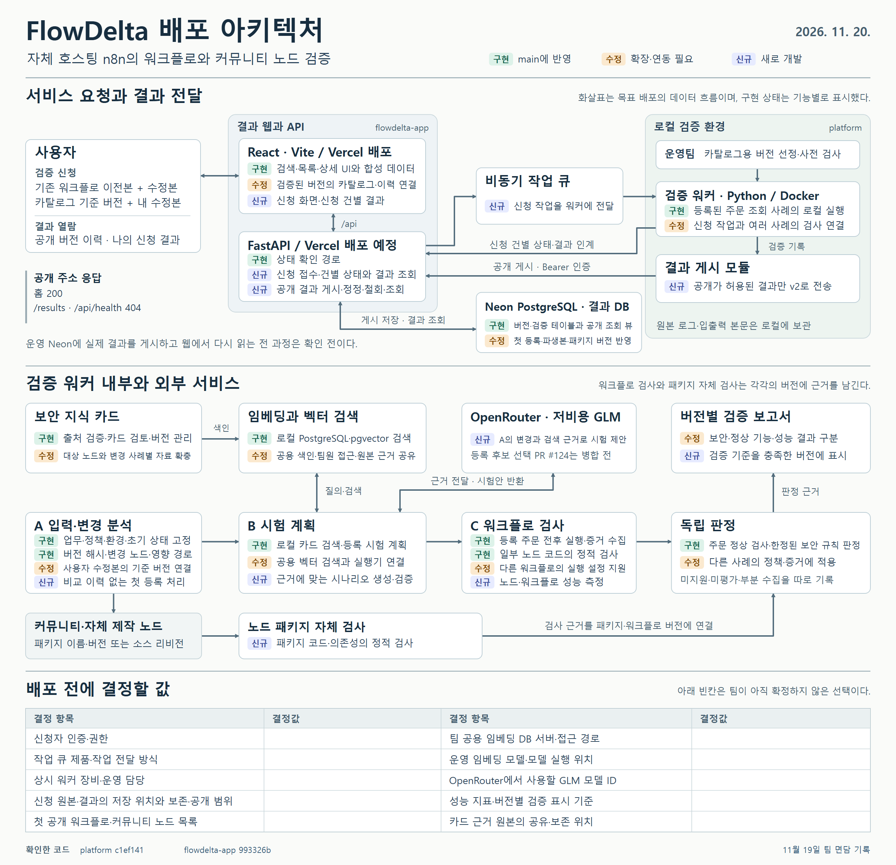

# FlowDelta 배포 설계 초안과 공용 RAG 운영안

2026년 11월 20일 · 양유상 개인 제안 · 팀 의견 요청

자체 호스팅 n8n 사용자가 검증 이력이 있는 워크플로를 고르고, 자기 업무에 맞게 수정한 뒤 원본과 다시 비교할 수 있는 서비스를 제안합니다. **우선 의견을 듣고 싶은 것은 팀원이 함께 쓸 RAG용 DB 서버와 임베딩 모델 조합입니다.** 아래 후보 중 어떤 조합이 지금 코드와 팀 예산에 맞을까요? 다른 조합도 좋습니다.

[제품 범위·신청·엔진·배포·미결정 항목 상세 설계](detailed-design.md) · [전체 배포 그림 크게 보기](flowdelta-deployment.png) · [확대용 SVG](flowdelta-deployment.svg)

## 먼저 결정할 공용 DB와 임베딩 모델

현재 코드에는 PostgreSQL·pgvector 카드 색인과 검색, Ollama 임베딩, 카드 버전과 모델 지문 기록이 있습니다. 기본 모델은 `qwen3-embedding:0.6b`이고 현재 색인은 1,024차원을 사용합니다. 팀 공용 서버에서 서로 다른 두 PC가 같은 카드와 원본 근거를 읽는 검증은 남아 있습니다. [기존 임베딩 구현](https://github.com/serendipity-sec/platform/blob/c1ef141a55a744e294ac6aca0448de2684fba90a/docs/EMBEDDING.md) · [공용 환경 과제](https://github.com/serendipity-sec/platform/issues/79)

| 검토 후보 | 배치와 재사용 범위 | 팀에서 따져볼 비용과 운영 조건 |
|---|---|---|
| A. Neon Free + 로컬 Ollama | 팀 전용 지식 DB에 pgvector를 쓰고, 팀 장비에서 기존 Qwen 0.6B로 카드와 질의를 임베딩합니다. 공개 결과를 읽는 계정과 지식 DB 접근 권한을 구분합니다. | DB 서버를 직접 켜 둘 부담이 작습니다. 무료 플랜의 저장·연산 한도 안에 카드와 색인이 들어가는지, 기존 마이그레이션과 권한이 적용되는지 확인해야 합니다. |
| B. 팀 장비의 PostgreSQL + 로컬 Ollama | 상시 가동할 수 있는 팀 장비에 기존 PostgreSQL 17·pgvector 0.8.1 Docker 구성과 같은 Qwen 모델을 올립니다. | 별도 클라우드 DB 사용료가 없고 현재 구성을 가장 많이 재사용합니다. 장비 가동·접속·백업을 맡을 수 있는지, 재시작 뒤에도 팀원이 같은 자료를 읽을 수 있는지가 관건입니다. |

제 첫 후보는 **A와 기존 Qwen 0.6B**입니다. 팀 장비를 상시 운영할 수 있다면 B의 운영 부담도 함께 비교하고 싶습니다. 11월 20일 Neon 공식 가격표에서 Free는 프로젝트당 월 100 CU-hours와 저장 공간 1 GB입니다. 두 후보 모두 로컬 임베딩의 장비 비용은 남습니다. [Neon 가격표](https://neon.com/pricing) · [Neon pgvector 지원](https://neon.com/docs/extensions/pgvector) · [기존 Docker 구성](https://github.com/serendipity-sec/platform/blob/c1ef141a55a744e294ac6aca0448de2684fba90a/runtime/knowledge/compose.yaml)

**어떤 자료로 고르면 좋을까요?** 같은 카드 묶음과 한·영 변경 설명으로 상위 5개 안에 필요한 근거가 들어오는 비율, 질의 시간, 실제 저장 용량을 비교하는 방법을 제안합니다. 팀원 두 명이 같은 카드 버전과 원본 해시를 읽을 수 있는지도 함께 볼 수 있습니다. 수집할 카드 수나 장비 사양을 아시면 알려주세요. 검색 품질 비교 후보로는 열린 PR에서 로컬 사용 기록이 있는 BGE-M3가 있습니다. [지식 저장소 운영 문서](https://github.com/serendipity-sec/platform/blob/c1ef141a55a744e294ac6aca0448de2684fba90a/docs/KNOWLEDGE_OPERATIONS.md) · [모델 시험 기록](https://github.com/serendipity-sec/platform/pull/124) · [카드·평가 자료 작업](https://github.com/serendipity-sec/docs/issues/67)

| 먼저 합의할 항목 | 팀 결정값 |
|---|---|
| 팀 공용 RAG DB 서버와 원본 근거 접근 경로 | |
| 임베딩 모델과 실행 위치 | |

## 서비스 흐름과 구현 범위

- **공개 카탈로그**에는 팀이 미리 검사한 워크플로와 커뮤니티·자체 제작 노드를 올립니다. 사용자는 버전별 검증 범위와 이전 이력을 봅니다.
- **사용자 신청**은 두 방식으로 받습니다. 기존 워크플로의 이전본과 수정본을 제출하거나, 카탈로그에서 사용한 원본 버전을 선택하고 수정본을 제출합니다. 같은 로컬 워커가 검사하고 결과를 신청 건에 연결합니다. 신청 결과의 공개 범위는 팀이 정할 항목입니다.
- **검사 결과**는 워크플로 연결·설정 변경과 노드 패키지 자체의 코드·의존성에 각각 연결합니다. 보고서에는 해당 버전의 보안 근거, 정상 기능 결과, 성능 측정 범위가 따로 보이도록 합니다.

| 상태 | 확인한 범위와 제안 |
|---|---|
| 구현 | 등록된 주문 조회에서 입력 고정 → A 변경 분석 → B 로컬 카드 계획 → C 전후 실행이 이어집니다. 제한된 정적 규칙과 주문 판정기가 있습니다. 결과 앱에는 React 화면, FastAPI 상태 확인 경로, Neon용 결과 테이블·조회 뷰가 있습니다. 화면의 검증 기록은 합성 데이터입니다. |
| 수정·연동 | 다른 워크플로에 공통 실행·판정 설정을 적용하고, B의 공용 카드 검색을 기본 실행 경로에 연결합니다. DB와 화면에는 첫 등록, 사용자 수정본의 기준 버전, 노드 패키지 버전과 검사 근거가 연결돼야 합니다. |
| 신규 | 신청·작업 큐·결과 반환, 공개 결과 게시·조회 API 연동, 노드 패키지 검사와 성능 측정, 버전별 검증 표시가 필요합니다. 시험 시나리오 생성·선택은 우선 OpenRouter의 저비용 GLM을 쓰는 방향입니다. 모델에는 A의 변경 요약과 검색한 카드 근거를 주고, 실제 판정은 관측한 기록과 규칙에 맡깁니다. |

결과 웹은 Vercel, FastAPI도 Vercel 배포 예정입니다. 결과 게시 경로는 로컬 워커 → 공개용 데이터 선별 → FastAPI → Neon으로 잡았습니다. 운영 Neon까지 게시한 결과를 웹에서 조회하는 전 과정은 확인 전입니다. 공용 RAG DB의 배치는 이번에 따로 논의할 대상입니다. [11월 19일 면담](https://github.com/serendipity-sec/docs/pull/88/files) · [엔진 확장](https://github.com/serendipity-sec/platform/issues/130) · [결과 인계](https://github.com/serendipity-sec/platform/issues/122) · [결과 DB](https://github.com/serendipity-sec/flowdelta-app/pull/7)

## 설계에서 바꾸거나 추가할 점

1. **AI가 워크플로 흐름을 읽으면 어떤 검사를 더할 수 있을까요?** A가 뽑은 노드·연결·변경 경로를 AI가 읽고, 어떤 데이터가 새 수신자로 전달되는지 설명하거나 빠진 정상 기능 검사를 제안하면 어떨까요? 기존 규칙 검사에 더할 만한 AI 검사와, 그 결과를 확인할 근거가 무엇인지 궁금합니다.
2. **어떤 정적·동적 검사 도구를 재사용할까요?** 정적 검사에는 n8n의 커뮤니티 노드 ESLint 규칙을, 동적 검사에는 n8n 저장소의 `NodeTestHarness`가 워크플로 입력과 기대 출력을 비교하는 방식을 검토할 수 있습니다. 외부 서비스를 흉내 내고 호출 기록을 비교하는 오픈소스로 WireMock도 있습니다. 현재 Semgrep 규칙과 Docker 실행기에 어떤 도구를 붙이거나 어떤 부분을 교체하면 좋을까요? 다른 후보가 있으면 저장소 링크와 어떤 검사를 보완하는지 한 가지 예를 부탁드립니다. [n8n 노드 린터](https://github.com/n8n-io/n8n-docs/blob/main/docs/connect/create-nodes/test-your-node/node-linter.md) · [n8n 테스트 코드](https://github.com/n8n-io/n8n/blob/e6b971535bc17e4c49c839d4b14112dda437d588/packages/core/nodes-testing/node-test-harness.ts) · [WireMock 요청 검증](https://wiremock.org/docs/verifying/)
3. **첫 배포 범위에서 어디를 바꾸고 싶으신가요?** 기존 워크플로 두 버전과 사용자 수정본 하나를 비교해 보는 흐름에서 빠진 입력·결과가 있나요? 먼저 검증하면 가치가 클 워크플로·커뮤니티 노드, 첫 배포에서 덜어낼 기능에 대해서도 의견을 부탁드립니다.

구현 상태와 외부 문서는 2026년 11월 20일 기준입니다. 인증·큐·워커 장비, 상세 GLM 모델, 성능 지표와 검증 표시 기준 등 남은 결정은 그림 아래 빈칸에 두었습니다.
