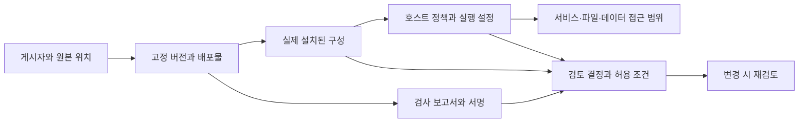

# 02. 출처·권한·변경 정보를 검토할 때 남는 공백

조사 기준일: 2026-09-20  
질문: 외부 AI 구성요소의 출처, 권한, 변경 내용을 현재 도구만으로 파악하기 어려운가?

## 1. 결론

**정보를 여러 계층에서 모아야 한다는 구조는 확인된다. 그러나 모든 사용자가 현재 도구로 검토하기 어렵다는 실증 결과는 아직 없다.** 출처 기록, 잠금 파일, 서명, 권한 정책, 변경 비교를 제공하는 도구도 이미 있다. 우리 프로젝트가 검증할 것은 “정보가 전혀 없다”가 아니라 **“사용자가 실제로 도입할 구성에 그 정보를 정확히 적용할 수 있는가”**다.

| 판단 | 근거 수준 |
|---|---|
| 형식마다 출처·권한의 표현 방식과 강제 지점이 다르다. | 공식 사양·문서에서 확인 |
| 작성자의 설명만으로 실제 실행 권한을 확정할 수 없다. | 선언과 호스트·운영체제·자격 증명 경계의 차이에서 도출 |
| 출처·해시·서명·변경 관리가 불가능하다. | 반증됨. 지원 도구가 있음 |
| 그 차이 때문에 우리 대상 사용자가 자주 오판하거나 시간을 낭비한다. | 미측정. 관찰 과업이 필요 |
| 통합 화면을 제공하면 문제가 해결된다. | 미검증. 같은 정보의 목록 화면과도 비교해야 함 |

## 2. 질문을 세 부분으로 나누기

### 출처: 무엇에서 왔고 지금 무엇인가

출처는 제작자 이름 하나로 끝나지 않는다. 게시 권한을 가진 계정·도메인, 원본 저장소, 고정 커밋, 배포 패키지, 설치된 파일, 검토 보고서 사이의 연결이 필요하다. 이 연결 중 어디까지 확인했는지를 표시해야 한다.

### 권한: 무엇을 할 수 있고 무엇이 막히는가

도구 설명, 설정 파일의 허용 목록, 운영체제 접근권한, API 토큰의 scope, 실제 실행 기록은 서로 다른 자료다. 같은 “읽기 전용” 표현도 어느 계층에서 강제되는지에 따라 의미가 다르다.

### 변경: 무엇과 무엇을 비교하는가

파일 내용의 변화, 스캐너 경고의 변화, 접근 가능 자원의 변화, 승인 조건의 변화는 다른 질문이다. 버전 문자열만 같거나 경고 개수만 같다고 이전 승인을 재사용할 수 있는 것은 아니다. 반대로 모든 텍스트 변경을 위험 증가로 처리하면 정상 업데이트도 불필요하게 막을 수 있다.

## 3. 사양과 구현에서 확인한 사실

### 3.1 Agent Skills는 최소 형식과 보안 보장이 다르다

Agent Skills 사양에서 필수 메타데이터는 `name`과 `description`이다. `metadata`, `compatibility`, `license`, `allowed-tools`는 선택 항목이며 `allowed-tools`는 실험적이고 호스트별 지원이 다를 수 있다. 본문 외에 실행 스크립트·참조 문서·자산을 포함할 수 있다. 따라서 `SKILL.md` 한 파일의 형식 적합성만으로 전체 묶음과 실제 실행 권한을 확인했다고 할 수 없다. [R07: 사양](https://agentskills.io/specification)

이것은 “Skill에는 버전 관리를 적용할 수 없다”는 뜻이 아니다. Vercel Skills의 확인한 소스에는 전역 `.skill-lock.json`에 출처·ref·트리 해시를, 프로젝트 `skills-lock.json`에 출처와 로컬 폴더 내용의 SHA-256을 기록하는 구조가 있다. **잠금·무결성 관리 자체는 이미 존재한다.** [R08: 전역 잠금](https://github.com/vercel-labs/skills/blob/7407f3893ad4dceab546ac002c3ef806e4000c73/src/skill-lock.ts), [R09: 프로젝트 잠금](https://github.com/vercel-labs/skills/blob/7407f3893ad4dceab546ac002c3ef806e4000c73/src/local-lock.ts)

**남는 질문:** 그 기록이 현재 활성화된 모든 경로를 포함하는가, 수동 복사본도 연결되는가, 파일 변경을 찾아낸 다음 어떤 승인 조건이 달라지는지 알려 주는가? 이번에는 해당 CLI를 실행하지 않았으므로 이 질문의 성공률은 측정하지 않았다.

### 3.2 MCP Registry는 출처 확인 기능이 있는 메타데이터 계층이다

공식 Registry는 GitHub 계정·도메인과 연결된 네임스페이스 소유 확인 및 설치 메타데이터를 제공한다. 코드와 바이너리는 npm·PyPI·컨테이너 레지스트리 등에 있고, 보안 검사는 패키지 레지스트리와 downstream aggregator의 역할로 설명한다. **소유 확인은 제공하지만 코드 안전성 인증을 대신하지 않는다.** [R10: Registry 역할과 신뢰 경계](https://github.com/modelcontextprotocol/registry/blob/main/docs/modelcontextprotocol-io/about.mdx)

확인한 OpenAPI에서 패키지 버전은 구체적인 버전이어야 하며 범위·`latest`를 허용하지 않는다. `fileSha256`은 MCPB에 필수, 다른 패키지 유형에는 선택이며 제공되면 내려받은 파일과 검증하도록 규정한다. API의 “최신 항목 조회”와 패키지 버전 필드의 규칙을 혼동하지 않는다. [R11: API 스키마](https://github.com/modelcontextprotocol/registry/blob/main/docs/reference/api/openapi.yaml)

**남는 질문:** Registry에 게시된 항목, 실제 설치 파일, 원격 서버의 현재 동작이 얼마나 연결되는가? 원격 endpoint의 주소와 tool schema가 같아도 서버 내부 구현의 동일성을 그 두 정보만으로 확인할 수는 없다. 소스나 배포 증거에 접근할 수 없다면 그 부분을 미확인으로 남겨야 한다.

### 3.3 MCP 도구 설명은 권한 강제 장치가 아니다

MCP의 `readOnlyHint`, `destructiveHint` 등은 도구의 성격을 표현하는 힌트다. 공식 설명도 이를 검증된 동작 보장으로 취급하지 않도록 구분한다. 도구 목록을 얻는 것과 그 도구에 부여된 파일·네트워크·서비스 권한을 확인하는 것은 별도 과업이다. [R12: 2026-07-28 Tools 사양](https://modelcontextprotocol.io/specification/2026-07-28/server/tools), [R13: Tool Annotations의 의미](https://blog.modelcontextprotocol.io/posts/2026-03-16-tool-annotations/)

예를 들어 선언된 읽기 도구가 실제로 읽을 수 있는 저장소 범위는 토큰·서비스 정책에도 달려 있다. 이 문서의 예시는 특정 제품의 취약점 보고가 아니라 **권한 확인에 필요한 자료의 종류**를 설명한다.

### 3.4 n8n에서는 워크플로와 노드가 다른 검토 단위다

n8n의 커뮤니티 노드 안내는 노드가 실행 시스템과 워크플로 데이터에 접근할 수 있고 버전 업데이트가 기존 워크플로에 영향을 줄 수 있다고 설명한다. 일부 검증된 노드를 별도로 심사하는 경로도 있다. 따라서 “노드가 캔버스에 보인다”와 “이번 인스턴스의 데이터 접근 범위를 확인했다”는 다른 판단이다. [R14: 커뮤니티 노드 위험 안내](https://github.com/n8n-io/n8n-docs/blob/main/docs/integrations/community-nodes/risks.md)

워크플로 JSON은 흐름의 중요한 근거지만 실행 엔진·커뮤니티 패키지·자격 증명의 현재 상태까지 항상 단독으로 설명하지는 않는다. 최신 공식 문서는 JSON 외에 관련 참조를 옮기는 Preview 패키지 경로도 제공한다. 비교 시 예전 JSON 내보내기 기능만을 기준으로 제품의 전체 능력을 평가하지 않는다. [R15: 내보내기·가져오기](https://github.com/n8n-io/n8n-docs/blob/main/docs/build/manage-workflows/export-and-import.md)

### 3.5 Dify는 이미 manifest와 서명 체계를 갖고 있다

Dify manifest는 버전·작성자·실행 환경 및 도구·모델 역호출 같은 요청 권한을 표현한다. 자체 호스팅 Dify의 제3자 서명 기능은 관리자가 신뢰한 공개키로 외부 패키지를 검증하도록 설계되어 있다. 이를 “외부 플러그인에는 검증 수단이 없다”는 사례로 제시해서는 안 된다. [R16: manifest](https://github.com/langgenius/dify-docs/blob/main/en/develop-plugin/features-and-specs/plugin-types/plugin-info-by-manifest.mdx), [R17: 서명 검증](https://github.com/langgenius/dify-docs/blob/main/en/develop-plugin/publishing/standards/third-party-signature-verification.mdx)

**남는 질문:** 선언한 권한과 실제 배포 설정이 일치하는가, 서명을 신뢰할 주체가 누구인가, 변경된 패키지에 기존 판단을 적용해도 되는가? 사양에 필드가 있다는 사실만으로 모든 설치의 값과 강제 여부를 확인했다고 처리하지 않는다.

## 4. 권한을 네 층으로 나누어 기록하기

아래는 우리 플랫폼을 위한 **설계 제안**이다. 서로 다른 근거를 하나의 “권한” 필드로 덮어쓰지 않는다.

| 층 | 의미 | 예시 근거 | 잘못된 해석 |
|---|---|---|---|
| 선언된 능력 | 제작자가 하겠다고 설명한 일 | 도구 설명, manifest, Skill 본문 | 설명에 없으므로 불가능하다. |
| 설정된 제한 | 호스트·관리자가 지정한 정책 | 허용 목록, sandbox 설정, mount, gateway 정책 | 설정 파일에 있으므로 실제 강제된다. |
| 실제 부여된 접근 | 실행 주체가 가진 권한 | 유효한 서비스 scope, OS 계정 권한, 배포 정책 | API 이름만 알면 접근 가능한 모든 자원도 안다. |
| 관찰된 행위 | 정해진 조건의 실행에서 일어난 일 | 특정 실행의 감사 로그·관찰 기록 | 관찰하지 못한 행위는 앞으로도 일어나지 않는다. |

권한을 하나의 단순한 교집합으로 계산하는 것도 조심해야 한다. 위임·하위 프로세스·원격 서비스 등 경계마다 적용되는 정책이 다르기 때문이다. 첫 구현에서는 지원하는 호스트와 자료에 대해 확인 가능한 관계만 표시하고, 해석할 수 없는 정책은 `unknown`으로 남기는 편이 타당하다.

## 5. 검토 정보가 이어져야 하는 위치

이 그림은 **확인해야 할 관계**다. 선이 그려졌다고 정보 흐름이나 공격 경로가 실제로 관찰됐다는 뜻은 아니다. 구현에서는 `설정에 명시`, `소스에서 확인`, `실행에서 관찰`, `추정`을 구분해야 한다. 같은 호스트에 두 도구가 등록되어 있다는 이유만으로 한 도구의 데이터가 다른 도구에 전달된다고 단정하지 않는다.

## 6. 사양 기반 검토 과정을 따라가 보기

아래는 실제 사용자 실험이 아니라, 앞의 사양을 토대로 재구성한 **검토 과업**이다. 시간·성공률·누락률은 아직 없다.

### 과업 A. 외부 Skill의 검사 결과를 내 로컬 파일에 적용하기

1. 검사 보고서가 어떤 디렉터리·커밋·해시를 대상으로 했는지 확인한다.
2. 설치본에서 본문 외의 스크립트·참조 파일을 포함해 대응 범위를 확인한다.
3. 잠금 파일이나 서명이 있으면 설치본과 대조한다. 없으면 출처 확인 실패와 악성 판정을 구분한다.
4. 로컬 수정이 있으면 바뀐 파일 및 외부 참조를 확인한다.
5. 사용 호스트가 적용하는 권한 정책을 함께 검토한다.
6. 보고서가 적용되는 조건과 추가 검토가 필요한 조건을 기록한다.

Vercel의 잠금과 NVIDIA의 디렉터리 서명처럼 이 과업 일부를 해결하는 수단이 있다. NVIDIA 문서는 추가된 미서명 파일도 엄격한 검증에서 다루며 로컬 수정 후 재검증을 안내한다. 따라서 우리 기능은 이 수단을 활용한 대조 절차와 비교해야 한다. [R32: 서명 검증 범위](https://docs.nvidia.com/skills/signing-agent-skills)

### 과업 B. 같은 MCP 구성을 다른 프로젝트에 가져오기

패키지 버전이 동일해도 mount 경로, 실행 계정, 환경 설정, 연결한 서비스 자격 증명, 허용 도구가 달라질 수 있다. 기존 보고서에서 코드 검사 결과는 재사용할 수 있어도 “이 프로젝트의 데이터에 접근해도 된다”는 결정은 별도일 수 있다.

이를 표시하려면 **구성요소의 검사 결과**와 **특정 배포 환경의 승인**을 다른 객체로 저장해야 한다. 예컨대 `artifact A의 검사 S`와 `artifact A + configuration C + policy P의 승인 D`를 구분하는 방식이다. 이것은 제안 모델이며 현재 플랫폼에 구현되었다는 뜻은 아니다.

### 과업 C. 워크플로 파일의 변경 없이 외부 노드만 업데이트하기

워크플로 파일의 diff가 비어 있어도 참조하는 노드 패키지나 호스트 버전이 바뀔 수 있다. 검토자가 실제 실행 버전을 알 수 있어야 의미 있는 재검토가 가능하다. 반대로 워크플로 파일만 입력받는 검사라면 외부 의존성 미확인을 명시해야 한다. 지원하지 않는 형식의 파일을 건너뛰고 전체 구성에 “통과”를 붙여서는 안 된다.

### 과업 D. 원격 서비스의 검토 결과 재사용하기

원격 서버의 URL·도구 설명·검사 시점은 기록할 수 있다. 서버가 내부 배포 해시나 검증 가능한 배포 증거를 제공하지 않으면 코드 동일성을 확인할 수 없는 경우도 있다. 일정 시간이 지났다는 이유만으로 변경이 있었다고 단정하지 않으며, 동일성을 입증할 수 없다는 한계를 표시한다.

## 7. 변경을 네 가지로 구분하기

| 변경 종류 | 답하려는 질문 | 가능한 근거 | 그 자체로 답하지 못하는 것 |
|---|---|---|---|
| 내용 변경 | 어떤 파일·문장이 달라졌는가? | Git diff, 폴더 해시 | 실제 권한·위험 증가 여부 |
| 검사 결과 변경 | 어떤 경고가 새로 생기거나 사라졌는가? | 동일 엔진·동일 설정의 결과 비교 | 규칙에 없는 접근 범위 변화 |
| 구성·접근 범위 변경 | 어떤 대상·연결·허용 동작이 달라졌는가? | 구조화 설정·manifest·지원 범위의 분석 | 모든 동적 행위의 완전한 추론 |
| 승인 조건 변경 | 지난 결정이 현재 상태에도 적용되는가? | 검토 대상 묶음·정책·예외·유효 조건 | 새로운 검토가 항상 위험을 낮춘다는 보장 |

`capability diff`는 세 번째 질문을 지칭하는 편의적 용어다. 자연어에서 모든 능력을 완벽히 추출하는 기능으로 정의하지 않는다. 예를 들어 명시된 mount·허용 도구·외부 서비스 선언처럼 확인 가능한 항목부터 다룰 수 있다. 기존 제품의 정책·공급망 drift 기능과 얼마나 겹치는지는 [04 문서](04-기존도구-비교와-차별화검증.md)의 검증 과제다.

변경을 발견했다고 무조건 위험 증가로 표시하지 않는다. 문구 다듬기, 권한 축소, 동등한 구조 변경, 의존성 보안 업데이트도 포함된다. “변경 있음”, “정책 위반”, “판단 불가”를 구분해야 불필요한 거부를 줄일 수 있다.

## 8. 사용자가 실제로 어렵다는 근거는 어디까지인가

2026년 7월의 *How Agents Ask for Permission*은 21개 연구 시스템·제안과 5개 상용 에이전트를 검토해 사용자 인터페이스, 내부 권한 표현, 강제를 연결하는 분류를 제시한다. 권한 표현과 투명성·사용 부담·지속 통제 사이의 미해결 문제를 분석한다. 공개 시스템을 비교한 preprint이며, 우리 사용자군의 검토 시간과 오판율을 측정한 연구는 아니다. [R19: 논문 원문](https://arxiv.org/html/2607.13718v1)

따라서 이 자료는 “권한 문제를 인터페이스와 강제 계층을 함께 보아야 한다”는 연구 근거로 사용한다. “학생 개발자의 몇 %가 위험한 스킬을 승인한다”는 식의 수치로 바꿔 쓰지 않는다. 공식 사양의 선택 필드도 정보 누락 가능성의 근거일 뿐, 실제 누락률의 측정값은 아니다.

이번 자료에서 가능한 가장 강한 결론은 다음과 같다.

> 출처·선언·호스트 정책·설치본·실행 조건을 결합해야 하는 검토 과업이 존재한다. 지원 도구가 이 중 일부 또는 상당 부분을 제공한다. 우리 대상 사용자에게 정보 결합이 얼마나 어렵고 반복되는지는 직접 관찰해야 한다.

## 9. 문제를 측정하기 위한 관찰안

아래는 **미실행 조사 설계**다. 인터뷰에서 불편하다는 응답을 받는 것과 과업에서 실제 누락을 관찰하는 것을 분리한다.

| 확인할 가설 | 사용자에게 줄 과업 | 기록할 지표 | 반증 가능한 결과 |
|---|---|---|---|
| 원본과 로컬 수정본을 연결하기 어렵다. | 현재 설치본에 맞는 검사 결과 찾기 | 정확한 해시·버전 매칭, 잘못 재사용한 보고서, 시간 | 기존 잠금·서명만으로 빠르고 정확하게 해결 |
| 선언과 실제 설정을 혼동한다. | 허용된 데이터 범위와 확인 불가 범위 설명 | 근거 종류 구분, 근거 없는 권한 단정 | 기존 문서·정책 화면으로 대부분 정답 |
| 변경 시 재검토 범위를 잡기 어렵다. | 정상 변경·권한 축소·범위 확대 분류 | 누락·과잉 검토·판단 보류, 결정 근거 | 단순 diff 화면과 우리 제안의 차이가 없음 |
| 현재 검토 근거의 공유가 어렵다. | 다른 팀원의 승인 판단 이어받기 | 근거 재발견 시간, 조건 오해, 중복 검사 | 기존 evidence pack이 동일하게 해결 |

사용자가 사용할 수 있는 기존 도구를 숨기지 않는다. 도구 경험 차이를 기록하고 기본 사용법을 제공한다. 정답은 실제 정책과 고정된 자료에서 독립적으로 정의한다. 여러 과업을 수행한 한 사람을 여러 명의 독립 참가자로 세지 않는다. 자세한 비교 설계는 [05 문서](05-보안효과와-사용자판단-평가설계.md)에 있다.

## 10. 플랫폼이 저장해야 할 최소 근거 — 설계 제안

| 객체 | 필요한 정보 | 이유 |
|---|---|---|
| 구성요소 | 종류, 원본 URI, 고정 ref, 내부 경로, 버전·digest | 동명이거나 수정된 대상을 구분 |
| 설치 스냅샷 | 실제 파일·설정의 식별값, 수집 범위, 제외 항목 | 검토한 대상과 사용 대상 연결 |
| 호스트 환경 | 제품·버전·실행 방식·지원 정책·설정 digest | 같은 파일의 다른 사용 조건 구분 |
| 관계 | 명시적 참조·의존·설정 연결과 그 근거 | 추정 경로를 확정 사실로 표시하지 않기 위함 |
| 검사 실행 | 엔진·버전·설정·규칙·시점·입력 digest·실행 상태 | 결과 재현과 누락 확인 |
| 발견 사항 | 원본 rule ID·위치·근거·판정 범위·확신도 출처 | 단일 점수의 해석 오류 방지 |
| 검토 결정 | 허용·거부·보류, 적용 정책, 예외 사유, 검토자 | 탐지 결과와 사람이 수용한 위험 분리 |
| 유효 조건 | 대상·설정·정책의 조합, 변경·만료 조건 | 예전 승인 무조건 재사용 방지 |

비밀키 원문을 이 모델에 넣지 않는다. 자격 증명은 식별자·권한 범위·확인 시점 등 필요한 정보만 기록한다. 소스 전체의 외부 전송이 필요한 분석기는 별도 실행 경로로 다룬다. 이는 우리 제품의 자료 취급 설계이며 각 서비스의 실제 보안 인증을 주장하는 것이 아니다.

SLSA도 코드 자체의 안전성과 빌드·유통 과정의 무결성을 서로 다른 문제로 다룬다. 따라서 출처·서명 확인 결과를 취약점 검사의 대체물로 쓰지 않고, 검토한 대상이 실제 배포물과 연결된다는 근거로 사용한다. [R18: SLSA v1.2의 범위](https://slsa.dev/spec/v1.2/about)

## 11. 이번 조사에 따른 범위 제안

첫 구현의 성공 조건을 “모든 권한을 자동으로 이해한다”로 설정하지 않는다. 하나의 호스트에서 지원하는 Skill 묶음, MCP 구성, 명시적 정책에 대해 **대상 동일성·명시적 연결·검사 적용 범위·이전 승인과의 차이**를 정확하게 표시하는 것으로 시작한다.

지원하지 않는 정책 문법·원격 코드·동적 참조는 미확인으로 남긴다. 동시에 미확인 항목이 많아 모든 결정을 보류하는 도구가 되지 않도록, 무엇을 추가하면 결정을 내릴 수 있는지 안내하고 보류율·추가 검토 시간을 평가한다.

이 좁은 범위에서도 기존 도구 대비 의미 있는 개선이 없다면 기능을 확대하기 전에 가설을 수정해야 한다. **구조적 복잡성은 프로젝트의 출발점이고, 해결되지 않은 사용자 문제의 크기는 별도의 검증 대상**이다.

관련 문서: [01 — 실제 도입 근거](01-외부구성요소-실사용과-도입근거.md) · [04 — 기존 도구 비교](04-기존도구-비교와-차별화검증.md) · [출처와 조사 기록](출처와-조사기록.md)
