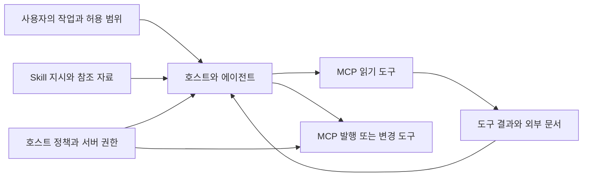

# 1. 개념, 위협 모델, 사례

확인일: 2026-09-25 · 민우 담당 · 아래의 **관측/추론/설계 예시**를 구분해서 설명한다.

## 1. Skill과 MCP가 만나는 위치

**Skill은 작업 방법을 담은 패키지**다. `SKILL.md`의 이름·설명·본문과 선택적인 스크립트·참조 파일을 에이전트가 필요할 때 읽는다. **MCP는 호스트가 외부 도구·자원·프롬프트를 연결하는 프로토콜**이다. Skill이 도구 사용 순서와 목적을 제시하고, 호스트가 MCP 호출을 실제로 수행할 수 있다. Skill이 항상 MCP를 쓰는 것도, MCP를 쓰려면 Skill이 필요한 것도 아니다. [S01](https://agentskills.io/specification), [S02](https://modelcontextprotocol.io/specification/2025-11-25/architecture)

문제의 연결 지점은 주로 **호스트의 컨텍스트와 도구 선택 과정**이다. MCP 서버끼리 직접 통신하지 않아도, 에이전트가 한 서버의 결과를 다른 서버의 입력으로 전달한다. 호스트는 연결·동의·컨텍스트 집계를 담당한다. [S02](https://modelcontextprotocol.io/specification/2025-11-25/architecture)

### 꼭 구분할 네 가지

| 표현 | 실제 의미 | 잘못된 해석 |
|---|---|---|
| 스캐너 통과 | 특정 버전·설정·검사 입력에서 finding 없음 | 취약점 부재가 증명됨 |
| 정상/선의의 구성요소 | 의도된 기능을 구현하며 악성 목적을 가정하지 않음 | 모든 환경에서 안전함 |
| 권한 있음 | 토큰·호스트·서버가 그 호출을 기술적으로 허용 | 이번 업무에서 사용자가 승인함 |
| `readOnlyHint` | 도구의 읽기 성격을 설명하는 annotation | 읽은 내용의 외부 공개도 안전함 |

`allowed-tools`는 실험적인 Skill 필드이며 지원이 호스트마다 다르다. MCP annotation 역시 출처의 신뢰를 검토해야 한다. **선언, 구현에서 추출한 접근 능력, 실제 강제되는 권한을 별도 필드로 저장해야 한다.** [S01](https://agentskills.io/specification), [S03](https://modelcontextprotocol.io/specification/2025-11-25/server/tools)

## 2. 민우 담당 문제의 정확한 정의

“각각은 안전하다”는 절대적 증명 대신 다음의 운영적 정의를 쓴다.

> 정해진 정책과 검사 범위에서 개별 구성요소에는 위험 판정이 없지만, 동일 작업의 결합된 실행 또는 연결 가능한 경로에서 그 정책을 위반할 수 있는 경우.

분석 단위는 `Skill 파일 하나`가 아니라 다음 묶음이다.

`작업 U + Skill 집합 S + MCP 도구/버전 M + 호스트 정책 H + 데이터 분류 D + 실행 경로 π`

예를 들어 보고서 작성 Skill, 사내 자료 조회 도구, 게시물 작성 도구는 모두 필요한 정상 기능일 수 있다. 그런데 사내 자료의 요약을 공개 게시물로 넘기면 별도의 공개 승인이 필요하다. **합법적인 기능의 연결이 업무 정책을 위반하는 것**이지, MCP나 Skill 패키지가 자동으로 악성으로 변하는 것은 아니다.

### 두 종류를 분리해서 평가한다

1. **순수 결합/설정 오류:** 악성 지시가 없어도 기본 게시 대상, 공유 범위, 자동 후속 처리 때문에 허용 범위를 벗어남.
2. **주입으로 활성화되는 결합 위험:** 정상 Skill과 도구들이 읽는 외부 데이터에 공격자 지시가 섞여 위험 경로가 선택됨.

여기에 **악성 Skill 또는 악성 MCP를 추가한 공격**을 별도 층으로 둔다. 이를 1번의 증거로 섞으면 “둘 다 안전했다면서?”라는 질문에 답할 수 없다.

## 3. 조사에서 확인한 사례의 증거 수준

### C01. GitHub 공개 이슈 → 비공개 저장소 → 공개 PR

**2025-05-26, Invariant의 통제된 공개 시연.** 공격자가 공개 이슈 내용을 조작하고, 정상 GitHub MCP를 쓰는 에이전트가 이를 읽게 한다. 비공개 저장소 내용을 가져와 공개 PR에 쓰는 경로가 시연됐다. 서버 자체의 악성 교체가 필요하지 않다는 점이 중요하다. 계정이 두 저장소에 접근하고 관련 호출이 허용되는 환경이 전제된다. 기본 확인 창과 사용자의 상시 허용 설정도 구분해야 한다. [C01 원문](https://invariantlabs.ai/blog/mcp-github-vulnerability)

**우리 담당과의 관계:** 정상 도구 조합이 위험하다는 강한 근거다. 다만 원문에 `SKILL.md` 개입이 명시된 것은 아니다. “이슈 처리 Skill이 이 흐름을 반복한다”는 연결은 **우리의 확장 가설**이다. 실제 피해 기업의 사고 통계로 소개하지 않는다.

**탐지 포인트:** 외부 이슈의 출처, 비공개 데이터 계보, 최종 PR의 공개 범위, 대상별 쓰기 권한, 사용자의 원래 요청.

### C02. WhatsApp 도구 결과/설명 → 정상 발송 도구

**2025-04-07 공개, 4월 9일 실험 추가.** 실험 1은 악성 MCP 설명이 정상 WhatsApp 도구 사용을 바꾸는 경우다. 실험 2는 악성 MCP 없이 수신 메시지의 주입만으로 연락처가 전달되는 경우다. 정상 발송 도구 호출만 로그에 남아도 조작의 원인은 다른 컨텍스트에 있을 수 있다. [C02 원문](https://invariantlabs.ai/blog/whatsapp-mcp-exploited)

**해석:** 실험 1을 “정상+정상” 사례로 부르면 틀린다. 실험 2는 정상 도구와 비신뢰 입력의 결합 사례다. 종단간 암호가 깨진 사례가 아니라 **권한 있는 에이전트가 복호화된 데이터를 잘못 전달한 시연**이다. 직접 재현하지 않았다.

### C03. Tool poisoning·shadowing·rug pull

**2025-04-01, Invariant 연구.** 도구 설명 속 지시가 다른 정상 도구의 인자·사용 방법을 바꾸거나, 승인 이후 설명이 바뀌는 공격을 설명한다. 악성 도구가 실제 호출되지 않아도 설명의 컨텍스트 노출이 영향을 줄 수 있다. [C03 원문](https://invariantlabs.ai/blog/mcp-security-notification-tool-poisoning-attacks)

**해석:** 악성 구성요소가 있는 비교 사례다. 그래프에서 `호출됨`뿐 아니라 `설명이 컨텍스트에 노출됨` 연결도 필요하고, 재검사 키에 도구 설명 해시가 들어가야 한다는 설계 근거다.

### C04. Git MCP의 실제 구현 취약점 — 순수 결합과 구분

| 공식 권고 | 확인된 결함 | 권고의 수정 버전 |
|---|---|---|
| [CVE-2025-68143](https://github.com/advisories/GHSA-5cgr-j3jf-jw3v) | `git_init`의 임의 위치 저장소 생성 | 2025.9.25 |
| [CVE-2025-68144](https://github.com/advisories/GHSA-9xwc-hfwc-8w59) | Git 인자 주입을 통한 로컬 파일 덮어쓰기 | 2025.12.18 |
| [CVE-2025-68145](https://github.com/advisories/GHSA-j22h-9j4x-23w5) | 설정한 저장소 범위를 호출 시 검증하지 않음 | 2025.12.18 |

여기는 **개별 서버 결함 자체가 존재**한다. 따라서 “둘 다 안전하지만 연결해서만 발생한 취약점”의 증명으로 쓰지 않는다. 관련 도구 연쇄 공격의 배경 사례로만 다루며, 실제 현장 악용을 확인한 것으로 표현하지 않는다. 특히 수정 버전을 세 CVE 모두 동일하다고 쓰지 않는다.

### C05. ToxicSkills — 실제 악성 패키지는 비교군

Snyk는 2026년 2월 조사에서 3,984개 Skill 중 1,467개에 보안 문제가 있었으며, 76개 악성 Skill을 별도로 확인했다고 보고한다. **보안 문제 있음, 악성임, 피해 발생은 서로 다른 지표**다. 해당 수치를 Skill×MCP 결합 취약점의 발생률로 사용할 수 없다. [C05 원문](https://snyk.io/blog/toxicskills-malicious-ai-agent-skills-clawhub/)

### C06. Skill 조합 실험 — 논문 증거

SCR-Bench·CompoSkill·SkillReact는 개별 Skill이 조건부로 통과한 상태에서 조합을 평가한다. 이는 민우 주제에 매우 가깝지만, **서로 다른 논문의 ‘safe’ 정의가 같지 않고 MCP 연결까지 직접 검증한 사례로 자동 치환할 수 없다.** 세부 조건은 [논문 비교](02-논문-비교.md)에 정리했다.

## 4. 우리가 다룰 취약점 후보

아래는 기존 메커니즘을 Skill×MCP로 구체화한 **설계 예시**이며, 새로 발견한 CVE나 성공한 공격 목록이 아니다.

| 후보 | 정상인 개별 기능 | 결합 시 위험 | 필요한 증거 |
|---|---|---|---|
| 자료 공개 범위 불일치 | 보고 Skill + 자료 조회 + 발행 | 비공개 자료가 공개 대상에 전달 | 자료 등급, 인자 계보, 대상 ACL |
| 비신뢰 입력의 승인 취급 | 검토 Skill + 티켓 조회 + 변경 도구 | 티켓의 문구를 실제 사용자 승인으로 취급 | 승인 출처, 작업 범위, 변경 인자 |
| 요약 과정의 출처 소실 | 요약 Skill + 검색/DB + 메시지 | 요약 후에도 민감한 의미가 남지만 공개로 분류 | 원자료→요약 연결, 유효한 비식별화 근거 |
| 도구 식별·바인딩 모호성 | 같은 이름의 정상 도구 + 자동 선택 | 의도한 프로젝트/계정과 다른 도구 호출 | 서버 ID, 계정, 이름, 버전 |
| 지속 상태를 통한 다음 세션 오염 | 파일 생성 Skill + 파일쓰기 MCP + Skill 로더 | 출력이 다음 실행의 지시 파일로 로드 | 쓰기 위치, 로드 시점, 신뢰 등급 |
| 연결 환경만 변하는 위험 | 동일 Skill + MCP 공개 범위 변경 | Skill 해시는 같아도 기존 승인이 무효 | 환경 스냅샷 차이, 정책 해시 |

최초 MVP는 첫 번째에 집중한다. 나머지 전부를 한 학기에 일반적으로 해결한다고 약속하지 않는다.
