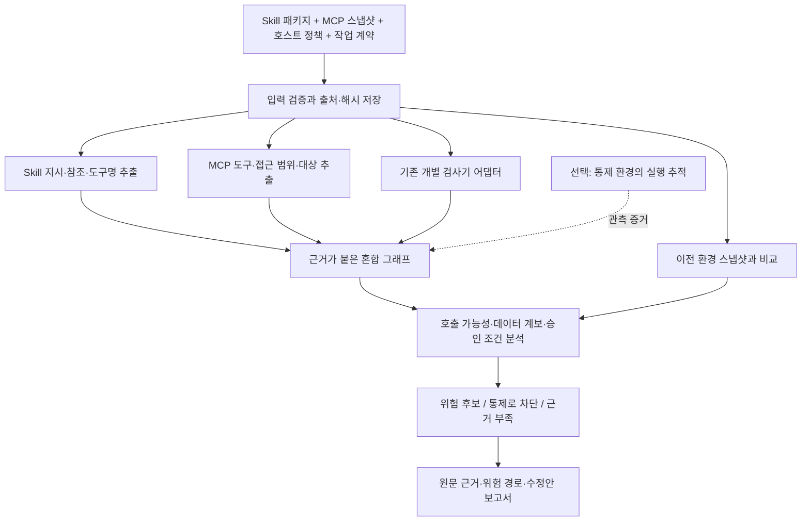

# 4. Research Gap 후보와 아키텍처

2026-09-25 · **설계 제안, 미구현 기능과 검증 전 가설 포함**

## 1. 무엇이 이미 있고, 어디를 검증할 것인가

| 제안하려던 내용 | 이미 존재하는 반례 | 남겨둘 연구 질문 |
|---|---|---|
| 안전한 구성요소가 합쳐지면 위험함 | SkillReact·SCR-Bench·CompoSkill | 발견 자체를 신규성으로 주장하지 않음 |
| 여러 Skill을 한 번에 검사 | Cisco CrossSkillScanner·SkillProbe | 실제 MCP의 범위를 붙이면 판정이 개선되는가 |
| 능력 그래프에서 위험 경로 찾기 | TFA·CompoSkill | 기능 동시 존재와 실행 가능한 데이터 경로를 구분하는가 |
| 실행 전 계획으로 검토 | SkillFuzz | 계획의 호출이 실제로 허용되고 정책에 위배되는가 |
| 출처·데이터 흐름으로 실행 차단 | CaMeL 계열 | 정적 검사 제품에서 필요한 증거를 어디까지 얻을 수 있나 |
| 경계에서 권한 책임 추적 | AgentThread | 구체적인 호스트·서버 통제의 책임과 근거를 표현할 수 있나 |

근거는 [논문 비교](02-논문-비교.md), [도구 코드 분석](03-도구-내부분석.md)에 연결된다. **조사에서 확인하지 못한 기능을 ‘세상에 없는 기능’으로 바꾸지 않는다.**

### 추천하는 중심 질문

> **같은 Skill과 정상 MCP 도구라도 계정·프로젝트·공개 대상·사용자 승인 범위가 다를 때, 이 정보를 연결한 분석이 개별 스캔 및 능력 합집합 규칙보다 위험 경로를 정확히 구별하는가?**

후보 제목: **Skill–MCP 혼합 워크플로의 권한·데이터 흐름 조건을 반영한 결합 위험 분석**.

공학적 기여와 학술적 기여를 분리한다. 통합 보고서·한글 근거 그래프는 구현 가치이고, **오탐 감소와 누락 감소를 대조 실험으로 입증한 경우**에만 탐지 방법의 기여라고 주장한다.

## 2. 위협 모델

**보호 대상:** 비공개 문서·레코드의 내용과 접근 범위, 사용자의 업무별 승인, 신뢰할 수 있는 Skill 지시와 검토 이력.

**분석 가정:** 주어진 Skill 패키지, MCP 명세 스냅샷, 확인 가능한 서버 구현/설정, 호스트 정책, 작업 계약을 입력으로 받는다. 토큰 값을 수집하지 않고 접근 범위의 식별자만 보관한다. 도구의 문서·annotation은 자기 선언이며 구현 검증과 분리한다.

**공격자/오류 조건:** 외부 문서·도구 결과를 바꾸는 공격자, 연결 설정의 잘못된 공개 대상, 과도한 토큰 scope, 승인 근거의 혼동을 구분한다. 원격 서버가 완전히 악성이거나 OS가 이미 장악된 경우는 별도 개별 취약점 검사 범위다.

**원하는 판정:** “공격이 반드시 성공한다”가 아니라 **정책 위반 경로 후보와 성립 조건**. 실행 관찰이 없으면 가능 경로이며, 런타임 검증을 했을 때만 관측 경로라고 표시한다.

## 3. MVP 아키텍처



### 모듈별 입출력과 책임

| 모듈 | 입력 → 출력 | 첫 구현 범위 |
|---|---|---|
| 수집·정규화 | 패키지/JSON → artifact와 해시 | 명시적으로 제공된 파일만. 압축 해제 경로·용량·심볼릭 링크 검사 |
| Skill 파서 | Markdown·참조 → instruction/declared-tool/reference | frontmatter와 명시적인 도구 참조 우선. 자연어 추정은 별도 상태 |
| MCP 파서 | tools/list·설정·선택적 소스 → tool/resource/effect | `server_id + tool_name + schema_hash`로 식별. 이름만 합치지 않음 |
| 기존 검사 어댑터 | 입력 → 원래 finding | Cisco 등 버전·모드·오류를 보존. 집합 finding도 수집 |
| 경로 생성 | 명시/추정 연결 → 후보 경로 | 명시 바인딩 우선, 제한 길이 탐색. 모든 노드 쌍을 실선으로 연결하지 않음 |
| 조건 검사 | 경로+scope+정책 → 판정과 근거 | 데이터 등급·대상·사용자 승인·통제 위치 확인 |
| 변경 비교 | 이전/현재 환경 → 재검사 대상 | Skill뿐 아니라 MCP 명세·대상·권한·호스트 정책 변경 |
| 보고 | finding+경로 → 검토용 화면/JSON | 원문 위치, 성립 조건, 불확실성, 권고 변경과 재검사 |

**기술 스택 제안:** Python 파서·분석기와 JSON Schema, FastAPI 작업 API, 초기 SQLite 또는 파일 기반 저장, 웹 그래프 뷰. 팀 기존 스택이 정해지면 맞춘다. 초기부터 그래프 DB·분산 큐·상용 모델을 필수로 만들 필요는 없다. 이 문서가 구현 완료를 의미하지 않는다.

## 4. 결과 모델 — ‘선언’, ‘가능’, ‘관측’을 섞지 않는다

최소 엔터티:

- `Artifact`: 종류, 원본 URL/경로, commit/version, SHA-256, 수집일.
- `Tool`: 서버·계정 식별자, schema hash, 읽기/쓰기 효과, 허용 자원 범위, 목적지 접근 범위.
- `Evidence`: 파일/행 또는 JSON pointer, 증거 종류, 분석기·모드, 검증 상태.
- `Edge`: source/target, `instructs / may_call / returns / transforms / sends / authorizes / persists`, 근거 ID.
- `TaskContract`: 목적, 허용 데이터, 허용 동작·대상, 신뢰된 승인 ID. **읽어온 문서 속 ‘승인됨’ 문구로 생성하지 않음.**
- `Finding`: 정책 ID, 경로, 위반 가능 조건, 통제 위치, 부족한 증거, 버전 묶음.

연결 상태는 `explicit_reference / inferred / observed`를 구분한다. 정적 경로는 관측 경로와 같지 않다. 확률을 보정하지 않은 LLM confidence를 97% 같은 안전 확률로 표시하지 않는다.

예시 출력(설계 데이터, 실제 발견 아님):

```json
{
  "rule_id": "SMC-DATA-001",
  "status": "candidate",
  "path": ["report-skill", "records.read", "summary", "updates.publish"],
  "conditions": {
    "data_label": "private",
    "sink_audience": "public",
    "release_authorization": "absent",
    "server_scope": "observed-config"
  },
  "edge_evidence": ["skill:12", "mcp:/tools/0", "policy:/destinations/public"],
  "runtime_observed": false,
  "missing_evidence": ["actual tool-call trace"]
}
```

정상 코드의 source/sink가 있다는 이유만으로 악성 판정을 내리지 않는다. `unknown` scope나 수신자는 “허용”도 “위반 확정”도 아닌 **근거 부족**이다. 반대로 설정이 막는다고 주장하려면 서버/호스트의 실제 강제 지점을 확인해야 한다.

## 5. 첫 정책과 분석 규칙

### P1. 비공개 정보의 공개 전환

`민감한 원자료 → 요약·변환 → 대상의 열람자가 허용 집합 밖 → 유효한 공개 승인 없음`

경로와 조건이 모두 확인되면 위험 후보. 요약·인코딩·파일명 변경은 자동 익명화로 취급하지 않는다. 실제 비식별화/집계가 허용되는 경우는 정한 정책과 검증된 변환만 예외로 둔다.

### P2. 외부 텍스트를 권한으로 승격

`외부 티켓/문서의 문구 → 승인 사실로 채택 → 쓰기/전송/권한 변경`

승인 주체·대상·동작·시점·범위가 신뢰된 계약과 연결되는지 확인한다. 범용 자연어에서 완전하게 판정하기 어려우므로 MVP는 명시된 승인 ID와 호출 인자 검증부터 한다.

### P3. 환경 변경에 의한 재검사

같은 Skill hash라도 서버·계정·도구 schema·수신 대상 ACL·허용 scope가 바뀌면 관련 경로를 다시 계산한다. 정책 version·분석기 version도 캐시 키에 포함한다. 이는 rug pull 탐지의 대체재가 아니라 **결합 검토 이력의 유효 범위 관리**다.

P2/P3는 P1 검증 이후 확장한다. Skill 경로 쓰기→다음 세션 로드 등 지속 상태 분석은 2차 범위로 둔다.

## 6. 평가 설계 — 좋아 보이는 예시만 모으면 안 된다

### 데이터셋 초안

12개 기본 업무를 고르고 각 업무에 다음 8조건을 만든다: 비공개→공개, 비공개→허용 팀, 공개→공개, 연결 단절, 서버에서 거부, 명시 공개 승인, 대상 미상, scope 미상. **96개 정책 조건**이며 서로 완전히 독립적인 96개 현실 서비스 표본으로 세지 않는다.

업무 예시는 이슈 처리, 회의 요약, 내부 문서 검색, 장애 보고, 자료 정리 등. 출처·목적지·scope만 최소 변경한 쌍을 만들고, 텍스트 표현 변경과 정책 변경을 혼합하지 않는다. 악성 주입 있음/없음은 별도 층으로 분리한다.

### 비교군

| 군 | 의미 |
|---|---|
| B0 | 개별 Skill/MCP 검사 finding만 합침 |
| B1 | Cisco 교차 Skill 모드 포함 |
| B2 | 수동 또는 동일 파서에서 얻은 능력의 합집합 규칙 |
| B3 | 동일 입력을 받을 수 있는 TFA 계열 도구; 실행 불가능하면 미측정으로 표시 |
| P | 혼합 그래프 + scope + 수신 대상 + 승인 계약 |
| P의 제거 실험 | scope 제거 / 승인 제거 / 데이터 계보 제거 / 변경 정보 제거 |

파서 성능과 정책 엔진 성능을 나눈다. 수작업 정답 그래프를 넣어 규칙을 평가하는 단계와, 원문에서 자동 추출한 그래프로 끝까지 평가하는 단계는 다른 결과다.

### ‘결합 때문에 생김’을 검증하는 대조

Skill 있음/없음 × MCP scope 제한/넓음의 **2×2 대조**에서 동일 사용자 요청·데이터·기본 모델·반복 횟수를 유지한다. Skill을 제거하면서 필수 기능까지 없애면 작업 자체가 불가능해져 비교가 편향된다. 필요한 도구 접근과 작업 가능성을 통제하고 정상 작업 완료율도 측정한다.

실행 평가를 한다면 여러 반복과 최소 2개 모델/호스트 조합을 사용한다. 모델 버전·온도·권한 모드·중단 기준·비용을 고정해 기록한다. **이번 조사에서는 이 실행 평가를 하지 않았다.**

### 지표와 정답 기준

- 후보 탐지 precision/recall/F1, 정상 업무 오탐률, 미판정률. 데이터셋의 정책 정답 기준을 먼저 공개한다.
- parser의 도구 바인딩 정확도, 실제 연결 복원율. 정책 정확도와 별도 산출한다.
- 공격 문자열 생성, 호출 제안, 호출 시도, mock sink의 상태 변화, 실제 정책 위반을 구분한다.
- 실행 시 **목표 데이터가 허용되지 않은 mock sink에 도착했는지** 같은 상태 검증을 우선한다. 모델 답변만으로 ASR를 계산하지 않는다.
- 정상 업무 완료율과 차단 비용·검사 시간도 함께 본다. 신뢰 구간은 기본 업무 단위로 묶어 계산해 유사 변형의 독립성을 과장하지 않는다.
- 규칙 개발용 업무와 평가용 업무를 분리한다. 같은 템플릿의 표현만 바꿔 train/test 양쪽에 넣지 않는다.

**가설 기각 조건:** B1/B2 대비 이득이 없거나, 외부 scope를 모르기 때문에 대부분 미판정이면 정확도 기여를 주장하지 않는다. 필요한 입력을 현실적으로 수집할 수 있는지까지 포함해서 판단한다.

## 7. 팀 인계와 구현 순서

| 담당 인터페이스 제안 | 필요 산출물 |
|---|---|
| 준서 → 민우 | Skill 지시/참조/명시 도구명, 개별 finding, 파일·행·hash, 미지원 범위 |
| 용준 → 민우 | 서버/도구 ID, schema, 접근 범위, 목적지, 강제 통제 근거, 미확인 필드 |
| 민우 | 연결·정책·경로 결과와 대조 평가, 환경 변경 재검사 |
| 팀 논의 | 첫 보호 정책, 사용자 승인 계약 형식, 평가용 허용/금지 사례 |

1차: 위협 모델·스키마·12업무 정답 확정 → 2차: 명시 참조 파서와 B0/B1/B2 → 3차: P1과 불확실성 표시 → 4차: 유지/기각 판단 후 환경 변경·실행 추적으로 확장.

정적 검사 결과를 런타임 차단 기능으로 소개하지 않는다. 실제 차단을 넣으려면 호출 직전 호스트/게이트웨이 훅과 서버 권한 통제가 필요하며, 현재 학기 범위와 별도 합의할 항목이다.
