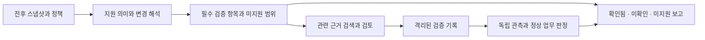

# FlowDelta 설계 평가 — 2026-10-08

**판정: 핵심 구조를 유지하는 조건부 추진을 권고한다. 캡스톤 시제품의 방향은 타당하지만, 현재 문서만으로 구현 준비 완료·연구 독창성 확보·8~10주 일정 타당성을 확정할 수는 없다.** 가장 먼저 고정할 것은 지원하는 n8n 동작, 필수 검증 항목, 증거 판정 규칙, 가장 가까운 기존 방법과의 비교다.

이 평가는 설계·회의록·공유 조사자료와 추가로 확인한 1차 자료를 대상으로 했다. FlowDelta나 비교 도구의 코드를 실행해 성능을 측정한 결과가 아니다. 계약 예시는 `DESIGN_ONLY_NOT_EXECUTED`이고 실행 상태는 `NOT_RUN`이다. platform 저장소 전체의 구현 상태를 감사한 것도 아니다.

**검토 기준과 문서 위치**

- 로컬 설계 기준: docs 저장소 `42837ce75aa5c55f994bfa035df9221cb3af334c`, `docs/1-security-test-records` 브랜치의 final 문서 묶음.
- 공유 문서 기준: 조회한 origin/main `b41b2a26e627f8ad2207bae003f16f4c9296fa57` 및 `.publication-work/slack-archive`의 Notion·Slack 보관본. 읽은 파일은 해당 공유 이력에 포함된다.
- [최종 설계](C:/Users/andyw/Desktop/serendipity-sec/docs/final/README.md), [실행 계획](C:/Users/andyw/Desktop/serendipity-sec/docs/final/execution-plan.md), [조사 근거](C:/Users/andyw/Desktop/serendipity-sec/docs/final/research-evidence.md), [계약 예시](C:/Users/andyw/Desktop/serendipity-sec/docs/final/contracts.example.json)를 기준으로 판단했다. architecture.html은 설명용 화면으로 취급했다.
- 공유된 다섯 제안서의 문제 정의·범위·검증·평가 관련 구간, 10/01·10/03 회의록, 구조적 커버리지 논문 정리 및 세부 설명, Slack 아키텍처 논의·공유자료 목록을 대조했다. 스킬 조사자료는 관련 도입부를 참고했다. 모든 첨부 PDF·HTML·회의 전사·오디오를 전수 감수한 것은 아니다.
- 최종 설계 본문은 [공유 Notion 페이지](https://app.notion.com/p/3eec2d6e1537801bb949de84023a2f23) 및 main의 Notion 내보내기에 존재한다. 첨부 README와 로컬 final/README는 줄바꿈을 제외하면 상태 문구만 다르다. 공유 사본은 ‘구현·연구 제안’, 로컬은 ‘사용자가 확정한 최종 설계’다. 따라서 main에 final 폴더가 없다는 이유로 설계가 공유되지 않았다고 볼 수 없다.
- 반면 공유 내보내기에는 README가 참조하는 research-evidence.md, execution-plan.md, contracts.example.json이 없다. 다른 공유 경로의 부재까지 단정할 수는 없지만, 이 내보내기만으로는 부속 문서를 따라 읽을 수 없다. [내보내기 검증 기록](C:/Users/andyw/Desktop/serendipity-sec/.publication-work/slack-archive/notion/verification.md)

**전체 평가**

| 평가 항목 | 판단 | 근거와 남은 조건 |
|---|---|---|
| 문제의 필요성 | 근거 있음 | 워크플로우 본문 밖의 의존성·환경 변화가 기존 검토 범위를 벗어나는 실제 사례가 공식 문서에 있다. 발생 빈도·시장 수요는 별도 검증 대상이다. |
| 아키텍처의 논리 | 일관성이 높음 | 스냅샷, 의미 그래프, 변경, 조건부 후보, 독립 관측이 연결된다. 그래프의 가능성과 관측 결과도 구별한다. |
| 증거·판정 설계 | 유지할 강점 | 결정적 재생과 모델 실행, 시도와 실제 효과, 실험실 차단과 대상 통제를 구분한다. 구체적인 이벤트·종료·관측 실패 계약은 더 필요하다. |
| n8n 해석의 정확성 | 가장 큰 구현 불확실성 | 지원 동작의 계약을 만들겠다는 계획은 있지만, 버전별 실제 계약과 의미 일치 검증 결과가 아직 설계 자료에 없다. |
| 연구 차별성 | 재정의 필요 | n8n 변경 비교·그래프·회귀 실행, 그래프 기반 검증 항목, 변경 관련 시험 선택과 겹치는 선행 자료가 확인된다. |
| 평가 설계 | 기본 원칙은 좋음 | 계열 분할·독립 라벨·대조군·기능 제거 비교가 있다. 최종 독립 계열 수와 반복 수로 주장할 수 있는 범위는 제한된다. |
| 일정·범위 | 판단 보류 | 전담 4명 하루 10시간 가정과 회의록의 주말 중심 작업 전제가 다르다. 어느 자원 가정이 유효한지 먼저 정해야 한다. |
| 공유 문서의 일관성 | 보완 필요 | 본문은 공유돼 있으나 상태 문구와 부속 파일 접근 경로가 일치하지 않는다. |

**1. 현재 방향이 타당한 이유**

가장 설명력이 좋은 사례는 ‘부모 워크플로우 JSON은 같지만 호출하는 하위 워크플로우나 실행 권한이 바뀌는 경우’다. 화면의 노드·연결 차이만 보아서는 이 변화를 충분히 설명하기 어렵다. n8n 공식 Workflow reviews 문서도 검토 범위를 고정한 워크플로우의 노드·연결로 한정하고, credentials·variables·data tables·sub-workflows·일부 설정은 검토 대상에서 제외한다고 설명한다. 확인한 기능은 2.37.0부터의 Enterprise Preview이므로 모든 버전으로 일반화해서는 안 된다. [n8n 공식 문서](https://docs.n8n.io/build/manage-workflows/workflow-reviews)

이 사실은 `Workflow + Dependencies + Environment + PolicyRef + RuntimeConfig`라는 분석 단위를 지지한다. ‘기존 도구는 아무것도 못 한다’거나 ‘현장에서 빈번히 사고가 난다’는 주장까지 입증하지는 않는다.

이전 제안서들의 장점을 현재 설계에 통합한 방향도 합리적이다.

| 이전 문서 | 현재 설계에 남길 가치 | 범위 판단 |
|---|---|---|
| FlowDelta 초기안 | 변경과 조건을 연결한 위험 설명 | 더 큰 노드·데이터셋 목표보다 현재의 좁은 범위를 먼저 검증한다. |
| WorkflowDelta | 환경·하위 의존성 포함, 전체 재분석 기준 | 현재 설계의 중심으로 유지한다. |
| BoundaryCheck | 정책 기대와 실제 권한의 구별, 독립 효과 관측 | 판정의 신뢰성을 위해 필수다. |
| MCP·Skills 검증 프레임워크 | 주장·가능성·관측의 증거 수준 구별 | 공급망 전체를 동시에 지원하는 범위는 미룬다. |
| ApprovalDiff | 승인한 대상과 실제 실행 대상의 결합 | P3 확장으로 둔 판단이 적절하다. 상태 재개까지 합치면 별도 연구 규모가 된다. |

특히 현재 문서에 이미 들어 있는 다음 원칙은 유지해야 한다. 전체 재분석 후 비교를 기준 구현으로 두기, 정적 가능성과 실행 사실을 나누기, 미지원·관측 실패를 UNKNOWN/INCONCLUSIVE로 남기기, 정상 업무 성공을 독립적으로 확인하기, 동일 계열을 평가 분할 사이에 섞지 않기다. 이를 새로 추가해야 할 누락 사항으로 평가하지 않았다.

**2. 가장 크게 달라진 판단: 연구 차별성을 더 좁혀야 한다**

10/06 Slack 공유 목록에 있던 n8n 도구가 특히 가깝다. 아래 비교는 원문과 저장소 문서에 설명된 범위이며, 이번 평가에서 각 도구의 실행 성능을 재현한 것은 아니다.

| 1차 자료 | 현재 설계와 겹치는 부분 | FlowDelta가 입증해야 할 차이 |
|---|---|---|
| [n8n AI Security Regression Gate](https://github.com/0xCD4/n8n-ai-agent-security-lab) | 위험 경로 검사, 노출 그래프, 하위 워크플로우 연결, baseline/candidate 비교, 회귀 기록, 로컬 전후 리허설 | 환경 사실의 의미와 실제 AI 동작까지 연결했을 때 확인 범위가 얼마나 늘어나는가 |
| [해당 도구의 리허설 범위](https://github.com/0xCD4/n8n-ai-agent-security-lab/blob/main/docs/release-rehearsal-cli.md) | 고정된 n8n 환경과 입력·변환·관측을 묶은 증거 산출물 | 문서상 실행 지원은 제한된 Webhook/Set/HTTP 부분집합이며 AI·credentials·subworkflows 등을 제외한다. 이 제외 범위에서 FlowDelta의 개선은 아직 가설이다. |
| [Testing Agentic Workflows with Structural Coverage Criteria](https://arxiv.org/html/2605.26521v1) | 그래프에서 검증 항목 도출, 시나리오 생성, 실행 흔적을 통한 커버리지 확인 | 구조를 거쳤다는 사실에서 실제 정책 효과·변경 원인까지 연결하는 추가 가치 |
| [Mutation Testing for Multi-Agent Systems](https://www.researchgate.net/publication/410035906_Mutation_Testing_for_Multi-Agent_Systems) | 원본/변경본 실행 비교, 변경 요소와 관련된 검증 항목으로 실행 비용 제한 | 환경·하위 의존성 변화에 대한 의미 정확성, 동일 예산에서의 유용성 |
| [OWASP Agent Security Regression Harness](https://github.com/OWASP/Agent-Security-Regression-Harness) | 시나리오 기반 회귀 검사와 실행 흔적의 assertion | 입력 조건·판정 기준을 맞췄을 때 변경 분석과 검색이 주는 추가 이득 |

구조적 커버리지 연구는 명시된 허용·제한·위임 관계를 검사한다. 커버리지 100%도 의미적 안전이나 실제 외부 효과의 증명이 아니다. Mutation Testing 자료는 저자가 공개한 원문이며 동료심사 여부와 결과 재현은 확인하지 않았다. 그 논문은 변경 요소 인접 항목에 한정한 선택이 비인접 효과를 놓칠 수 있다는 한계도 명시한다. 따라서 그래프 전체 재분석을 기준으로 두는 현재 선택은 유지할 가치가 있다.

‘그래프 + LLM + RAG + 실행 검증’, ‘변경 부분 위주로 시험’, ‘n8n에서 전후 비교’만을 핵심 독창성으로 내세우기는 어렵다. 이번 자료 확인으로 전 세계에 동일한 방법이 없다고 입증할 수도 없다.

현재 가장 검증하기 좋은 연구 질문은 다음 정도다.

> 제한된 n8n 동작과 명시된 정책에서, 워크플로우 본문뿐 아니라 환경·하위 의존성의 의미 변화를 반영하면, 동일한 평가 예산에서 확인 가능한 보안 회귀와 판단 가능한 범위가 얼마나 달라지는가?

RAG는 이 질문 안에서 추가 기여를 측정할 구성요소다. 카드 60개·필수 정책 2개라는 계획에서는 명시적 조건 필터나 고정 카드 선택이 충분할 가능성도 있다. 현재 B3와 검색 제거 실험이 이를 고려한 점은 좋다. 검색 방식 비교에서 생성기·실행기·관측기까지 달라지지 않도록, 각 비교군의 공통 부분과 달라지는 부분을 표로 고정해야 한다. 개선이 없으면 단순한 방법을 채택할 수 있다.

**3. 핵심 보완: 검색 전에 ‘반드시 확인할 항목’을 명시한다**

현재 데이터 객체에는 Snapshot, Graph, ChangeSet, ScenarioCard, Hypothesis, TestPlan, Run, Evidence, Finding이 있다. coverage 보고 요구도 있다. 다만 검색이 어떤 카드를 찾았는지와 독립적으로, 해당 구성에서 반드시 확인해야 하는 정책 요구와 미확인 사유를 연결하는 공통 객체는 명시되지 않았다.

예를 들어 ‘보호 문서의 읽기 업무에서는 내용이 바뀌지 않아야 한다’와 ‘허용된 정상 조회 결과는 제공돼야 한다’는 필수 조건이다. 관련 카드 검색이 실패하더라도 이 두 조건이 평가 목록에서 사라져서는 안 된다.

권고하는 추가 산출물은 **검증 항목–근거 대응표**다. 항목 ID, 정책·원본 위치, 지원/미지원 여부, 필요한 증거 종류, 연결된 실행, 미확인 이유를 기록한다. 이 표는 누락과 관측 품질을 관리하는 용도이며 자동 생성 결과 자체를 정답으로 인정하지 않는다.

이 구조에서 ‘대상 전체 중 지원한 비율’, ‘지원 항목 중 실제로 확인한 비율’, ‘정상 업무 성공률’을 별도로 보고해야 한다. 검색된 후보만 분모로 삼으면 누락된 범위가 보이지 않는다.

**4. 구현에서 가장 어려운 것은 n8n의 실제 동작을 정확히 해석하는 일이다**

12개 노드 후보를 정한 것과 12개 동작의 의미를 검증한 것은 다르다. 실행 계획도 이 차이를 인정하고 있으므로, 문제는 원칙의 부재보다 구체 명세의 미완성이다.

공식 문서의 구체적인 예로 Call n8n Workflow Tool 같은 sub-node의 표현식은 여러 입력 중 첫 항목을 참조한다. 일반 노드의 항목별 해석과 다르다. Database 하위 워크플로우는 실제 운영 실행에서 publish 여부도 영향을 준다. 이 차이를 평범한 연결 간선 하나로 처리하면 데이터 출처나 실행 성공 여부를 잘못 판단할 수 있다. [n8n Workflow Tool 문서](https://docs.n8n.io/integrations/builtin/cluster-nodes/sub-nodes/n8n-nodes-langchain.toolworkflow)

따라서 첫 지원 범위는 노드 이름이 아니라 `n8n 버전 × node typeVersion × operation × 입력 형태 × 실행 모드`로 명세해야 한다. 여러 항목, 분기·병합, 오류, 하위 호출 등에서 정상 동작을 손으로 확인한 예와 분석 결과가 일치하는지부터 검증한다. 미지원 의미는 보수적으로 표시하되, 지나치게 넓은 UNKNOWN으로 탐지 성능만 좋아 보이는지도 함께 점검한다.

환경 정보도 같은 원칙이 필요하다. 현재 계획에서 실제 권한 수집기 1종은 후순위다. 제공받은 환경 프로필로 분석하는 연구는 가능하지만, 이를 실제 배포 환경을 자동 확인한 제품처럼 설명해서는 안 된다. 연구의 중심을 환경 변경에 둔다면 통제된 실험에서 관측한 환경 사실과 수동 선언을 구분해 평가하고, 실환경 자동 수집은 별도 지원 수준으로 표시해야 한다.

**5. 독립 관측 설계는 강점이며, 구체 계약까지 완성해야 한다**

문서에는 이미 독립 증거 구역, oracle 수정 금지, 관측기 건강 상태, 쓰기 이벤트와 상태 비교, 실행별 초기화가 있다. 보완은 이 원칙들을 실행 결과가 일관되게 따르도록 상세화하는 것이다.

- 실행과 관측 이벤트가 어떤 불변 ID로 연결되는가.
- 관측기가 정상 작동했다는 사실과, 필요한 관측 범위를 확보했다는 사실을 어떻게 남기는가.
- 비동기 효과가 남아 있을 때 언제 실행 완료로 판단하는가.
- 이벤트 누락·중복·관측 실패 시 어떤 판정을 반환하는가.
- 실험용 대체 서비스나 변환을 사용했다면 원본에서 바뀐 의미와 입증하지 못한 범위가 무엇인가.

기존 n8n 리허설 문서는 자체 결과를 변환된 합성 요청의 로컬 수신으로 한정하고, 원래 목적지 전달·배포 동일성·전체 실행 동등성을 입증하지 않는다고 명시한다. FlowDelta도 증거가 직접 뒷받침하는 범위를 결과에 붙여야 한다. 합성 자원에서 효과가 확인됐다는 사실을 운영 환경의 결과로 확대하면 안 된다.

**6. 평가 계획은 원칙이 좋지만 수치 목표를 입증할 표본은 부족할 수 있다**

계열 분할, 두 명의 독립 라벨링, 제3자 조정, RAG 정답 누수 방지, 전체 분석 기준군, 기능 제거 비교, 계열 단위 신뢰구간은 유지할 만한 설계다. 정적 후보의 정확도와 실행으로 확정한 결과의 정확도를 분리하는 것도 적절하다.

다만 120쌍 전체를 최종 평가에 쓰는 구조가 아니다. 계획상 최종셋은 **10계열·40쌍**이고 위험/정상 각 20쌍이다. 40개의 독립 제품을 검사한 것으로 계산해서는 안 된다. 3회 반복은 실행 수를 늘리지만 독립 workflow 계열 수를 늘리지 않는다. 문서의 480 episodes 예시는 이 최종셋과 자동으로 같은 집합도 아니다.

다음은 실측 결과가 아닌 표본 한계를 설명하는 계산이다.

- 정상 사례 20개에서 오탐이 0개여도, 독립 시행을 가정한 정확한 단측 95% 이항 신뢰상한은 `1 - 0.05^(1/20) = 약 13.9%`다. 따라서 이 결과만으로 모집단 오탐률 10% 이하를 강하게 확인할 수 없다. 같은 계열의 상관까지 있으면 단순 이항 가정도 약해진다.
- 어떤 현상이 매 독립 시도에서 20% 확률로 나타난다고 가정하면, 3회 모두 관측하지 못할 확률은 `0.8^3 = 51.2%`다. 3회 무관측을 안전성 보증으로 바꿀 수 없다. 현행 설계도 이 해석을 금지하고 있으므로 보고·통계 단계에서 일관되게 적용해야 한다.

표본을 임의로 크게 늘리는 대신 pilot의 변동성과 비용을 측정하고, 입증하려는 효과 크기·불확실성에 맞춰 반복 수를 정하는 편이 낫다. 최종 평가에서는 효과 크기와 신뢰구간, 판단 가능 비율, 미지원 비율, 정상 업무 성공률을 함께 공개해야 한다. 알려진 정답이 없는 실제 공개 저장소에 전체 recall을 붙이지 않는 현재 원칙도 유지한다.

비교 도구가 지원하지 않는 사례는 ‘탐지 실패’와 나누어 집계한다. 공통 지원 범위의 성능과 각 도구의 추가 지원 범위를 분리해야 공정하다. 가장 가까운 n8n 비교 도구는 필수 비교 목록에 추가하되, 실행 재현 전까지는 문서상 기능 비교로 표시한다.

**7. 일정은 기술보다 먼저 자원 가정이 충돌한다**

[실행 계획 7행](C:/Users/andyw/Desktop/serendipity-sec/docs/final/execution-plan.md:7)은 4명 모두 매일 10시간, 8~10주를 전제한다. 명목 2,240~2,800시간이며 35% 여유를 제외한 1,456~1,820시간을 계획한다. [10/03 회의록](https://app.notion.com/p/3eec2d6e1537800caf44ea12e5aea35d)은 평일 시간이 부족하고 주말에 대부분 과제를 마친다는 전제를 기록한다.

두 문서 중 어느 자원 가정이 이후 확정됐는지는 이번 자료만으로 판단할 수 없다. 따라서 ‘현재 계획은 8주면 된다’거나 ‘절대 불가능하다’고 단정하기 어렵다. 주당 실제 확보 시간을 먼저 정해야 한다.

회의록의 워크플로우 약 2개와 대시보드는 통합 시연의 범위이고, 30계열 데이터와 비교 실험은 연구 평가의 범위다. 이 둘을 같은 완료 상태로 표시하면 안 된다. 먼저 두 업무에서 끝까지 연결된 결과를 만든 뒤, 의미 계약·관측기의 신뢰성을 확인한 범위에서 평가 계열을 늘리는 순서가 적절하다. P3·LangGraph 재개·공개 지식 웹·선택적 재분석 최적화를 후순위로 둔 현재 결정은 유지한다.

**권고하는 다음 완료 기준**

| 우선순위 | 구체 산출물 | 완료 판단 |
|---|---|---|
| 먼저 | 연구 주장과 비교표 1장 | n8n 선행 도구·구조적 커버리지·변경 기반 평가와의 중복, 검증할 차이를 각각 한 문장으로 설명한다. |
| 먼저 | 버전별 지원 동작 명세 | 선정한 정상 입력의 실제 동작과 그래프 해석이 일치하고, 미지원 조건이 명시된다. |
| 먼저 | 필수 검증 항목–근거 대응표 | 검색 실패·미실행·관측 실패가 항목 삭제나 통과로 바뀌지 않는다. |
| 먼저 | 판정 상태 예시와 관측 계약 | 정상 성공, 대상 통제, 미관측, 관측기 실패를 독립 증거로 구분한다. |
| 다음 | 같은 실행기·관측기를 쓰는 최소 비교 | 변경/환경 정보와 검색 방식의 이득을 다른 요소의 차이와 분리한다. |
| 다음 | 실제 가용 시간과 pilot 비용표 | 인력·토큰·실행 시간에 맞는 평가 범위를 제시한다. |
| 공유 정리 | 본문·계약·계획·근거의 단일 안내 | 공유 경로에서 네 문서에 접근할 수 있고, 제안·확정·실행 결과의 상태가 일치한다. |

핵심은 설명 가능한 변경 분석과 신뢰할 수 있는 판정이다. 이 두 부분이 성립하면 RAG의 개선 여부가 부정적이어도 유용한 캡스톤 결과를 만들 수 있다. 논문 주장은 그 위에서 관측된 비교 결과에 맞춰 정해야 한다.

**검토한 추가 1차 자료와 사용 범위**

- [Agentproof](https://arxiv.org/abs/2603.20356): 구조 그래프·보안 규칙·실행 확인의 기존 연구 맥락. 성능 수치를 재현하지 않았다.
- [AgentFlow](https://arxiv.org/abs/2607.01640): 에이전트 의존성 그래프의 선행 사례. 그래프 도입 자체를 독창성으로 삼지 않는 근거다.
- [Invariant Toxic Flow Analysis](https://invariantlabs.ai/blog/toxic-flow-analysis): 도구 조합과 데이터 흐름 위험의 기존 분석 맥락. 공급자의 최초·우월성 주장을 독립 검증 사실로 사용하지 않았다.
- [Agentic Radar](https://github.com/splx-ai/agentic-radar): n8n을 포함한 정적 분석 비교 후보. 모든 프레임워크에 동일한 동적 검증을 지원한다고 간주하지 않았다.
- [n8n security audit](https://docs.n8n.io/hosting/securing/security-audit/): 내장 감사와 겹치는 항목의 비교 후보.
- [n8n package format](https://docs.n8n.io/build/manage-workflows/n8n-packages/package-format): 원본·의존성 묶음 수집에서 기존 포맷 재사용 가능성. manifest만으로 실효 권한이 증명되지는 않는다.
- [Rethinking MCP Security](https://arxiv.org/abs/2607.11086): 스캐너 결과의 독립 검증 필요성 참고. 이 논문의 MCP 수치를 n8n의 오탐률로 옮기지 않았다.

외부 자료의 확인일은 2026-10-08이다. GitHub main과 공식 제품 문서는 이후 바뀔 수 있다. 이 평가에서 인용한 기능은 당시 읽은 문서에 설명된 범위이며, 외부 도구의 실행·안전성·성능 보증을 의미하지 않는다.
